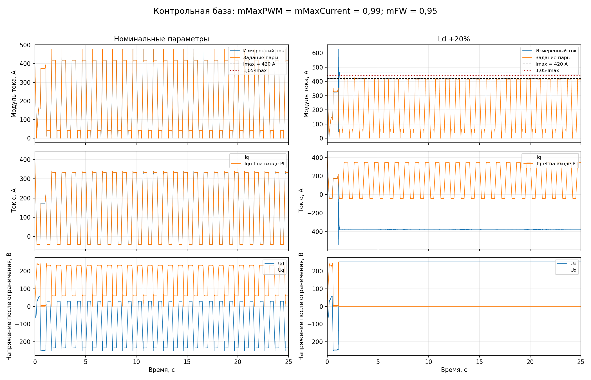
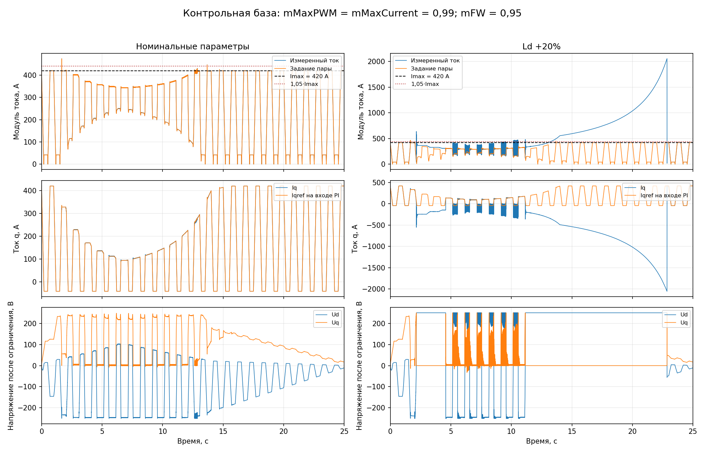
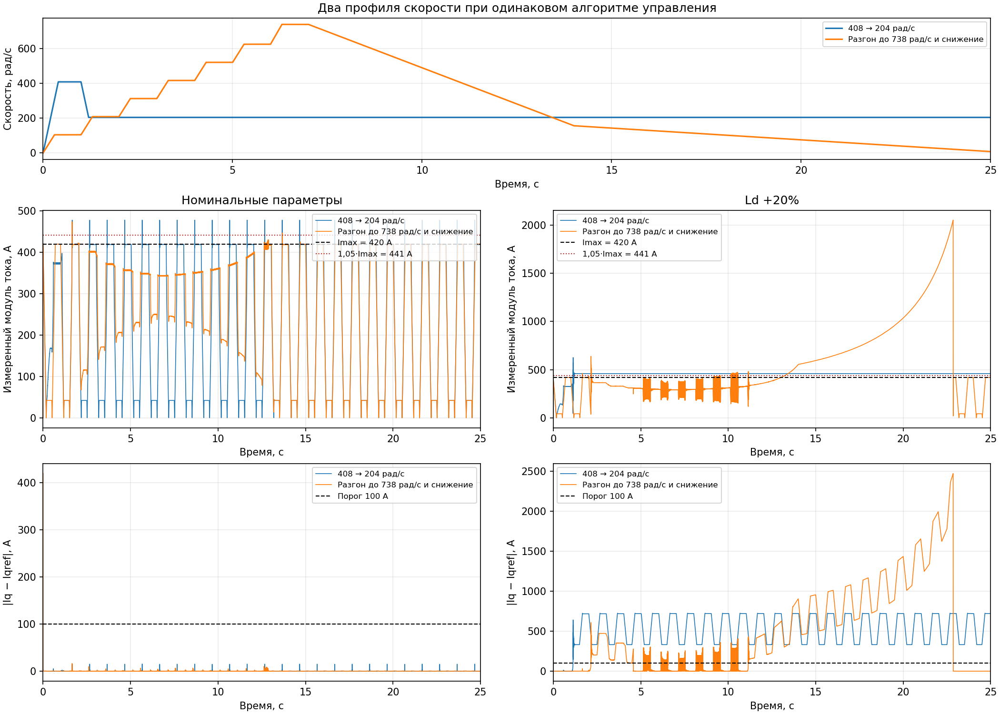

# Контрольная база после исправления модуляции

Дата проверки: 10.11.2026. MATLAB R2025a, 25.1.0.2943329.

Это исходная база B00 до последующих коррекций. Ход дальнейшей работы и результаты
после изменения модели сохраняются отдельно в [журнале исправлений](control_fix_log.md).

Первые три подготовительных пункта [бэклога](control_backlog.md) выполнены:
сохранена исходная версия, добавлены диагностические сигналы и исправлены метрики.
В базе четыре завершённых прогона по 25 с: два профиля скорости, каждый в номинале
и при Ld +20%. Токовые критерии не выполнены, при ошибке Ld остаются длительные
потери слежения. Алгоритм управления в рамках этого этапа не менялся.

## Условия и границы сравнения

Зафиксированы две модели:

| Режим | Активный источник | Сохранённая модель |
|---|---|---|
| Переход 408 → 204 рад/с с удержанием | `1-D Lookup Table4` | [baseline_source.slx](data/control_baseline_20261110/baseline_source.slx) |
| Разгон до 738 рад/с со снижением | `1-D Lookup Table2` | [sweep738/baseline_source.slx](data/control_baseline_20261110/sweep738/baseline_source.slx) |

SHA-256 первого источника:
`c0fd6c1a7c8c4e5210ba4726f8a1c74d8ca567408f371c3691838f398be25eaa`;
второго: `cc6d86c5b0b74a7d09f2f7dcdf9a6ba292806a60ccf86f9c73916028a8601593`.
При переключении пользователь изменил источник на входе `Simulink-PS Converter1`
и соответствующую ветвь Scope. Рабочая область, настройки расчёта и код
MATLAB Function совпадают; [сверка источников](data/control_baseline_20261110/sweep738/source_manifest.json).

- `mMaxPWM = mMaxCurrent = 0.99`, `mFW = 0.95`, Vdc = 440 В, Is_max = 420 А.
- Токовый регулятор работает с периодом 1/12000 с; прореживание логов отключено.
- В номинале все четыре ошибки параметров равны нулю; во втором сценарии
  `deltaLd = 0.2`, остальные ошибки нулевые. Значения проверены также в сохранённых
  копиях моделей, а не только в аргументах запуска.
- Первый профиль: точки времени `[0, 0.4, 1.0, 1.2, 1.8]` с,
  скорости `[0, 408, 408, 204, 204]` рад/с. После 1,8 с сохраняются 204 рад/с.
- Второй профиль: точки времени
  `[0, 0.3, 1, 1.3, 2, 2.3, 3, 3.3, 4, 4.3, 5, 5.3, 6, 6.3, 7, 14, 24]` с,
  скорости `[0, 104, 104, 208, 208, 312, 312, 416, 416, 520, 520, 624, 624, 738, 738, 156, 21]` рад/с.
  После последней узловой точки скорость продолжает снижаться: в конце лога,
  на 25 с, измерено 7,5135 рад/с. Удержания 21 рад/с до конца расчёта нет.
- Запрос Iq периодический: точки `[0, 0.2, 0.5, 0.7, 1]` с,
  значения `[420, -42, -42, 420, 420]` А.

Первый профиль был проверен первоначально; второй добавлен после восстановления
базового источника скорости пользователем. Их сравнение показывает влияние
траектории скорости на один и тот же алгоритм, а не улучшение регулятора.
Старые таблицы до изменения модуляции также не заменяют эти эталоны.
Полная матрица приёмки, оба направления вращения, изменяемые пределы, ключевой
инвертор и динамическое DC-звено ещё не проверены.

## Результаты: 408 → 204 рад/с с удержанием

| Проверка | Номинал | Ld +20% |
|---|---:|---:|
| Конечное время, с | 25 | 25 |
| Максимум модуля задания на входе PI, А | 477,234 | 432,438 |
| Максимум измеренного модуля тока, А | 477,832 | 626,163 |
| Задание не превышает 420 А | Нет | Нет |
| Измеренный ток не превышает 441 А (1,05·Is_max) | Нет | Нет |
| Сигналы конечны, обязательные логи полны | Да | Да |
| Конечные duty в диапазоне 0,005…0,995 | Да | Да |
| Эпизоды абсолютной ошибки Iq >100 А длительностью >20 мс | Нет | Один, открыт в конце |
| Ошибка Iq вернулась в порог минимум на 20 мс к концу расчёта | Да | Нет |

В номинале пик задания возникает на 3,66575 с: Idref = −334,135 А,
Iqref = 340,743 А. Максимум измеренного тока — на 3,66583 с.
Превышение заданного токового круга сохраняется даже при соблюдении пределов ШИМ.
Стартовый эпизод ошибки Iq >100 А длится 0,5 мс и не нарушает критерий >20 мс.

При Ld +20% ошибка Iq непрерывно превышает 100 А с 1,13158 до 25 с.
Конец файла не считается восстановлением. На участке удержания 204 рад/с
наблюдаются Ud ≈ +251,494 В и Uq ≈ 0,0316 В: ось d занимает доступное напряжение.
Это наблюдение соответствует описанному ранее характеру насыщения; автоматической
проверки достижимости задания и классификации причины защёлки здесь ещё нет.



## Результаты: разгон до 738 рад/с со снижением

| Проверка | Номинал | Ld +20% |
|---|---:|---:|
| Конечное время, с | 25 | 25 |
| Максимум модуля задания на входе PI, А | 473,677 | 466,174 |
| Максимум измеренного модуля тока, А | 474,019 | 2053,270 |
| Задание не превышает 420 А | Нет | Нет |
| Измеренный ток не превышает 441 А | Нет | Нет |
| Сигналы конечны, обязательные логи полны | Да | Да |
| Конечные duty в диапазоне 0,005…0,995 | Да | Да |
| Эпизоды абсолютной ошибки Iq >100 А длительностью >20 мс | Нет | Два, закрыты к концу |
| Ошибка Iq вернулась в порог минимум на 20 мс к концу расчёта | Да | Да, при низкой скорости |

В номинале максимум задания возникает на 1,66342 с, измеренного тока —
на 1,66358 с. Как и в первом режиме, длительной ошибки Iq нет, но токовый
круг нарушается. Стартовый эпизод ошибки >100 А длится 0,5 мс.

При Ld +20% два длительных эпизода ошибки Iq занимают интервалы
**2,15875–4,57683 с** и **11,14783–22,85850 с**. Между ними присутствуют также
многочисленные короткие пересечения порога; число «два» не означает спокойную
работу на всём остальном интервале. Максимум измеренного тока 2053,270 А возникает
на 22,85358 с. Последний возврат ошибки Iq в порог происходит на 22,85850 с,
когда скорость уже снизилась примерно до **36,424 рад/с**. До конца расчёта
остаётся 2,1415 с без превышения порога по q.

Следовательно, `recoveryObserved=true` здесь подтверждает возврат ошибки в порог
при низкой скорости. Он **не подтверждает устранение потери управления** при
исходной скорости или соблюдение допустимого тока.



## Сопоставление и база дальнейших исправлений

| Профиль | Параметры | max Iref, А | max I, А | Состояние слежения Iq в конце |
|---|---|---:|---:|---|
| 408 → 204, удержание | Номинал | 477,234 | 477,832 | В пороге |
| 408 → 204, удержание | Ld +20% | 432,438 | 626,163 | Не восстановилось |
| До 738, затем снижение | Номинал | 473,677 | 474,019 | В пороге |
| До 738, затем снижение | Ld +20% | 466,174 | 2053,270 | Вернулось в порог лишь при снижении до ≈36,4 рад/с |



Профили выявляют разные проявления дефекта: первый — длительное насыщение при
постоянных 204 рад/с, второй — рост тока при снижении скорости и позднее
восстановление. Для каждого следующего изменения сохраняется матрица
**два профиля × номинал/Ld +20%**, четыре прогона по 25 с без прореживания.
Каждый результат исправления сравнивается с исходным результатом того же профиля.

## Что изменено в проверке

`run_aug` сохраняет 46 сигналов и две вычисленные команды Ud/Uq до ограничения.
Логируются совместная пара заданий на входе VectorBase, токи d/q, исходный
запрос Iq, выходы PI до/после ограничения, развязка, интеграторы d/q/ОП,
FF/trim, sens до/после фильтра и нижней границы, freeze/reset, конечные duty,
Vdc и действующие пределы. Изменения вносятся только в диагностические копии.

`fwl_assess` проверяет модуль ошибки обеих осей, токовый круг, измеренный ток,
конечность, завершение расчёта, полноту логов и возврат ошибки в порог.
Открытый эпизод отмечается отдельно, включая эпизоды короче 20 мс.
Для завершённого эпизода используется время первого отсчёта внутри порога.
Измеренные токи проверяются на общей исходной сетке, дискретные задания —
совместно; для прежних логов используется удержание вместо линейной интерполяции.

Критерий восстановления здесь означает только возвращение ошибки в порог.
Он не доказывает выход из насыщения при той же скорости. Нет маски достижимости
и исключения переходных окон; значения 100 А, 20 мс и 5% — диагностические
пороги из review. Предел Imax пока считается постоянным в пределах сценария.

`metrics` больше не называет любое большое отклонение потерей управления и
показывает `OPEN` у незавершённых эпизодов. Столбец `T@738` остаётся NaN,
если нужная скорость не достигалась в контрольном окне.

## Проверка и воспроизведение

- [summary.json](data/control_baseline_20261110/summary.json) — численная сводка,
  параметры, эпизоды и SHA-256 моделей и полных MAT для режима 408 → 204 рад/с.
- [sweep738/summary.json](data/control_baseline_20261110/sweep738/summary.json) —
  те же сведения для профиля до 738 рад/с;
  [comparison.json](data/control_baseline_20261110/comparison.json) — сопоставление
  четырёх сочетаний профиля и параметров, времена пиков и длительные эпизоды.
- [verification.txt](data/control_baseline_20261110/verification.txt) — итоговая
  проверка метрик и логов. Регрессионные случаи включают обе полярности ошибки,
  границу 20 мс, открытый конец, короткое восстановление, NaN, неполный расчёт,
  усечённый лог, ступенчатые задания, несовпадающие сетки и нарушения duty.
- [sweep738/verification.txt](data/control_baseline_20261110/sweep738/verification.txt) —
  проверка добавленных двух прогонов. Сравнение в Python дополнительно проверяет
  совпадение общих параметров, сеток токов/заданий и максимумов с MATLAB-сводками.
- Дополнительно проверены соответствие сохранённых параметров сценариям и
  тождества Ud/Uq = ограниченный выход PI + развязка с допуском 1 нВ.
- Полные MAT, копии прогонов, логи и кэши находятся в
  `tmp/control_baseline_20261110/` и `tmp/control_baseline_20261110_sweep738/`;
  оба каталога исключены из Git. Прежние прогоны сохранены без перезаписи.

```matlab
addpath tools/fw_limiter
run_baseline('tmp/control_baseline_repeat_hold204', ...
    'docs/data/control_baseline_20261110/baseline_source.slx')
verify_baseline('tmp/control_baseline_repeat_hold204')
run_baseline('tmp/control_baseline_repeat_sweep738', ...
    'docs/data/control_baseline_20261110/sweep738/baseline_source.slx')
verify_baseline('tmp/control_baseline_repeat_sweep738')
```

```bash
python3 tools/fw_limiter/baseline_comparison.py tmp/control_baseline_repeat_hold204 tmp/control_baseline_repeat_sweep738 tmp/control_baseline_repeat_sweep738/comparison.png
```

Эти команды воспроизводят сохранённые эталоны. При проверке исправленного
алгоритма оба профиля запускаются на копиях одной изменённой модели;
сведения об активном источнике и его точках сверяются в `summary.json`.

Следующий пункт — формировать конечную пару Id/Iq в одном такте внутри токового
круга. После него повторить оба профиля и отдельно проверить большие отрицательные
запросы Iq. Исправление текущего бюджета не следует считать достаточным для
устранения длительного насыщения при Ld +20%.
