# Журнал исправлений управления

Здесь фиксируется ход работы: наблюдаемая проблема, предложенное объяснение,
фактическая правка, условия проверки, осциллограммы и измеренный эффект.
Рабочую модель изменяет пользователь. Контрольные расчёты выполняются на копиях;
исходные версии, прежние результаты и неудачные режимы сохраняются.

Основная матрица проверки — два профиля скорости, каждый в номинале и при
Ld +20%, четыре прогона по 25 с без прореживания. Дополнительные профили
отмечаются отдельно. Обнаружение одного исправленного дефекта не означает
закрытия остальных пунктов [бэклога](control_backlog.md).

| Дата | Этап | Результат |
|---|---|---|
| 10.11.2026 | B00 — фиксация состояния после изменения модуляции | Два профиля скорости, четыре прогона; [исходный отчёт](control_baseline_20261110.md) |
| 12.11.2026 | F01 — обход LPF8 в расчёте токового бюджета q | Выход задания за токовый круг устранён в проверенных сценариях; срыв при Ld +20% сохраняется |
| 12.11.2026 | D02 — диагностика оставшегося срыва | По логам F01 подтверждено удержание Ud на пределе при практически нулевом Uq; подготовлен опыт F02 с фиксированными параметрами, ещё не выполнен |
| 12.11.2026 | F02 — постоянные Psi и Lq в управлении | Четыре прогона; срыв при Ld +20% сохраняется без адаптации. В номинале выявлена недостижимая цель ОП при текущем напряженческом пределе Iq |
| 12.11.2026 | F03 — коэффициент 0,95 в напряженческом бюджете q | На 408 → 204 исчез срыв при Ld +20%; на профиле до 738 появился срыв в номинале. Выявлено занижение обратной связи ОП из-за фильтрации компонент до расчёта модуля |
| 12.11.2026 | F04 — фильтрация скалярного модуля напряжения | Номинальный срыв устранён, колебания на полке 738 резко уменьшились. При Ld +20% срывы остаются, на 408 → 204 результат хуже F03. Зафиксировано частичное решение |
| 12.11.2026 | D05 — роль ошибки Ld и требования к устойчивости | По данным F04 разделены ошибка FF, накопленная подстройка, быстрое снятие ОП и удержание насыщения. Новых изменений модели и прогонов нет |
| 12.11.2026 | D06 — подстройка, freeze/reset и новая структура ОП | Четыре новых прогона: при Ld +20% подтверждены переходы trim между пределами и дребезг верхнего условия freeze. Подготовлен проект перестройки FF; новая структура ещё не реализована |
| 12.11.2026 | F05-W — сохранённая `_woFreeze` | Пять прогонов: фактическая подстройка отключена, FF работает. Прежние большие выбросы при Ld +20% исчезли, но сохраняются насыщение и ошибка слежения; номинальная полка 738 ухудшилась. Дополнительный Ld −20% даёт срыв до 2048 А |
| 12.11.2026 | F05-I — разрешение 1 и коэффициент наружного интегратора | 14 прогонов, пять коэффициентов. Увеличение I с 15 до 150 помогает отдельным переходам, но общей настройки не найдено. Подтверждены интегрирование вне ОП, накопление за итоговым пределом Id и неверное направление коррекции в сорванном режиме |
| 12.11.2026 | F06 — подготовка новой подстройки | Подготовлены код и инструкция ручного подключения. Проверены границы состояния и отдельная схема Simulink; рабочая модель и осциллограммы привода пока остаются на этапе F05-I |
| 12.11.2026 | F06 — первый полный прогон пользовательской реализации | sweep738, Ld +20%, 25 с. Старт улучшился, затем пик 956,40 А и длительная потеря слежения. Фактический такт fw_trim = 10·FocDiscrTime при шаге интегрирования FocDiscrTime; код и подключения подтверждены |
| 13.11.2026 | F06-T — согласованный период подстройки | Четыре прогона по 25 с. Такт 83,333 мкс подтверждён; на sweep738 сохраняется удержание d-насыщения и потеря управления q: 1,454 с в номинале, 16,965 с при Ld +20%. В последнем случае мощность около 98 кВт, поздний пик тока 1401,09 А |
| 13.11.2026 | F06-R450 — проверка ближайшего релиза | 11 прогонов по 25 с на дневном снимке с оценками Ψ/Lq. Сохранённый профиль и плавные ступени проходят; быстрые изменения q и повторные разгоны не проходят, включая номинал. [Полный отчёт](f06_release450_validation.md) |
| 13.11.2026 | F06-SG2900 — уточнённый диапазон стартер-генератора | 6 × 25 с, вся история ≤2900 об/мин. Все случаи не прошли; пики 599–760 А при заданиях в токовом круге. Подтверждена потеря Uq при положительном насыщении Ud. [Полный отчёт](f06_starter2900_validation.md) |
| 13.11.2026 | F06-NFF — отдельное отключение FF | 6 × 25 с при прежнем Kψ = 2,5. Часть срывов при смене q исчезла, быстрый вход в ОП ухудшился; все полные сценарии не прошли. Восстановлены исторические схемы Uq и проверено их подключение. [Отчёт](f06_noff_validation.md) |
| 13.11.2026 | F06-C01 — аудит компонентов | Правки Iq подтверждены; 130 граничных проверок, 8652 проверки SVPWM, стенд UqLimiter, 4 × 25 с. Найдены несогласованное подключение FF в промежуточном autosave, недостаточный предел Id и рассогласование выборок оценщика Lq. [Отчёт](f06_component_audit.md) |
| 13.11.2026 | F06-NL — нелинейность нормированного канала | Аналитический расчёт и архив C01: нормировка не линеаризует U(Id); при текущих коэффициентах усиление ОП интегратором ограничено 339,56 А/с при неизменном FF. Новых прогонов нет. [Подробный анализ](fw_trim_nonlinearity.md) |

**Последний аналитический результат — [F06-NL](fw_trim_nonlinearity.md).**
Нормировка оставляет переменную и потенциально знакопеременную чувствительность
U(Id). Ограниченный модуль даёт максимум −4,21% ошибки усиления ОП и не
показывает глубину насыщения. Расчёт производной проверен численно;
постоянная ошибка подтверждена в архивном прогоне. Новых изменений модели
и симуляций нет.

**Последняя серия прогонов — [F06-C01](f06_component_audit.md).** По инициативе
пользователя проверены компоненты и их связи. `lim`/`Min2` работают корректно
на проверенных границах. В одном autosave обнаружен разрыв FF на Sum6,
в следующем пользователь восстановил связь и изменил Gain1 на 0,98.
Дополнительно подтверждены отсутствие самостоятельной токовой границы Id,
деградация оценок на остановке и устаревший знак знаменателя Lq.
Перед F07 продолжаем отдельные проверки этих узлов. Рабочие SLX ассистент не правил.

Предыдущий результат — [F06-NFF](f06_noff_validation.md). По запросу
пользователя FF обнулён на отдельной копии сразу на входе `fw_trim` и в
итоговой сумме. Остальные механизмы и Kψ сохранены. На одних переходах
срывы исчезли, на других появились; удержание насыщения d/q возможно без FF.
Перед F07 отделяем настройку обратной связи от выбора сигнала Uq.
[Майский исторический ПИ подключён к Idreq; июльский отключён](field_weakening_uq_history.md).
Рабочая сохранённая F06 не изменена.

Предыдущий результат — [F06-SG2900](f06_starter2900_validation.md). Реальный
максимум уточнён пользователем до 2900 об/мин; для автомобильного
стартер-генератора быстрые переходы существенны. Шесть новых сценариев не прошли,
включая номинал; предыстория работы выше реального максимума исключена.
План F07 дополнен необходимостью проверить положительное и отрицательное
насыщение d. Логика рабочей модели не менялась.

Предыдущий результат — [F06-R450](f06_release450_validation.md). Проверен
сохранённый дневной вариант пользователя до 450 механических рад/с, с работающими
оценками Ψ/Lq. Три сценария проходят, восемь не проходят; ограничение только
максимальной скорости не обеспечивает управляемость. Логику модели в этой
серии не меняли. [F07](field_weakening_f07.md) остаётся отдельным предложением;
[контекст для второго диалога](F07_HANDOFF.md) сохранён.

Предыдущая проверка — [F06-T](#f06-t). Исправление периода подтверждено во всех
четырёх случаях ночной матрицы. Управляемость в глубоком ОП ещё не
восстановлена: приоритет d обнуляет диапазон q, а подстройка продолжает углублять
невыполняемое задание Id. Подготовлен отдельный [опыт F07](field_weakening_f07.md)
с направленной ошибкой Uq; он ещё не внедрён и не проверен в приводе.
Рабочие SLX ассистент не изменял.

В предыдущем [F05-I](#f05-i) подстройка действительно включена;
проверены I = 1,5 / 15 / 45 / 150 / 450, включая оба профиля и оба знака
ошибки Ld в оговорённой матрице. I = 150 улучшает часть переходов, но увеличивает
колебания и не проходит остальные сценарии. Новый рабочий коэффициент не принят.
Порядок ручной настройки F06 уточнён в [инструкции](field_weakening_f06.md).

В предыдущем [F05-W](#f05-w) при подаче 0 на тег `freeze` вход
интегратора отключён: это FF с нулевой подстройкой, а не непрерывная подстройка
с расширенными пределами. Частичное улучшение при Ld +20% подтверждено;
полная устойчивость и качество слежения не достигнуты. [План](field_weakening_redesign.md)
уточнён: FF сохраняется как контрольная ветвь, немедленное удаление FF не является
обязательным первым шагом. Следующий раздел фиксирует исторический результат F04.

## Зафиксированное частичное решение F04

**Принято исправление двух конкретных дефектов:** отставания токового бюджета q
из-за LPF8 (F01) и занижения обратной связи ОП из-за усреднения компонент до
расчёта модуля (F04). Полная устойчивость управления пока не подтверждена.

Проверенная конфигурация сохранена в [снимке F04](data/control_fixes/f04_20261112/user_source.slx):

- токовый бюджет q рассчитан по текущему Idreq, без LPF8;
- выбраны постоянные Psi и Lq; адаптация не участвует в управлении;
- `mMaxPWM = mMaxCurrent = 0.99`, `mFW = 0.95`;
- `Gain15 = 0.95` в напряженческом бюджете Iq;
- обратная связь ОП — `LPF(hypot(Ud,Uq))`, T = 10·Ts = 0,833 мс;
- новый `VectorBase/Gain1 = 1`; опыт пользователя с 0,98 в эту проверку не входит.

На обоих профилях в номинале max Iref ≤420 А, max I ≈421,2 А; длительных ошибок
слежения d/q и длительного удержания Ud на пределе с Uq ≈0 нет. На полке
738 рад/с размах Id уменьшился с 34,20 до 1,14 А, Iq — с 46,73 до 0,44 А.

**Остаются открытыми** колебания напряжения при набросах задания q и срывы при
Ld +20%: max I ≈649 А на 408 → 204 и ≈2047 А на профиле до 738. Первый из этих
сценариев ухудшился относительно F03. Поэтому F04 фиксируется как частичный
результат на номинальной машине, не как решение всей матрицы ошибок параметров.
Проверка относится к модели с идеальными источниками напряжения и заданной
скоростью; ключевой инвертор, механика и динамика DC-звена в неё не входят.

Подробности, сравнение четырёх прогонов и осциллограммы приведены в разделе
[F04](#f04-фильтрация-модуля-напряжения-частичное-решение).

## F01. Убрать запаздывание бюджета Iq из-за фильтра Idreq

### Проблема и исходная гипотеза

В B00 при Is_max = 420 А номинальные максимумы задания составляли 477,234 А
для профиля 408 → 204 рад/с и 473,677 А для профиля до 738 рад/с.
Измеренный ток следовал этому завышенному заданию и достигал 477,832/474,019 А.

В регулятор d поступало задание `Idreq` после `Unit Delay1`. Однако токовый
бюджет q рассчитывался по отфильтрованной версии этого задания:

$$
I_{q,\mathrm{curLim}}=
\sqrt{\max(0,\ I_{\max}^2-I_{d,\mathrm{req,f}}^2)}.
$$

`Low-Pass Filter (Discrete or Continuous)8` имеет постоянную времени
`100·FocDiscrTime = 8,333 мс`. При быстром росте модуля отрицательного Idreq
фильтр отстаёт и оставляет для q слишком большой бюджет. Векторы задания,
использованного в расчёте бюджета и фактически поданного в PI, не совпадают.

Предложенный первый шаг — исключить этот фильтр из расчёта токового бюджета.
Ожидалось устранение зафиксированных выбросов модуля задания. Устранение
длительного срыва при ошибке Ld не предполагалось доказанным этой правкой.

### Действия по коррекции

Пользователь внёс изменение и сообщил, что выбросы исчезли. Сверка сохранённого
SLX подтвердила:

- было: `From25 (Idreq) → LPF8 → Square1`;
- стало: `From25 (Idreq) → Square1`;
- фильтр сохранён для наблюдения; его выход и исходный Idreq подключены к Scope.

Таким образом, бюджет теперь рассчитывается по текущему Idreq:

$$
I_{q,\mathrm{curLim}}=
\sqrt{\max(0,\ I_{\max}^2-I_{d,\mathrm{req}}^2)}.
$$

Параметры рабочей области, настройки расчёта и код MATLAB Function совпадают
с B00. Дополнительно пользователь изменил `1-D Lookup Table1` и подключил его
как источник скорости. Поэтому для сравнения до/после на тестовых копиях
восстановлены прежние два профиля; текущий пользовательский профиль проверен
отдельно. Рабочий SLX при проверке не изменялся.

Сохранён [пользовательский снимок](data/control_fixes/f01_20261112/user_source.slx),
SHA-256: `0a32fc0a1dde0e5156344281cc7b03d3729d539390c4617af1d9c3112b8d791d`.
Точные изменения соединений и источников скорости приведены в
[манифесте](data/control_fixes/f01_20261112/source_manifest.json).

### Контрольная проверка

MATLAB R2025a. Выполнены **шесть полных прогонов по 25 с** без прореживания:

| Профиль | Сценарии | Роль в проверке |
|---|---|---|
| 408 → 204 рад/с, далее удержание; `Table4` | Номинал, Ld +20% | Прямое сравнение с B00 на том же профиле |
| Разгон до 738 рад/с со снижением; `Table2` | Номинал, Ld +20% | Прямое сравнение с B00 на том же профиле |
| 0 → 204 → 408 → 204 рад/с; текущий `Table1` | Номинал, Ld +20% | Дополнительная проверка пользовательского режима; эталона «до» для него нет |

Общие параметры: Vdc = 440 В, Is_max = 420 А, Ts = 1/12000 с,
`mMaxPWM = mMaxCurrent = 0.99`, `mFW = 0.95`. В номинале все ошибки параметров
нулевые; во втором сценарии только `deltaLd = 0.2`. Токи приведены в принятой
амплитудной системе dq, не в фазном RMS.

Критерий задания — модуль не выше 420 А с численным допуском 1 мкА.
Для измеренного тока сохранён контрольный порог 441 А, то есть 1,05·Is_max.
Длительная ошибка слежения — абсолютная ошибка оси более 100 А непрерывно
дольше 20 мс. Это критерии текущего исследования, а не окончательная приёмка привода.

### Эффект: токовое задание и номинальный режим

| Профиль | Параметры | max Iref до → после, А | max I до → после, А |
|---|---|---:|---:|
| 408 → 204 | Номинал | 477,234 → **420,000** | 477,832 → **421,188** |
| 408 → 204 | Ld +20% | 432,438 → **420,000** | 626,163 → **625,574** |
| До 738 со снижением | Номинал | 473,677 → **420,000** | 474,019 → **421,204** |
| До 738 со снижением | Ld +20% | 466,174 → **420,000** | 2053,270 → **2084,553** |

Во всех шести прогонах итоговая пара на входе PI остаётся внутри токового круга.
Дополнительно по полным логам проверена формула бюджета q: после коррекции
максимальная разность между выходом `Sqrt` и расчётом по текущему Idreq равна
нулю в сохранённых данных. До коррекции это расхождение достигало 96,626 А
и 96,070 А в двух номинальных прогонах.

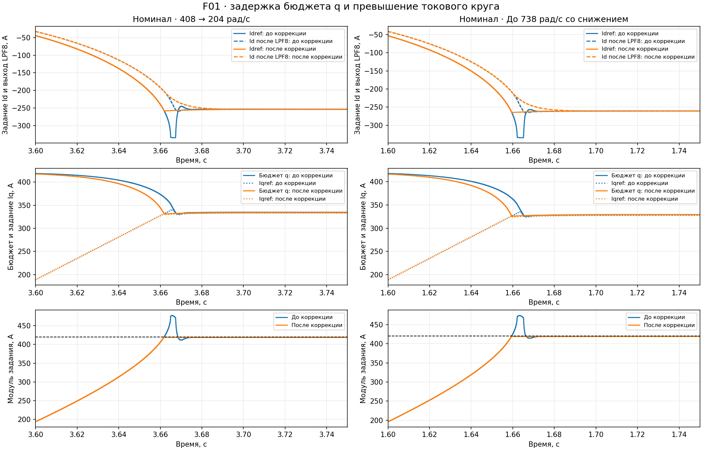

Рисунок 1. Номинальные режимы: слева прежний пик около 3,666 с, справа — около
1,663 с. Синий цвет — до коррекции, оранжевый — после. LPF8 по-прежнему отстаёт,
но теперь используется только для наблюдения. В замкнутой системе изменились
траектории обеих осей: исчезли также кратковременные провалы Idreq примерно
до −334 А. Нижние графики показывают устранение превышения токового круга.

В номинале длительных ошибок d/q нет. Максимум измеренного тока после
коррекции составляет 421,188–421,211 А на разных профилях и возникает при
начальном переходе около 0,00075 с. Это небольшое превышение 420 А укладывается
в принятый критерий 441 А; утверждать отсутствие любого превышения 420 А нельзя.

### Что не исправлено: режим Ld +20%

При ошибке Ld допустимое задание ещё не обеспечивает его исполнение:

| Профиль | Длительные эпизоды ошибки Iq после F01, с | Состояние в конце |
|---|---|---|
| 408 → 204 | 1,13108–25,00000 | Эпизод открыт, слежение не восстановилось |
| До 738 со снижением | 2,13725–4,57683; 10,22408–22,90083 | Последний возврат ошибки в порог лишь при ≈35,85 рад/с |
| Текущий пользовательский | 4,14725–25,00000 | Эпизод открыт, слежение не восстановилось |

На профиле до 738 рад/с пик измеренного тока **вырос** с 2053,270 до 2084,553 А,
а второй длительный эпизод начинается раньше. Этот результат не отмечается
как улучшение устойчивости. Возврат ошибки в порог в конце происходит на малой
скорости и не подтверждает устранения срыва.

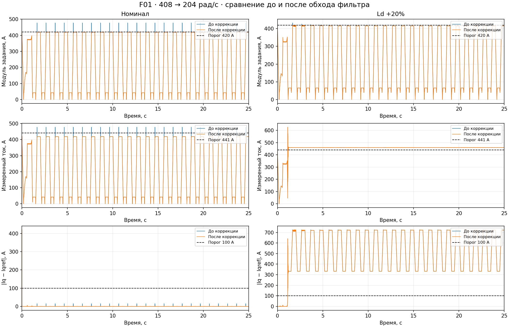

Рисунок 2. Профиль 408 → 204 рад/с. В номинале выбросы задания и связанного с ним
измеренного тока устранены. При Ld +20% длительная потеря слежения практически
сохранилась, хотя задание уже не превышает 420 А.

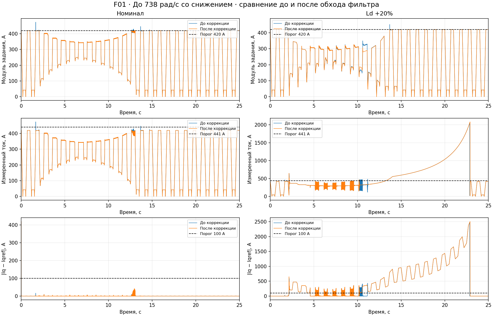

Рисунок 3. Профиль до 738 рад/с со снижением. Справа видны сохраняющийся рост
измеренного тока при снижении скорости и позднее восстановление. Совпадающие
кривые до/после могут перекрывать друг друга.

### Дополнительный пользовательский профиль

Точки времени: `[0, 0.2, 0.4, 4, 4.2, 8, 8.2, 9]` с; скорости:
`[0, 0, 204, 204, 408, 408, 204, 204]` рад/с. Далее удерживаются 204 рад/с.

| Сценарий | max Iref, А | max I, А | Результат |
|---|---:|---:|---|
| Номинал | 420,000 | 421,211 | Критерии задания, измеренного тока и длительной ошибки выполнены |
| Ld +20% | 420,000 | 515,184 | Задание допустимо; измеренный ток и слежение не проходят проверку |

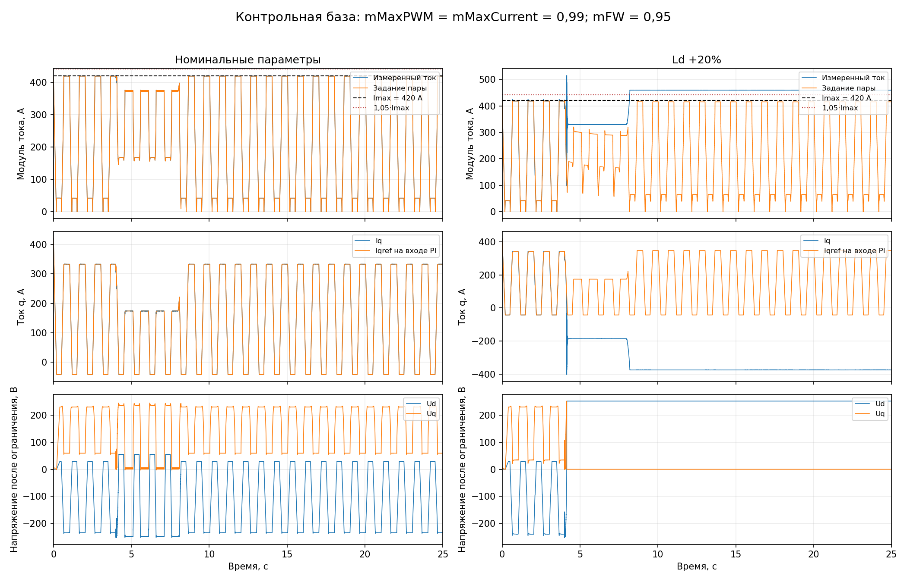

Рисунок 4. Дополнительный профиль после F01. Прямого сравнения до/после для
этого профиля нет, поскольку одновременно с коррекцией пользователь изменил
само задание скорости. Он не заменяет два основных эталонных режима.

### Решение по шагу и оставшиеся задачи

**F01 подтверждён как исправление запаздывающего токового бюджета.** В проверенной
матрице исчез выход итогового задания за круг; в номинале исчезли соответствующие
пики измеренного тока. Обход LPF8 сохраняется в пользовательской модели.

**Срыв при Ld +20% остаётся открытой проблемой.** Причину и способ устранения
нужно исследовать отдельно; одной коррекции бюджета q оказалось недостаточно.
Общий пункт формирования пары в одном такте не закрывается целиком: независимый
предел Id, ограничение обеих полярностей Iq, изменяемый Imax и согласование темпа
изменения пары ещё не проверены/не реализованы в полном объёме. В выполненных
сценариях отрицательный исходный запрос Iq ограничен величиной −42 А.

### Доказательства и воспроизведение

- [Сопоставление до/после](data/control_fixes/f01_20261112/comparison.json) —
  максимумы, эпизоды, остаток проверки бюджета q и контрольные суммы MAT.
- Профиль 408 → 204: [сводка](data/control_fixes/f01_20261112/hold204/summary.json),
  [проверка](data/control_fixes/f01_20261112/hold204/verification.txt),
  [модель](data/control_fixes/f01_20261112/hold204/baseline_source.slx).
- Профиль до 738: [сводка](data/control_fixes/f01_20261112/sweep738/summary.json),
  [проверка](data/control_fixes/f01_20261112/sweep738/verification.txt),
  [модель](data/control_fixes/f01_20261112/sweep738/baseline_source.slx).
- Текущий профиль: [сводка](data/control_fixes/f01_20261112/saved/summary.json),
  [проверка](data/control_fixes/f01_20261112/saved/verification.txt),
  [модель](data/control_fixes/f01_20261112/saved/baseline_source.slx).

Проверены завершение всех шести расчётов, конечность и полнота 48 сигналов,
совместная сетка пары задания, параметры сценариев, контрольные суммы,
тождества напряжений PI с развязкой и диапазон конечных duty 0,005…0,995.
Регрессионные проверки метрик прошли. Максимумы MATLAB независимо сверены
в Python при построении графиков; осциллограммы просмотрены.

Полные MAT, диагностические модели и логи находятся в
`tmp/control_fix_f01_20261112/`. Исходные результаты B00 сохранены. Кэши сборки
можно удалить после подтверждения пользователя; полные логи пока нужны для
последующего сравнения и дополнительной диагностики.

```matlab
addpath tools/fw_limiter
source = 'docs/data/control_fixes/f01_20261112/user_source.slx';
run_control_check('tmp/f01_repeat/hold204', 'hold204', source)
run_control_check('tmp/f01_repeat/sweep738', 'sweep738', source)
run_control_check('tmp/f01_repeat/saved', 'saved', source)
```

```bash
python3 tools/fw_limiter/fix_figures.py tmp/control_baseline_20261110/full tmp/control_baseline_20261110_sweep738/full tmp/f01_repeat tmp/f01_repeat/figures
```

## D02. Диагностика срыва и подготовка опыта без адаптации

12.11.2026. Повторно обработаны полные логи F01; **новых прогонов и изменений
модели на этом этапе нет**. Рассмотрены второй длительный срыв на профиле до
738 рад/с и срыв на пользовательском профиле. Контрольные суммы MAT и исходных
моделей сверены со сводками F01, максимумы тока повторно проверены в Python.

### Наблюдаемая проблема

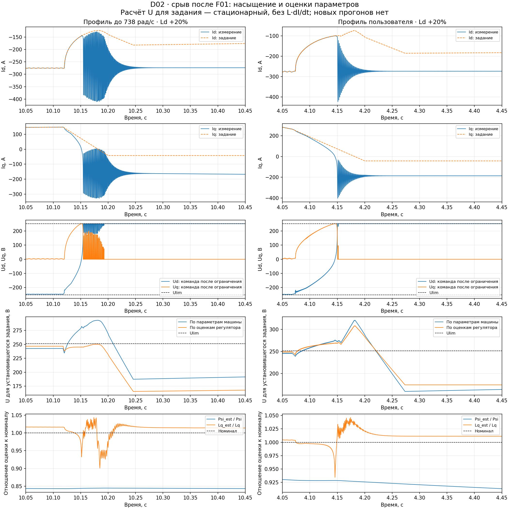

Рисунок 5. Верхние два ряда — задания и измеренные токи. Третий — команды Ud/Uq
после ограничителей, а не восстановленное напряжение на машине. Четвёртый —
напряжение для удержания заданной пары токов по двум наборам параметров. Пятый —
оценки, поступающие в управление. На всех графиках Ld машины больше номинальной
на 20%, а остальные истинные параметры номинальные.

Для четвёртого ряда вычислено:

$$
U_{ss}=\sqrt{(R_s I_{d,ref}-\omega_e L_q I_{q,ref})^2+
[R_s I_{q,ref}+\omega_e(\Psi+L_d I_{d,ref})]^2}.
$$

Синяя кривая использует истинную Ld = 1,2·Ld_ном; оранжевая — Ld_ном,
Psi_est и Lq_est. Это **стационарная** проверка: напряжения L·dI/dt в неё
не входят, поэтому она не доказывает достижимость перехода или возможность
немедленного выхода из насыщения.

| Профиль и время | Idref / Iqref, А | Uss по машине / по оценкам, В | Ud / Uq после ограничения, В |
|---|---:|---:|---:|
| До 738; 10,14 с | −164,39 / 96,60 | 269,47 / 245,13 | −121,70 / 220,09 |
| До 738; 10,30 с | −180,87 / −42,00 | 188,66 / 166,22 | 251,494 / 0,0316 |
| Пользовательский; 4,14 с | −101,64 / 96,60 | 272,63 / 268,41 | −51,00 / 246,27 |
| Пользовательский; 4,30 с | −184,48 / −42,00 | 160,05 / 174,27 | 251,494 / 0,0316 |

Предел Ulim = 251,494 В. На профиле до 738 рад/с в 10,14 с расчёт по оценкам
ещё укладывается в предел, тогда как по машине даже стационарная потребность
уже выше него. Psi_est в этот момент составляет 0,8433·Psi.
На пользовательском профиле в 4,14 с обе расчётные потребности выше предела:
объяснять оба перехода только занижением оценки потока нельзя.

После срыва напряжение почти полностью отдано оси d. В 10,30 и 4,30 с
заданная пара снова укладывается в стационарный бюджет, но токи не следуют ей.
Это подтверждает сохранение состояния насыщения после исчезновения
стационарного дефицита напряжения на задании.

В пользовательском случае в 4,30 с Idref = −184,48 А, Id = −273,31 А.
Состояние интегратора PI_d составляет всего −0,651 В, а команда Ud до ограничения
равна 421,62 В. После переходного процесса интегратор сохраняет это значение.
Следовательно, удержание Ud на пределе здесь **не требует большого накопленного
интеграла**. Одна лишь борьба с накоплением интегратора не объясняет весь дефект:
на запрос влияют также пропорциональная часть и развязка.

### Следующее действие пользователя: F02, фиксированные параметры

**Цель опыта** — отделить динамику оценщиков от поведения токовых контуров,
формирователя заданий и ограничителей. Это диагностический режим, а не уже
подтверждённое исправление. Обе оценки переключаются вместе как один фактор
«адаптация включена/выключена»; такой опыт сам по себе не разделит вклад Psi и Lq.

На корневом листе добавить два `Manual Switch`:

| Куда подать выход переключателя | Адаптивный вход | Фиксированный вход |
|---|---|---|
| `Goto32`, тег `Psi_est` | Выход `Low-Pass Filter (Discrete or Continuous)7` | `Constant`, Value = `Psi` |
| `Goto38`, тег `Lq_est` | Выход `Low-Pass Filter (Discrete or Continuous)9` | `Constant`, Value = `Lq` |

У констант задать `Sample time = FocDiscrTime`, у обоих переключателей выбрать
константы. Значения: Psi = 0,1024 Вб, Lq = 0,000305 Гн. Выходы фильтров сохранить
на Scope: они продолжают показывать результат оценки, но в этом режиме не должны
влиять на управление. Сверка текущего SLX подтвердила, что LPF7 поступает в
`Goto32`, а LPF9 — в `Goto38` и `ScopeLq`.

Ld в регуляторе остаётся номинальной. В контрольных сценариях истинная Ld машины
по-прежнему задаётся через deltaLd = 0 либо 0,2. Коэффициенты PI, пределы напряжения,
FF/trim и обход LPF8 сохраняются, чтобы результат можно было отнести к отключению
обратного влияния оценок. Добавления переменных `Psi_est`/`Lq_est` в workspace
недостаточно: сейчас это сигналы, формируемые блоками.

### Проверка и статус эффекта

**На момент D02 F02 ещё не внесён пользователем и не испытан; эффект неизвестен.**
Последующий результат записан ниже, в разделе F02. После
получения изменённого SLX сначала проверяются оба соединения и выбранные входы,
затем выполняются прежние четыре прогона по 25 с. Пользовательский профиль
проверяется дополнительно, если остаётся активным.

В новых логах нужно различать вычисленные оценки и фактически выбранные
параметры управления. Сравнение — с F01 на тех же профилях: модуль задания и тока,
ошибки d/q, время и продолжительность насыщения, состояние в конце. Исчезновение
срыва будет свидетельствовать о роли адаптации в его возникновении, но не докажет
корректность ограничителя во всех режимах. Сохранение срыва подтвердит, что он
возможен и при фиксированных параметрах регулятора.

[Численные срезы и контрольные суммы](data/control_fixes/d02_20261112/diagnosis.json).
Исходные MAT остаются в `tmp/control_fix_f01_20261112/`. Воспроизведение диагностики:

```bash
python3 tools/fw_limiter/diagnose_f01.py tmp/control_fix_f01_20261112 tmp/control_d02_20261112
```

## F02. Постоянные Psi и Lq в управлении

12.11.2026. Пользователь добавил переключатели, изменил активный профиль скорости
и сообщил: колебания в глубоком ОП остались, проблемы выхода из насыщения в своём
наблюдении не видел. Ниже приведена проверка сохранённого SLX и разделены
номинальный режим и искусственная ошибка Ld машины.

### Проблема и действие по коррекции

После F01 требовалось выяснить, необходима ли динамика оценщиков для возникновения
срыва. Пользователь подключил `Manual Switch` к `Goto32 (Psi_est)` и
`Manual Switch2` к `Goto38 (Lq_est)`, выбрал константы `Psi` и `Lq` с шагом
`FocDiscrTime`. Оценщики остались в модели и продолжают вычислять свои выходы.

Выбранным источником скорости стал `1-D Lookup Table2` — прежний профиль до
738 рад/с со снижением. Его точки не изменены. Поэтому отдельного третьего
профиля в F02 нет. Прежний режим 408 → 204 восстановлен только в тестовой копии.

Сверка с F01: рабочая область модели, конфигурация расчёта, параметры существующих
блоков управления и код MATLAB Function совпадают; обход LPF8 сохранён.
Изменились связи оценщиков через переключатели и источник скорости. Добавленный
неподключённый `Manual Switch1` не входит в управляющий тракт.

[Пользовательский снимок](data/control_fixes/f02_20261112/user_source.slx),
SHA-256: `61d9bf937a5a672f06b3b33a217e6d16f2e0c19fadc31b52f92262d08057d607`.
[Манифест изменений](data/control_fixes/f02_20261112/source_manifest.json).
Рабочий SLX ассистент не изменял.

### Проверка выбранных параметров и полные прогоны

В тестовые копии добавлены независимые наблюдения `Psi_used` и `Lq_used` от тегов,
поступающих в управление. Имена `Psi_est`/`Lq_est` в логах по-прежнему обозначают
вычисленные выходы фильтров. Это исключает смешение действующей константы и
отключённой от управления оценки.

Выполнены четыре полных прогона по 25 с, без прореживания: оба прежних профиля,
каждый в номинале и при deltaLd = 0,2. Во всех четырёх логах:

- Psi_used = 0,1024 Вб, Lq_used = 0,000305 Гн на всём интервале; максимальное
  отклонение от номинала равно нулю в сохранённых данных;
- 50 сигналов, включая две вычисленные необрезанные команды напряжения,
  конечны; расчёт завершён, необходимые временные сетки и покрытие полны;
- max Iref = 419,999997 А; конечные duty остаются в 0,005…0,995;
- параметры сценариев, SHA-256, тождества PI с развязкой и регрессионные проверки
  метрик прошли. Максимумы независимо сверены при построении рисунков.

### Эффект: выход из насыщения

| Профиль | Параметры | max I в F01 → F02, А | Длительная ошибка q в F02 |
|---|---|---:|---|
| 408 → 204 | Номинал | 421,188 → 421,188 | Нет |
| До 738 со снижением | Номинал | 421,204 → 423,807 | Нет |
| 408 → 204 | Ld +20% | 625,574 → 642,724 | 1,14117–25 с, открыт в конце |
| До 738 со снижением | Ld +20% | 2084,553 → 2050,730 | Шесть эпизодов; последний 13,14125–22,85500 с |

Критерий длительной ошибки прежний: |Iq − Iqref| > 100 А непрерывно более 20 мс.
Оба номинальных прогона проходят принятый порог измеренного тока 441 А и не имеют
длительных ошибок d/q. Наблюдение пользователя об отсутствии проблемы выхода
подтверждается для этих номинальных сценариев. Результат нельзя распространить
на проверку Ld +20%: в ней проблема сохраняется.

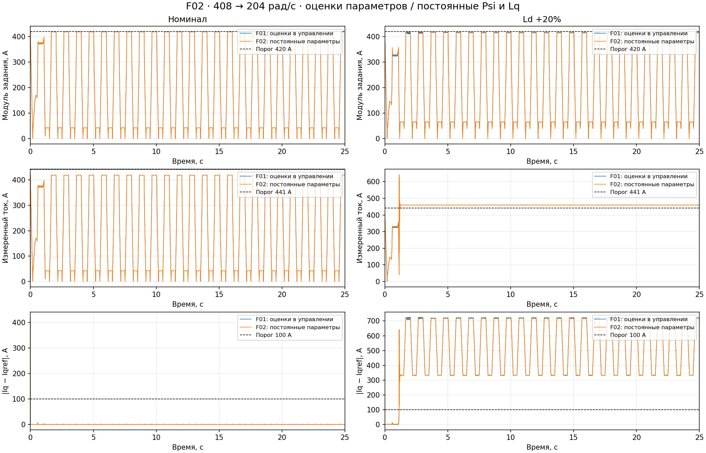

Рисунок 6. При ошибке Ld на профиле с удержанием 204 рад/с слежение не
восстанавливается до конца. Максимум измеренного тока после отключения влияния
оценок немного вырос; исправлением срыва это не является.

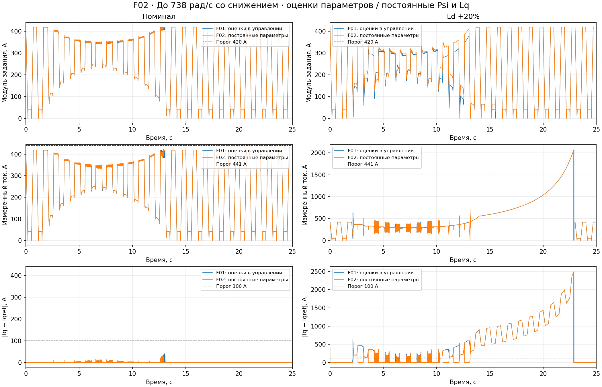

Рисунок 7. На профиле до 738 рад/с часть прежнего длинного эпизода разбилась
на отдельные срывы. Однако поздний токовый выброс порядка 2 кА сохранился.
Последний возврат ошибки q в порог происходит при скорости около 36,47 рад/с.

Дополнительно выделены непрерывные интервалы, где |Ud| ≥ Ulim − 1 мкВ и
|Uq| < 0,1 В, без объединения разрывов. В F02 при Ld +20% на профиле 408 → 204
такое насыщение длится с 1,14583 до 25 с; на профиле до 738 последний длинный
интервал — 13,14775–22,85008 с. Это согласуется с прежним механизмом: оси q
остаётся практически нулевой бюджет напряжения. По номинальному профилю до
738 максимальный отдельный интервал составляет 17,17 мс, но суммарное время
таких коротких ограничений — около 3,03 с за прогон.

**Вывод:** адаптация влияет на траекторию, но её динамика не является необходимым
условием срыва. Контрольная ветвь с фиксированными параметрами подготовлена;
проблема ограничителей и восстановления остаётся открытой.

### Колебания в глубоком ОП: несогласованный бюджет Iq

Для сравнения выбраны одинаковые окна на постоянных скоростях и высоком запросе
Iq: 4,80–4,98 с при 520 рад/с, 5,80–5,98 с при 624 рад/с и 6,80–6,98 с при
738 рад/с. Правый край исключён. Размах — максимум минус минимум по полной сетке.

| Скорость, рад/с | Размах Id, F01 → F02, А | Размах Iq, F01 → F02, А | Размах Idref в F02, А |
|---:|---:|---:|---:|
| 520 | 2,733 → 7,308 | 0,300 → 8,075 | 5,834 |
| 624 | 2,281 → 13,989 | 0,445 → 14,883 | 9,212 |
| 738 | 2,022 → 18,562 | 0,502 → 18,609 | 10,388 |

Таблица относится к **номинальной машине**. В F02 в этих окнах FF постоянен:
Psi_d_ff = −Psi. Размах задания d задаёт интегральная подстройка; sens меняет
знак и принимает значения −0,1/+0,1. На измеренных токах есть также быстрые
колебания; их размах выше размаха задания. Эти наблюдения не доказывают, что
любые колебания в модели вызваны одним звеном.

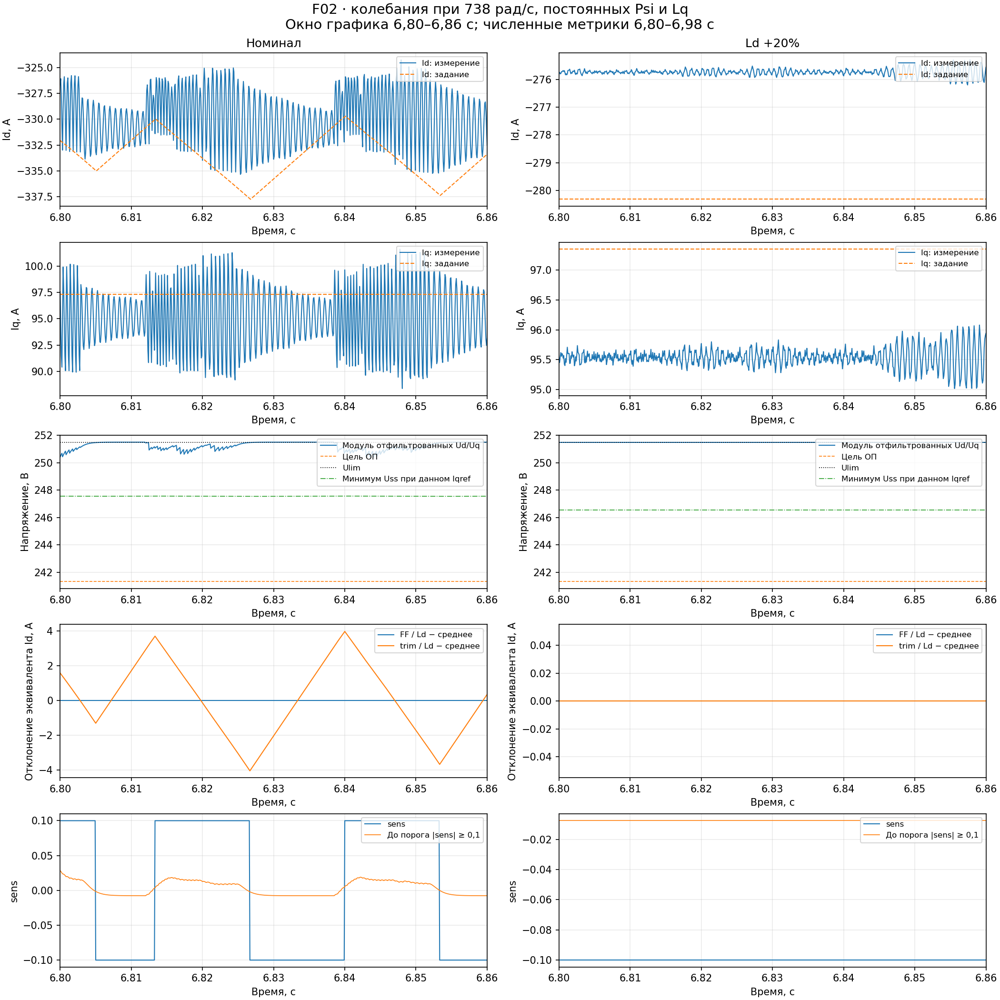

Рисунок 8. Окно 6,80–6,86 с при 738 рад/с. Слева номинал, справа Ld +20%.
В четвёртом ряду показаны отклонения FF/Ld и trim/Ld от их средних значений,
а не абсолютное задание. Справа trim упёрся в +50 А и задание постоянно;
меньший размах токов в этом отдельном окне не означает отсутствия насыщения.

При фиксированном Iq минимальное стационарное напряжение по всем Id можно
рассчитать точно для принятой модели машины:

$$
U_{ss,\min}(I_q)=
\frac{|(R_s^2+\omega_e^2 L_d L_q) I_q+R_s\omega_e\Psi|}
{\sqrt{R_s^2+(\omega_e L_d)^2}}.
$$

Ограничения тока и размагничивания здесь не наложены. Поэтому если даже этот
неограниченный минимум выше цели ОП, допустимый Id тем более не решит задачу.
Выражение проверено независимой подстановкой минимизирующего Id в оба уравнения
напряжений. Динамические члены L·dI/dt в этот стационарный вывод не входят.

На номинальной машине в окне при 738 рад/с:

- средний Iqref = 97,311 А;
- минимум достигается около Id = −330,314 А;
- Uss,min = 247,538…247,571 В, а цель Vs_max = 241,332 В;
- жёсткий предел инвертора выше: Ulim = 251,494 В.

То есть **текущий Iq допускает стационарную точку ниже жёсткого предела, но не
позволяет получить заданную цель ОП ни при каком Id**. ОП пытается уменьшить
напряжение через Id вблизи минимума, где знак чувствительности меняется. FF
остаётся на границе −Psi, ошибка напряжения не исчезает, sens меняет знак,
и направление интегрирования подстройки переключается.

Действующий `Divide4` даёт бюджет Vs_max/(|ωe|·Lq_used). Он не учитывает
резистивное падение по d и не гарантирует достижимость самой цели ОП.
Для положительных скорости и Iq в рассмотренной номинальной точке из точной
границы следует Iq ≤ 94,798 А даже без динамического запаса. В F01 оценка Lq
в этом окне была около 0,31721 мГн вместо истинных 0,305 мГн, и через тот же
ограничитель уменьшала Iqref примерно до 93,566 А. После её отключения этот
дополнительный запас исчез. Это объясняет, почему фиксированные параметры
выявили более сильные колебания, хотя сами оценщики перестали влиять на контур.

### Следующий опыт F03: добавить запас в напряженческий предел q

Предложен один ручной диагностический шаг: добавить `Gain = 0.95` **между
выходом `Divide4` и его входом в `Min_smooth_ab`**. Уменьшается только
напряженческий бюджет q. Постоянные Psi/Lq, цель mFW = 0,95, ограничитель
инвертора, коэффициенты PI и токовый круг сохраняются.

Коэффициент 0,95 выбран как простой проверочный запас: при 738 рад/с получаем
Iq порядка 92,4 А, ниже расчётной границы 94,8 А. Цена — некоторое уменьшение
доступного момента в этой области. Ожидается, что цель ОП станет достижимой
с запасом и исчезнет необходимость переключения подстройки вокруг минимума.
**На момент предложения этот эффект ещё не был проверен; результат приведён в F03 ниже.**
Формула с постоянным коэффициентом не заменяет
будущий совместный расчёт достижимой пары с Rs, Idmin, токовым кругом и динамикой.
Устранение длительного срыва при Ld +20% также не обещается этой мерой.

После пользовательской правки — та же матрица четырёх прогонов, сравнение с F02
по насыщению, слежению и размахам на тех же полках. Дополнительно сравниваются
Iqref и момент, чтобы снижение колебаний не скрывало потерю производительности.

### Доказательства и воспроизведение

- [Сравнение F01/F02 и метрики колебаний](data/control_fixes/f02_20261112/comparison.json).
- 408 → 204: [сводка](data/control_fixes/f02_20261112/hold204/summary.json),
  [проверка](data/control_fixes/f02_20261112/hold204/verification.txt),
  [модель](data/control_fixes/f02_20261112/hold204/baseline_source.slx).
- До 738: [сводка](data/control_fixes/f02_20261112/sweep738/summary.json),
  [проверка](data/control_fixes/f02_20261112/sweep738/verification.txt),
  [модель](data/control_fixes/f02_20261112/sweep738/baseline_source.slx).

Полные MAT, инструментированные модели и логи сохранены в
`tmp/control_fix_f02_20261112/`. Кэши сборки можно удалить после подтверждения;
полные логи нужны для следующего сравнения. Осциллограммы просмотрены.

```matlab
addpath tools/fw_limiter
source = 'docs/data/control_fixes/f02_20261112/user_source.slx';
run_control_check('tmp/f02_repeat/hold204', 'hold204', source)
run_control_check('tmp/f02_repeat/sweep738', 'saved', source)
```

```bash
python3 tools/fw_limiter/f02_figures.py tmp/control_fix_f01_20261112 tmp/f02_repeat tmp/f02_repeat/figures
```

## F03. Запас в напряженческом бюджете Iq и новый срыв в номинале

12.11.2026. Пользователь сообщил: в первых периодах колебания уменьшились,
затем резко выросли, произошли провал и залипание Id. Это наблюдение
воспроизведено на сохранённой модели при номинальных параметрах машины.

### Проблема и фактическая коррекция

Проверялась гипотеза из F02: уменьшение напряженческого бюджета q позволит
достичь цели ОП с запасом. Пользователь добавил `Gain15 = 0.95` в соединение
`From67 (Iq_voltLim) → Min_smooth_ab`, второй вход. Это именно ветвь от
`Divide4`, передаваемая через тег `Iq_voltLim`. Остальные параметры, соединения
управления, профиль скорости и рабочая область совпадают с F02.

[Пользовательский снимок](data/control_fixes/f03_20261112/user_source.slx),
SHA-256: `17f6a14ccbb0c814d38cb1c01a889c73365b5fb65824205ad9bd595ca77c138c`.
[Манифест изменений](data/control_fixes/f03_20261112/source_manifest.json).
Рабочая модель не изменялась ассистентом.

В тестовых копиях добавлен `Iq_voltLim_used` с ветви, поступающей во второй
вход `Min_smooth_ab`. Во всех четырёх прогонах проверено равенство
`Iq_voltLim_used = 0.95·Iq_voltLim`; максимальный остаток равен нулю в логах.
Psi_used и Lq_used остаются постоянными номинальными значениями.

### Проверка и общий эффект

Выполнены четыре полных прогона по 25 с без прореживания, на прежних двух
профилях, в номинале и при Ld +20%. В каждом 51 конечный сигнал, включая
две вычисленные команды напряжения. Проверены завершение, покрытие, сетки,
параметры сценариев, SHA-256, тождества напряжений PI и пределы duty.
Регрессионные проверки метрик прошли. Max Iref = 419,999997 А во всех случаях.

| Профиль | Параметры | max I, F02 → F03, А | Эффект |
|---|---|---:|---|
| 408 → 204 | Номинал | 421,188 → 421,188 | Прежние критерии выполнены |
| 408 → 204 | Ld +20% | 642,724 → 421,188 | Длительные ошибки d/q исчезли |
| До 738 со снижением | Номинал | 423,807 → **2104,063** | Появилась длительная потеря управления |
| До 738 со снижением | Ld +20% | 2050,730 → 2047,469 | Срыв сохраняется |

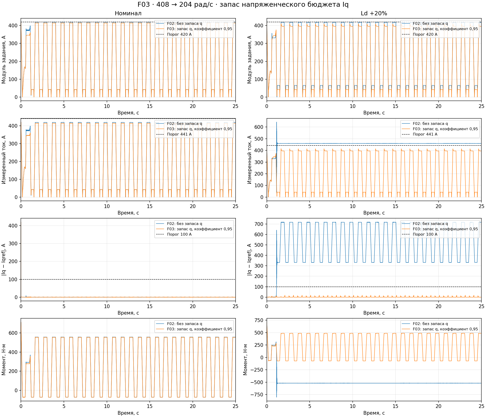

Рисунок 9. На профиле 408 → 204 добавленный запас устранил ранее наблюдавшийся
срыв при Ld +20%. Это положительный результат одного сценария, не приёмка F03.

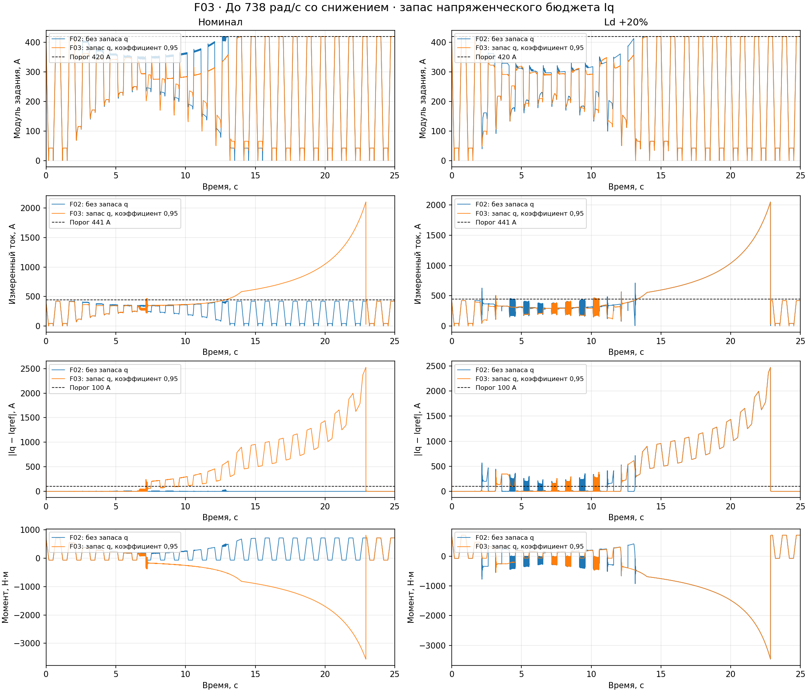

Рисунок 10. На профиле до 738 новый вариант дал срыв даже в номинале. В нижнем
ряду показан момент: улучшение формы тока на отдельных полках нельзя оценивать
без учёта уменьшения запроса и последующей потери слежения.

В номинале критерий |Iq − Iqref| > 100 А более 20 мс выделяет три интервала:
7,51517–8,18925; 8,50850–9,19717; 9,49933–22,92733 с. **Это не три отдельных
защёлки с восстановлением между ними.** Непрерывное состояние |Ud| ≥ Ulim − 1 мкВ,
|Uq| < 0,1 В длится с **7,25467 до 22,92242 с**, то есть 15,668 с. При отрицательном
запросе q ошибка некоторое время меньше 100 А, хотя ось q всё ещё лишена
напряжения. Последний возврат ошибки q в порог происходит около 35,49 рад/с.

При Ld +20% длительные ошибки q: 3,17758–4,57142 и 12,16258–22,85050 с.
Сохраняется поздний рост тока приблизительно до 2 кА.

**F03 не принимается как общее исправление:** локальное улучшение сопровождается
существенным ухудшением другого сценария. Предложенный коэффициент был
диагностическим опытом; ожидание устойчивой работы всей матрицы не подтвердилось.

### Уменьшение колебаний в начале и их последующий рост

Номинальная машина, те же окна на полках скорости, что в F02:

| Скорость, рад/с | Размах Id, F02 → F03, А | Размах Iq, F02 → F03, А | Средний момент, F02 → F03, Н·м |
|---:|---:|---:|---:|
| 520 | 7,308 → 0,238 | 8,075 → 0,276 | 228,537 → 218,324 |
| 624 | 13,989 → 0,320 | 14,883 → 0,320 | 188,735 → 181,774 |
| 738 | 18,562 → 34,199 | 18,609 → 46,728 | 157,802 → 122,489 |

Окна: [4,80;4,98), [5,80;5,98), [6,80;6,98) с, полная сетка. На первых двух
полках запас уменьшил колебания, ценой снижения доступного момента. На 738 рад/с
средний Iqref снизился с 97,311 до 92,483 А, но средний измеренный Iq — до
73,489 А. Дополнительная потеря момента здесь связана уже с ошибкой слежения.

Статическая часть гипотезы подтвердилась: при новом Iqref минимум Uss на полке
738 рад/с составляет около 235,60 В, ниже цели 241,33 В. Однако фактически
сформированная пара токов позднее уходит из достижимой области. Одной
стационарной проверки бюджета оказалось недостаточно.

### Как развивается номинальный срыв

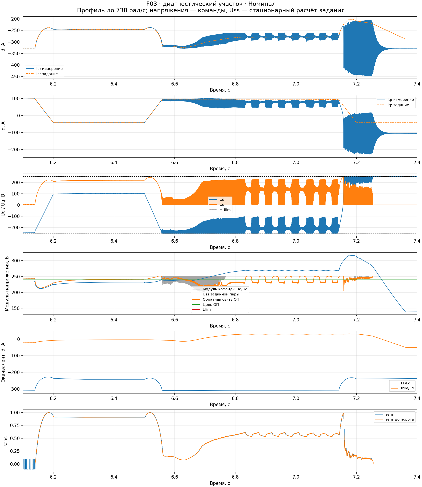

Рисунок 11. Номинальный сценарий, 6,1–7,4 с. Серая кривая четвёртого ряда —
модуль ограниченной команды Ud/Uq, оранжевая — действующая обратная связь ОП.
Это команды регулятора, не восстановленное напряжение на клеммах машины.
Uss рассчитано для заданной пары по истинным параметрам без членов L·dI/dt.

Последовательность по логам:

1. Около 6,55–6,65 с при росте запроса q появляются насыщение и быстрые колебания
   токов и направления напряжения. В 6,60 с стационарная потребность задания
   составляет лишь 237,13 В; этим расчётом сам переход не объясняется.
2. В 6,70–6,80 с средний модуль команды уже **247,98 В**, но обратная связь ОП
   показывает в среднем **224,70 В**. Цель равна 241,33 В. Подстройка trim/Ld
   растёт с **+6,45 до +27,06 А**, снимая ослабление поля при ложном запасе.
3. К 6,80 с Idref = −281,53 А и Iqref = 92,48 А. Для удержания этой пары нужно
   **265,67 В**, выше Ulim = 251,49 В. В 6,80–6,90 с модуль команды практически
   постоянно равен Ulim, а обратная связь ОП опускается до 228,66 В.
4. При следующем снижении запроса q около 7,14–7,20 с FF снимает отрицательный Id,
   остаётся положительная подстройка около +30 А. В 7,18 с стационарная потребность
   задания достигает **316,75 В**, Ud переходит на положительный предел, Uq ≈0.
5. В 7,30 с задание снова стационарно достижимо: Uss = **216,98 В**. Однако
   Idref = −249,86 А, измеренный Id ≈−331,00 А, Ud = +251,49 В, Uq ≈0,0316 В.
   Измеренный Id удерживается около −Psi/Ld ≈−330 А, пока задание продолжает
   меняться. Это и есть наблюдаемое залипание тока, а не фиксация самого задания.

В 7,30 с необрезанный запрос Ud равен 510,25 В, интегратор d — 117,12 В.
Даже арифметическое исключение его вклада оставляет около 393,13 В запроса,
выше предела. Это не эксперимент со сбросом, но показывает, почему нельзя
объяснить сохранение насыщения только накоплением интегратора.

### Выявленный дефект обратной связи ОП

Сейчас измерительная ветвь вычисляет:

$$
V_f=\sqrt{\operatorname{LPF}(U_d)^2+\operatorname{LPF}(U_q)^2}.
$$

Она усредняет компоненты вектора. При колебаниях его направления полученный
модуль может заметно уменьшиться, хотя модуль самой команды остаётся на пределе.
Наружный контур воспринимает это как возможность снять ослабление и дополнительно
увеличивает требуемое напряжение задания.

Для следующего опыта предлагается другая последовательность операций:

$$
V_f=\operatorname{LPF}\!\left(\sqrt{U_d^2+U_q^2}\right).
$$

Логи подтверждают занижение действующей обратной связи и последующее неверное
направление подстройки. **Они ещё не доказывают, что порядок фильтрации —
единственный источник первоначальных быстрых колебаний.** Исправление этой
ветви не заменяет дальнейшую проверку внутренних контуров, ограничителя
напряжения и выхода из насыщения.

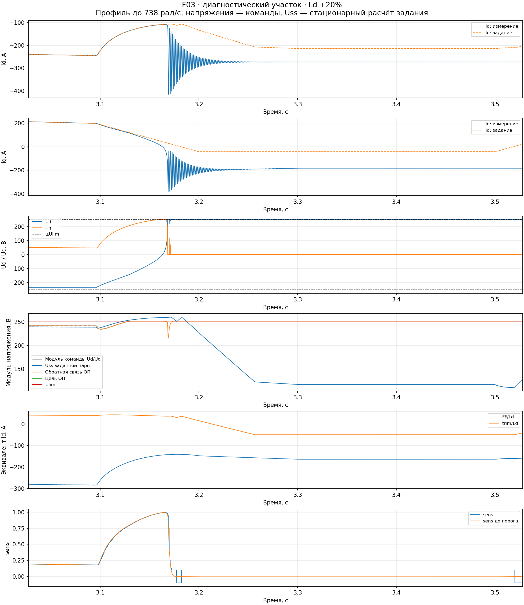

Рисунок 12. Отдельно сохранён первый длительный эпизод при Ld +20%. Его нельзя
смешивать с более поздним развитием номинального срыва на рисунке 11.

### Следующий ручной опыт F04: сначала модуль, затем фильтр

На корневом листе:

1. Подать `From43 (Ud)` непосредственно на `Square3`, а `From (Uq)` — на
   `Square8`. Существующие `Sum3 → Sqrt1` начнут вычислять модуль команд
   до фильтрации компонент.
2. После `Sqrt1` поставить новый `Low-Pass Filter (Discrete or Continuous)`:
   K = 1, T = `10*FocDiscrTime`, Ts = `FocDiscrTime`, x0 = 0. Получается
   та же постоянная времени 0,833 мс, но фильтруется скалярный модуль.
3. Выход нового фильтра подать вместо прежнего выхода `Sqrt1` на **второй вход
   `Sum11`** и на **`Saturation1`**. Сохранить ветвь существующего фильтра №6
   на `Sum9`: она нужна для числителя sens и этим опытом не заменяется.

Для сравнения F04 с F03 оставить Gain15 = 0,95, постоянные Psi/Lq, профиль,
коэффициенты PI и остальные ограничения. Это сохранение условий диагностического
опыта, а не признание F03 рабочим исправлением. Перед следующим запуском
логирование `Vabs_f` нужно перенести на фактический вход обратной связи после
нового фильтра; `Sqrt1` после правки будет уже нефильтрованным модулем.

На момент предложения **F04 ещё не был выполнен**. Ожидалось исчезновение ложного
запаса из-за усреднения направления и связанного снятия ОП. Последующая проверка
и границы достигнутого эффекта приведены ниже в разделе F04.

### Доказательства и воспроизведение

- [Сравнение F02/F03, численные срезы, насыщение и момент](data/control_fixes/f03_20261112/comparison.json).
- 408 → 204: [сводка](data/control_fixes/f03_20261112/hold204/summary.json),
  [проверка](data/control_fixes/f03_20261112/hold204/verification.txt),
  [модель](data/control_fixes/f03_20261112/hold204/baseline_source.slx).
- До 738: [сводка](data/control_fixes/f03_20261112/sweep738/summary.json),
  [проверка](data/control_fixes/f03_20261112/sweep738/verification.txt),
  [модель](data/control_fixes/f03_20261112/sweep738/baseline_source.slx).

Полные данные и логи сохранены в `tmp/control_fix_f03_20261112/`. Максимумы
перепроверены в Python, контрольные суммы входных MAT сверены, рисунки просмотрены.
Кэши сборки можно удалить после подтверждения; полные логи сохраняются для F04.

```matlab
addpath tools/fw_limiter
source = 'docs/data/control_fixes/f03_20261112/user_source.slx';
run_control_check('tmp/f03_repeat/hold204', 'hold204', source)
run_control_check('tmp/f03_repeat/sweep738', 'saved', source)
```

```bash
python3 tools/fw_limiter/f03_figures.py tmp/control_fix_f02_20261112 tmp/f03_repeat tmp/f03_repeat/figures
```

## F04. Фильтрация модуля напряжения: частичное решение

### Проблема и действия по коррекции

В F03 на номинальной машине после начального уменьшения колебаний происходили
их рост, провал и длительное залипание Id. Установлено, что при изменении
направления вектора напряжения вычисление модуля после фильтров компонент
занижает обратную связь ОП. Пользователь изменил порядок операций и сообщил
об улучшении, при этом колебания напряжения при набросах остались.

Сверка сохранённой модели с F03 подтвердила:

1. `From43 (Ud) → Square3` и `From (Uq) → Square8` подключены без фильтрации.
   `Sum3 → Sqrt1` вычисляет модуль ограниченной команды напряжения.
2. Существующий `Low-Pass Filter (Discrete or Continuous)1` перенесён после
   `Sqrt1`. Его выход подключён ко второму входу `Sum11` и к `Saturation1`.
   K = 1, T = `10*FocDiscrTime`, Ts = `FocDiscrTime`, x0 = 0 сохранены.
3. Ветвь фильтра №6 на `Sum9` сохранена для числителя sens.
4. В `VectorBase` добавлен `Gain1` между `From16 (VDC)` и исходным `Gain`;
   сохранённое значение **1** подтверждено через MATLAB.

Итоговая обратная связь:

$$
V_f=\operatorname{LPF}\!\left(\sqrt{U_d^2+U_q^2}\right),\qquad
T=10T_s=0{,}833\ \text{мс}.
$$

Рабочая область модели, настройки расчёта и код MATLAB Function совпадают с F03.
`Gain15 = 0.95`, постоянные Psi/Lq, обход LPF8 и сохранённый профиль `Table2`
не изменены. Контрольные расчёты выполнены на копиях; рабочий SLX не редактировался.

Сохранены [пользовательская модель](data/control_fixes/f04_20261112/user_source.slx)
и [манифест соединений](data/control_fixes/f04_20261112/source_manifest.json).
SHA-256: `53a833c43c1e6dcfb1448112a1472301c0d16c9bb97e8584363849f92d2a0134`.

### Что означает дополнительный Gain 0,98

По сообщению пользователя, проба с 0,98 изменила картину, но не устранила
колебания напряжения при набросах; коэффициент возвращён в 1.
**Этот опыт отдельно не воспроизводился.** Все результаты F04 ниже получены с 1.

По фактическим соединениям новый Gain меняет только предел **оси d**. В
`UqLimiter` VDC приходит отдельной ветвью, поэтому общий радиус напряжения
остаётся прежним. При `k_d = 0.98`:

$$
U_{\lim}=0{,}99\frac{440}{\sqrt3}=251{,}494\ \text{В},\qquad
|U_d|\le k_d U_{\lim}=246{,}464\ \text{В},
$$

$$
U_{q,\lim}=\sqrt{\max(0{,}001,\ U_{\lim}^2-U_d^2)}
\ \ge\ U_{\lim}\sqrt{1-k_d^2}
\approx 0{,}199\,U_{\lim}=50{,}047\ \text{В}.
$$

То есть получается около **20% бюджета напряжения для Uq**, а не для Ud.
Это доступный предел q; фактический Uq определяется регулятором. При сохранённом
`k_d = 1` такой резерв отсутствует: на пределе Ud остаётся лишь нижний предел
UqLimiter, √0,001 ≈0,0316 В. Само резервирование q не доказывает устранения
динамических колебаний.

### Контрольная матрица F03 → F04

MATLAB R2025a, четыре полных прогона по 25 с, без прореживания. Сохранены прежние
два профиля и периодический запрос q. Для каждого профиля проверены номинал
и только `deltaLd = 0.2`; остальные ошибки параметров нулевые.

Логирование `Vabs_f` перенесено на фактический вход обратной связи `Sum11`.
Дополнительно записаны нефильтрованный `Vabs_sqrt` и доступный предел `Uq_limit`:
51 записанный сигнал и две вычисленные команды. Токи — в амплитудной системе dq.

| Профиль | Параметры | max I, F03 → F04, А | Длительная ошибка q в F04 |
|---|---|---:|---|
| 408 → 204 | Номинал | 421,188 → **421,188** | Нет |
| 408 → 204 | Ld +20% | 421,188 → **649,269** | 1,14467–25 с; не завершилась |
| До 738 со снижением | Номинал | 2104,063 → **421,204** | Нет |
| До 738 со снижением | Ld +20% | 2047,469 → **2047,470** | 3,17783–4,57158 и 12,16267–22,85050 с |

Во всех четырёх случаях max Iref ≤420 А, все записанные сигналы конечны,
скважности остаются в диапазоне 0,005…0,995. **Это не означает допустимость
измеренного тока:** при Ld +20% оба профиля нарушают контрольный порог 441 А.
В обоих номинальных прогонах нет ошибок d/q свыше 100 А непрерывно дольше 20 мс.

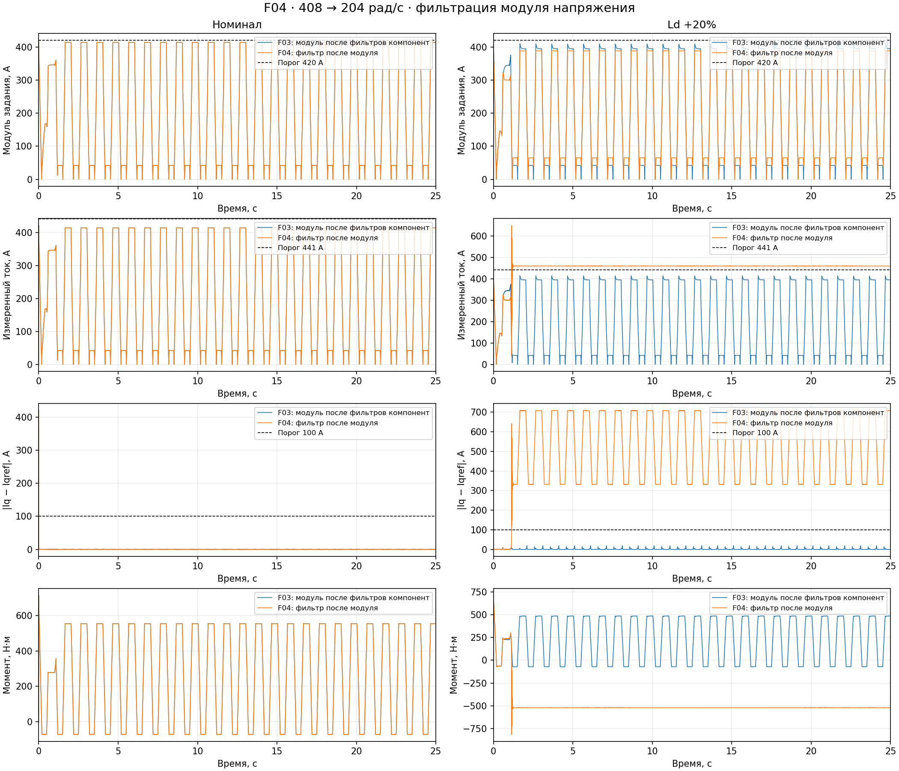

Рисунок 13. Номинальный режим сохранился. При Ld +20% вновь возник длительный
срыв, отсутствовавший в F03: ухудшение этого сценария явно сохранено в результате.

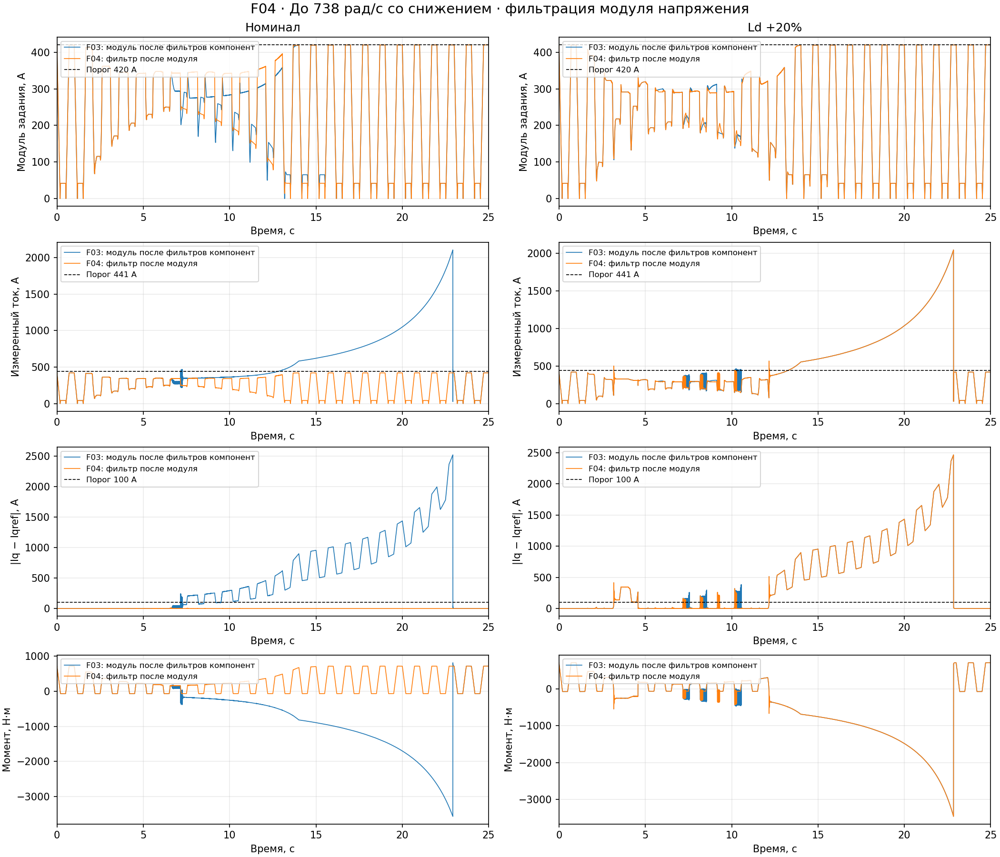

Рисунок 14. Номинальный срыв устранён. Поздний рост тока при Ld +20% практически
не изменился. Возврат ошибки в порог после 22,85050 с происходит уже при малой
скорости и не является подтверждением устойчивости во всём профиле.

Отдельно проверено насыщение по критерию `|Ud| ≥ Ulim − 1 мкВ` и `|Uq| < 0,1 В`.
В номинале на 408 → 204 таких эпизодов нет, на профиле до 738 максимальная
непрерывная длительность составляет **5,917 мс** вместо **15,668 с** в F03.
При Ld +20% на 408 → 204 насыщение длится с 1,14892 с до конца расчёта;
на профиле до 738 поздний непрерывный эпизод длится 12,16108–22,84558 с.
Эта проверка отличает краткое насыщение при переходе от длительного залипания.

### Эффект исправления обратной связи

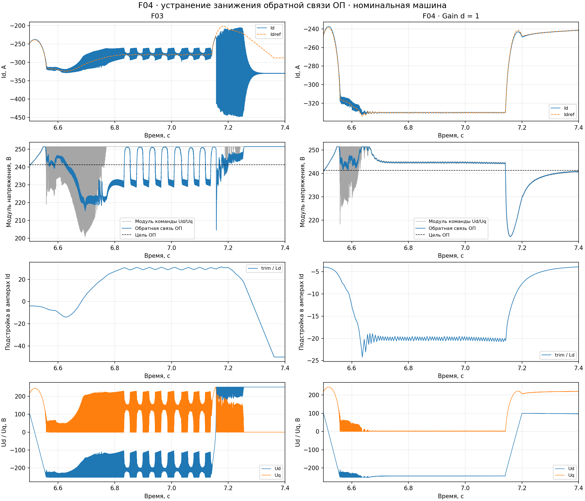

Рисунок 15. Номинальный сценарий. Исправление устраняет большое расхождение
между модулем команды и обратной связью при меняющемся направлении напряжения.
Здесь Ud/Uq — ограниченные команды, не восстановленное напряжение на машине.

В окне 6,70–6,80 с:

| Величина | F03 | F04 |
|---|---:|---:|
| Средний модуль команды Ud/Uq, В | 247,979 | 244,767 |
| Средняя обратная связь ОП, В | 224,699 | 244,769 |
| Подстройка trim/Ld, начало → конец, А | +6,45 → +27,06 | −19,88 → −20,52 |

Ложный запас напряжения и связанное с ним снятие ослабления исчезли в этом
номинальном переходе. Средние модуля и обратной связи различаются примерно
на 0,003 В; мгновенные значения различаются из-за сохранённого фильтра.

На одинаковых полках скорости получены следующие размахи по полной сетке:

| Скорость, рад/с | Окно, с | Размах Id, F03 → F04, А | Размах Iq, F03 → F04, А | Средний момент, F03 → F04, Н·м |
|---:|---|---:|---:|---:|
| 520 | [4,80;4,98) | 0,238 → 0,237 | 0,276 → 0,276 | 218,324 → 218,324 |
| 624 | [5,80;5,98) | 0,320 → 0,335 | 0,320 → 0,386 | 181,774 → 181,774 |
| 738 | [6,80;6,98) | **34,199 → 1,137** | **46,728 → 0,439** | **122,489 → 153,678** |

На полке 738 средний Iqref ≈92,446 А, измеренный Iq ≈92,445 А: потеря момента
из-за большой ошибки слежения устранена. Это результат при сохранённом
коэффициенте бюджета q 0,95; максимальный достижимый момент здесь не оптимизировался.

### Что ещё не решено

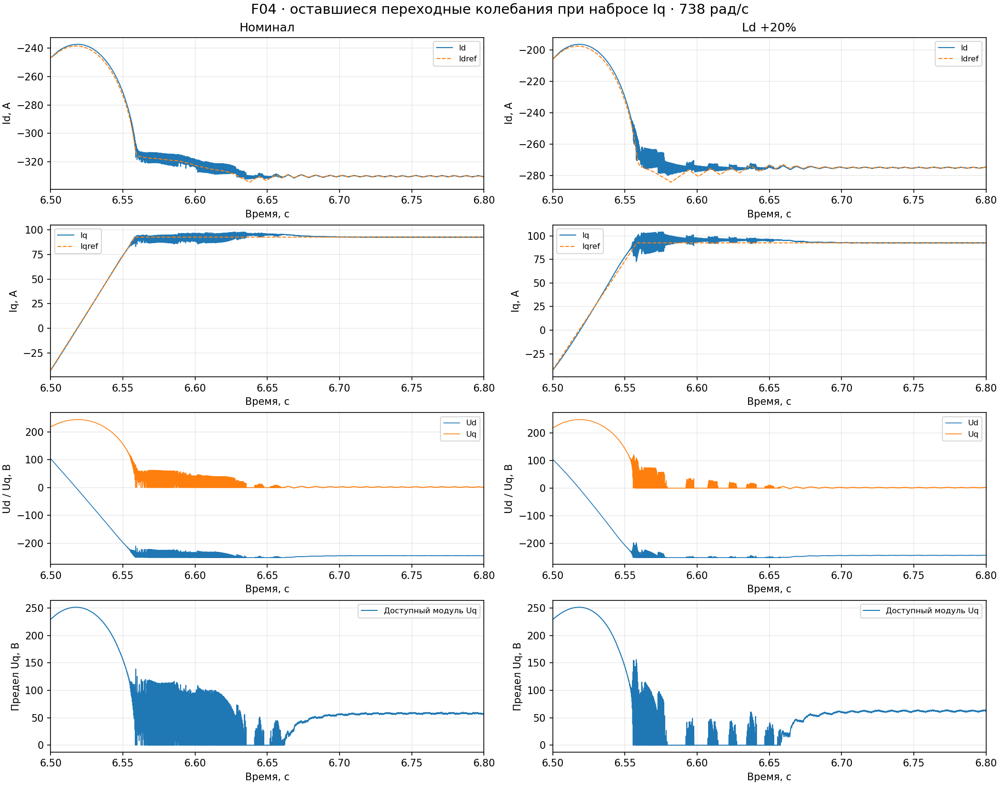

Рисунок 16. Наброс задания q на 738 рад/с, 6,50–6,80 с. После начального
изменения задания сохраняются быстрые колебания Ud/Uq и доступного предела q,
который кратковременно падает почти до нуля. Улучшение установившейся полки
не закрывает этот переходный процесс.

В номинале на полке 738 размах Ud ≈1,184 В, Uq ≈3,388 В, а средний модуль
напряжения ≈244,674 В всё ещё выше цели ОП 241,332 В. На полках 624 и 738
sens переключается между −0,1 и +0,1. Поэтому динамика ОП и sens, распределение
напряжения между осями, anti-windup и переходы заданий остаются предметом
дальнейшей проверки. По этой работе нельзя выбрать единственную причину
оставшихся колебаний или признать согласование контуров завершённым.

**Итог F04 — частичное решение.** Подтверждены корректный токовый бюджет задания,
исправленный порядок фильтрации и существенное улучшение номинального режима.
Срывы при Ld +20%, включая ухудшение профиля 408 → 204 относительно F03,
и колебания напряжения при набросах остаются в бэклоге. Адаптация пока отключена;
результат не переносится автоматически на режим с оценщиками.

### Доказательства и воспроизведение

- [Сравнение F03/F04, интервалы насыщения, полки и остатки проверочных тождеств](data/control_fixes/f04_20261112/comparison.json).
- 408 → 204: [сводка](data/control_fixes/f04_20261112/hold204/summary.json),
  [проверка](data/control_fixes/f04_20261112/hold204/verification.txt),
  [модель](data/control_fixes/f04_20261112/hold204/baseline_source.slx).
- До 738: [сводка](data/control_fixes/f04_20261112/sweep738/summary.json),
  [проверка](data/control_fixes/f04_20261112/sweep738/verification.txt),
  [модель](data/control_fixes/f04_20261112/sweep738/baseline_source.slx).

Регрессионные проверки метрик пройдены. Сверены полные сетки, длительность,
контрольные суммы моделей/MAT, фактические параметры, постоянство выбранных
Psi/Lq и источник обратной связи. Максимумы повторно рассчитаны в Python.
Для всех четырёх прогонов остатки тождеств модуля, коэффициента бюджета q 0,95,
предела d при Gain1 = 1 и предела Uq не превышают 3·10⁻¹⁴ в соответствующих
единицах. Осциллограммы просмотрены.

Полные MAT, логи и рабочие материалы сохранены в `tmp/control_fix_f04_20261112/`.
Нужные для сравнения снимки, сводки и рисунки перенесены в `docs/`.
Кэши сборки можно удалить после подтверждения; полные MAT нужны для дальнейшего
анализа и сейчас сохраняются. Удаление не выполнялось.

```matlab
addpath tools/fw_limiter
source = 'docs/data/control_fixes/f04_20261112/user_source.slx';
run_control_check('tmp/f04_repeat/hold204', 'hold204', source)
run_control_check('tmp/f04_repeat/sweep738', 'saved', source)
```

```bash
python3 tools/fw_limiter/f04_figures.py tmp/control_fix_f03_20261112 tmp/f04_repeat tmp/f04_repeat/figures
```

## D05. Ошибка Ld и устойчивость при неточных параметрах

### Уточнение задачи

Машину для этого проекта разрабатывает сторонний изготовитель. По сообщению
пользователя, реальная зависимость индуктивностей от токов неизвестна.
Требуется устойчивость структуры управления при неточных параметрах;
предоставление карты машины не является условием продолжения работы.

Пользователь считает увеличение Ld на 20% менее вероятным, чем уменьшение
от измеренного на ненагруженной машине значения при насыщении. Для этой машины
диапазон не подтверждён измерениями. Сценарий Ld +20% сохраняет роль диагностического
возмущения, выявляющего механизм срыва, а не утверждения о реальном допуске машины.

### Где действует ошибка Ld

В сохранённой F04 блок PMSM использует `Ld*(1+deltaLd)`, а управление — исходную
Ld = 0,31 мГн. Она входит в деление при формировании Idreq, q-развязку
`VectorBase/Gain6`, Kpd = piBandwidth·Ld, предел подстройки ±50·Ld и несколько
служебных преобразований ток/поток. Для опыта Ld +20% истинная Ld = 0,372 мГн.

При заданном отрицательном приращении потокосцепления Δλ:

$$
I_{d,\mathrm{FF}}=\frac{\Delta\lambda}{\hat L_d},\qquad
I_{d,\mathrm{нужный}}=\frac{\Delta\lambda}{L_{d,\mathrm{true}}}.
$$

При Ld,true = 1,2·Ld,ном расчётный модуль тока на 20% больше необходимого
для того же Δλ. Например, −300 А по номинальной модели соответствуют −250 А
при истинной Ld: требуется +50 А коррекции. Ток нулевого суммарного потока
−Ψ/Ld смещается с −330,32 до −275,27 А, разность 55,05 А. Она уже больше
имеющегося диапазона trim ±50 А. Это иллюстрация ограниченности коррекции,
а не разрешение увеличивать предел отрицательного Id.

Второй эффект — ошибка q-развязки:

$$
U_{q,\mathrm{FF}}=\omega_e(\hat\Psi+\hat L_d I_d),\qquad
\Delta U_{q,\mathrm{FF}}=\omega_e(\hat L_d-L_{d,\mathrm{true}})I_d.
$$

При Id = −300 А и ωm = 738 рад/с ошибка составляет **+150,995 В**.
Это расчётный пример, не отдельный опыт. В фактическом логе F04 Ld +20%
при t = 6,80 с ошибка развязки ≈+138,36 В и выход интегратора q ≈−137,02 В:
внутренний PI компенсирует значительную ошибку расчётной модели.
Формулы развязки согласуются с
[PMSM FeedForward Control, MathWorks](https://www.mathworks.com/help/mcb/ref/pmsmfeedforwardcontrol.html).

### Почему срыв нельзя объяснить только переослаблением

Ниже использованы существующие полные логи F04. Новых симуляций нет.
Наружный регулятор ОП здесь интегральный; PI d/q находятся внутри VectorBase.

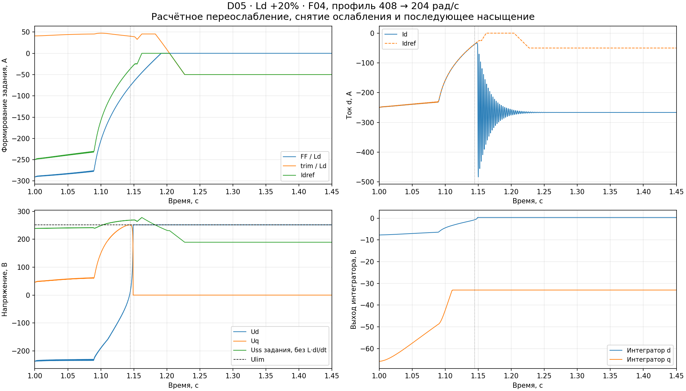

Рисунок 17. Профиль 408 → 204, Ld +20%. Пунктирная вертикаль — начало длительной
ошибки q. Напряжение Uss рассчитано для заданной пары по истинным постоянным
параметрам без L·dI/dt; Ud/Uq — ограниченные команды.

| Момент | Что видно в логе |
|---|---|
| 1,05 с | FF/Ld ≈−282,05 А, trim/Ld ≈+44,10 А, Idref ≈−239,64 А. Положительная подстройка снимает излишнее расчётное ослабление |
| 1,14 с | FF/Ld уже ≈−85,31 А, trim/Ld ещё ≈+40,97 А; Idref ≈−45,30 А. Заданная пара требует Uss ≈267,08 В при Ulim = 251,49 В |
| 1,40 с | Idref = −50 А, измеренный Id ≈−266,51 А; Iqref = −42 А, Iq ≈−374,18 А. Uss задания ≈189,25 В, но Ud = +251,49 В, Uq ≈0,0316 В |

Формирование задания содержит задержку на полтакта, поэтому мгновенная сумма
FF/Ld и trim/Ld в таблице не обязана точно совпадать с уже задержанным Idref.

Следовательно, последовательность включает **оба направления ошибки**:
расчётная ветвь сначала переослабляет поле и требует положительной подстройки;
затем при изменении скорости/запроса q FF быстро снимает ослабление, пока
положительная подстройка ещё сохраняется. В 1,14 с задание уже недостаточно
ослаблено даже для стационарного удержания, независимо от динамического запаса.
После потери слежения система остаётся в состоянии с почти отсутствующим Uq.

В 1,40 с необрезанный Ud ≈659,13 В, а вклад интегратора d всего **+0,325 В**.
Значит, длительное насыщение d в этой точке не вызвано большим накопленным
интегральным вкладом. Пропорциональная реакция на ошибку Id и развязка вместе
с последовательным выделением напряжения удерживают d на пределе. Одного
сброса интегратора или изменения его усиления недостаточно для объяснения
устранения этого состояния; опыт со сбросом не выполнялся.

### Направление дальнейших изменений

Критерий устойчивости — сохранение ограниченного управляемого режима и возврат
слежения после возмущения в достижимой области. При недостатке напряжения или
тока допускается уменьшение момента; сохранение прежнего момента при любых
параметрах физически не гарантируется.

Предлагается проверять по отдельным этапам:

1. Согласованное ограничение вектора Ud/Uq и anti-windup обоих PI по фактически
   выделенному напряжению. Радиальная проекция — кандидат для сравнения;
   сама по себе она ещё не является доказанным решением и требует проверки
   вместе с развязкой, заданиями и восстановлением.
2. Единое формирование окончательной пары Id/Iq с ограничением темпа перехода
   и обратной связью по окончательным ограничениям. Быстрое изменение FF не
   должно бесконтрольно складываться с сохранившимся trim; при дефиците
   напряжения нужно согласованно ограничивать запрос q.
3. Пересмотр нормировки sens около нулевой/меняющей знак чувствительности.
   Нижний предел ±0,1 защищает деление, но не делает обращение чувствительности
   корректным в насыщении. Дальнейшее ослабление не должно быть единственной
   реакцией на всякий дефицит напряжения.

Уточнение или медленная адаптация Ld могут уменьшить ошибку FF и загрузку PI,
но не заменяют эти требования. Для нелинейной машины полезно различать
потокосцепление λd(Id,Iq), используемое в ЭДС/развязке, и дифференциальную
индуктивность ∂λd/∂Id в локальной динамике. Одна скалярная оценка не обязана
одновременно точно описывать обе зависимости. Представление развязки через
карты потокосцеплений также описано в указанной документации MathWorks;
наличие карт в этом проекте не предполагается.

Эти пункты — предложения, ещё не выполненные изменения. Статус частичного
решения F04 и открытые результаты Ld +20% остаются прежними.

### Проверка и воспроизведение анализа

В [численных срезах](data/control_fixes/d05_20261112/diagnosis.json) сохранены
оба профиля, значения до и после срыва и SHA-256 исходных MAT/моделей.
Скрипт проверяет контрольные суммы MAT, полные сетки, постоянство выбранных
Psi/Lq, завершение прогонов и совпадение максимумов с MATLAB-сводками.

```bash
python3 tools/fw_limiter/diagnose_f04_ld.py tmp/control_fix_f04_20261112 tmp/f04_ld_analysis_20261112
```

Ассистент модель не изменял. Численные срезы и осциллограмма сохранены в docs;
промежуточные материалы — в `tmp/f04_ld_analysis_20261112/`.
При завершающей сверке рабочий SLX уже отличался от снимка F04
(SHA-256 `e608fc78542cd6a20a4a629d6977bcfabb77d0c416d7e54efedf7ea245869743`;
в том числе изменились рабочая область и настройки переключателей Psi/Lq).
Анализ D05 относится строго к архивным прогонам F04 с постоянными Psi/Lq;
новая сохранённая конфигурация здесь не проверялась.

## D06. Подстройка на пределах, переключения freeze и проект новой структуры

### Запрос и сохранённые условия

Пользователь добавил подстройку в ScopeDemag2, отметил её движение между
пределами и частые переключения freeze. Общий план исправлений принят с
уточнением: пересмотреть всю структуру FF, а не ограничиться настройкой PI.

Зафиксирован [новый пользовательский снимок](data/control_fixes/d06_20261112/user_source.slx),
SHA-256 `b4a938647d12a4e7695ca3e9cee42bd70964739419f6c0c66a922da2bdf6a824`.
В сохранённой рабочей области `deltaLd = 0.2`, остальные ошибки параметров
нулевые. Выбраны постоянные Psi/Lq, Gain15 = 0,95, VectorBase/Gain1 = 1.
Подключение ScopeDemag2 и параметры сохранены в
[манифесте](data/control_fixes/d06_20261112/source_manifest.json).

| Вход ScopeDemag2 | Фактический сигнал |
|---:|---|
| 1 | `Psi_candidate ≥ 0`, сумма FF + trim перед окончательным ограничением |
| 2 | `dPsi > 0`, знак нормированной ошибки потока |
| 3 | `Psi_candidate`, сумма FF + trim, Вб |
| 4 | Вход наружного I-регулятора после умножения на разрешение, Вб |
| 5 | Выход подстройки Psi_trim, Вб; деление на Ld даёт эквивалент в амперах |
| 6 | freeze, где 1 означает разрешение интегрирования |
| 7 | reset, отдельный сигнал сброса |

### Проверка на копиях

Выполнены четыре полных прогона по 25 с: оба прежних профиля, номинал и Ld +20%.
К управляющим связям не вносились изменения. В копиях дополнительно записаны
причины блокировки, сумма FF/trim, фактический вход I-регулятора и базовая скорость.
Итого 57 записанных сигналов и две вычисленные команды.

Максимумы тока повторили F04: 421,188 / 649,269 А на 408 → 204 и
421,204 / 2047,470 А на профиле до 738 для номинала / Ld +20% соответственно.
Max Iref ≤420 А; все сигналы конечны, полные сетки и конечные duty проверены.
Диагностика не является новым исправлением срывов.

| Профиль | Параметры | trim/Ld, минимум…максимум, А | Переходы от одного предела trim к другому | Фронты freeze / reset за 25 с |
|---|---|---:|---:|---:|
| 408 → 204 | Номинал | −9,869…+1,306 | 0 | 49 / 2 |
| 408 → 204 | Ld +20% | **−50…+50** | **47** | **10369 / 2** |
| До 738 со снижением | Номинал | −24,211…+1,678 | 0 | 6 / 4 |
| До 738 со снижением | Ld +20% | **−50…+50** | **10** | **432 / 18** |

Переход между пределами считается при последовательном достижении разных
границ с допуском 0,01 А; промежуточные отсчёты не считаются отдельными переходами.
На 408 → 204 при Ld +20% около 82,7% отсчётов trim находится вблизи одного из
пределов. В номинале движение от −50 до +50 А не воспроизводится.

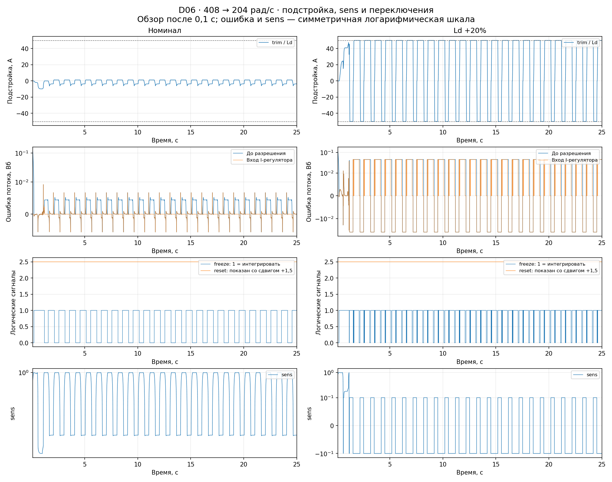

Рисунок 18. Номинал и Ld +20%. Обзор показан после 0,1 с, на сетке токового
регулятора 12 кГц. Для ошибки и sens использована симметричная логарифмическая
шкала; стартовые значения не определяют масштаб всего графика. Табличные
минимумы/максимумы и общий счёт фронтов относятся к полным 25 с.

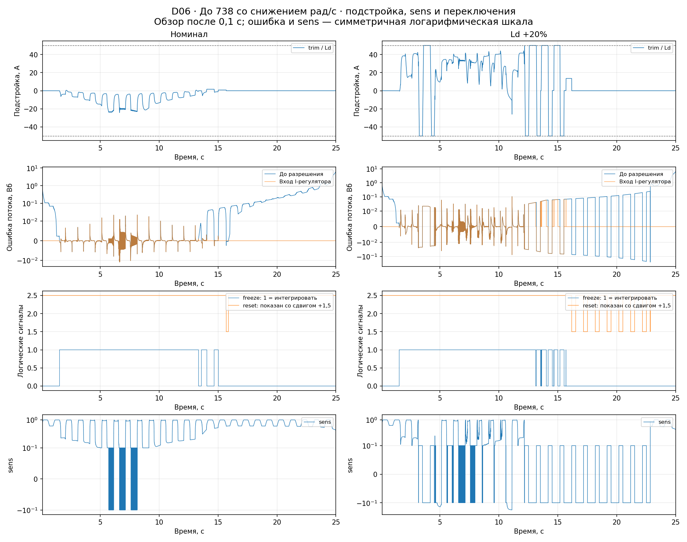

Рисунок 19. Подстройка и логические сигналы на втором профиле. Медленные переходы
trim между пределами и быстрые переключения разрешения — разные наблюдения.

### Что именно переключается

Обозначим z = Psi_d_ff + Psi_trim. По схеме и записанным сигналам:

$$
H_{\mathrm{upper}}=(z\ge0)\land(d\Psi>0),\qquad
H_{\mathrm{lower}}=(z\le-1{,}2\hat\Psi)\land(d\Psi<0),
$$

$$
H_{\mathrm{base}}=(|\widetilde\omega_e|\le\omega_{\mathrm{base}})\land(d\Psi<0),
\quad freeze=\neg(H_{\mathrm{upper}}\lor H_{\mathrm{lower}}\lor H_{\mathrm{base}}),
\quad reset=\neg H_{\mathrm{base}}.
$$

Наружный I-регулятор сбрасывается по обоим фронтам reset. Однако **частое
переключение freeze в данных D06 вызвано верхним условием Hupper, а не частым
reset**. На 408 → 204 при Ld +20% верхнее условие меняется 10371 раз,
базовое — два раза, нижнее не меняется и остаётся ложным.

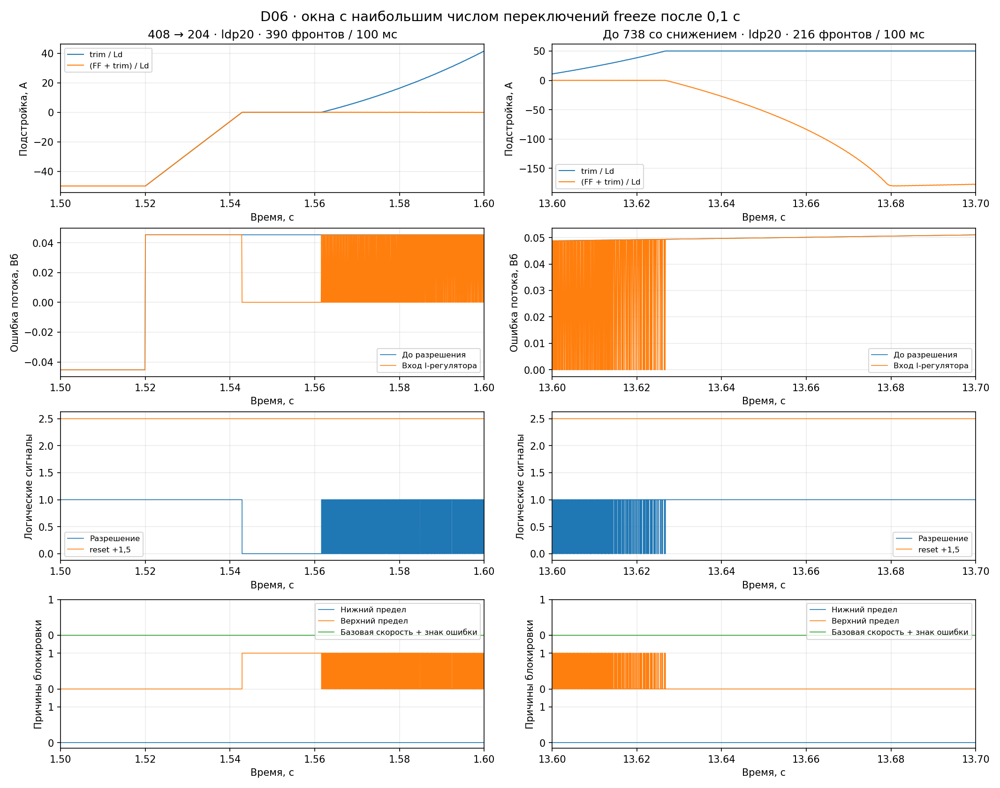

Рисунок 20. В 1,50–1,60 с на 408 → 204 зарегистрировано 390 фронтов freeze;
в 13,60–13,70 с на профиле до 738 — 216. В обоих увеличенных окнах reset
постоянен. Сумма FF + trim проходит вдоль верхней границы, а разрешение
переключается при её пересечениях.

Эти числа получены на собственных временных сетках логических сигналов,
включая события решателя; учитываются оба направления фронта. Это **не частота
синусоидальных колебаний и не частота вызова регулятора**. На сетке 12 кГц
за весь прогон видны 10177/424 фронта freeze вместо 10369/432 на исходных сетках.
Следовательно, высокочастотную логику нельзя оценивать только по данным,
перенесённым на сетку токового регулятора.

Проверены тождества freeze/reset на исходных сетках и произведение
`fw_input_gated = freeze*dPsi` на сетке токового регулятора. Появление частого
freeze не доказывает, что именно он инициировал срыв: например, окно 1,50–1,60 с
идёт уже после начала длительной ошибки q в 1,14467 с. По этим данным нельзя
приписать весь срыв одному логическому сигналу.

### Решение по направлению работы

Подготовлен [проект перестройки формирователя ОП](field_weakening_redesign.md).
Первый кандидат F05-A ведёт полное Id в амперах одним состоянием, без старой
расчётной ветви FF, отдельного trim ±50 А и деления на sens. Окончательные
ограничения пары и темпа возвращаются в состояние; нормальные изменения
режима не вызывают сброс по знаку ошибки.

Это контрольная ветвь для проверки динамики, не утверждение, что FF никогда
не нужен. Если упреждение потребуется, предлагается отдельный статический
расчёт достижимой пары с последующим ограниченным переходом, вместо нынешней
связки возвращённых заданий, FF, независимо ограниченной подстройки и логики
сброса. Общий ограничитель Ud/Uq и согласованный anti-windup остаются частью плана.

**F05-A ещё не реализован и не запускался.** Нет оснований обещать устойчивость
за минимумом напряжения по Id или при недостижимом запросе только за счёт
удаления FF/freeze. В проекте отдельно выделены ограничение момента, границы
применимости, переход через Iq = 0 и подбор динамики.

### Доказательства и воспроизведение

- [Числа, интервалы срыва и счёт переключений](data/control_fixes/d06_20261112/diagnosis.json).
- 408 → 204: [сводка](data/control_fixes/d06_20261112/hold204/summary.json),
  [проверка](data/control_fixes/d06_20261112/hold204/verification.txt),
  [модель](data/control_fixes/d06_20261112/hold204/baseline_source.slx).
- До 738: [сводка](data/control_fixes/d06_20261112/sweep738/summary.json),
  [проверка](data/control_fixes/d06_20261112/sweep738/verification.txt),
  [модель](data/control_fixes/d06_20261112/sweep738/baseline_source.slx).

Принятая матрица находится в `tmp/control_d06_20261112/full/`. Первые номинальные
запуски завершили симуляцию, но проверка полноты логирования обнаружила два
имени на одном выходе Divide. После устранения дублирования вся матрица выполнена
повторно; первые файлы сохранены отдельно и не используются как принятая проверка.

```matlab
addpath tools/fw_limiter
source = 'docs/data/control_fixes/d06_20261112/user_source.slx';
run_control_check('tmp/d06_repeat/hold204', 'hold204', source)
run_control_check('tmp/d06_repeat/sweep738', 'saved', source)
```

```bash
python3 tools/fw_limiter/d06_figures.py tmp/d06_repeat tmp/d06_repeat/figures
```

Регрессионные проверки метрик, SHA-256 входных MAT/моделей и сравнение максимумов
пройдены. Осциллограммы просмотрены. Ассистент рабочую модель не изменял.
Полные MAT сохраняются для продолжения; кэши и материалы первых не принятых
запусков можно удалить после подтверждения. Удаление не выполнялось.

<a id="f05-w"></a>

## F05-W. `_woFreeze`: FF с отключённым входом подстройки

### Проблема и фактическое изменение

После D06 пользователь запретил freeze, расширил диапазон подстройки и отметил
визуальное улучшение. Требовалось проверить сохранённую модель, сохранить
осциллограммы и уточнить дальнейший план по результату. Ассистенту разрешено
менять только сценарий на копии, без изменения логики управления.

Зафиксирован [снимок `_woFreeze`](data/control_fixes/f05w_20261112/user_source.slx),
SHA-256 `32216a42fe10e43f93c93998c82db437619960b00a7e56ed42f610efb5b9835b`.
Сравнение с D06 показало два изменения, влияющих на управление:

1. Выход вычисленного NOT отключён от `Goto9` с тегом `freeze`; вместо него
   подключён `Constant16 = 0`.
2. Пределы наружного I-регулятора изменены с ±50·Ld на ±500·Ld, то есть
   с ±50 до ±500 А в пересчёте на принятую Ld. Коэффициент I = 15, начальное
   состояние 0 и внешний reset по обоим фронтам (`either`) сохранены.

Рабочая область, настройки решателя, код Stateflow и параметры VectorBase
совпадают с D06; [манифест сравнения](data/control_fixes/f05w_20261112/source_manifest.json).
Выбраны постоянные Psi/Lq, Gain15 = 0,95 и VectorBase/Gain1 = 1.

**Здесь `freeze = 1` разрешает интегрирование.** Тег поступает на первый вход
`Product1`, где умножается на `dPsi`. Поэтому сохранённый 0 выключает коррекцию.
Во всех пяти прогонах точно равны нулю фактическое разрешение, вход I-регулятора,
его состояние и Psi_trim. Сумма перед окончательным ограничением равна одному FF.
Расширенные пределы не достигались и не объясняют улучшение.

Этот результат проверяет **FF без активной подстройки**. Работа FF с непрерывной
подстройкой и пределами ±500 А ещё не проверена. Старая вычисляющая логика freeze
и внешний reset остаются в модели; вычисленный freeze может переключаться,
хотя больше не управляет входом интегратора.

### Условия и полнота проверки

Выполнены пять полных прогонов по 25 с без прореживания:

- прежние четыре сочетания: hold204 и sweep738, каждый в номинале и при Ld +20%;
- дополнительный sweep738 при **Ld −20%**. Этот знак выбран для проверки
  уменьшения индуктивности машины относительно значения, принятого управлением.
  Реальная зависимость от насыщения неизвестна; постоянное отклонение −20%
  является испытательным сценарием, а не установленной картой машины.

Здесь `Ld_machine = (1 + deltaLd)·Ld_controller`, Ld_controller = 310 мкГн:
истинная Ld равна 372 мкГн при +20% и 248 мкГн при −20%. Остальные ошибки
параметров нулевые. Не менялись q-запрос, VDC = 440 В, Is_max = 420 А,
частота токового регулятора 12 кГц и коэффициенты модуляции. Профиль hold204
использует существующую Table4; sweep738 — сохранённую Table2, со снижением
скорости после 7 с. Отдельной длительной выдержки на 738 рад/с здесь нет.

Проверены завершение, конечность, исходные сетки токов/заданий, SHA-256
моделей и MAT, фактические ошибки параметров в тестовых SLX, выбранные Psi/Lq,
тождество команд напряжения после ограничения и конечные duty. В каждом
прогоне 58 записанных сигналов и две вычисленные команды. Токи и совместное
задание имеют 300001 отсчёт за 0…25 с.

`freeze_used` добавлен отдельным наблюдателем фактического входа Product1;
историческое имя `freeze` оставлено у вычисленного NOT для сравнения.
Постоянный `freeze_used = 0` записан Simulink одним отсчётом при t = 0.
Это проверено вместе с источником в SLX и полными записями входа, состояния
и выхода интегратора; один отсчёт константы не считается обрезанным расчётом.

### Эффект на прежней матрице

| Профиль | Параметры | Max I в D06, А | Max I в F05-W, А | Длительная ошибка d/q >100 А в F05-W |
|---|---|---:|---:|---|
| 408 → 204 | Номинал | 421,188 | 421,188 | Нет |
| 408 → 204 | Ld +20% | 649,269 | 421,188 | Нет |
| До 738 со снижением | Номинал | 421,204 | 429,245 | Нет |
| До 738 со снижением | Ld +20% | 2047,470 | 421,841 | Нет |

Все четыре максимума меньше принятого диагностического порога 441 А.
Во всех пяти сценариях max Iref ≤420 А, duty в пределах 0,005…0,995.
Здесь ток — модуль амплитудно-инвариантного вектора d/q, не действующее
значение фазного тока. «Нет длительной ошибки» означает отсутствие непрерывного
превышения 100 А дольше 20 мс, а не точное слежение или отсутствие насыщения.

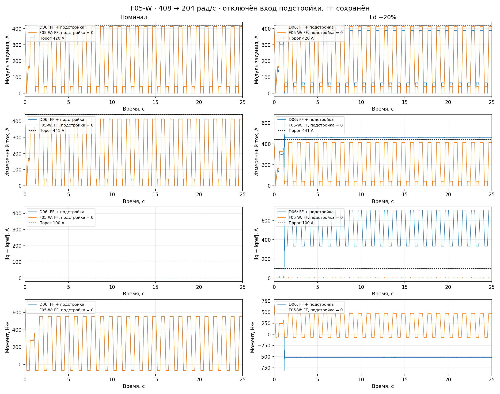

Рисунок 21. При Ld +20% устранён прежний срыв после снижения скорости;
в номинале результат практически повторяет D06.

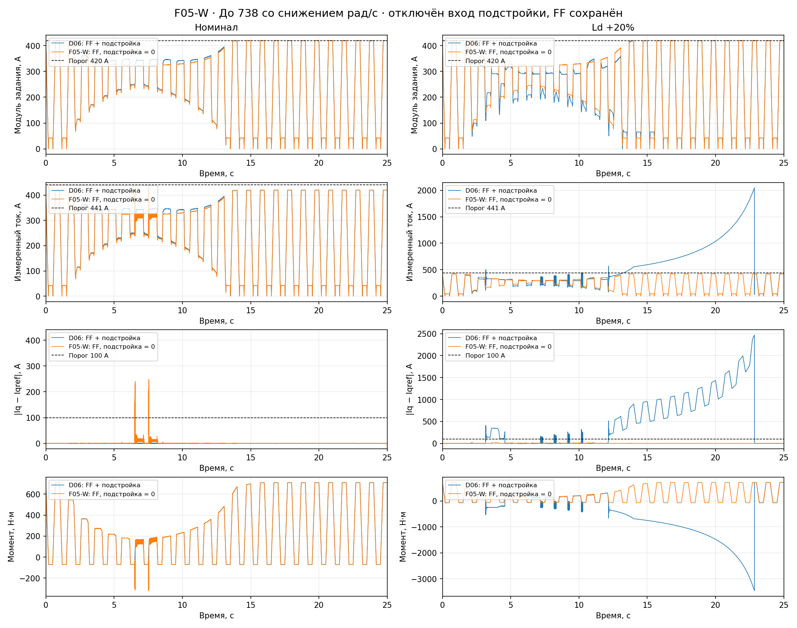

Рисунок 22. При Ld +20% исчез большой рост тока на снижении скорости.
В номинале видны короткие ошибки и тормозные выбросы на высокоскоростных
переходах; на полном временном масштабе их длительность неразличима.

### Ограничения улучшения: полка и переходы

Показатели в одном и том же окне **6,80…6,98 с**, скорость 738 рад/с:

| Показатель | Номинал D06 | Номинал F05-W | Ld +20% D06 | Ld +20% F05-W |
|---|---:|---:|---:|---:|
| Размах Id, А | 1,137 | **21,232** | 0,814 | 0,470 |
| Размах Iq, А | 0,439 | **25,563** | 0,623 | 0,661 |
| Средний Iq, А | 92,445 | 87,696 | 92,486 | 95,538 |
| Среднее задание Iq, А | 92,446 | 92,465 | 92,484 | 92,465 |
| Средний момент, Н·м | 153,678 | 145,961 | 128,133 | 132,297 |
| Средний модуль команды напряжения, В | 244,674 | 251,466 | 243,641 | 251,494 |

В номинале FF выдаёт постоянную пару примерно (−309,46; 92,47) А.
Её стационарная потребность по истинным параметрам равна **241,33 В** при
доступных 251,49 В. Несмотря на статическую достижимость, фактические токи
колеблются, модуль команды почти достигает предела, средний момент снижается
примерно на 5% относительно D06. Значит, этот дефект нельзя объяснить только
недостижимой конечной парой или погрешностью Ld.

В номинале также возникают пачки коротких превышений ошибки q >100 А около
6,51…6,55 и 7,52…7,55 с. Максимум ошибки после первых 50 мс — **248,35 А**;
минимум Iq = **−192,20 А** при Iqref = **+32,69 А** в 7,53233 с.
Наиболее длинный непрерывный эпизод >100 А в этих пачках — 3,33 мс.
Критерий 20 мс их пропускает, хотя переход по моменту неудовлетворителен.

При Ld +20% малый размах токов на полке не означает правильную отработку:
средний Id ≈−275,75 А при Idref ≈−309,46 А. Средняя ошибка около 33,71 А
удерживается при **Ud = −251,49 В, Uq ≈−0,032 В**. Стационарная потребность
заданной пары при истинной Ld — 256,06 В, то есть выше доступного предела.
Увеличение момента относительно D06 сопровождается ошибкой Iq и не считается
самостоятельным улучшением управления моментом.

По критерию `|Ud| ≥ Ulim − 1 мкВ` и `|Uq| < 0,1 В`, без склейки промежутков:

- hold204, Ld +20%: насыщение 0,59042…1,08975 с, длительность 0,49933 с;
- sweep738, Ld +20%: восемь участков дольше 20 мс; самый длинный
  6,55592…7,14800 с, длительность 0,59208 с;
- sweep738, номинал: самый длинный участок 0,667 мс, но повторные ограничения
  дают суммарно 0,59525 с за прогон.

Следовательно, прежнее аварийное поведение при положительной ошибке Ld
устранено в этих сценариях, но **насыщение d и потеря напряжения q остаются**.

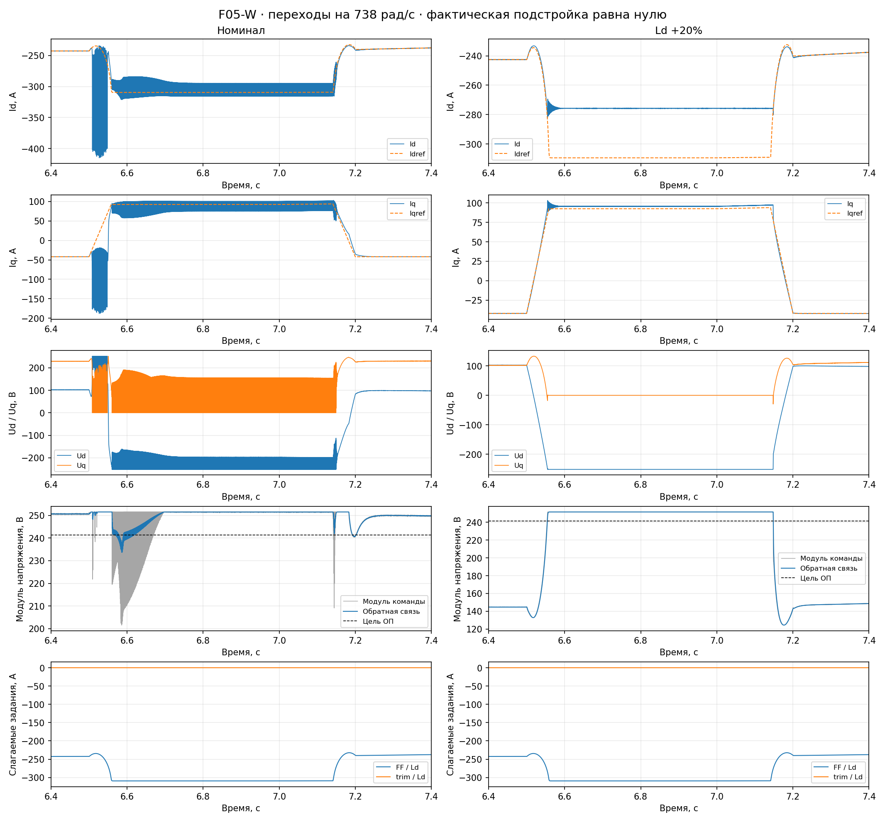

Рисунок 23. Слева — колебания в номинале, справа — постоянная ошибка Id
при Ld +20%. Нижний ряд подтверждает нулевую подстройку. Окно заканчивается
в 7,4 с; приведённый выше абсолютный минимум Iq при 7,53233 с находится за ним.

### Дополнительный сценарий Ld −20%

На той же сохранённой логике и профиле sweep738 изменён только `deltaLd`
машины с +0,2 на −0,2. Максимальный измеренный ток — **2048,288 А**.
Напряжение d непрерывно удерживается на положительном пределе с Uq ≈0
от **2,17992 до 22,84667 с**, длительность **20,66675 с**.

Шесть отдельных превышений порога ошибки q не являются шестью независимыми
срывами с восстановлением: задание q меняется, а насыщение d сохраняется
непрерывно. Возврат слежения к концу прогона происходит уже при сниженной
заданной скорости; он не подтверждает восстановление на прежней скорости.

Для меньшей истинной Ld заданное отрицательное Id даёт меньшее ослабление
потока. Например, в 6,8 с стационарная потребность заданной пары составляет
**315,33 В** при доступных 251,49 В. Подстройка отключена и не компенсирует
ошибку расчётной ветви. При этом удержание срыва не сводится к статической
недостижимости: в 20 с пара задания (0; 419,95) А требует только **140,71 В**,
но измерено (−312,81; −1023,72) А, Ud = +251,49 В и Uq ≈+0,032 В.

Стационарная оценка использует истинные постоянные параметры:

$$
U_{ss,ref}=\sqrt{(R_sI_{d,ref}-\omega_eL_qI_{q,ref})^2+
[R_sI_{q,ref}+\omega_e(\Psi+L_dI_{d,ref})]^2}.
$$

Она не учитывает L·dI/dt и показывает только достижимость конечной точки,
а не устойчивость перехода или способность выйти из насыщения.

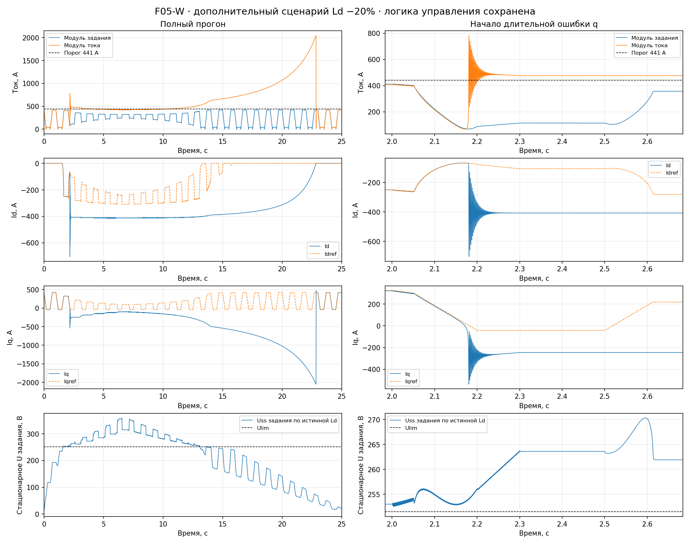

Рисунок 24. Полный прогон и начало срыва. Это дополнительная проверка границы
работоспособности: соответствующего прогона D06 с Ld −20% нет, поэтому
ухудшение относительно D06 для этого знака ошибки не утверждается.

### Решение и следующий шаг

**Принят диагностический результат F05-W, а не завершённое исправление ОП.**
Отключение существующей подстройки устранило прежние большие выбросы при
Ld +20%, но ухудшило номинальную высокоскоростную полку. Отрицательная ошибка
Ld вновь вызвала длительный срыв. Нельзя сделать вывод ни о достаточности
одного FF, ни о пользе расширения trim, которое фактически не участвовало.

[План перестройки](field_weakening_redesign.md) уточнён:

1. Сохранить D06 и F05-W как разные контрольные варианты. Для отдельного опыта
   с действительно непрерывным интегрированием разрешающий вход должен быть 1;
   одно это изменение оставит прежние sens и reset, поэтому ещё не реализует
   новую структуру.
2. Согласовать ограничение Ud/Uq, восстановление слежения и коррекцию конечной
   пары Id/Iq. Сохранить FF в первой ветви сравнения; состояние коррекции
   должно учитывать движение FF и окончательные ограничения.
3. Оставить F05-A без FF отдельным последующим сравнением. Дополнить регрессию
   sweep738 при Ld −20% и оценкой коротких пачек ошибок, постоянной ошибки,
   размаха на полках и момента. Проверенные пять сценариев не заменяют полную
   матрицу ошибок параметров, Vdc и нагрузки.

### Артефакты и воспроизведение

- [Сводное сравнение, полки, срезы и интервалы](data/control_fixes/f05w_20261112/comparison.json).
- hold204: [сводка](data/control_fixes/f05w_20261112/hold204/summary.json),
  [проверка](data/control_fixes/f05w_20261112/hold204/verification.txt),
  [снимок сценария](data/control_fixes/f05w_20261112/hold204/baseline_source.slx).
- sweep738: [сводка](data/control_fixes/f05w_20261112/sweep738/summary.json),
  [проверка](data/control_fixes/f05w_20261112/sweep738/verification.txt),
  [снимок сценария](data/control_fixes/f05w_20261112/sweep738/baseline_source.slx).
- sweep738, Ld −20%: [сводка](data/control_fixes/f05w_20261112/sweep738_ldm20/summary.json),
  [лог запуска и проверки](data/control_fixes/f05w_20261112/sweep738_ldm20/verification.txt),
  [исходный снимок](data/control_fixes/f05w_20261112/sweep738_ldm20/baseline_source.slx).
  Ошибка −0,2 вводится только в диагностическую копию `aug_ldm20.slx`;
  `baseline_source.slx` сохраняет исходную рабочую область пользовательского файла.

```matlab
addpath tools/fw_limiter
source = 'docs/data/control_fixes/f05w_20261112/user_source.slx';
run_control_check('tmp/f05w_repeat/hold204', 'hold204', source)
run_control_check('tmp/f05w_repeat/sweep738', 'saved', source)
run_parameter_check('tmp/f05w_repeat/sweep738_ldm20', 'ldm20', ...
    struct('deltaLd', -.2, 'deltaLq', 0, 'deltaPsi', 0, 'deltaRs', 0), source)
```

```bash
python3 tools/fw_limiter/f05w_figures.py tmp/control_d06_20261112/full tmp/f05w_repeat tmp/f05w_repeat/figures
```

Пять запусков и проверки метрик завершены успешно; «успешно» относится к
полноте расчёта и проверке данных, а не к качеству управления во всех сценариях.
Осциллограммы просмотрены. Исходные пользовательские SLX и XLSX ассистент
не изменял. Проверка ограничена идеальными источниками напряжения и заданной
скоростью; механическая нагрузка, ключевой инвертор и динамическое DC-звено
в неё не входят.

Полные MAT, диагностические SLX и логи оставлены в
`tmp/control_fix_f05w_20261112/`; снимки исходников, сводки и рисунки перенесены
в постоянные каталоги выше. Полные данные нужны для дальнейшей диагностики.
Кэши сборки можно удалить после подтверждения пользователя; очистка не выполнялась.

<a id="f05-i"></a>

## F05-I. Постоянное разрешение и влияние коэффициента интегратора

### Запрос, источник и допустимые изменения

Пользователь установил разрешающий вход в 1, отметил ухудшение кривых и
разрешил ассистенту исследовать и подстраивать коэффициент `PID Controller`.
В этом опыте менялся **только I наружного регулятора**, а также сценарий
скорости/ошибка Ld на тестовых копиях. Структура управления, P/D, пределы,
reset, нормировка sens и параметры внутренних токовых PI не менялись.

[Исходный снимок](data/control_fixes/f05i_20261112/user_source.slx) зафиксирован
из автосохранения `_woFreeze`; на момент начала проверки обычный SLX ещё
содержал 0, затем был сохранён с 1. SHA-256 проверенного снимка:
`8654386d860ca2ce3d96e2477e428a27a94b7850b2d57cc9bc5dd7b0e1016fa0`.
Сравнение с F05-W вне Scope/оформления показывает единственное изменение
управления — `Constant16 = 1`. Рабочая область, Stateflow, конфигурация
решателя и связи совпадают; [манифест](data/control_fixes/f05i_20261112/source_manifest.json)
и [проверка MATLAB](data/control_fixes/f05i_20261112/source_inspection.txt).

`PID Controller` остаётся чистым I-регулятором: исходное выражение `0.3*50 = 15`,
Forward Euler, Ts = 1/12000 с. Предел выхода ±500·Ld = ±0,155 Вб соответствует
±500 А; reset — `either`, anti-windup — `clamping`, tracking и ограничение
самого внутреннего интегратора выключены. FF, выбранные постоянные Psi/Lq,
Gain15 = 0,95 и VectorBase/Gain1 = 1 сохранены.

### Матрица проверки

Выполнены **14 полных прогонов по 25 с без прореживания**:

- sweep738, Ld +20%: I = 1,5 / 15 / 45 / 150 / 450;
- для I = 15 и I = 150 — оба прежних профиля в номинале и при Ld +20%,
  плюс sweep738 при Ld −20%; два из этих случаев уже входят в первую строку;
- дополнительно sweep738 в номинале при I = 45.

Ld −20% на hold204 не проверялся. Ни одно значение, кроме 15 и 150, не
проверялось на всей указанной расширенной матрице. Это направленный перебор,
а не доказательство отсутствия любого возможного удачного коэффициента.

Во всех 14 расчётах проверены завершение 25 с, конечность, полные сетки токов
и совместного задания, SHA-256 MAT и запущенных моделей, фактический I и
ошибки параметров, сохранение reset/пределов и постоянство выбранных Psi/Lq.
Max Iref ≤420 А, duty остаются в 0,005…0,995. Записаны 58 сигналов и две
вычисленные команды; токи и задания имеют 300001 отсчёт. Константа разрешения
проверена по источнику и логу; на полной сетке выполнено `fw_input_gated = dPsi`.

### Влияние коэффициента на исходный сценарий Ld +20%

Все строки ниже относятся к одному профилю sweep738 и одинаковой машине.
Длительная ошибка — непрерывное |Iq − Iqref| >100 А дольше 20 мс.
Насыщение d определяется прежним критерием |Ud| ≥ Ulim −1 мкВ, |Uq| <0,1 В,
без склейки промежутков.

| I, с⁻¹ | Max I, А | Самая длинная ошибка q >100 А, с | Самое длинное насыщение d, с | Фронты reset за 25 с |
|---:|---:|---:|---:|---:|
| 1,5 | 1130,580 | 10,99683 | 18,43775 | 12 |
| 15, исходный | 712,276 | 0,55433 | 0,53375 | 24 |
| 45 | 687,998 | 0,39292 | 0,23500 | 34 |
| 150 | 442,503 | 0,08300 | 0,04083 | 42 |
| 450 | 442,478 | 0,02208 | 0,00900 | 82 |

Уменьшение коэффициента в десять раз ухудшает этот сценарий. Увеличение до
150 заметно ускоряет восстановление, однако превышение тока и ошибки слежения
остаются. Дальнейшее увеличение до 450 практически не уменьшает максимальный
ток; при этом возникают более крупные короткие ошибки q и колебания Id.
У 150 максимальная ошибка q после первых 50 мс составляет 233,24 А,
у 450 — 341,66 А. Уменьшение длины одного эпизода не является полной оценкой.

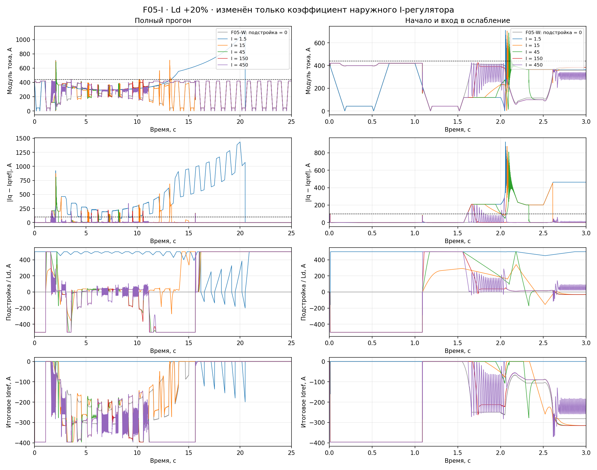

Рисунок 25. Сравнение коэффициентов на полном профиле и в начале прогона.
Серым показан F05-W с отключённой подстройкой. При разрешении 1 коэффициент
меняет движение состояния, но не исключает накопление за итоговым пределом Id.

### Проверка переноса настройки на остальные режимы

| Профиль | Параметры | Max I при I = 15, А | Max I при I = 150, А |
|---|---|---:|---:|
| 408 → 204 | Номинал | 759,264 | 759,269 |
| 408 → 204 | Ld +20% | 709,327 | 709,325 |
| До 738 со снижением | Номинал | 752,387 | 421,204 |
| До 738 со снижением | Ld +20% | 712,276 | 442,503 |
| До 738 со снижением | Ld −20% | 863,493 | 863,493 |

В номинале sweep738 увеличение до 150 убирает большой выброс тока, но
сохраняет два эпизода ошибки q: 1,61283…1,69950 с и 13,65458…13,70558 с.
Критерий тока здесь проходит, критерий длительной ошибки — нет.

На hold204 в номинале при I = 15 есть один длительный эпизод q в начале
разгона, 0,23125…0,40008 с. При I = 150, кроме начального, появляются
**24 повторных эпизода примерно по 82,25 мс**, по одному на период задания
после снижения скорости. Во всём этом прогоне reset имеет только два фронта;
повторные ошибки не вызваны периодическим сбросом интегратора.

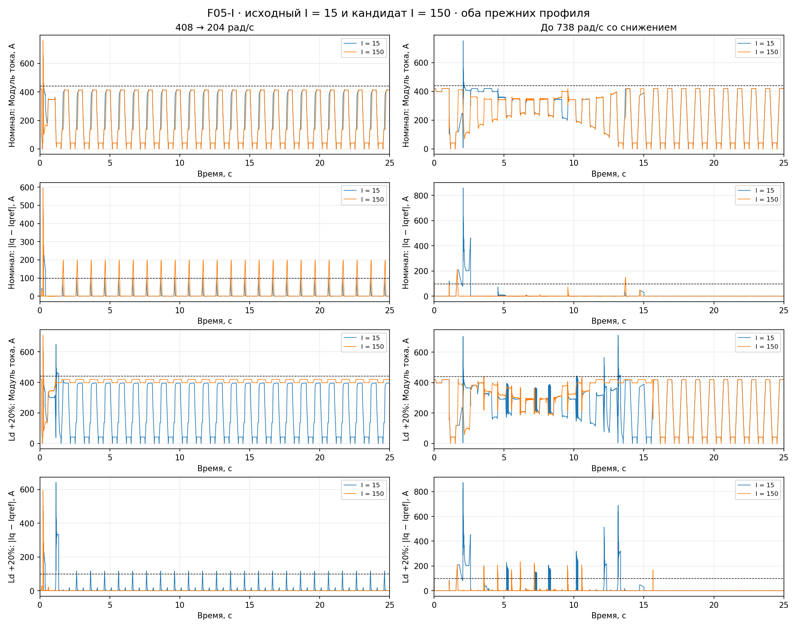

Рисунок 26. Верхние два ряда — номинал, нижние — Ld +20%. Слева видно,
что улучшение sweep738 не переносится автоматически на удержание 204 рад/с.

Установившаяся полка **6,80…6,98 с при 738 рад/с** также показывает цену
ускорения коррекции:

| Параметры | I | Размах Id, А | Размах Iq, А | Средний момент, Н·м |
|---|---:|---:|---:|---:|
| Номинал | 15 | 1,152 | 0,477 | 153,679 |
| Номинал | 150 | 10,859 | 1,330 | 153,682 |
| Ld +20% | 15 | 0,825 | 0,563 | 128,130 |
| Ld +20% | 150 | 7,769 | 3,090 | 128,107 |
| Ld +20% | 450 | 16,964 | 7,371 | 130,251 |

При I = 15 на этой полке слежение уже хорошее: пиковая ошибка Id составляет
0,138 А в номинале и 0,122 А при Ld +20%. Наличие плохого перехода не означает,
что установившийся контур требует десятикратного увеличения усиления.
Для I = 450 при Ld +20% пиковая ошибка Id достигает 71,81 А; изменение среднего
момента в этом случае не принимается за улучшение управления моментом.

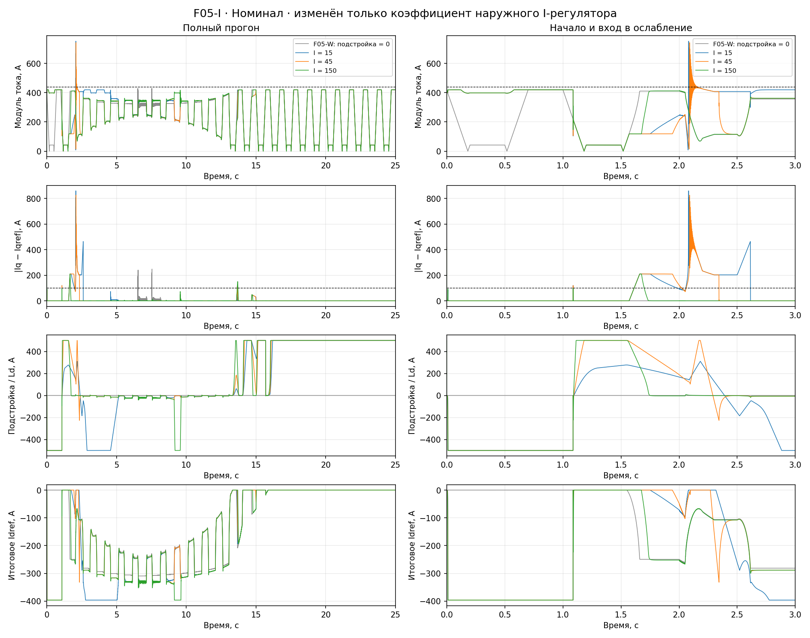

Рисунок 27. В номинале высокая скорость после завершения плохого входа может
выглядеть удовлетворительно. Поэтому сравнение включает и старт/вход, и полки,
и снижение скорости за полные 25 с.

### Подтверждённые механизмы ухудшения

**1. Большой первый шаг скрыт ограничителем выхода.** В начале sweep738
фактический вход интегратора равен 24133,24 Вб: нормировка использует нижний
предел скорости 0,1 рад/с и sens = 0,1. Для I = 15 непосредственно проверено:

$$
x_1=I T_s\,d\Psi_0
=15\frac{1}{12000}\,24133{,}24
=30{,}1666\ \text{Вб}.
$$

Это внутреннее состояние, **не поток машины и не измеренный ток**.
Выход Psi_trim уже ограничен 0,155 Вб, а внутреннее состояние превышает этот
предел примерно в 194,6 раза. Clamping собственного выхода не проецирует
состояние назад в допустимую область после такого шага. При I = 150 первый
шаг равен 301,67 Вб. Сброс в 0,833 мс обнуляет первоначальный выброс, но
не решает дальнейшую работу вне области ОП.

**2. Разрешение 1 открывает интегрирование и при достаточном напряжении.**
В sweep738 при I = 15, Ld +20% к 12 мс подстройка достигает нижнего предела.
В 0,20 с скорость всего 68,99 рад/с, FF = 0, trim/Ld = −500 А,
а окончательное Idref = −396,39 А. Reset в это время равен 0, но режим
`either` означает сброс по фронту, а не удержание нулевого состояния при уровне 0.
Начальный знак sens и dPsi заставляет регулятор вводить глубокое ослабление
до того, как оно нужно по напряжению.

После следующего reset в 1,0875 с состояние опять начинает накапливаться.
В 1,40 с FF = 0 и Idref = 0, но trim/Ld уже **+275,94 А**. Напряжение
236,01 В ниже цели 241,33 В, и интегратор продолжает положительное движение
за окончательным верхним пределом Id. Собственный предел +500 А ещё не достигнут,
поэтому clamping внутри PID этого накопления не останавливает. При следующем
набросе q положительное состояние отменяет требуемый отрицательный FF.

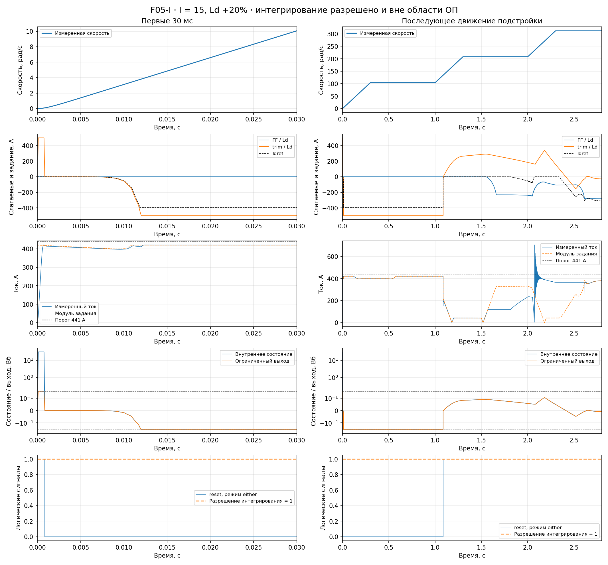

Рисунок 28. Слева первые 30 мс, справа первые 2,8 с. Для внутреннего состояния
использована симметричная логарифмическая шкала, чтобы различить первый выброс
и обычный диапазон выхода. Ограниченный Psi_trim не показывает всего состояния.

**3. При потере слежения знак sens может поддерживать неверное направление.**
В sweep738, Ld −20%, I = 150, при t = 6,8 с:

| Сигнал | Значение |
|---|---:|
| Скорость | 738 рад/с |
| Обратная связь напряжения / цель | 251,494 / 241,332 В |
| sens | −0,1 |
| dPsi = фактический вход интегратора | +0,012517 Вб |
| FF/Ld / trim/Ld | −300,89 / +500 А |
| Итоговое Idref / Iqref | 0 / +92,52 А |
| Измеренное Id / Iq | −412,60 / −101,04 А |

При превышенном напряжении положительная поправка продолжает отменять
отрицательный FF. Увеличение положительного I меняет скорость движения,
но в этом состоянии сохраняет его знак. Нормировка по ограниченному напряжению
и заданному q здесь не является достоверной производной для восстановления
потерянного режима. Простое удаление sens также не объявляется готовым решением:
физическая смена знака чувствительности и допустимая ветвь ОП остаются важны.

Насыщение d при Ld −20% непрерывно длится 12,42867 с для I = 15 и
12,15692 с для I = 150. Шесть пороговых эпизодов q в каждом случае не означают
шесть выходов из насыщения; непрерывность ограничения d проверяется отдельно.

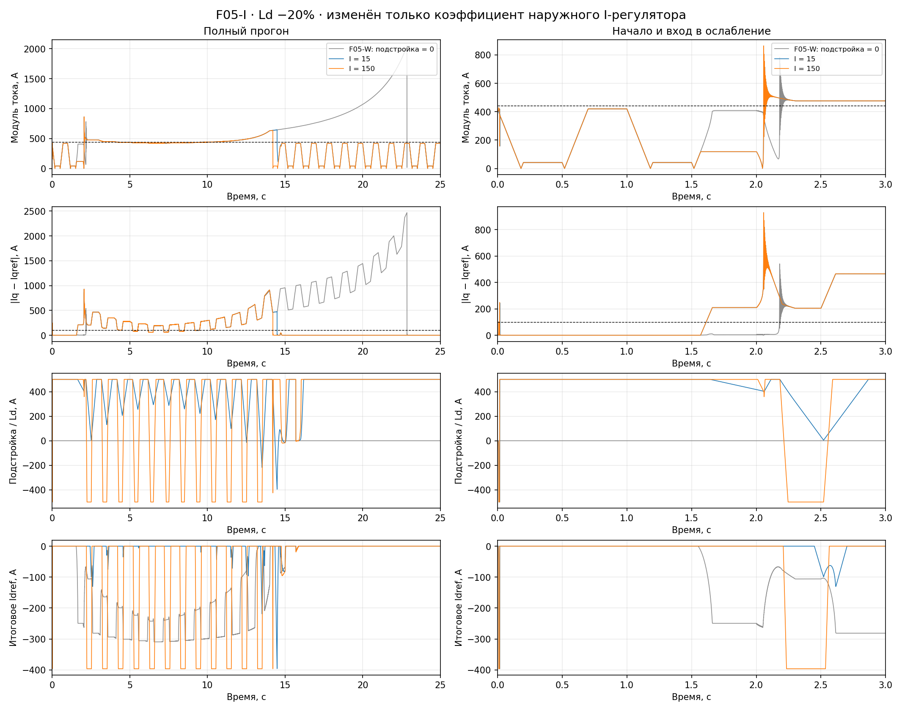

Рисунок 29. Увеличение I с 15 до 150 почти не изменяет тяжёлый режим при
Ld −20%; относительно F05-W меняется длительность срыва, но слежение не сохраняется.

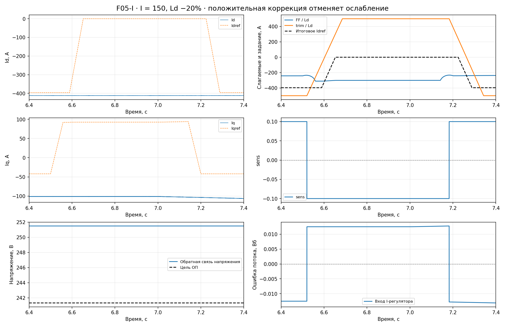

Рисунок 30. На высокоскоростной полке напряжение выше цели, вход коррекции
положителен, итоговое Idref равно нулю. Разрешение постоянно равно 1; проблема
на этом участке сохраняется без переключений freeze.

### Решение по настройке и следующей коррекции

**Новый рабочий коэффициент не принят.** I = 150 сохранён как диагностический
кандидат: он уменьшает часть выбросов, но ухудшает колебания, создаёт повторные
ошибки на другом профиле и не устраняет срыв при Ld −20%. I = 450 также не
прошёл исходный сценарий и не даёт основания переносить его в рабочую модель.

Гипотеза пользователя о влиянии коэффициента подтверждена количественно.
Одновременно проверено, что существующие условия интегрирования и ограничения
создают режимы, для которых одного изменения скорости интегрирования недостаточно.
Следующая ручная коррекция должна прежде всего:

1. Определить допустимую работу интегратора вне ОП и при запуске. Нельзя
   подавать нормировку по малой скорости/недостоверному sens без согласованного
   состояния и проверки области работы.
2. Связать anti-windup с окончательным Idref, движением FF и ограничениями
   итоговой пары. Ограничение только trim ±500 А этого не делает.
3. Отдельно определить действия при насыщении и потере слежения: достоверность
   направления коррекции, уменьшение запроса q, распределение Ud/Uq и восстановление.

Далее коэффициент выбирается по динамике исправленной структуры. Возврат всей
старой логики freeze или удаление FF не объявляются автоматическим решением.
[План](field_weakening_redesign.md) и [бэклог](control_backlog.md) уточнены.
Рабочие SLX и XLSX ассистент не менял; все настройки находятся в тестовых копиях.

### Артефакты и воспроизведение

- [Сводные метрики 14 опытов, интервалы, срезы и полки](data/control_fixes/f05i_20261112/analysis.json).
- [Перечень случаев со ссылками на сводки, модели и логи](data/control_fixes/f05i_20261112/cases.md).
- [Итоговая проверка](data/control_fixes/f05i_20261112/final_verification.txt).

Пример двух настроек на одном сценарии:

```matlab
addpath tools/fw_limiter
source = 'docs/data/control_fixes/f05i_20261112/user_source.slx';
run_gain_check('tmp/f05i_repeat/sweep738_k15_ldp20', 'k15_ldp20', 15, .2, 'saved', source)
run_gain_check('tmp/f05i_repeat/sweep738_k150_ldp20', 'k150_ldp20', 150, .2, 'saved', source)
```

Полный перечень коэффициентов, ошибок и профилей находится в `cases.md`.
Каждый запуск получает новый каталог; `hold204` выбирает прежнюю Table4,
`saved` сохраняет Table2. `baseline_source.slx` содержит выбранные I/профиль;
ошибки параметров и наблюдатели добавляются в `aug_<tag>.slx`.

```bash
python3 tools/fw_limiter/f05i_analysis.py tmp/f05i_repeat tmp/f05i_repeat/analysis.json
python3 tools/fw_limiter/f05i_figures.py tmp/f05i_repeat tmp/control_fix_f05w_20261112 tmp/f05i_repeat/figures
```

Для воспроизведения всех рисунков нужны все перечисленные случаи, включая
оба профиля для I = 15/150 и sweep738 при Ld −20%. Скрипт анализа допускает
неполную матрицу и включает только завершённые проверенные случаи.

Полные MAT, диагностические SLX и кэши сохранены в `tmp/control_f05i_20261112/`.
Исходный снимок, сводки, проверенные варианты коэффициентов и рисунки перенесены
в постоянные каталоги. Данные нужны для продолжения диагностики; кэши можно
удалить после подтверждения пользователя. Очистка не выполнялась. Результат
относится к идеальному источнику напряжения и заданной скорости; ключевой
инвертор, механика и динамическое DC-звено здесь не проверялись.

<a id="f06-prepare"></a>

## F06: подготовка подстройки с ограниченным состоянием

**Статус: компонент подготовлен; внедрение пользователем и проверка полного
привода впереди.** Рабочие SLX не изменены. Это запись о подготовке коррекции,
не новый результат замкнутой системы.

**Проблема.** В F05-I собственное ограничение PID не удерживает внутреннее
состояние в окончательном диапазоне FF + trim. Деление на малую скорость и
знаковый sens даёт большой начальный шаг и неверное направление коррекции.

**Предлагаемое действие.** Вместо PID — MATLAB Function с одним состоянием:
текущая сумма FF + x проецируется на границы окончательного ограничителя Id,
после интегрирования снова ограничивается и сохраняется как поправка к FF.
Вход — `(U_FW − Vabs_f)/U_FW`, с численной защитой знаменателя и ограничением ±1.
Деления на скорость/sens и старых freeze/reset в активном пути нет. FF сохраняется.
Начальная оценка Kψ = 2,5 Вб/с ещё не настроена по замкнутому приводу.
Первоначальный вариант хранил состояние во внешнем Unit Delay. По предложению
пользователя состояние перенесено в `persistent x` с инициализацией через
`isempty`, без изменения закона обновления. Выход вычисляется по старому
состоянию, новое записывается в конце вызова. Прежний вариант сохранён как
эталон; для внедрения используется `fw_trim_persistent.m`.

Подготовлены [код и точные ручные подключения](field_weakening_f06.md).
Состояние пока оставлено в Вб для совместимости с существующей суммой и Gain1.
Пределы берутся с фактического окончательного Saturation Dynamic. Динамический
ограничитель пары Id/Iq, переход через физическую смену чувствительности и
восстановление после потери слежения этим компонентом не реализованы.

**Проверенный эффект на уровне компонента.** При FF = 0 и запасе напряжения
не накапливается положительное состояние. Скрытые положительные состояния
из F05-I удаляются проекцией. Полезная положительная поправка при отрицательном
FF сохраняется. Интегрирование от нижнего предела внутрь диапазона начинается
со следующего такта; отрицательная поправка при запасе напряжения возвращается
к нулю без сброса. Проверены 2000 комбинаций меняющихся FF, границ и ошибок.
Изолированная схема Simulink скомпилирована: все четыре выхода на 1201 отсчёте
совпали с расчётом функции при Ts = 1/12000 с.

[Протокол проверки](data/control_fixes/f06_prepare_20261112/verification.txt)
и [SHA-256/условия](data/control_fixes/f06_prepare_20261112/manifest.json)
сохранены постоянно. Схема компонента и MAT находятся в
`tmp/control_f06_prepare_20261112_r2/`; первый запуск тестовой обвязки — в
`tmp/control_f06_prepare_20261112/`. Он потребовал исправить режим удержания
From Workspace; сама функция подстройки после этого не менялась.
Очистка не выполнялась; первую обвязку и кэш успешной проверки можно удалить
после подтверждения, оставив исходники и постоянный протокол.

**Проверка варианта persistent.** 6000 отсчётов MATLAB и четыре изолированных
прогона Simulink по 1201 отсчёту, два с Fast Restart: максимальное расхождение
с вариантом Unit Delay равно нулю. Проверены обработка первого такта,
переинициализация при повторном прогоне и независимость состояния двух
экземпляров блока. Второй выход `x_state` наблюдает состояние до обновления;
это диагностический выход, внешняя обратная связь через него не нужна.
[Протокол](data/control_fixes/f06_persistent_20261112/verification.txt),
[версии и условия](data/control_fixes/f06_persistent_20261112/manifest.json).
Тестовая схема и MAT сохранены в `tmp/control_f06_persistent_20261112/`.
Кэш проверки можно удалить после подтверждения; он не нужен для воспроизведения.

**Параметр периода.** По предложению пользователя аргумент Ts переименован
в FocDiscrTime и в MATLAB Function объявлен как Parameter Data, Tunable = off.
Сигнальный порт периода исключён; шесть остальных входов сохранены.
Sample time блока также задаётся выражением FocDiscrTime. Проверки MATLAB
и четырёх изолированных прогонов Simulink повторены: разрешение параметра
из рабочей области модели и число портов проверены, расхождение с эталоном 0.
[Протокол](data/control_fixes/f06_parameter_20261112/verification.txt),
[версии и условия](data/control_fixes/f06_parameter_20261112/manifest.json).
Прежние исходники persistent сохранены рядом с его предыдущим протоколом.
Рабочий SLX ассистент не менял; пользовательская сохранённая `_woFreeze`
уже отличается от снимка предыдущего этапа и здесь не проверялась на приводе.
Тестовая схема, MAT и воспроизводимый кэш сохранены в
`tmp/control_f06_parameter_20261112/`; очистка не выполнялась.

На момент подготовки компонента эффект на токи, напряжения и колебания ещё
не измерялся. Ниже приведён первый полный прогон после ручного подключения.

<a id="f06-run"></a>

## F06: первый полный прогон — улучшение старта и поздний срыв

**Проверена сохранённая `ideal_source_drive_Idff_aug_param_F06.slx` от
12.11.2026 22:55:51.** SHA-256: `fab59b2abc248e1ad88b744d7712d777fc8500c4d010fa573c95722937822734`.
Снимок: [user_source.slx](data/control_fixes/f06_20261112/user_source.slx).
Сценарий — тот же профиль до 738 рад/с со снижением скорости, Ld машины +20%,
остальные ошибки параметров нулевые. Выполнен один полный 25-секундный прогон
без прореживания; 63 сигнала с учётом двух восстановленных напряжений.
Исходный рабочий SLX не менялся. Матрица двух профилей отложена до согласования такта.

### Проверка подключения и обнаруженное расхождение

- Код `fw_trim` совпадает с подготовленным `fw_trim_persistent` после исключения
  комментариев и пробелов. FF, ошибка напряжения, U_FW, обе границы и Kψ = 2,5
  подключены к нужным входам. Старый PID закомментирован.
- Выход trim включён в Sum6 и Psi_trim; окончательный Saturation Dynamic,
  Gain1 = 1/Ld и задержка Idreq = FocDiscrTime/2 сохранены.
- FocDiscrTime объявлен Parameter, его значение 1/12000 с. В пользовательской
  модели Tunable включён; в этом прогоне параметр не изменялся.
- **У MATLAB Function режим Update method = Inherited, Sample time = −1.
  У его атомной подсистемы SystemSampleTime = FocDiscrTime*10.**

По полным временным меткам состояния фактический период равен **833,333 мкс**,
а множитель в шаге интегрирования — **83,333 мкс**. Это также подтверждено
расписанием скомпилированной схемы. При одинаковой ошибке средняя скорость
накопления в десять раз меньше принятой: Kψ = 2,5 Вб/с в коде соответствует
примерно **0,25 Вб/с** по времени симуляции. Это рассогласование периода,
а не изменение значения Kψ пользователем.

На всех 30 001 тактах проверены четыре равенства: нормированная ошибка,
ограниченная сумма, trim и переход внутреннего состояния. Максимальный
остаток каждого равенства — **0**. Поэтому явного дефекта реализации формул
и пропущенного возврата ограничения в persistent в этой модели не найдено.

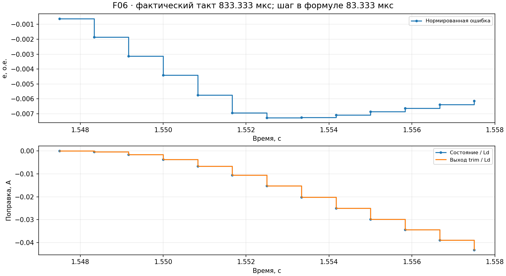

Рисунок 31. Отсчёты новой подстройки идут через 833,333 мкс. Приращение состояния
рассчитывается с множителем FocDiscrTime = 83,333 мкс.

### Что улучшилось и что не прошло проверку

Сравнение с F05-I, I = 15, на том же профиле и с теми же параметрами машины:

| Показатель | F05-I | F06, сохранённый такт 10·Ts |
|---|---:|---:|
| Максимальный ток на 0,05–3 с, А | 704,46 | 419,92 |
| Максимальная абсолютная ошибка q на 0,05–3 с, А | 874,43 | 7,93 |
| Максимальная абсолютная ошибка d на 0,05–3 с, А | 508,07 | 1,74 |
| Максимальный ток за 25 с, А | 712,28 | **956,40** |
| Максимальный модуль задания за 25 с, А | ≤420 | 420,00 |
| Наибольший непрерывный участок насыщения d с почти нулевым Uq, с | 0,534 | **7,310** |

Начальное накопление на десятки Вб исчезло: на первых 30 мс состояние F06
равно нулю, тогда как в F05-I достигало 30,17 Вб. На первых трёх секундах
улучшение слежения подтверждено. Максимальный модуль состояния F06 за весь
прогон — 0,06855 Вб; поздний срыв происходит при работающей проекции состояния.
Токи конечны, duty остаются в диапазоне 0,005…0,995; критерий измеренного тока
441 А и критерии слежения не выполнены.

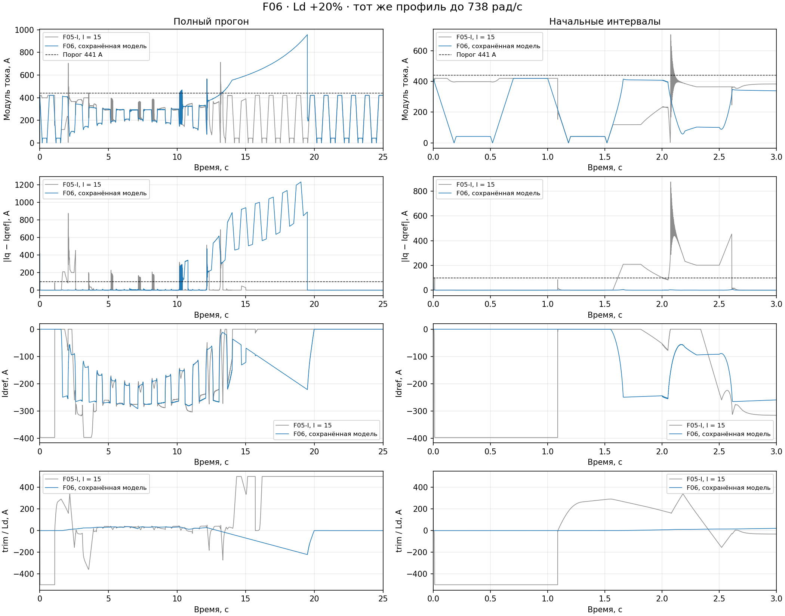

Рисунок 32. Первые интервалы улучшились, но после 10 с появилась более длительная
потеря слежения. Исчезновение стартового дефекта не означает принятия всего F06.

### Как развивается поздний срыв

1. Уже на полке 738 рад/с есть участок насыщения d примерно 6,706–7,145 с.
   В окне 6,8–6,98 с колебания малы (размах Id 0,69 А), но ошибка d достигает
   **10,08 А**: ровная кривая здесь не означает слежение. В 6,8 с Id = −275,75 А
   при Idref = −279,41 А; Ud = −251,49 В, для q остаётся около 0,032 В.
2. При снижении скорости и переходе запроса q через ноль около 10,2 с
   развиваются большие колебания. Первое превышение 441 А — **10,214 с**.
   После 10,373 с Ud удерживается на положительном пределе, Uq практически
   нулевое. Длительная ошибка q >100 А начинается с **10,400 с**.
3. В 12,18 с начинается непрерывное удержание Ud на пределе до **19,4899 с**.
   Насыщение длится **7,3099 с**; ошибка q >100 А держится 12,1853–19,4918 с.
   Пик тока **956,40 А** получен около 19,4899 с при скорости **81,90 рад/с**.

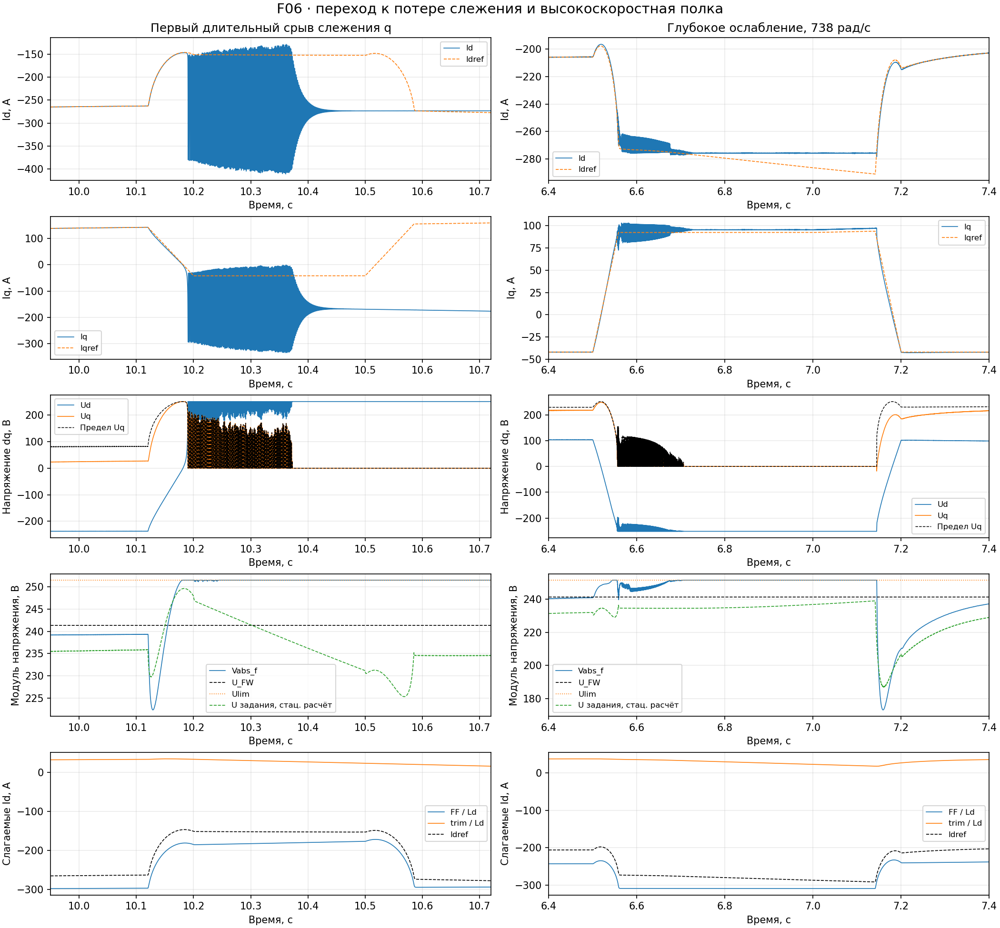

Рисунок 33. Слева — переход при снижении скорости; справа — высокоскоростная
полка. Зелёная кривая — стационарное напряжение для заданной пары по истинным
параметрам машины, без производных токов. Оно не является оценкой динамической
достижимости перехода.

На позднем участке удержание нельзя объяснить только недостижимостью конечной
пары. Например, в **16 с** задано Idref = −102,51 А, Iqref = +407,09 А;
стационарная потребность этой пары **204,07 В** ниже доступных 251,49 В.
Фактически Id = −253,07 А, Iq = **−592,07 А**, Ud = +251,49 В,
предел Uq = 0,0316 В. Канал q почти лишён напряжения для восстановления.

Для проверки этого режима решены стационарные уравнения машины при фактически
выделенных Ud/Uq и текущей навязанной скорости:

$$
U_d=R_s I_d-\omega_e L_q I_q,\qquad
U_q=R_s I_q+\omega_e(\Psi+L_d I_d).
$$

В частности, при Ud ≈ +Ulim получается
`Iq ≈ (Rs·Id − Ulim)/(ωe·Lq)`: при снижении положительной скорости модуль
отрицательного тока увеличивается. Решение двух уравнений на 14,2–19,4 с
совпадает с наблюдаемыми токами со среднеквадратичным отклонением **0,61 А по q**
и **0,22 А по d**. Это расчёт установившегося режима, без производных;
он объясняет форму позднего роста тока, но не заменяет анализ возникновения срыва.

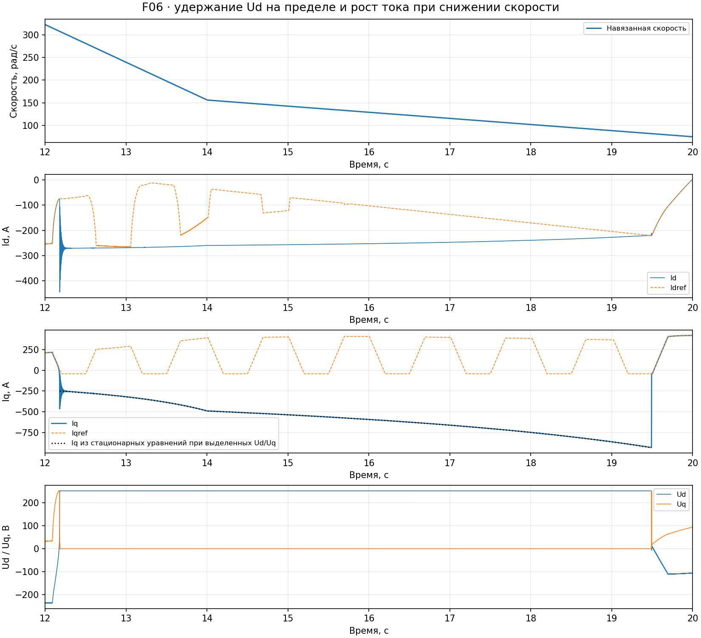

Рисунок 34. Во время длительного насыщения ток q близок к режиму, заданному
выделенными напряжениями, и существенно отличается от команды регулятора.
Возврат к слежению в конце прогона происходит при существенно меньшей скорости;
он не доказывает восстановление при прежних условиях.

### Следующая ручная правка и границы вывода

**Сначала согласовать период, Kψ пока оставить 2,5.** На отдельной тестовой
схеме воспроизведены три конфигурации:

| MATLAB Function | SystemSampleTime подсистемы | Результат |
|---|---|---|
| Inherited | FocDiscrTime*10 | Фактический такт 833,333 мкс |
| Discrete, FocDiscrTime | FocDiscrTime*10 | Ошибка компиляции из-за конфликта периодов |
| Discrete, FocDiscrTime | **−1** | Фактический такт **83,333 мкс** |

Рекомендованный способ: снять старое ограничение периода подсистемы **и** задать
явный период MATLAB Function. [Точные действия и команды](field_weakening_f06.md),
[протокол проверки настроек](data/control_fixes/f06_20261112/rate_settings_verification.txt).
Рабочую модель меняет пользователь; полный привод с исправленным периодом
в этом этапе не запускался.

**Дополнение 13.11.2026.** По вопросу пользователя отдельно проверен более
простой вариант: MATLAB Function остаётся Inherited, а SystemSampleTime меняется
с FocDiscrTime*10 на FocDiscrTime. На компонентной схеме R2025a он дал тот же
такт 83,333 мкс и полное совпадение всех четырёх выходов и временных отметок
с явным Discrete/FocDiscrTime: 1201 отсчёт за 0,1 с, разность 0.
[Протокол](data/control_fixes/f06_period_20261113/verification.txt).
Это подтверждает эквивалентность в данной проверке, но не является новым прогоном
привода. MathWorks рекомендует задавать период у самой MATLAB Function;
в инструкции оставлены команды, позволяющие сделать это без Property Inspector.

Рассогласование периода подтверждено, но его достаточность для объяснения
всего срыва **не доказана**: нужен повтор того же сценария после исправления.
Длительное насыщение d и потеря напряжения q подтверждены непосредственно;
согласование ограничителя Ud/Uq и восстановления токовых контуров остаётся
открытым. Увеличением Kψ нельзя считать устранённой эту структурную проблему.
После проверки периода — оба профиля с номиналом/Ld +20% и дополнительный Ld −20%.

### Артефакты и воспроизведение

- [Сводка и проверка полного прогона](data/control_fixes/f06_20261112/summary.json),
  [анализ сравнения, интервалы и численные срезы](data/control_fixes/f06_20261112/analysis.json).
- [Проверка исходной схемы](data/control_fixes/f06_20261112/inspection.json),
  [код пользователя](data/control_fixes/f06_20261112/user_fw_trim.m).
- [Протокол прогона](data/control_fixes/f06_20261112/verification.txt),
  [версии и SHA-256](data/control_fixes/f06_20261112/manifest.json).

```matlab
addpath tools/fw_limiter
run_f06_check('tmp/f06_saved_repeat', 'f06_ldp20', 'saved', 0.2, ...
    'docs/data/control_fixes/f06_20261112/user_source.slx')
```

Первый расчёт потребовал повторного запуска после ошибки извлечения безымянного
стороннего лога. Регистрация исправлена: читается явный контракт имён сигналов;
при дальнейшей ошибке извлечения сохраняется исходный Dataset. В таблицах и
рисунках использован только повторный полностью проверенный результат.

Полный MAT (528 МБ), диагностическая SLX и кэши сохранены в
`tmp/control_f06_20261112/` (около 546 МБ). MAT нужен для продолжения сравнения;
воспроизводимые кэши можно удалить после подтверждения. Очистка не выполнялась.
Условия прежние: идеальные источники напряжения, навязанная скорость;
ключевой инвертор, механика и динамическое DC-звено этим прогоном не проверялись.


<a id="f06-t"></a>
## F06-T: правильный период, удержание мощности и потеря управления q

Дата: **13.11.2026**. Пользователь исправил период, сообщил об исчезновении
больших колебаний, но отсутствии реакции q на пульсации задания в глубоком ОП.
Проверена сохранённая F06 от 00:40:17; рабочий файл ассистент не менял.

### Изменение и проверка

- `fw_trim`: MATLAB Function **Discrete / FocDiscrTime**, оболочка
  **SystemSampleTime = −1**. Kψ = 2,5, алгоритм и подключения прежние.
- Дополнительно пользователь изменил период старого `sat_signed4` с 10·Ts на Ts.
  Он формирует диагностический sens; в активный вход новой подстройки не входит.
- Параметры машины, профиль сохранённой скорости и остальная логика совпадают
  с предыдущим снимком. Сохранённый случай — **Ld +20%, sweep738**.
- На копиях выполнены **четыре прогона по 25 с**, оба профиля и номинал/Ld +20%.
  Записаны 63 сигнала с производными командами Ud_raw/Uq_raw; прореживания нет.
- Во всех случаях подтверждены завершение, конечность, покрытие времени,
  общий такт задания/токов, SHA исходника/MAT/инструментированной модели.
  Фактический период подстройки **83,333 мкс**, отношение к шагу интегрирования 1;
  остатки всех четырёх потактовых равенств F06 равны нулю.

[Снимок пользовательской модели](data/control_fixes/f06t_20261113/user_source.slx),
[манифест версий](data/control_fixes/f06t_20261113/manifest.json),
[численный анализ](data/control_fixes/f06t_20261113/analysis.json).

### Эффект

Длительное насыщение d здесь определено как |Ud| ≥ Ulim − 10⁻⁶ В при
|Uq| < 0,1 В. Это критерий режима ограничителя; длительность ошибки q
отдельно оценивается по прежнему порогу 100 А / 20 мс.

| Профиль | Машина | Пик полного тока, А | Наибольший непрерывный интервал насыщения d | Результат |
|---|---|---:|---:|---|
| 408 → 204 рад/с | Номинал | 421,19 | Нет | Нет длительных ошибок q по принятому критерию |
| 408 → 204 рад/с | Ld +20% | 669,73 | 0,474 с | Переходный срыв 1,16–1,63 с |
| До 738 рад/с | Номинал | 421,20 | 1,454 с | Удержание мощности и потеря слежения 6,71–8,16 с |
| До 738 рад/с | Ld +20% | **1401,09** | **16,965 с** | Длительное удержание 4,59–21,56 с, рост тока при снижении скорости |

Заданный вектор тока во всех случаях остаётся в круге 420 А; duty — в пределах
0,005…0,995. Это не ограничивает фактический ток при потере слежения.
Пики 421 А в номинале приходятся на старт, 0,75 мс; сам этот небольшой пик
не объясняет позднее залипание q.

В сопоставимом sweep738/Ld +20% прежний F06 с ошибочным периодом имел пик
956,40 А и непрерывное насыщение d 7,310 с. После исправления получены
1401,09 А и 16,965 с. Исправление такта подтверждено, но улучшением
управляемости всей системы этот результат считать нельзя.

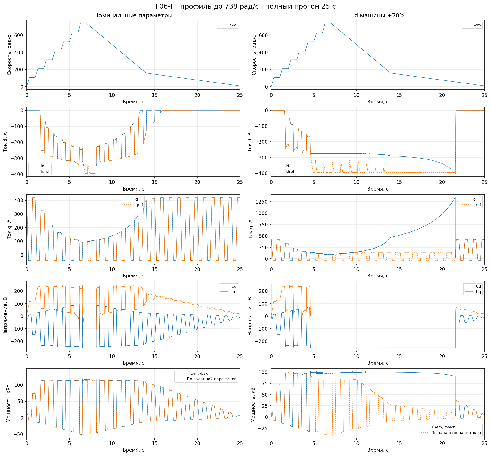

Рисунок 35. Оба случая sweep738. Справа исчезновение крупных колебаний
сопровождается длительным уходом фактического Iq от команды. Мощность вычислена
по датчику момента как T·ωm; штриховая линия — расчёт по заданной паре токов
с истинными параметрами машины, а не отдельное задание регулятора мощности.

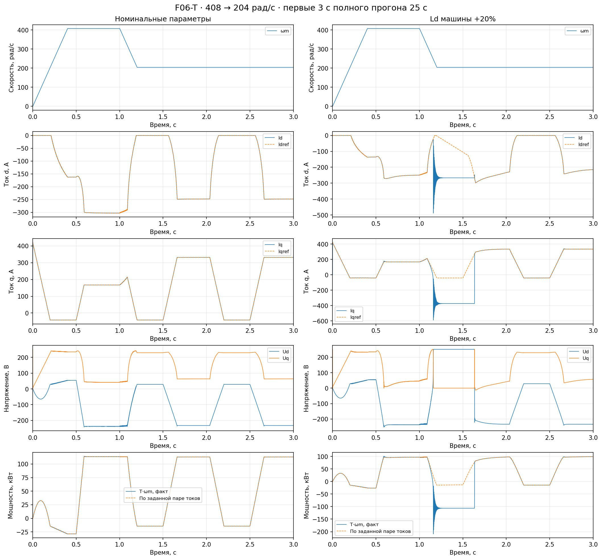

Рисунок 36. Первые 3 с полных 25-секундных прогонов 408 → 204 рад/с.
В случае Ld +20% сохраняются переходный выброс и потеря слежения q.

### Откуда берётся залипание

При набросе q в 4,5–4,6 с FF быстро делает задание Id более отрицательным.
В 4,58 с Iqref = 131,28 А, фактический Iq = 136,65 А;
Ud_raw = −253,60 В уже превышает бюджет. Ограничитель устанавливает
Ud = −251,49 В и оставляет Uq всего ±0,0316 В. При этом стационарное напряжение
**самой заданной пары** в этой точке — 234,57 В, ниже физического предела.
Начало насыщения нельзя объяснить только недопустимым стационарным заданием:
значение имеют переходная динамика, ошибка развязки и распределение напряжения.

После 4,59025 с устанавливается непрерывное насыщение d. Отфильтрованный
модуль ограниченного вектора практически фиксирован:

\[
|U|_f=251{,}494\ \text{В},\quad U_{FW}=241{,}332\ \text{В},\quad
 e_{norm}=-0{,}0421053.
\]

Подстройка до проекции продолжает уменьшать свою добавку со скоростью
Kψ·e_norm = **−0,10526 Вб/с**, эквивалент **−339,6 А/с** через номинальный Ld.
Вместе с FF это доводит Idref до нижней границы −396,39 А. Фактический Id
остаётся около −275,8 А — рядом с компенсацией потока истинной машины
−Ψ/Ld_actual = −275,27 А. Поэтому малые пульсации Id скрывают ошибку слежения
около 120 А. Увеличение отрицательного задания удерживает отрицательный предел Ud.

В точке **6,4 с, 738 рад/с**:

| Величина | Значение |
|---|---:|
| Iqref / Iq | **−42,00 / +95,55 А** |
| Idref / Id | **−396,39 / −275,92 А** |
| Ud_raw / Ud | −470,82 / −251,49 В |
| Uq_raw / Uq | **−232,45 / −0,0316 В** |
| Предел модуля Uq | 0,0316 В |
| Мощность T·ωm | **+97,64 кВт** |
| Стационарное напряжение заданной пары | **378,98 В**, при доступных 251,49 В |

Команда −42 А доходит до q-регулятора; он запрашивает отрицательное напряжение,
но ограничитель почти целиком его отсекает. Это не пропажа команды q.
Накопление интегратора q также не является достаточным объяснением:
знак полной сырой команды Uq уже соответствует требуемому уменьшению тока.

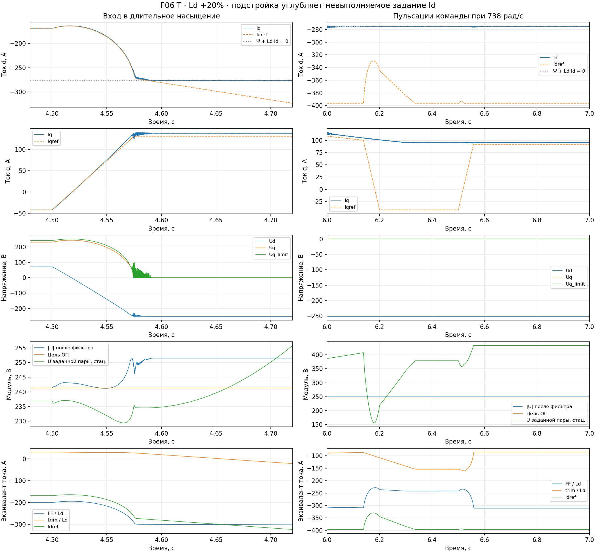

Рисунок 37. Слева — вход в насыщение, справа — отрицательное задание q
на полке 738 рад/с. Подстройка продолжает углублять Idref после того,
как фактический Id перестал следовать ему.

### Почему мощность почти постоянна

При фиксированном предельном отрицательном Ud и практически нулевом Uq
установившиеся уравнения связывают ток с навязанной скоростью:

\[
u_d=R_s i_d-\omega_e L_q i_q,\qquad
u_q=R_s i_q+\omega_e(\Psi+L_d i_d).
\]

Если напряжение остаётся почти фиксированным, то положительный Iq примерно
увеличивается обратно пропорционально скорости; момент растёт, а произведение
T·ωm меняется мало. Это объяснение формы наблюдаемой полки, не доказательство
достижения оптимальной или допустимой максимальной мощности машины.
Команды VectorBase здесь не объявляются точным измерением напряжения на машине.

В 6,3–6,5 с при Iqref = −42 А средняя мощность **97,635 кВт**;
в 6,8–6,98 с при Iqref = +92,06 А — **97,635 кВт**.
На снижении скорости в 14,2–19,4 с мощность остаётся 96,93–100,07 кВт,
тогда как ток q растёт примерно от 477 до 878 А.
Пик полного тока **1401,09 А** получен в **21,5557 с** при 54,012 рад/с:
Id = −397,20 А, Iq = +1343,60 А. Возврат к слежению происходит уже на малой
скорости и не подтверждает возможность управлять моментом в глубоком ОП.

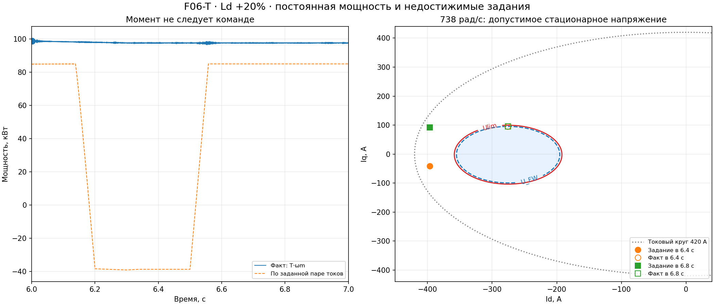

Рисунок 38. На 738 рад/с новое Idref лежит вне стационарной области напряжения
даже при малом отрицательном Iq. Переключение только команды q эту область
не меняет: требуется согласованная коррекция Id и распределения напряжений.

### Следующий опыт и незакрытые вопросы

Сохраняем подтверждённые части F06: правильный период и ограниченную проекцию
состояния. Безусловное углубление Id по модулю уже ограниченного напряжения
не обеспечивает восстановления; расширение trim и увеличение Kψ этого
ограничения не устраняют.

Подготовлен [F07: направленная ошибка Uq](field_weakening_f07.md): FF и
persistent сохраняются, меняется только формирование eU. Используется
стационарная потребность по d для **заданного Iq** и измеренного Id, затем
выбирается ветвь q со знаком скорости. В записанной точке залипания новая ошибка
требует снять чрезмерный отрицательный Id. Это отдельная проверяемая гипотеза;
**закрытый контур с F07 не запускался**, рабочую модель меняет пользователь.

Совместное ограничение полного вектора напряжения и согласование anti-windup
обоих токовых PI остаются в бэклоге. Простое ограничение d коэффициентом 0,98
создаёт резерв q, но само по себе не делает Idref = −396 А достижимым в приведённой
точке; прежний опыт с этим коэффициентом не считаем решением.
Дополнительный Ld −20% на текущей F06-T ещё не проверен: основная матрица
уже выявила потерю слежения в номинале и при +20%.

### Артефакты

- [Протокол сохранённого случая](data/control_fixes/f06t_20261113/saved_ldp20_verification.txt),
  [протокол остальных трёх](data/control_fixes/f06t_20261113/matrix_verification.txt).
- [Сводка sweep738, номинал](data/control_fixes/f06t_20261113/saved_nom/summary.json),
  [сводка sweep738, Ld +20%](data/control_fixes/f06t_20261113/saved_ldp20/summary.json).
- [Сводка hold204, номинал](data/control_fixes/f06t_20261113/hold204_nom/summary.json),
  [сводка hold204, Ld +20%](data/control_fixes/f06t_20261113/hold204_ldp20/summary.json).
- Анализ и рисунки воспроизводятся `tools/fw_limiter/f06t_analysis.py`.
  Полные MAT и инструментированные модели оставлены в `tmp/control_f06t_20261113/`
  (около 2,37 ГБ на момент архивации); они нужны для сопоставления следующего опыта.
  Воспроизводимые кэши можно удалить после подтверждения. Очистка не выполнялась.

Ограничения проверки прежние: идеальные источники напряжения и навязанная
скорость; ключевой инвертор, механическая нагрузка и динамическое DC-звено
в эти прогоны не входят.

<a id="f06-r450"></a>

## F06-R450: ограниченный диапазон для ближайших испытаний

**Проблема:** требуется отделить пригодность F06 в диапазоне до 450 рад/с
от дальнейшей разработки глубокого ослабления поля. Пользователь сохранил
новую конфигурацию с оценками Ψ/Lq и ошибками машины Ld +5%, Lq +20%, Ψ +10%.

**Действия:** зафиксирован снимок 13.11.2026 12:15:49; выполнены 11 прогонов
по 25 с, изменялись только сценарии и ошибки машины на копиях. Сохранённая
логика, Kψ = 2,5 и такт 83,333 мкс проверены; рабочая модель не изменена.
Добавлены проверка слежения после 50 мс неизменных внешних входов и увеличенные
осциллограммы снятия момента/повторного входа в ОП.

**Эффект:** сохранённый профиль до 438 и плавные ступени до 450 проходят
в номинале/с пользовательскими ошибками, пик ≤421,38 А. На постоянных 450
при быстром изменении q получены 500,30 А в номинале и до 503,70 А с
пользовательскими ошибками; при разгоне второго случая — 727,35 А уже
на 213,71 рад/с с нулевым заданием q. Быстрые циклы дают 759,79/750,96 А.
Изолированные Ld ±20% также не проходят. При Ld −20% подтверждён выход
отрицательного задания q за токовый круг: модуль пары 432,54 А.

Общий допуск диапазона не подтверждён. Коррекция логики в этой серии не
выполнялась; положительный результат относится к конкретным плавным сценариям.
Профили, критерии, таблица всех случаев, осциллограммы и файлы проверки:
**[отчёт F06 до 450 рад/с](f06_release450_validation.md)**.

<a id="f06-sg2900"></a>

## F06-SG2900: реальные обороты и резкие режимы

**Постановка:** пользователь уточнил реальный максимум 2900 об/мин
(303,687 рад/с); 450 рад/с были запасом. Назначение — автомобильный
стартер-генератор, резкие изменения режима ожидаемы. Программы пока нет.

**Действия:** на прежнем снимке F06 выполнены шесть прогонов по 25 с,
без превышения реального максимума на всём интервале. Проверены быстрые
переключения q на максимуме, повторные разгоны и электрический профиль
пуск/генерация/снятие нагрузки; каждый в номинале и с ошибками 5/20/10%.
Коэффициенты и логика не менялись, проверены полные логи и такт.

**Эффект проверки:** все шесть случаев не прошли. Пики в номинале/
с пользовательскими ошибками: полка — 605,29/599,43 А, повторные разгоны —
759,77/751,00 А, цикл стартер-генератора — 609,09/739,54 А. Задания остаются
в пределах 420 А; это не достаточное условие управляемости.
В номинале при смене тяги на генерацию Ud = +251,49 В удерживается 0,641 с,
Uq почти обнулено. С пользовательскими ошибками после снятия момента
на 2900 об/мин Iq = −221,33 А при задании 0.

Полученное положительное насыщение d требует дополнить прежний план F07:
обоснование знака стационарной ошибки Uq не заменяет проверку восстановления
обоих направлений насыщения и распределения напряжений. Изменения логики
в этой серии не выполнялись. [Отчёт с 12 осциллограммами](f06_starter2900_validation.md).

<a id="f06-nff"></a>
## F06-NFF: отдельное отключение FF перед F07

**Проблема:** требуется отделить влияние расчётной ветви FF от интегратора
ОП и последующего удержания насыщения. Пользователь предложил выполнить
этот опыт до F07 и найти историческую реализацию по Uq.

**Действие:** на замороженной копии дневной F06 добавлен Gain = 0 сразу
в обе активные ветви FF: вход `fw_trim` и итоговую `Sum6`. Kψ = 2,5,
код состояния, обратная связь по модулю, ограничения и токовые контуры
сохранены. Выполнены шесть прежних сценариев SG2900 по 25 с.
Проверены связи SLX, нулевой используемый FF, такт, потактовые равенства,
полнота логов и одинаковые параметры/входные таблицы парных опытов.

**Эффект:** на переходе к генерации около 5 с в номинале пик снизился
609,09 → 344,52 А, насыщение d на 0,957 с исчезло. На полке около 16 с —
605,29 → 357,84 А, насыщение 0,641 с также исчезло. Но первый быстрый
разгон без FF ухудшился 421,19 → 758,90 А; появился срыв при 0 → −105 А
на полке. Все шесть полных сценариев без FF не прошли. Подтверждены как
полезное упреждение FF, так и его участие в части срывов при быстром снятии
ослабления. Удержание насыщения возможно без FF.

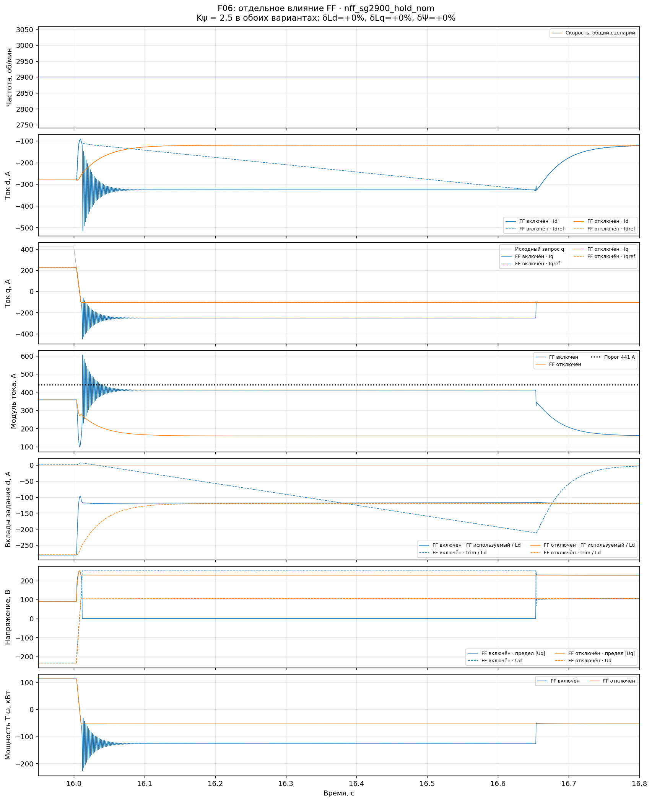

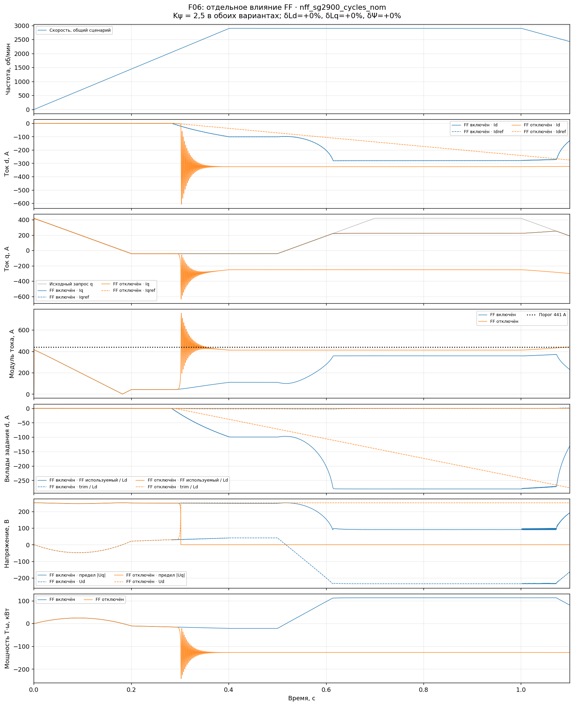

Это проверка удаления FF при прежней настройке; оптимизация обратной связи
без FF не проводилась. Полный F05-A с иным формирователем задания не реализован.
Перед F07 следующий вопрос — быстродействие обратной связи на противоположных
переходах, затем отдельное сравнение сигнала Uq.
[Полный отчёт и все осциллограммы](f06_noff_validation.md).

**История Git:** активный ПИ по Uq найден в `cd3e1e5` от 06.05.2026,
`ideal_source_Motor_DVS_newest_param.slx`; дополнительно работает алгебраическая
коррекция. В июльском `ideal_source_drive.slx` формула по Uq сохранена,
но в токовый контур подан Idreq = 0. Старый предел Uq зависит от фактического
Ud; в кандидате F07 — от расчётного Ud для заданного Iq. Исторические модели
не симулировались. [Формулы, подключения и извлечённые копии](field_weakening_uq_history.md).

<a id="f06-c01"></a>
## F06-C01: компоненты, ограничения и согласованность сигналов

**Проблема:** пользователь исправил отрицательный предел Iq и выход smoothmin
за допустимый диапазон. Залипание сохранилось; предложено последовательно
проверять все компоненты активного тракта.

**Действия:** зафиксированы два autosave, проверены их графы и параметры,
выполнены 130 граничных случаев реального `lim`, 8652 случая реальной SVPWM,
отдельный Simulink-стенд UqLimiter и четыре прогона по 25 с. Логирование
теперь следует за фактическими источниками тегов Iqreq/IqLim, а не за именами
оставленных старых блоков. Добавлены внешние границы ПИ и знаменатели оценок.

**Эффект и найденные дефекты:**

- `lim` и `Min2` подтверждены на проверенных входах; отрицательный бюджет
  от smoothmin больше не используется.
- В autosave 14:59 FF остался на входе `fw_trim`, но отсутствовал на Sum6.
  Расхождение внутренней и наружной команд достигло эквивалента 297,13 А
  перед окончательным ограничителем. В autosave 15:44 пользователь восстановил
  связь; одновременно установлен Gain1 = 0,98. Инспектор теперь проверяет
  согласованность обеих ветвей перед стандартными сравнениями.
- Нижняя граница Id при Ψ_used = 1,1·Ψном допускает −436,03 А при Is_max = 420 А.
  Симметричный предел q не заменяет собственного ограничения d.
- На остановке оценки продолжают обновляться и стремятся к нижним пределам.
  Подтверждено также рассогласование тактов: в свежем снимке при Iq = +164,71 А
  в знаменателе Lq ещё −70,30 А; сырая оценка отрицательна и ограничивается снизу.
- Арифметика внешних ограничений обоих ПИ и SVPWM в проверенном режиме прошла
  проверки. Это не подтверждает восстановление всей системы при насыщении.

На последнем снимке пики составили 521,25 А на номинальной полке и 636,48 А
при повторных разгонах с ошибками +5/+20/+10%. Полные прогоны не прошли критерии.
Числа включают восстановление FF и резерв d = 0,98; эффект одного исправления
Iq по ним отдельно не выделяется. Связь каждой находки с конкретным срывом
требует отдельного изменения и повторного сравнения.

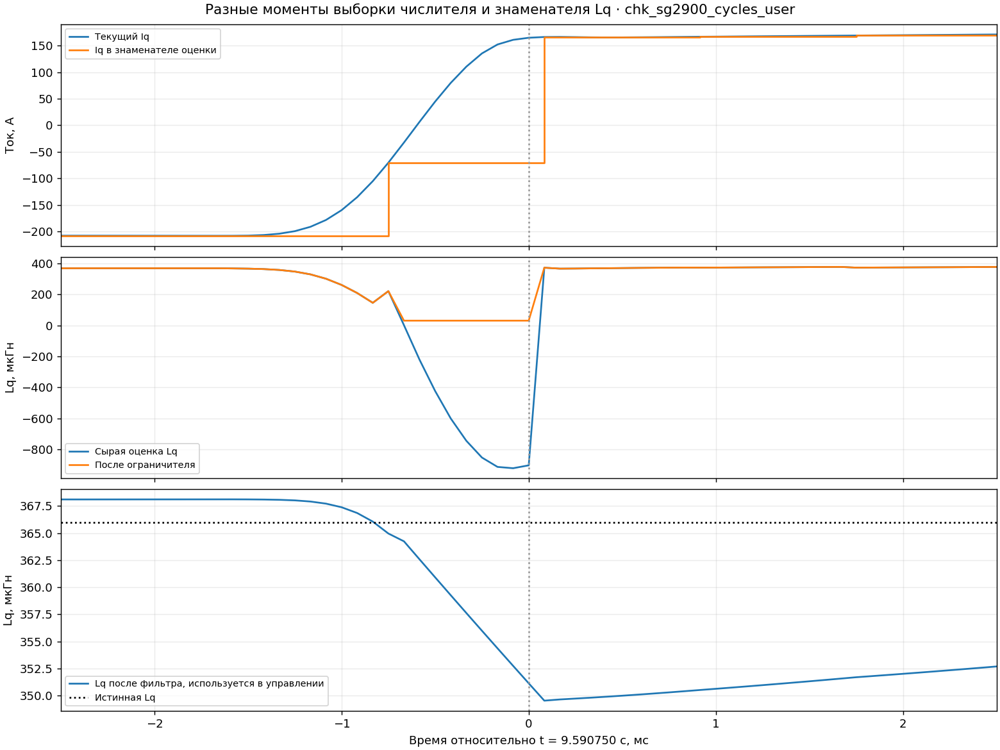

[Полный аудит, карта компонентов, источники и осциллограммы](f06_component_audit.md).
Рабочую модель ассистент не менял. Следующие шаги: фиксировать одну конфигурацию,
согласовать границу Id с состоянием, затем исправлять допустимость обновления
оценок и моменты выборки; после этого возвращаться к F07.

<a id="fw-literature"></a>
## FW-LIT: литература и приоритеты перед F07, 13.11.2026

**Проблема:** после анализа нелинейности пользователь предложил оценить
значимость действий по учебным и научным материалам до перестройки контура.
F07 не отменяется.

**Действия:** подготовлен [обзор 19 источников](fw_control_literature.md)
с уровнями доступа и маршрутами чтения. Проверены нужные формулы Wallmark,
блок-схема NXP AN12235 и цепочка вызовов TI от расчёта Vs до ограничений ПИ.
Разделены полные доступные материалы, аннотации и сообщения форумов.

**Эффект анализа:** приоритет 5/5 получили фиксация исправленной базы,
согласование ограничений/восстановление токов и выбор полосы вместе с
запасом напряжения. Сигнал Uq/F07 и настройка усиления — 4/5. Примеры
TI/NXP разобраны в обзоре как основания для отдельных сравнений,
с указанием различий с нашей системой. FF оставлен в контрольной конфигурации
до отдельного сравнения при настроенной обратной связи.

**Проверка:** модели и алгоритмы не изменялись, новых прогонов и новых
осциллограмм нет. Приоритеты — инженерная оценка, не количественное
подтверждение эффекта будущей правки. Критерии и порядок следующих
сравнений приведены в обзоре; F07 остаётся непроверенным кандидатом.
