# Управление PMSM в ослаблении поля: причины срывов и предлагаемая структура исправления

Первоначальный анализ: 04.11.2026. Пересмотр: 10.11.2026. Модель: [ideal_source_drive_Idff_aug_param.slx](../ideal_source_drive_Idff_aug_param.slx).

Документ объединяет [исходный разбор ограничителей](fw_limiter_issues.md), дополнительную проверку модели и [обзор промышленных и тяговых реализаций](industry_field_weakening.md). Исходный разбор сохранён как исторический материал. Здесь уточнены механизмы отказа, проблемы оценщиков и ШИМ, варианты исправления и условия их сравнения.

Текущий статус исправлений ведётся в [коротком бэклоге с чекбоксами](control_backlog.md). Описания исходной структуры и результаты прежних прогонов ниже сохранены как база сравнения.

Подробное продолжение — [контур ОП: действующая схема, динамика, VESC и варианты изменения](field_weakening_loop.md). Оно раскрывает FF, sens, фильтры и переключения нашей модели, сопоставляет наружные контуры и добавляет расчёт обратной начальной реакции напряжения. Это аналитическое дополнение, без новых прогонов Simulink.

**Статус: анализ существующей модели и проект сравнительных испытаний. Исправленный регулятор ещё не реализован.** Пересмотр по внешним источникам не добавляет новых прогонов Adaptto. Прежние графики и численные результаты относятся к исходной структуре.

Все иллюстрации вставлены как локальные PNG по относительным путям. Для просмотра в MarkText достаточно открыть этот файл из папки репозитория; внешние сервисы и Mermaid не нужны.

Для первого чтения: п. 2.3 описывает объект и внешние воздействия; раздел 3 показывает действующие контуры и сигналы; разделы 4–7 разбирают их поведение; раздел 8 описывает предлагаемую структуру. Схемы текущей модели сверены с блоками и соединениями SLX. Их [карта блоков и параметров](data/control_model_structure.json) содержит контрольную сумму исследованного файла.

## 1. Основной вывод

Проблема возникает на стыке четырёх частей управления:

1. Формирователь заданий может потребовать недопустимый вектор тока или временно недостижимый по напряжению режим.
2. В исследованной реализации ось d может занять практически весь вектор напряжения и лишить q управления.
3. Clamping каждого PI учитывает собственное ограничение, но в воспроизведённом режиме вся связанная система не восстанавливает слежение.
4. Контур ослабления поля и оценщики получают неполную информацию о насыщении и фактически приложенном напряжении.

В результате даже после возвращения задания в достижимую область токовый контур может оставаться в насыщении. Рассмотренные ранее изменения коэффициентов и запасов не дали удовлетворительного результата на всех исследованных переходах. Это не доказательство невозможности любой параметрической настройки, но основание проверить структуру согласования ограничений.

Основное требование — **согласовать формирование пары Id/Iq и её траектории, распределение напряжения, anti-windup двух интеграторов и используемую модель машины**. Первым кандидатом для испытания выбран приоритет d с ограничением её доли напряжения и коррекцией недостижимого запроса. Радиальная проекция остаётся вариантом сравнения. Окончательный выбор определяется испытаниями, а не одним геометрическим свойством ограничителя.

Приоритет d сам по себе не является дефектом: он присутствует в опубликованных реализациях VESC и Microchip. Сохранение угла напряжения, в свою очередь, не гарантирует удержания отрицательного Id. Основания выбора, ссылки и схемы приведены в [обзоре](industry_field_weakening.md); изменения по всем разделам ревью сведены в раздел 13.

| Вопрос | Что установлено | Статус доказательства |
|---|---|---|
| Защёлкивание при Ld +20% | Задание снова достижимо, но Ud остаётся на пределе, Uq ≈ 0 | Исходные прогоны и повторная проверка |
| Превышение Is_max | В номинале задание 473,76 А, измеренный ток 474,07 А при лимите 420 А | Повторная проверка |
| Оценка Lq при Iq ≈ 0 | На исправной номинальной машине оценка падает до 0,1·Lq | Дополнительная проверка исходной модели |
| Смешение Ψ и ошибки Ld | Формула оценки относит ошибку Ld к потоку магнитов | Вывод из уравнений; согласуется с прогоном |
| Независимый предел Id | Разрешённые диапазоны блоков допускают более 420 А по одной оси d | Анализ диапазонов; отдельный такой режим не воспроизводился |
| Ограничения ШИМ | m = 0,995 несовместим с duty ∈ [0,005; 0,995] для всех углов | Прямой расчёт алгоритма SVPWM |
| Колебания 240 Гц | Наблюдались в исходном исследовании | Причина остаётся гипотезой |
| Обратная начальная реакция Us | При фиксированном Iq усиление ОП может сначала увеличить Us через Ld·dId/dt | Вывод из уравнений и заданная траектория тока; связь с прежней защёлкой не доказана |
| Выбор политики ограничения | Есть промышленные примеры приоритета d; сравнения вариантов в Adaptto ещё нет | Исследовательская гипотеза, не результат приёмки |

## 2. Что моделируется и как читать величины

### 2.1. Параметры и ограничения исследования

| Величина | Значение |
|---|---|
| Пары полюсов p | 11 |
| Ld / Lq | 0,31 / 0,305 мГн |
| Поток магнитов Ψ | 0,1024 Вб |
| Rs | 0,02 Ом |
| Vdc | 440 В |
| Is_max | 420 А в принятой амплитудной системе dq |
| Период токового регулятора Ts | 1/12000 с = 83,33 мкс |
| Параметр piBandwidth | 6000 рад/с |
| Kpd / Kpq | 1,86 / 1,83 В/А |
| Kid / Kiq | 120 В/(А·с) |
| Предел напряжения регулятора | 0,995·Vdc/√3 = 252,76 В |
| Цель ослабления поля | 0,95·Vdc/√3 = 241,33 В |

Используется амплитудно-инвариантное преобразование Clarke/Park. Поэтому модуль dq-тока сопоставляется с пиковым фазным током симметричной синусоидальной системы, а не непосредственно с фазным RMS. При переносе ограничений на стенд эту нормировку нужно сохранить.

Механическая скорость ωm задаётся идеальным источником. Электрическая скорость:

$$
\omega_e=p\omega_m.
$$

В таблицах результатов скорость дана в механических рад/с; в электрических уравнениях ниже используется **ωe**. Например, 455,4 рад/с механической скорости соответствуют примерно 5009 рад/с электрической.

Машина имеет постоянные Ld, Lq, Ψ и Rs. Параметры delta меняют истинные параметры машины, оставляя номинальные значения в регуляторе. Это проверка чувствительности к ошибкам параметров, но не полноценная модель насыщения и нагрева.

Фазные напряжения формируются идеальными управляемыми источниками из скважностей SVPWM. В тракте уже есть дискретизация, удержание и обрезка скважностей, но нет переключений силовых ключей, их падений напряжения и динамического DC-звена. В проверенных прогонах compensate_pwm = 0, compensate_dt = 0.

### 2.2. Уравнения, необходимые для объяснения

Для принятых направлений осей и постоянных параметров:

$$
U_d=R_s I_d+L_d\frac{dI_d}{dt}-\omega_e L_q I_q,
$$

$$
U_q=R_s I_q+L_q\frac{dI_q}{dt}+\omega_e(\Psi+L_d I_d),
$$

$$
M=\frac{3}{2}p\left[\Psi I_q+(L_d-L_q)I_d I_q\right].
$$

Это dq-запись модели PMSM; используемая библиотечная модель описана в [документации MathWorks](https://www.mathworks.com/help/simscape-electrical/ref/pmsm.html).

Отрицательный Id уменьшает суммарное потокосцепление оси d:

$$
\Psi_d=\Psi+L_d I_d.
$$

Ослабление поля уменьшает противо-ЭДС. При этом часть доступного тока расходуется на Id, а допустимый Iq и момент снижаются. Физический смысл такого распределения тока соответствует [описанию FOC с ослаблением поля](https://www.mathworks.com/help/mcb/gs/field-weakening-control-mtpa-pmsm.html).

В установившемся режиме производные токов равны нулю:

$$
V_{\mathrm{ss}}(I_d,I_q)=
\sqrt{(R_sI_d-\omega_eL_qI_q)^2+
[R_sI_q+\omega_e(\Psi+L_dI_d)]^2}.
$$

Рабочая точка должна одновременно удовлетворять ограничениям:

$$
I_d^2+I_q^2\le I_{\max}^2,\qquad
V_{\mathrm{ss}}\le V_{\mathrm{доступ}}.
$$

**Достижимость установившейся точки не гарантирует достижимости быстрого перехода к ней.** Для изменения токов дополнительно требуется напряжение Ld·dId/dt и Lq·dIq/dt. Это существенно при быстром снятии ослабления поля.

### 2.3. Объект, воздействия и измерения в текущей модели

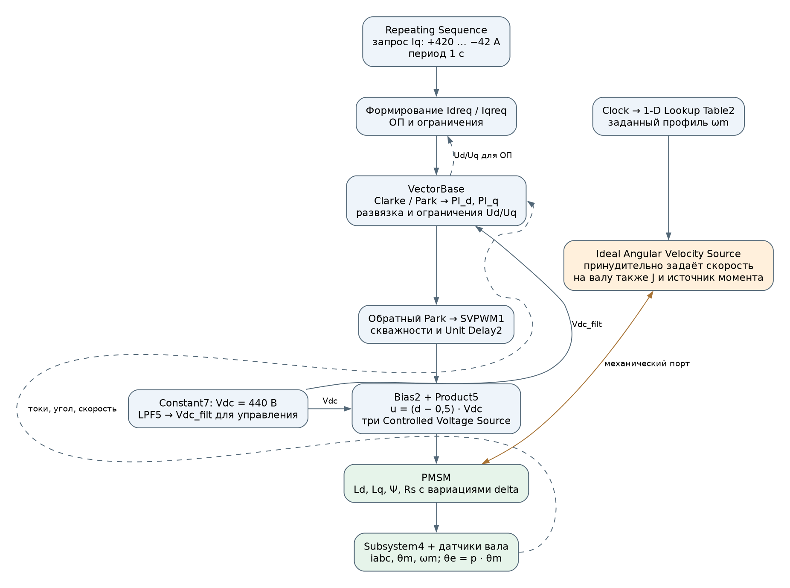

Схема М1. Активный тракт `ideal_source_drive_Idff_aug_param.slx`. Сплошные стрелки показывают передачу сигналов, пунктир — обратные связи, двусторонняя стрелка — механическое соединение. Это функциональная реконструкция: служебные преобразователи и диагностические ответвления объединены.

В исследуемой конфигурации независимо задаются два воздействия:

- **Механическая скорость:** `Clock → 1-D Lookup Table2 → Ideal Angular Velocity Source`. Профиль поднимается ступенями с линейными переходами до 738 рад/с, затем снижается. Идеальный источник удерживает эту скорость независимо от развиваемого машиной момента.
- **Запрос тока q:** `Repeating Sequence → Min3`. Период равен 1 с; точки запроса при t = 0 / 0,2 / 0,5 / 0,7 / 1 с равны +420 / −42 / −42 / +420 / +420 А. Между точками действует линейная интерполяция. Это запрос до ограничения IqLim.

У машины соединение обмоток «звезда», постоянные Ld/Lq/Ψ/Rs; нулевая последовательность исключена. Вариации `deltaLd`, `deltaLq`, `deltaPsi`, `deltaRs` изменяют параметры блока `PMSM`. Номинальные значения в формулах регулятора при этом сохраняются, а Lq_est и Psi_est могут изменяться через оценщики.

На валу присутствуют `Inertia` с J = 0,1 кг·м² и `Ideal Torque Source` с командой −50 Н·м. Они влияют на баланс механических моментов, но скорость в этой конфигурации всё равно задаёт идеальный источник. По такому прогону нельзя оценивать разгон привода под собственной нагрузкой.

Три `Controlled Voltage Source` получают команды из скважностей SVPWM. `Subsystem4` измеряет фазные токи и линейные напряжения. Вектор `Currents` поступает непосредственно в `VectorBase`; токи Id/Iq вычисляются там через Clarke/Park и возвращаются на верхний уровень через `Bus Selector`. Угол и скорость приходят от идеального датчика движения вала: θe = p·θm, ωe = p·ωm.

| Узел, видимый на общем листе SLX | Роль в рассматриваемой конфигурации |
|---|---|
| `SpeedController` | Его выход не подключён к активному запросу Iq; замкнутого регулирования скорости в этих прогонах нет |
| `GenPowerController` | Блок закомментирован; активного регулирования генераторной мощности через него нет |
| `HallSensors` | Диагностическая ветвь; угол и скорость для VectorBase берутся с датчика вала |
| `idTorqueController` | Это константа 0; через Gain2/Min1 задаёт нулевую верхнюю границу для FF ослабления |
| `Idc_calc`, `CurrentsMuxFilter`, отдельные Clarke/Park и Scope | Расчёты и отображение сигналов; они не заменяют активную обратную связь токов внутри VectorBase |

Таким образом, дальше обсуждаются внутренние токовые контуры и наружный контур ОП при заданной скорости. Ошибочный момент не замедляет автоматически источник скорости и не выводит систему из насыщения.

## 3. Существующая структура управления

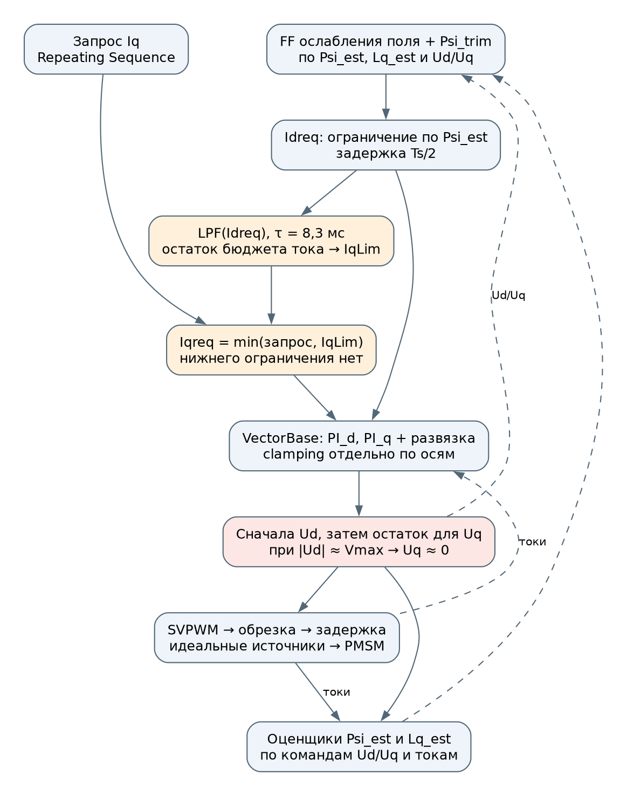

Рисунок 1. Функциональная схема активного тракта. Обозначены логические связи; это не полный список блоков модели.

Два быстрых контура поддерживают Id и Iq. Наружный контур ОП меняет Idreq по ошибке напряжения. Расчёт FF даёт предварительное ослабление, а ограничитель Iq связывает запрос момента с бюджетом тока и напряжения. Оценщики замыкают дополнительные обратные связи через параметры развязки и FF.

В схемах ниже LPF с номером означает блок `Low-Pass Filter (Discrete or Continuous)` с тем же номером. Имя без префикса относится к корневому листу; внутри схемы токового регулятора — к `VectorBase`. Переносы строк в именах блоков опущены.

### 3.1. Токовые PI и развязка

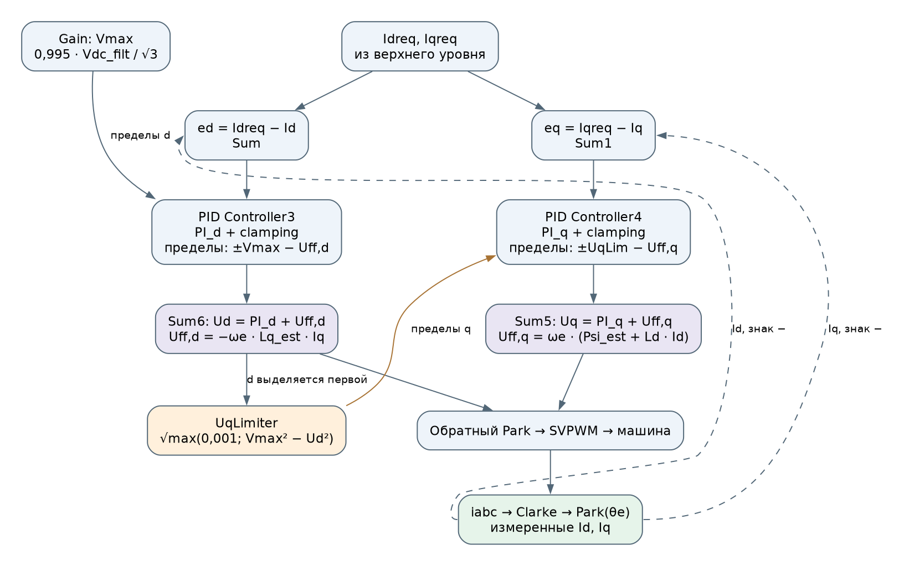

Схема М2. Замыкание токовых контуров и зависимость пределов q от уже ограниченного Ud. Ограничение выхода и clamping находятся внутри соответствующего PI; отдельного общего ограничителя после двух PI в текущей схеме нет.

В VectorBase вычисляются ошибки Idreq − Id и Iqreq − Iq. Составляющие развязки:

$$
U_{\mathrm{ff},d}=-\omega_e\hat L_q I_q,\qquad
U_{\mathrm{ff},q}=\omega_e(\hat\Psi+L_{d,\mathrm{ном}}I_d).
$$

`PID Controller3` управляет d, `PID Controller4` — q. Их коэффициенты: Kpd = piBandwidth·Ld, Kpq = piBandwidth·Lq и Kid = Kiq = piBandwidth·Rs. Входы развязки используют **измеренные** Id/Iq. Номинальная Ld применяется в q-развязке; отдельной оценки Ld в этой модели нет.

Внешние пределы PI пересчитаны с учётом этих добавок. Это полезная часть реализации: ограничивается суммарное напряжение с развязкой, а не только выход PI. Однако доступное напряжение распределяется последовательно:

1. Ud ограничивается диапазоном ±Vmax.
2. Для q остаётся корень из Vmax² − Ud².
3. Оба PI используют clamping по своим пределам.

Если выходы собственно PI обозначить vd_PI и vq_PI, фактические интервалы их ограничения имеют вид:

$$
v_{d,\mathrm{PI}}\in[-V_{\max}-U_{\mathrm{ff},d};\ V_{\max}-U_{\mathrm{ff},d}],
$$

$$
v_{q,\mathrm{PI}}\in[-U_{q,\lim}-U_{\mathrm{ff},q};\ U_{q,\lim}-U_{\mathrm{ff},q}].
$$

Для d эти пределы формируют `Sum9/Sum10`, для q — `Sum7/Sum8`. После добавления развязки `Sum6/Sum5` выдают Ud/Uq. Именно эти **уже ограниченные команды** экспортируются из VectorBase и далее используются в ОП и оценщиках. Связь Ud → UqLimiter → пределы PI_q — причина, по которой два контура нельзя рассматривать как независимые при насыщении.

В точной реализации UqLimiter подкоренное выражение ограничено снизу числом 0,001 В². Поэтому при насыщении d остаётся не строго ноль, а около **0,0316 В**. Практически управление осью q всё равно потеряно.

Претензия относится к поведению этой связанной схемы в зафиксированных режимах. Последовательное выделение напряжения и clamping допустимы как методы; необходимо проверить их согласование с заданиями, развязкой и внешним контуром ОП.

### 3.2. Ослабление поля

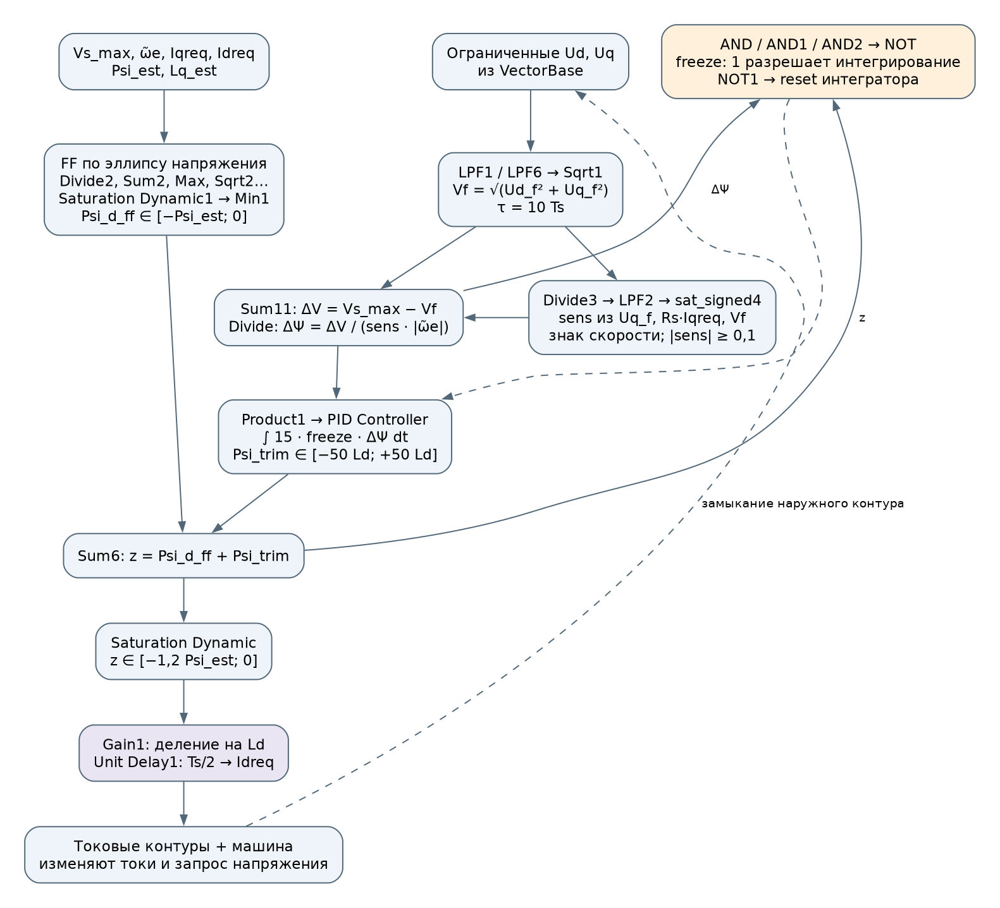

Схема М3. Две ветви формирования Idreq: расчётная FF и интегральная подстройка по напряжению. Последняя замыкается через токовые контуры и машину. У неё нет прямого выхода на Ud или Uq.

FF рассчитывает отрицательное приращение потока для работы внутри эллипса напряжения. Важно различать два понятия:

- Ψd = Ψ + Ld·Id — суммарное потокосцепление машины;
- сигнал **Psi_d_ff в модели** — приращение потока, соответствующее Ld·Id, в диапазоне от −Psi_est до 0.

К FF добавляется Psi_trim с пределом ±50·Ld. После ограничения суммы и деления на номинальную Ld получается Idreq.

Для чтения FF удобно ввести qf = LPF4(Iqreq) и ω̃e — сигнал `w_el_sat`. Вне переходных эффектов отдельных блоков вычислительная цепочка записывается так:

$$
F=\sqrt{\max\left(0,
\left(\frac{V_{\mathrm{FW}}}{\tilde\omega_e}\right)^2-
\left(\hat L_q q_f-\frac{R_s I_{d,\mathrm{req}}}{\tilde\omega_e}\right)^2
\right)}
-\frac{R_s I_{q,\mathrm{req}}}{\tilde\omega_e}-\hat\Psi,
$$

$$
\Psi_{d,\mathrm{ff}}=\operatorname{clip}(F,-\hat\Psi,0),\qquad
I_{d,\mathrm{req}}=\operatorname{Delay}_{T_s/2}
\left[\frac{\operatorname{clip}(\Psi_{d,\mathrm{ff}}+\Psi_{\mathrm{trim}},-1{,}2\hat\Psi,0)}{L_{d,\mathrm{ном}}}\right].
$$

Здесь VFW — сигнал `Vs_max = 0,95·Vdc_filt/√3`. Внутри FF участвуют задания токов, причём только индуктивная составляющая q проходит через LPF4 с τ = 10·Ts; резистивные поправки используют Iqreq и задержанный Idreq. Это описание существующих соединений, а не новый алгоритм из п. 8.4. При нулевом `idTorqueController` дополнительный Min1 не меняет уже неположительный результат.

Обратная связь ослабления поля использует:

$$
V_f=\sqrt{\operatorname{LPF}(U_d)^2+\operatorname{LPF}(U_q)^2},
\qquad \Delta V=V_{\mathrm{FW}}-V_f.
$$

Здесь Ud/Uq уже ограничены. Ветка `Divide3 → LPF2 → sat_signed4` вычисляет чувствительность:

$$
s_{\mathrm{raw}}=\operatorname{sign}(\tilde\omega_e)
\frac{U_{q,f}-R_s I_{q,\mathrm{req}}}{\max(V_f,10^{-6}\ \text{В})},\qquad
\mathrm{sens}=\operatorname{sat\_signed4}\left(\operatorname{LPF}_2(s_{\mathrm{raw}})\right).
$$

Модуль sens принудительно ограничивается снизу 0,1. Это предотвращает деление на малое число, но не восстанавливает физически правильную чувствительность в насыщении.

Сигнал с именем freeze используется множителем на входе интегратора: значение 1 разрешает интегрирование, 0 останавливает его. Отдельная логика reset реагирует на переходы условия низкой скорости. Поэтому название сигнала нельзя интерпретировать как «1 = заморозить» без проверки соединений.

Точнее, для z = Psi_d_ff + Psi_trim и ΔΨ = ΔV/(sens·|ω̃e|) интегрирование запрещается, если истинно хотя бы одно условие:

| Ветка логики | Условие запрета |
|---|---|
| `AND` | z ≤ −1,2·Psi_est и ΔΨ < 0: коррекция ведёт за нижнюю границу |
| `AND1` | z ≥ 0 и ΔΨ > 0: коррекция ведёт за верхнюю границу |
| `AND2` | \|ω̃e\| ≤ ωbase и ΔΨ < 0: запрос усиления ОП ниже расчётного порога скорости |

Порог вычисляется как ωbase = Vs_max / √(Psi_est² + (Lq_ном·Is_max)²). `NOT` инвертирует объединение трёх запретов и выдаёт freeze. Сигнал `NOT1 = NOT(AND2)` подан на внешний reset I-регулятора, настроенный на оба фронта (`either`); поэтому сброс связан с переходом составного условия AND2, а не только с пересечением скорости. Имена `IsNegative1` и `IsNegative2` также не отражают текущие настройки: в них выбраны сравнения > 0 и ≥ 0 соответственно.

### 3.3. Ограничение тока и характерные времена

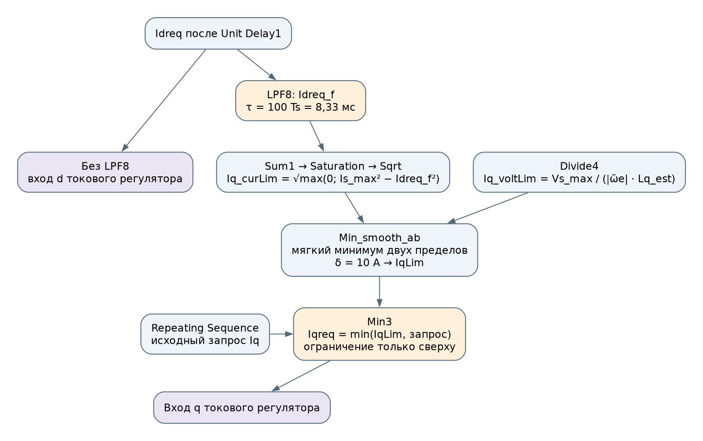

Схема М4. Idreq идёт в токовый регулятор напрямую, а в расчёт остатка бюджета q — через LPF8. Это два разных сигнала с разной динамикой.

В остатке токового бюджета используется отфильтрованный Idreq:

$$
I_{q,\mathrm{cur}}=
\sqrt{\max(0,I_{\max}^2-\operatorname{LPF}(I_{d,\mathrm{req}})^2)}.
$$

Он плавно объединяется с ограничением по напряжению. Затем Min3 ограничивает запрос Iq только сверху.

Вторая ветвь даёт Iq_voltLim = Vs_max/(|ω̃e|·Lq_est). `Min_smooth_ab` вычисляет 0,5·[a + b − √((a − b)² + δ²)] при δ = 10 А; выход называется IqLim. Значение Iqreq после Min3 поступает и в PI_q, и обратно в FF/чувствительность ОП. Поэтому изменение предела q меняет также последующее задание d.

| Узел | Период / постоянная времени | Следствие |
|---|---|---|
| Токовые PI | Ts = 83,33 мкс | Основной такт FOC |
| SVPWM и Unit Delay1/2 | Ts/2; SVPWM обновляет скважности через вызов | Нужно учитывать фактическую последовательность обновления |
| LPF(Idreq) для IqLim | 100·Ts = 8,33 мс | Бюджет тока отстаёт от задания d |
| LPF Ud/Uq для ОП | 10·Ts = 0,833 мс | Вносит задержку в обратную связь |
| Фильтр Lq_est | 200·Ts = 16,67 мс | Ошибочная оценка влияет на следующие переходы |
| Фильтр Psi_est | 20000·Ts = 1,667 с | Долго сохраняет ошибку старой рабочей точки |
| Фильтр Vdc | 20·Ts = 1,667 мс | Запаздывает относительно изменения питания |
| Блоки sat_signed1…5 | 10·Ts = 0,833 мс | Знаменатели и знаки обновляются реже токового контура |

Само наличие разных частот не является ошибкой. Но при переходах через Iq = 0 и ωe = 0 в вычисления могут одновременно попадать данные разных моментов времени.

### 3.4. Оценщики как дополнительные обратные связи

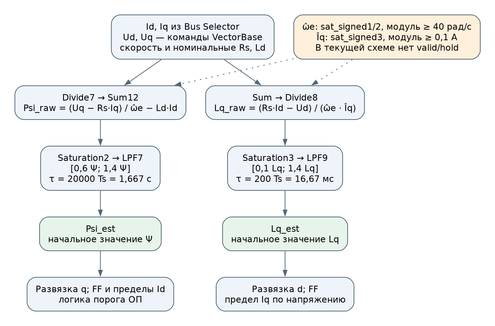

Схема М5. Оценки возвращаются в развязку и формирователь заданий. Символы ω̂e и Îq на схеме обозначают величины после защиты знаменателя, а не отдельные наблюдатели скорости и тока.

Обе оценки строятся по измеренным Id/Iq и **командным Ud/Uq**. Измеренные линейные напряжения `Subsystem4` в эти формулы не поданы. Psi_est изменяет q-развязку, FF и пределы ослабления; Lq_est — d-развязку, FF и предел Iq по напряжению. Неверная оценка поэтому меняет сам режим, из которого будет получена следующая оценка.

Начальные значения фильтров равны номинальным Ψ и Lq. После расчёта стоят диапазоны допустимых значений и фильтры, но отдельного разрешения по достоверности измерения (`valid/hold`) сейчас нет. Защиты знаменателей работают постоянно: модуль скорости в оценщиках не ниже 40 электрических рад/с, модуль Iq в оценке Lq не ниже 0,1 А. Подробный вывод ошибок этих формул приведён в разделе 6.

### 3.5. От команды Ud/Uq до напряжения машины

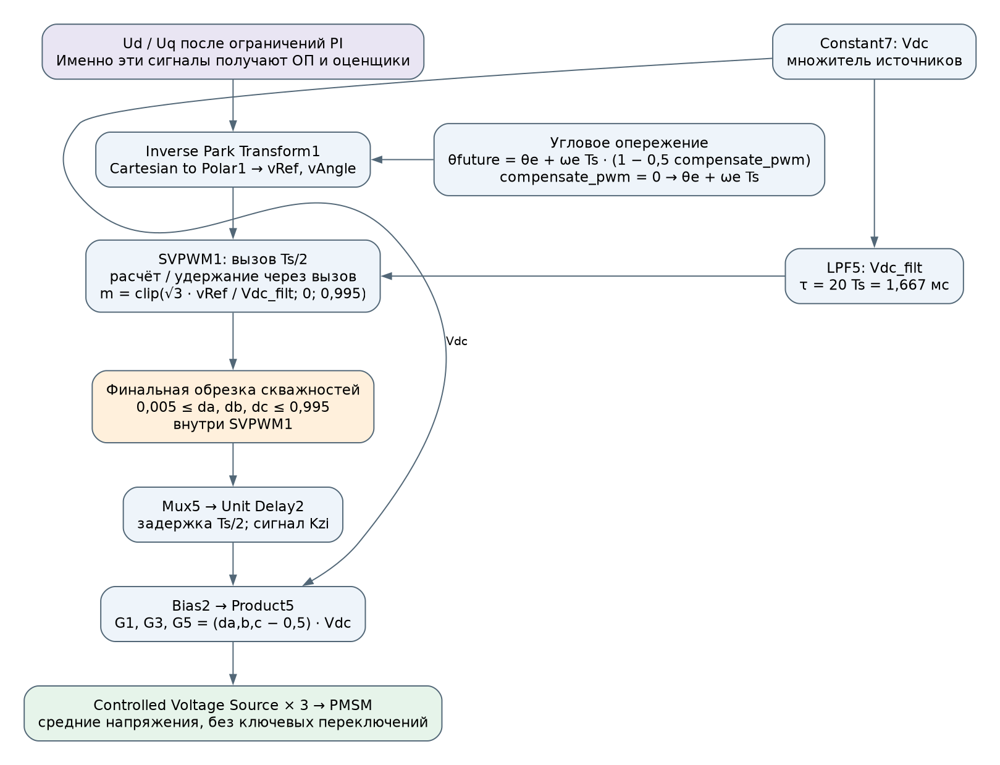

Схема М6. Стадии приложения напряжения и два использования Vdc. Верхняя точка отбора Ud/Uq находится до модулятора, задержки скважностей и умножения на фактическое питание.

Прямой Park использует текущий электрический угол. Для обратного Park внутри VectorBase формируется θfuture = θe + ωe·Ts·(1 − 0,5·compensate_pwm). Следовательно, даже при выключенной экстраполяции скважности (`compensate_pwm = 0`) угловое опережение на ωe·Ts остаётся. После обратного Park блок `Cartesian to Polar1` выдаёт модуль vRef и угол vAngle вектора напряжения в неподвижной системе.

`SVPWM1` вызывается с шагом Ts/2. В одном полутакте он вычисляет скважности, в следующем возвращает последние ограниченные значения. Финальная обрезка [0,005; 0,995] выполняется внутри функции; после неё `Unit Delay2` задерживает вектор скважностей ещё на Ts/2. Это описание заданных периодов и состояний; точный фазовый порядок задач следует учитывать отдельно при анализе дискретного контура.

`Bias2/Product5` формируют команды источникам относительно общей опоры: G1/G3/G5 = (da/db/dc − 0,5)·Vdc. Для звезды без нулевого тока эквивалентные фазные напряжения относительно плавающей нейтрали получаются вычитанием общего среднего, как в п. 8.7. Поэтому число d − 0,5 нельзя напрямую отождествлять с фазным напряжением относительно нейтрали обмоток.

Модулятор и пределы регулятора используют Vdc_filt из LPF5, источники напряжения — Vdc до фильтра. В исходном режиме оба равны 440 В. Отличие становится существенным при изменении питания; несогласованность финальных пределов duty рассматривается в разделе 7.

### 3.6. Карта контуров и обозначений для дальнейшего разбора

| Контур или расчётная связь | Что возвращается по обратной связи | На что воздействует | Где разбирать поведение |
|---|---|---|---|
| Ток d | Id после Clarke/Park | PI_d → Ud → машина | Пп. 3.1, 4.2 |
| Ток q | Iq после Clarke/Park | PI_q → Uq → машина; предел зависит от Ud | Пп. 3.1, 4.2 |
| Наружный контур ОП | Модуль отфильтрованных ограниченных Ud/Uq | Psi_trim → Idreq → токовые контуры | Пп. 3.2, 4.3 |
| Формирование бюджета q | Задание Idreq через LPF8 и оценка Lq_est | IqLim → Iqreq → FF и токовый контур | Пп. 3.3, 5 |
| Адаптация параметров | Id/Iq, команды Ud/Uq, скорость | Psi_est/Lq_est → развязка, FF и ограничения | Пп. 3.4, 6 |

| Обозначение в тексте / сигнал модели | Значение и единица |
|---|---|
| ωm / `speed`; ωe | Механическая / электрическая скорость, рад/с; ωe = 11·ωm |
| ω̃e / `w_el_sat` | Скорость для верхнего уровня после защиты малого модуля 0,1 рад/с; это не оценка скорости |
| Id/Iq / `Id_meas`, `Iq_meas` | Измеренные компоненты тока, А |
| Idreq/Iqreq | Итоговые задания на входах VectorBase, А |
| Idreq_f | LPF8(Idreq), только для расчёта бюджета q, А |
| Psi_d_ff, Psi_trim | Расчётная и корректирующая добавки потокосцепления, Вб; сумма до ограничения обозначена z |
| Psi_est; Ψd | Оценка потока магнитов / полное потокосцепление оси d; это разные величины |
| VFW / `Vs_max` | Цель наружного ОП: 0,95·Vdc_filt/√3, В |
| Vmax | Жёсткий предел VectorBase: 0,995·Vdc_filt/√3, В |
| Ud/Uq | Ограниченные выходные команды VectorBase, В; измеренным напряжением машины не являются |
| U*; Ureal | Неограниченный запрос / реализованное напряжение в обсуждении исправления; отдельного полного тракта их логирования в исходной схеме нет |
| `freeze` | Разрешение интегрирования Psi_trim: 1 — разрешено, 0 — запрещено |

В разборе защёлки используются связи М2–М3, при превышении токового круга — М4, при деградации параметров — М5, при расхождении командного и приложенного напряжений — М6.

## 4. Защёлкивание в глубоком ослаблении поля

### 4.1. Наблюдение и последовательность событий

При Ld_ист = 1,2·Ld_ном исходное исследование зафиксировало длительную потерю управления. В повторном 11-секундном прогоне воспроизвелись первый эпизод 3,1475–4,5767 с и второй, начиная примерно с 10,225 с по критерию ошибки Iq более 100 А. Второй эпизод продолжается до конца этого укороченного прогона.

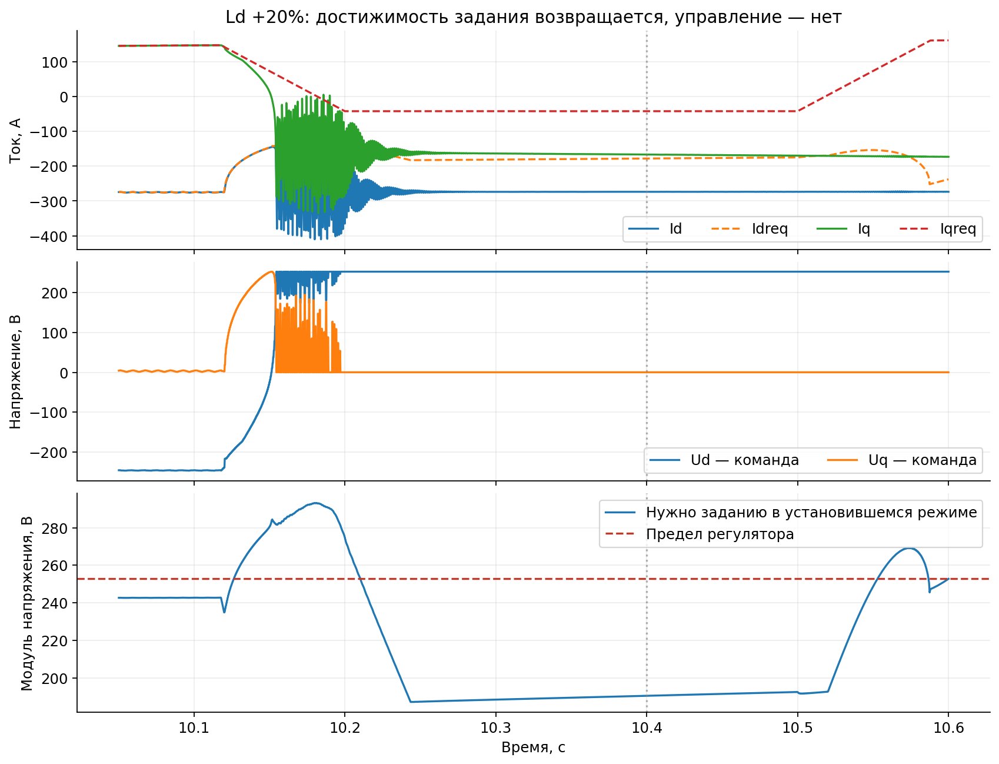

Рисунок 2. Повторный прогон исходной структуры, Ld +20%. Нижняя кривая — расчёт установившегося напряжения для задания по истинным параметрам машины. Динамические члены L·dI/dt в неё не включены.

По сигналам восстанавливается следующая последовательность; вклад ошибки оценки в запуск срыва ещё нужно отделить экспериментом от влияния траектории задания:

1. На высокой скорости уменьшается запрос момента.
2. FF быстро делает Idreq менее отрицательным.
3. Оценка Psi_est зависит от предыдущего Id и ошибки Ld; её использование при новой точке может занизить требуемое напряжение. Это объяснение триггера согласуется с уравнениями, но отдельным отключением оценщика не проверено.
4. Токовые PI входят в насыщение. Ось d занимает практически весь доступный вектор напряжения.
5. Ось q теряет возможность поддерживать требуемый Iq.
6. Позднее задание снова становится достижимым, но положительная ошибка d удерживает ограничитель в прежнем состоянии.

Проверочная точка повторного прогона:

| Величина при t = 10,4 с | Значение |
|---|---|
| Механическая скорость | 455,40 рад/с |
| Задание Id / Iq | −177,96 / −42,00 А |
| Измеренные Id / Iq | −273,67 / −166,59 А |
| Командные Ud / Uq | 252,764 / 0,0316 В |
| Напряжение, необходимое заданию в установившемся режиме | 190,40 В |
| Psi_est / истинная Ψ | 0,08641 / 0,10240 Вб |

Числа показывают именно потерю способности вернуться к достижимому заданию. Они не означают, что переход к нему можно выполнить за один такт.

Здесь Id уже более отрицателен, чем задание. Положительное Ud требуется для **снятия части ОП**, а не для усиления размагничивающего тока. Поэтому приоритет любого выхода PI_d нельзя отождествлять с сохранением необходимого ослабления. Режим потери отрицательного Id при просадке питания — другой обязательный сценарий проверки.

### 4.2. Почему насыщение поддерживает само себя

При Uq ≈ 0 и медленно меняющейся скорости:

$$
R_sI_q+\omega_e(\Psi+L_dI_d)\approx0.
$$

На высокой скорости резистивный член относительно мал, поэтому Id оказывается близким к −Ψ/Ld_ист, то есть примерно −275 А. Из уравнения d:

$$
I_q\approx-\frac{V_{\max}}{\omega_eL_q}.
$$

Это генераторный ток. При снижении скорости его модуль может возрастать.

Точное квазистационарное решение при Uq = 0 имеет вид:

$$
I_d=\frac{R_sV_{\max}-\omega_e^2L_q\Psi}
{R_s^2+\omega_e^2L_dL_q},
$$

$$
I_q=\frac{-\omega_e L_dV_{\max}-R_s\omega_e\Psi}
{R_s^2+\omega_e^2L_dL_q}.
$$

Приближение через 1/ωe нельзя продолжать до нулевой скорости: там резистивные члены становятся определяющими. Кроме того, в прогоне скорость меняется, а приложенное напряжение несколько отличается от командного из-за дискретного тракта.

В точке 10,4 с ошибка d положительна: примерно +95,7 А. PI_d требует увеличить Ud, но оно уже максимально. Clamping останавливает интегрирование в сторону насыщения, однако **не предоставляет напряжение оси q**. Для перехода к другому установившемуся потокосцеплению нужны согласованные изменения обеих компонент напряжения.

### 4.3. Почему наружный контур не выводит систему из защёлки

- После ограничителя он видит около 253 В независимо от того, насколько велик необрезанный запрос PI.
- Разность с целью ОП составляет около −11,4 В; глубина насыщения скрыта, но ненулевая ошибка для коррекции всё же существует.
- Оценка чувствительности по почти нулевому Uq становится ненадёжной. Знак может определяться членом Rs·Iqreq.
- Ограничение подстройки ±50 А по эквивалентному Id ограничивает её воздействие.
- Логика низкой скорости может запретить дальнейшее действие ОП, хотя внутренний контур ещё не восстановился.

Использование ограниченного напряжения в обратной связи ОП не является ошибкой само по себе: если цель ниже предела, контур получает ошибку и может регулировать. В этой реализации проблема связана также с чувствительностью, пределами коррекции и состоянием внутреннего контура. Необрезанный запрос полезен для диагностики дефицита, но его подстановка вместо прежнего сигнала ещё не обеспечивает выход.

В исходном исследовании расширение подстройки до ±150·Ld не устранило срыв. Снижение цели напряжения до 0,90 убрало длительную защёлку в рассмотренном прогоне, но оставило колебательные срывы порядка 50 мс. Эти опыты ограничивают вывод о проверенных настройках, а не обо всех возможных коэффициентах.

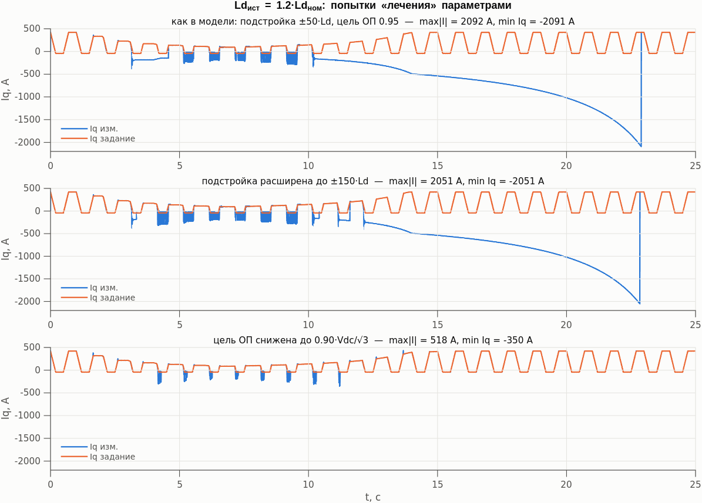

Рисунок 3. Материал исходного исследования. Эти варианты повторно не прогонялись при подготовке настоящего документа.

### 4.4. Обратная начальная реакция — отдельный механизм

Даже вне насыщения уменьшение Id может сначала увеличить требуемый модуль напряжения. При положительной скорости и моменте Ud обычно отрицательно. Член Ld·dId/dt при усилении ОП делает его ещё более отрицательным; снижение Uq возникает по мере изменения самого Id. При фиксированных Iq и скорости локальная связь имеет вид:

$$
\delta U_s=g_d\delta I_d+h_d\delta\dot I_d,
\qquad
g_d=\frac{R_sU_{d0}+\omega_eL_dU_{q0}}{U_{s0}},
\qquad h_d=\frac{L_dU_{d0}}{U_{s0}}.
$$

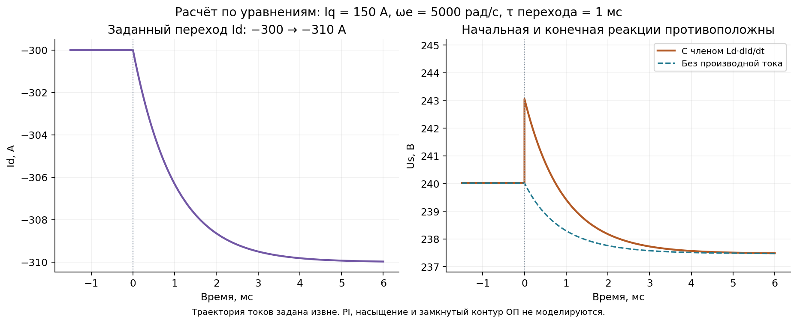

Рисунок Д1. Собственный расчёт по уравнениям машины: заданный переход Id от −300 до −310 А с постоянной времени 1 мс, Iq = 150 А, ωe = 5000 рад/с. Us сначала увеличивается с 240,016 до 243,049 В, затем снижается к 237,469 В. PI, насыщение и замкнутый контур ОП здесь не моделируются.

При gd > 0 и hd < 0 приближённый канал (gd + hd·s)·Ti(s), где Ti — предполагаемая динамика слежения по d, содержит положительный нуль −gd/hd. Поэтому нормировка статического усиления не сохраняет неизменной динамику объекта. В глубоком ОП нужно проверять не только знак чувствительности, но и допустимый темп наружного контура.

Этот вывод не объясняет автоматически зарегистрированную защёлку или колебания 240 Гц. В полном FOC изменяется Iq, работают ограничители, FF, фильтры и оценщики. Условия расчёта, влияние нижнего предела sens и план отдельной идентификации приведены в [подробном разборе, разделы 3–5 и 9](field_weakening_loop.md).

## 5. Ограничение вектора тока

### 5.1. Отставание бюджета Iq

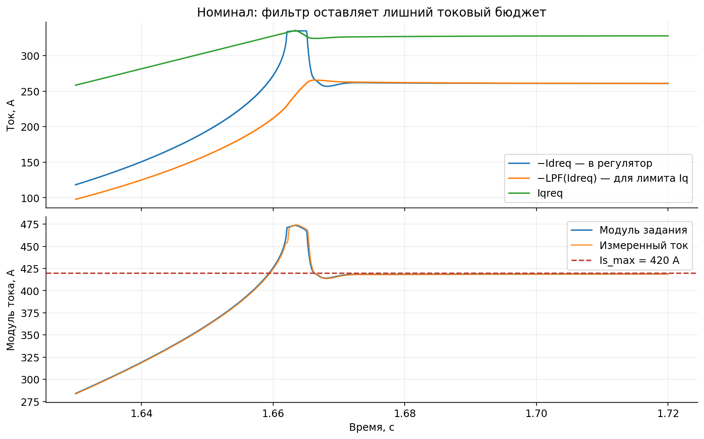

Рисунок 4. Повторный номинальный прогон. Токовый контур следует за заданием, уже вышедшим за допустимый круг.

При входе в ОП Idreq быстро уходит примерно к −335 А. Фильтр в расчёте IqLim ещё разрешает около +335 А по q:

$$
\sqrt{335^2+335^2}\approx474\ \text{А}.
$$

По актуальному Idreq остаток бюджета был бы около 253 А. Проблема существует даже при идеальном слежении токового контура, поэтому её нельзя устранить настройкой PI.

### 5.2. Генераторный запрос ограничен несимметрично

Min3 реализует min(IqLim, запрос). Отрицательный запрос проходит без ограничения снизу. В исходном профиле отрицательная часть равна всего −42 А; она не проверяет работу при сильной рекуперации.

Нужны отдельные физически обоснованные пределы обеих полярностей. Ограничение по модулю тока симметрично, но предел генераторной мощности и возможности DC-источника могут быть другими.

В текущем исследовании 420 А — фиксированный предел. Для реального привода Imax и допустимый момент могут изменяться по температуре, питанию и режиму инвертора. Их снижение также должно проходить через общий формирователь пары, а не только через независимое урезание Iq. Практические примеры верхнего уровня ограничения приведены в [разделах 4–5 обзора](industry_field_weakening.md).

### 5.3. Сам Id также обязан входить в токовый бюджет

Выходной предел −1,2·Psi_est/Ld не связан непосредственно с Is_max. С учётом диапазона FF и подстройки максимальный разрешённый модуль Idreq оценивается как:

$$
\min\left(
\frac{1{,}2\hat\Psi}{L_d},
\frac{\hat\Psi}{L_d}+50\ \text{А}
\right).
$$

При верхнем разрешённом Psi_est = 1,4·Psi он достигает **512,45 А**. Это граница, допускаемая структурой; одновременное достижение всех крайних значений в замкнутой модели отдельно не доказано.

Следовательно, вариант B1 исходного документа необходимо дополнить ограничением d. Если Id уже больше Is_max по модулю, даже Iq = 0 не возвращает вектор внутрь круга.

Есть и меньший численный дефект: используемый smoothmin может дать отрицательный результат при неотрицательных аргументах. Например, smoothmin(0, 100) с delta = 10 А равен примерно −0,249 А. Величина, трактуемая как **модуль допустимого Iq**, должна иметь нижний предел ноль.

## 6. Оценщики параметров

### 6.1. Lq: отсутствие информации нельзя исправить ограничением знаменателя

Ветка Divide8 → Saturation3 → Low-Pass Filter…9 реализует алгебраическую оценку:

$$
\hat L_{q,\mathrm{raw}}\approx
\frac{R_{s,\mathrm{ном}}I_d-U_{d,\mathrm{cmd}}}
{\omega_e I_q}.
$$

В знаменателях используются ограничения модуля: скорость не менее 40 электрических рад/с, ток не менее 0,1 А. Сырая оценка ограничивается диапазоном [0,1·Lq; 1,4·Lq] и фильтруется.

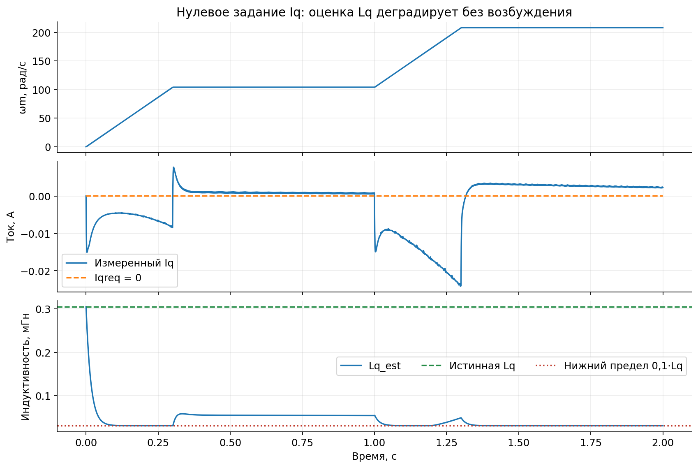

Рисунок 5. Дополнительный прогон исходной структуры: профиль скорости сохранён, все значения Repeating Sequence заменены на ноль. К 1,5–2 с оценка Lq достигает 0,0305 мГн при истинных 0,305 мГн.

При Iq ≈ 0 влияние Lq на установившееся напряжение d практически исчезает. Деление на искусственно заданные 0,1 А не создаёт недостающего измерения. Оценщик начинает интерпретировать малые остатки напряжения, дискретизацию и переходные процессы как изменение индуктивности.

Если временно считать знаменатели точными, из уравнения машины следует:

$$
\hat L_{q,\mathrm{raw}}=
L_q-\frac{L_d\dot I_d}{\omega_e I_q}
+\frac{(R_{s,\mathrm{ном}}-R_{s,\mathrm{ист}})I_d}
{\omega_e I_q}
-\frac{\delta U_d}{\omega_e I_q},
$$

где δUd = Ud_cmd − Ud_real. Все паразитные члены усиливаются при малом произведении ωe·Iq.

Ошибка передаётся в развязку d, FF ослабления поля и оценку Iq_voltLim. При заниженной в десять раз Lq_est сам расчёт ограничения Iq по напряжению завышается в десять раз; другие ограничители могут частично скрыть это. Срыв при последующем запросе момента из данного состояния ещё нужно проверить.

### 6.2. Psi_est: смешение потока магнитов и ошибки Ld

Ветка Divide7 → Sum12 → Saturation2 → Low-Pass Filter…7 использует:

$$
\hat\Psi_{\mathrm{raw}}=
\frac{U_{q,\mathrm{cmd}}-R_{s,\mathrm{ном}}I_q}{\omega_e}
-L_{d,\mathrm{ном}}I_d.
$$

В области, где ограничения знаменателя не действуют:

$$
\hat\Psi_{\mathrm{raw}}=
\Psi+(L_{d,\mathrm{ист}}-L_{d,\mathrm{ном}})I_d
+\frac{L_q\dot I_q}{\omega_e}
+\frac{(R_{s,\mathrm{ист}}-R_{s,\mathrm{ном}})I_q}{\omega_e}
+\frac{\delta U_q}{\omega_e}.
$$

Отсюда следуют три разных источника ошибки:

1. Статическая ошибка Ld выглядит как изменение потока магнитов, зависящее от Id.
2. Переходный процесс Iq попадает в ту же оценку.
3. Ошибка приложенного напряжения также приписывается машине.

Например, при Ld +20% и Id = −275 А статическое смещение составляет −0,01705 Вб. Квазистационарная оценка получается около 0,08535 Вб вместо истинных 0,1024 Вб. В повторном прогоне при 10,4 с получено 0,08641 Вб; фильтрация и динамика объясняют, почему числа не обязаны совпадать точно.

При длительном стоянии без тока и напряжения сырая оценка стремится к нулю. Нижний предел 0,6·Psi тогда не удерживает исходную оценку, а заставляет фильтр двигаться к 0,6·Psi. Это следствие структуры; отдельный длительный прогон стоянки здесь не выполнялся.

Ускорить фильтр недостаточно: уменьшится задержка, но усилится прохождение переходных членов. Требуется определиться, что оценивается: поток магнитов при известной Ld, суммарный поток Ψd или совместная модель параметров при достаточном возбуждении.

### 6.3. Что следует из практики параметризации

Онлайн-оценивание Lq и Ψ не является обязательным условием работоспособного ОП. Для начального сравнения ограничителей можно фиксировать номинальные параметры регулятора, сохраняя ошибки истинных параметров машины. Это позволит отделить нелинейность насыщения от динамики адаптации. Затем оценщики возвращаются с условиями valid/hold и проходят отдельные испытания.

Для насыщенной машины одного постоянного L недостаточно. Карты потокосцеплений и их производных, температурная параметризация и онлайн-адаптация — разные способы описания машины. Опубликованные таблицы заданий в тяговых контроллерах не подтверждают наличие в них именно наших алгебраических оценщиков. Переход к нелинейной машине потребует различать потокосцепление для установившегося режима и дифференциальную индуктивность для динамики тока.

## 7. Напряжение регулятора и напряжение машины

### 7.1. Несогласованность статических пределов SVPWM

В SVPWM1 относительная амплитуда:

$$
m=\frac{\sqrt{3}\,V_{\mathrm{ref}}}{V_{\mathrm{dc}}},
\qquad m\le0{,}995.
$$

В середине сектора сумма активных времён равна m, поэтому крайние скважности:

$$
d_{\max,\mathrm{raw}}=\frac{1+m}{2},
\qquad
d_{\min,\mathrm{raw}}=\frac{1-m}{2}.
$$

При m = 0,995 они равны 0,9975 и 0,0025. Финальные ограничения [0,005; 0,995] обрежут обе.

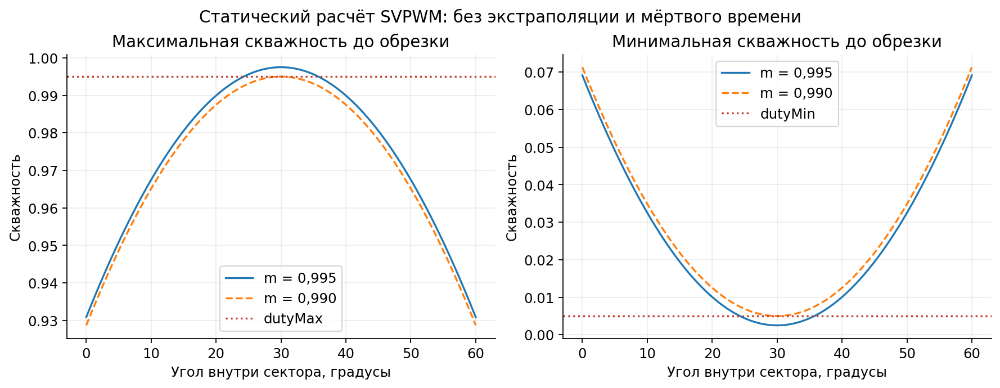

Рисунок 6. Прямой расчёт существующего алгоритма, без симуляции машины. Это не результат нового испытания замкнутого контура.

Для симметричного запаса скважности dmin = 0,005 согласованная круговая граница без такой обрезки:

$$
m_{\max}\le1-2d_{\min}=0{,}99,
\qquad
V_{\lim}\le0{,}99\,V_{\mathrm{dc}}/\sqrt3.
$$

При 440 В это 251,49 В. Разница с текущими 252,76 В невелика — около 1,27 В, — но она важна у границы насыщения. Экстраполяция скважности и компенсация мёртвого времени могут потребовать дополнительного запаса; одно число 0,99 не учитывает их динамику.

Эта граница относится к принятому SVPWM и указанным пределам duty, а не ко всем приводам. Overmodulation, минимальное время импульса и окна измерения тока рассматриваются отдельно. Также нельзя смешивать коэффициент использования шины, долю напряжения d и запас между целью ОП и физическим пределом.

### 7.2. Что не видят PI и оценщики

Существующие Ud/Uq — команды после ограничений VectorBase. После них остаются:

- преобразование координат с опережением угла;
- удержание и задержка скважностей;
- окончательная обрезка скважностей;
- умножение на фактическое Vdc.

В текущей схеме регулятор и нормировка SVPWM используют фильтрованное Vdc, а идеальные фазные источники масштабируются фактическим Vdc. При его скачке некоторое время:

$$
U_{\mathrm{real}}\approx
U_{\mathrm{расчётное}}\frac{V_{\mathrm{dc,actual}}}{V_{\mathrm{dc,filt}}},
$$

если отдельно пренебречь обрезкой и динамикой преобразования координат. На постоянных 440 В этот эффект не проявляется. Ступень Vdc остаётся обязательным будущим испытанием.

Поэтому ограниченная команда, реконструированное среднее напряжение и измерение на машине должны быть разными сигналами. Для anti-windup допустима модель актуатора, если она учитывает действующее насыщение и согласована по времени. Для оценивания параметров особенно существенна погрешность этой модели: команда не становится измерением только потому, что она прошла ограничитель.

## 8. Предлагаемая структура исправления

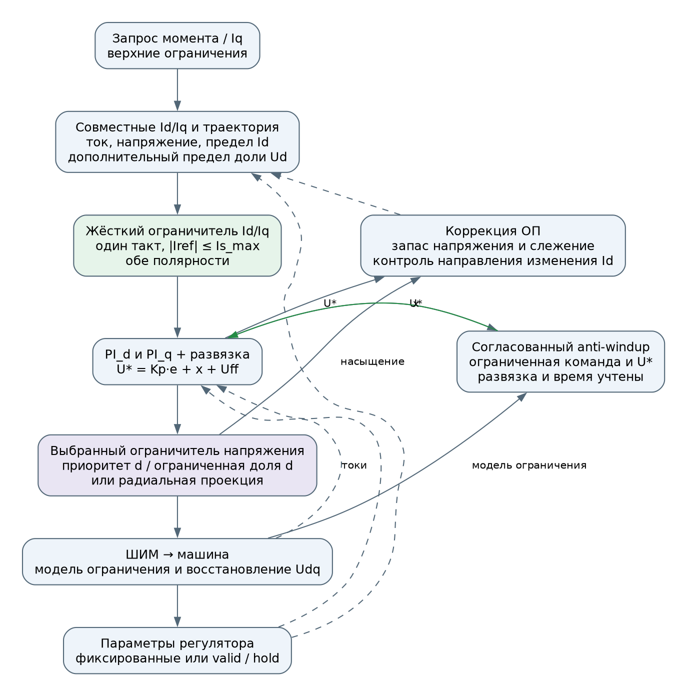

Рисунок 7. Общая структура для сравнения ограничителей. Она не предписывает радиальную проекцию. Порядок вычисления выходов, ограничений и следующих состояний задаётся отдельно.

### 8.1. Жёсткий инвариант для пары токовых заданий

Последний ограничитель ставится непосредственно перед токовым регулятором, после мягких фильтров, ограничений скорости изменения и задержек формирования задания:

```matlab
IdLo = max(-Is_max, Id_demag_min);  % Id_demag_min <= 0, из параметров машины
Idref = min(0, max(IdLo, Id_candidate));

IqCurrentMax = sqrt(max(0, Is_max^2 - Idref^2));
IqPosMax = min(IqCurrentMax, max(0, IqPositiveAllowed));
IqNegMax = min(IqCurrentMax, max(0, IqNegativeAllowed));
Iqref = min(IqPosMax, max(-IqNegMax, Iq_candidate));
```

Id_demag_min здесь — отдельный допустимый предел машины, а не прежнее выражение через Psi_est. Для исследования без такого ограничения можно использовать −Is_max; для стенда предел следует определить по машине.

Оба значения выдаются одной парой в одном такте. После этого узла нельзя независимо фильтровать Id и Iq так, чтобы снова нарушить круг. Фильтр 8,33 мс можно оставить в предварительном формирователе, но не использовать его как единственную защиту тока.

Формулы гарантируют ограничение **задания**. Они не гарантируют отсутствие переходного превышения измеренного тока; это отдельный критерий проверки.

### 8.2. Распределение доступного напряжения

Оба PI сначала формируют необрезанные команды вместе с развязкой:

$$
\mathbf U^*=\mathbf K_p\mathbf e+\mathbf x+\mathbf U_{\mathrm{ff}}.
$$

Ограничитель применяется к суммарной команде после развязки. Сравниваются три политики при одинаковом Ulim: исходный приоритет d, ограниченный приоритет d и радиальное ограничение.

**Первый кандидат — приоритет d с ограниченной долей напряжения:**

$$
U_{d,s}=\operatorname{clip}(U_d^*,-k_dU_{\lim},k_dU_{\lim}),\quad 0<k_d<1,
$$

$$
U_{q,\max}=\sqrt{\max(0,U_{\lim}^2-U_{d,s}^2)},\qquad
U_{q,s}=\operatorname{clip}(U_q^*,-U_{q,\max},U_{q,\max}).
$$

Такой вариант сохраняет смысл приоритета d, но не позволяет занять ей весь круг. В опубликованном коде VESC используется именно этот подход; в общей конфигурации kd = 0,98. Это отправная точка для исследования, а не готовая настройка Adaptto. [Исходный код и разбор](industry_field_weakening.md).

При kd = 0,98 доступный диапазон q не уже ±0,199·Ulim. Резерв диапазона не задаёт обязательное Uq и не гарантирует преодоления противо-ЭДС. Ограничение d может уменьшить достижимый момент; его необходимо учитывать в формирователе заданий, как показано в п. 8.4.

**Вариант сравнения — радиальная проекция:**

$$
\mathbf U_s=
\begin{cases}
\mathbf U^*,&\|\mathbf U^*\|\le U_{\lim},\\
\displaystyle\frac{U_{\lim}}{\|\mathbf U^*\|}\mathbf U^*,&
\|\mathbf U^*\|>U_{\lim}.
\end{cases}
$$

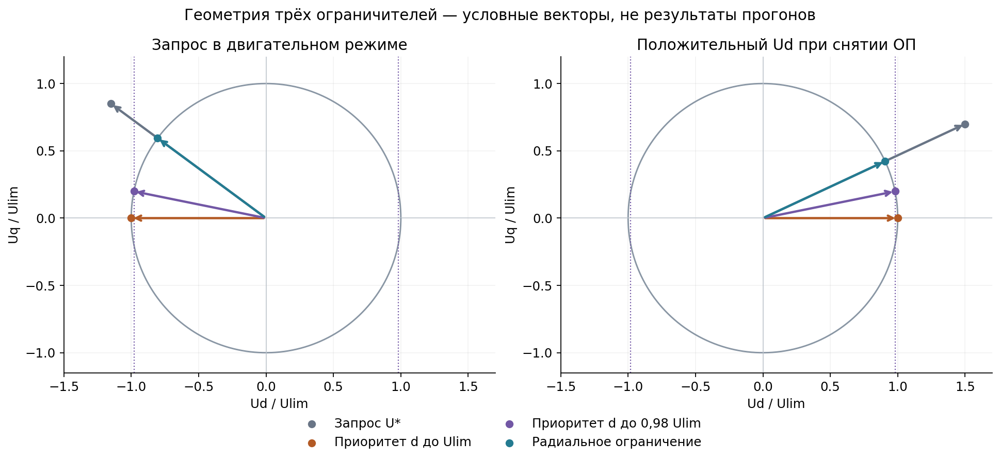

Рисунок 8. Два условных запроса для сравнения трёх правил. Это геометрия ограничения, а не испытание замкнутого управления.

Радиальная проекция сохраняет угол текущего запроса напряжения, но не угол тока и не необходимый Id. В установившемся двигательном режиме Ud0 < 0, Uq0 > 0 при умножении всего напряжения на α < 1 начальные производные равны:

$$
\dot I_d(0^+)=\frac{(\alpha-1)U_{d0}}{L_d}>0,\qquad
\dot I_q(0^+)=\frac{(\alpha-1)U_{q0}}{L_q}<0.
$$

Отрицательный Id уменьшается по модулю, что увеличивает потребность в Uq. Одновременно падение положительного Iq разгружает компенсацию по d. Эти конкурирующие изменения и последующая реакция PI определяют переход; неизбежность срыва или восстановления из геометрии не следует. [Расчёт и иллюстрация](industry_field_weakening.md).

Для честного сравнения сохраняется доступ к U* до выбранного ограничения. В радиальном варианте прежние динамические пределы, реализующие приоритет d, должны быть отключены или перестроены: добавленная после них проекция не является независимым радиальным ограничителем. В варианте с приоритетом d динамические пределы можно сохранить, пересчитав их по новой границе и правильно учитывая развязку. В обоих случаях anti-windup должен соответствовать окончательной команде.

Ulim рассчитывается из доступного Vdc с учётом финальных пределов скважности. Для первого этапа при выключенных компенсациях используется согласованная граница 0,99·Vdc/√3; цель ОП должна лежать ниже неё. Точное значение рабочего запаса выбирается по переходным испытаниям.

Сначала испытывается работа с фиксированными параметрами регулятора и заранее допустимыми заданиями. Затем включаются наружный контур ОП и адаптация. Ни ограниченный приоритет, ни радиальная проекция пока не признаны достаточным исправлением.

### 8.3. Anti-windup для обоих интеграторов

Clamping, ограничение интегрального состояния и back-calculation — разные допустимые методы. Проблема исходной модели состоит в отсутствии восстановления всей связанной системы в испытанных режимах, а не в самом названии clamping. Независимый предел интегратора не обязательно учитывает итоговую обрезку суммы PI и развязки.

Для сравниваемых вариантов можно использовать общий tracking/back-calculation. Для интегральных состояний в вольтах его дискретная форма:

$$
\mathbf x_{k+1}=
\mathbf x_k+T_s\left[
\mathbf K_i\mathbf e_k+
\mathbf K_{\mathrm{aw}}(\mathbf U_{\mathrm{track},k}-\mathbf U_k^*)
\right].
$$

На первом этапе с идеализированным согласованным актуатором Utrack = Us. Если за ним действует дополнительная обрезка SVPWM, tracking должен учитывать её через модель финальной команды или согласованное по времени восстановление напряжения. Обычное запаздывание ШИМ не следует без разбора трактовать как новое статическое насыщение.

Развязка включена в U*. Если используется tracking-вход стандартного PID Controller, который относится только к выходу PI, на него нужно подать **Utrack − Uff**. Иначе интегратор начнёт компенсировать сам feedforward. Такой способ работы с внешним насыщением и feedforward соответствует [рекомендациям MathWorks по tracking anti-windup](https://www.mathworks.com/help/simulink/slref/anti-windup-control-using-a-pid-controller.html).

Здесь Kaw имеет размерность 1/с. Для изолированной явной tracking-коррекции множитель равен 1 − Ts·Kaw: диапазон 0 < Ts·Kaw < 2 обеспечивает устойчивость только этой скалярной коррекции, а 0 < Ts·Kaw ≤ 1 исключает её знакопеременную сходимость. **Это не критерий устойчивости полного FOC.** Коэффициент следует выбирать с учётом задержек и проверять прогонами.

Нельзя напрямую вычитать напряжение предыдущего периода из текущего U*, не учтя время их формирования. Варианты реализации:

- вычислять конечные скважности текущей команды алгебраически и использовать полученное ограничение для текущего anti-windup;
- для измеренного или восстановленного за прошлый период напряжения хранить соответствующие U*, Uff и угол, а tracking проектировать как отдельную дискретную обратную связь с задержкой.

Один такт не должен содержать алгебраическую петлю через новое состояние интегратора: сначала вычисляются выход и ограничения по x_k, затем x_{k+1}.

### 8.4. Согласованный расчёт достижимой пары Id/Iq

Жёсткий токовый ограничитель решает только часть задачи. Предварительный формирователь должен искать точку в пересечении токового круга, эллипса напряжения, допустимого диапазона Id и дополнительных ограничений выбранного актуатора.

Реализовать этот поиск можно расчётом, таблицами Id/Iq или через угол тока с обратной связью по напряжению. Такие подходы представлены в [обзоре](industry_field_weakening.md). Для нашей машины с постоянными параметрами ниже предложен прозрачный аналитический расчёт; он не является единственным промышленным способом.

Для заданного q = Iq и оценённых параметров запишем:

$$
\mathbf U_{\mathrm{ss}}(I_d,q)=\mathbf a I_d+\mathbf b,
\quad
\mathbf a=
\begin{bmatrix}\hat R_s\\ \omega_e\hat L_d\end{bmatrix},
\quad
\mathbf b=
\begin{bmatrix}-\omega_e\hat L_q q\\ \hat R_s q+\omega_e\hat\Psi\end{bmatrix}.
$$

В первой реализации без новой идентификации Ld и Rs здесь используются их номинальные значения. Значок оценки не означает, что отдельные оценщики Ld/Rs уже существуют в исходной модели.

Условие по напряжению сводится к квадратному неравенству:

$$
A I_d^2+B I_d+C\le0,
\quad
A=\mathbf a^\mathsf{T}\mathbf a,\quad
B=2\mathbf a^\mathsf{T}\mathbf b,\quad
C=\mathbf b^\mathsf{T}\mathbf b-V_{\mathrm{FW}}^2.
$$

При A > 0 и неотрицательном дискриминанте допустим интервал между корнями. Его нужно пересечь с:

$$
\left[
\max\left(I_{d,\min},-\sqrt{I_{\max}^2-q^2}\right),\ 0
\right],
\qquad |q|\le I_{\max}.
$$

Это позволяет учитывать Rs и знак ωe без ручного выбора знака квадратного корня из старой FF-формулы.

Для варианта с ограниченной долей d дополнительно проверяется:

$$
|\hat R_sI_d-\omega_e\hat L_q q|\le k_dU_{\lim}.
$$

Это линейное ограничение даёт ещё один интервал Id при Rs > 0; при пренебрежении Rs проверяется непосредственно. Если требуется запас и по d, применяется более узкая расчётная граница. Искать точку только внутри полного эллипса и затем исключать её ограничителем d — несогласованная постановка.

Порядок работы:

1. Проверить запрос q с учётом тока и ограничений мощности.
2. Найти допустимый интервал Id.
3. Если интервал непустой, выбрать целевой Id: для базового установившегося варианта ближайший к нулю либо ближайший к предварительному Id с коррекцией ОП. Переход к нему формируется отдельно; скачок к ближайшей к нулю точке может слишком быстро снять ОП.
4. Если интервал пустой, искать меньший по модулю q того же знака, для которого есть допустимый Id; допустимость такого направления поиска и наличие начальной достижимой точки проверяются явно.
5. Если нет подходящей точки, выдать признак недостижимости запроса и перейти к отдельно определённому режиму ограничения, а не продолжать интегрировать ошибку.

Бисекция по модулю q допустима, когда установлено, что q = 0 достижим и допустимое множество вдоль поиска образует интервал от нуля. При предельной скорости q = 0 также может быть недостижим; этот случай нельзя автоматически объявлять невозможностью любого управления. Нужно проверить всё допустимое множество и предусмотреть поведение верхнего уровня.

Этот расчёт обеспечивает достижимость **по оценённой установившейся модели**. Ошибки параметров, динамические члены и инверторные искажения требуют запаса и обратной связи. Это также ещё не оптимизатор максимального момента: при существенной разнице Ld и Lq отдельно учитываются MTPA/MTPV и формула момента.

### 8.5. Переходы и коррекция ослабления поля

При сбросе момента нельзя мгновенно снимать отрицательный Id только потому, что новая установившаяся точка выглядит допустимой. Для предварительной проверки темпа изменения можно использовать:

$$
\mathbf U_{\mathrm{dyn}}\approx
\mathbf U_{\mathrm{ss}}+
\begin{bmatrix}L_d\dot I_{d,\mathrm{ref}}\\L_q\dot I_{q,\mathrm{ref}}\end{bmatrix}.
$$

Это приближённая оценка необходимого запаса, а не точный прогноз замкнутого контура. Если переход требует слишком большого напряжения, его нужно замедлить или изменить траекторию пары токов.

Сигнал обратной связи ОП выбирается вместе с законом регулятора. Возможны модуль запроса напряжения, модуль ограниченной команды или показатель модуляции. При цели ниже предела даже ограниченный сигнал даёт ошибку для регулирования; недостаток — потеря информации о глубине насыщения. Поэтому для исследования дополнительно логируются U*, Us, Ureal, признак насыщения и ошибки токов. Автоматически заменять обратную связь на U* без настройки динамики и anti-windup нельзя.

Для выбора направления коррекции полезна производная установившегося напряжения при фиксированном Iq:

$$
g_d=\frac{\partial V_{\mathrm{ss}}}{\partial I_d}
=\frac{\hat R_s U_{d,\mathrm{ss}}
+\omega_e\hat L_d U_{q,\mathrm{ss}}}
{\max(V_{\mathrm{ss}},\varepsilon_V)}.
$$

При gd > 0 более отрицательный Id уменьшает требуемое напряжение. При gd ≈ 0 дальнейшее уменьшение Id почти бесполезно. При gd < 0 оно увеличивает напряжение. Поэтому нельзя просто заменить малую чувствительность фиксированным числом и продолжать движение в прежнюю сторону.

Эти утверждения относятся к фиксированному Iq. На границе токового круга изменение Id меняет также допустимый Iq; полную пару должен пересчитывать совместный формирователь. Производная gd служит местной проверкой направления коррекции и не заменяет этот расчёт.

Кроме статического gd, существен динамический член hd·dId/dt из п. 4.4. Его нельзя компенсировать одним делением на чувствительность. Нижний предел |sens| ≥ 0,1 ограничивает обратное усиление и возле малого gd может уменьшить эффективную полосу; сам по себе он не доказывает ни неустойчивость, ни достаточный запас устойчивости. Перед выбором KFW измеряется канал Idref → Us с действующими токовыми контурами и фильтрами, сначала при фиксированном Iq, затем вдоль согласованной траектории пары.

Полный модуль напряжения сохраняет физический смысл. Замена на duty лишь нормирует его по шине; замена на квадрат модуля в локальной модели не удаляет положительный нуль. В [сопоставлении вариантов A–D](field_weakening_loop.md) отдельно рассмотрены ограниченный I-контур, конечная карта duty → Id, совместный формирователь с подстройкой и управление углом тока.

Для первой реализации предлагается:

- на ветви gd > gmin медленно корректировать Id по ошибке напряжения, ограничивая величину и темп коррекции;
- при малой или отрицательной чувствительности передавать ограничение момента формирователю достижимой пары токов;
- возвращать в интегратор ОП разность между предварительным и окончательно реализованным Idref, чтобы он не накапливался за внешним ограничением;
- применять гистерезис разрешения и плавное восстановление коррекции при входе/выходе из ОП.

Например, на разрешённой ветви начальная форма коррекции в амперах:

$$
\Delta I_{d,k+1}=
\operatorname{clip}\left(
\Delta I_{d,k}-K_{\mathrm{FW}}T_s e_{V,k}
+K_{\mathrm{tr,FW}}T_s
(I_{d,\mathrm{ref},k}-I_{d,\mathrm{pre},k})
\right),
$$

где для этого кандидата eV = LPF(‖U*‖) − VFW, KFW имеет размерность А/(В·с), а Ktr,FW — 1/с. Другой сигнал напряжения требует отдельного обозначения и настройки. Ветвь должна отключать коррекцию по eV при отсутствии достоверной чувствительности. Конкретные коэффициенты и пределы clip определяются после испытания внутреннего токового контура.

Обнуление Id при выходе из ОП разрешается только после проверки достижимости такого режима. Сам по себе логический переход признака скорости не подтверждает восстановление внутреннего контура.

Нужно различать недостаточное ОП, чрезмерное ОП и слишком быстрое снятие ОП. Уменьшение допустимого размагничивающего тока по ошибке Iq, подобное backoff VESC, является режимной коррекцией, а не универсальной реакцией на любую большую ошибку. Для нашей защёлки её знак и условия должны быть выведены заново. Ограничение момента также должно учитывать знак мощности и возможности DC-звена.

### 8.6. Условия достоверности оценщиков

Если онлайн-адаптация сохраняется, для каждого оценщика вводится собственный признак valid. До этого сравнения выполняются с фиксированными номинальными параметрами регулятора и варьируемыми параметрами машины. Для Lq нужны как минимум:

- достаточный модуль электрической скорости;
- достаточный модуль Iq;
- ограниченная скорость изменения Id либо явный учёт её вклада;
- достоверное реализованное напряжение и согласованные времена измерений.

Порог следует связывать с отношением полезного сигнала к погрешности. Например, при допустимой относительной ошибке εL:

$$
|\omega_e I_q|\,L_{q,\mathrm{scale}}
>
\frac{\Delta U_{\mathrm{err}}+
L_d|\dot I_d|+
|\Delta R_s I_d|}{\varepsilon_L}.
$$

Это оценка пригодности измерения; пороги 40 рад/с и 0,1 А из защиты деления не являются автоматически порогами valid.

При valid = 0 адаптация удерживает последнее достоверное значение. Нужны гистерезис, выдержка входа в valid и ограничение скорости обновления. Если достоверной оценки ещё не было, используется номинальное значение с явно заданным запасом.

Для Psi_est дополнительно решается вопрос ошибки Ld. Для первого этапа адаптации разумно запретить изменение оценки потока магнитов в глубоком ОП и на быстрых переходах, идентифицируя её в подходящих режимах с малым Id и достаточной скоростью. Удержанная оценка может устареть при изменении температуры; это требуется проверить отдельно. Далее возможны:

- карта Ld(Id, Iq) и согласованная оценка Ψ;
- наблюдатель суммарных потоков Ψd/Ψq;
- совместная идентификация параметров при достаточном возбуждении.

Замена Ψ на суммарный поток не решает автоматически обратную задачу «какой Id задать»: для неё всё равно нужна корректная зависимость потока от токов. Это отдельный этап, а не переименование текущего сигнала.

### 8.7. Восстановление реализованного напряжения

Для идеального трёхфазного инвертора средние фазные напряжения относительно нейтрали можно получить из конечных скважностей:

$$
\bar d=(d_a+d_b+d_c)/3,\qquad
u_{a,b,c}=V_{\mathrm{dc}}\,(d_{a,b,c}-\bar d).
$$

Затем выполняется то же Clarke/Park-преобразование с углом, соответствующим периоду приложения напряжения. Для текущей модели это позволяет учесть финальную обрезку и фактический Vdc.

На ключевой модели добавляются мёртвое время, падения напряжения и условия измерения тока. Согласование временных меток обязательно: ток после задержки нельзя сопоставлять с ещё не приложенным напряжением.

## 9. Какие варианты следует сравнить

Обозначения A1–A6/B1–B3 ниже сохранены из исходного разбора. Варианты A–D [нового документа](field_weakening_loop.md) относятся к организации наружного ОП. Это разные уровни: кандидат C с совместным формирователем может использовать внутренний ограничитель A2, а затем сравниваться с A1 при согласованном anti-windup.

| Мера из исходного документа | Оценка и место в решении |
|---|---|
| A1: радиальная проекция + anti-windup | Вариант сравнения. Не сохраняет Id и не гарантирует устойчивость ОП |
| A2: резерв Uq через ограничение доли d | Первый кандидат вместе с согласованием заданий и anti-windup. Резерв не гарантирует нужного Uq; новая граница включается в расчёт достижимости |
| A3: использовать запрос до ограничителя | Полезен для диагностики и как один из сигналов ОП. Не является обязательной заменой любого ограниченного сигнала |
| A4: tracking задания d | Полезен как согласование наружного контура с итоговым заданием; прямое притягивание к измеренному току требует осторожности |
| A5: улучшить Ld/Ψ и FF | Убирает часть триггеров. Не заменяет устойчивую обработку насыщения |
| A6: детектор и сброс интегратора d | Может быть диагностической страховкой; сам по себе не гарантирует выхода |
| B1–B3: жёсткий круг и обе полярности Iq | Обязательны, с добавлением независимого предела Id и единого такта пары токов |

Почему сброс PI_d не является достаточным решением: в точке 10,4 с повторного прогона при x_d = 0

$$
U_d^*=K_{pd}(I_{d,\mathrm{req}}-I_d)
-\omega_e\hat L_qI_q\approx436{,}38\ \text{В}.
$$

Это всё ещё намного больше 252,76 В. Даже с нулевым интегратором пропорциональная часть и развязка удерживают насыщение.

Утверждение исходного документа, что при A1 «ловушка исчезает», следует понимать узко: исчезает конкретное геометрическое правило, обнуляющее бюджет q. Автоматическую устойчивость при любых параметрах, задержках и запросах оно не доказывает.

Опубликованные реализации дают основание не отвергать приоритет d. Они не подтверждают, что конкретное значение kd или чужая логика backoff исправят Adaptto. В сравнении следует отдельно оценить свойства распределения напряжения, anti-windup, траектории заданий и адаптации; иначе улучшение нельзя будет приписать определённой мере.

## 10. Порядок реализации и проверки

### 10.1. Этапы изменения модели

| Этап | Что изменить или проверить | Цель и условие перехода дальше |
|---|---|---|
| 0 | Полный исходный прогон, совместное логирование пары токов и всех стадий напряжения | Зафиксировать исходное поведение и критерии без изменения модели |
| 1 | Жёсткий ограничитель Id/Iq, обе полярности, неотрицательный IqLim; согласование SVPWM | Разделить влияние исправлений тока и напряжения отдельными вариантами |
| 2 | Зафиксировать номинальные параметры регулятора; сохранить вариации истинной машины | Получить контрольную ветвь без динамики оценщиков; прежнюю адаптивную ветвь сохранить |
| 3 | Подготовить достижимые задания и допустимые переходы; включить предел доли d в расчёт | Исключить заведомо несовместимые требования при испытании токового контура |
| 4 | Сравнить исходный приоритет, ограниченный приоритет и радиальную проекцию с совместимым anti-windup | Проверить восстановление, удержание Id, момент и цену резерва q |
| 4а | Измерить локальные каналы Idref → токи и напряжения при отключённой подстройке и фиксированном FF; повторить с вдвое меньшим возмущением | Разделить обратную начальную реакцию, малую статическую чувствительность и насыщение |
| 5 | Сравнить наружные варианты A/B; затем совместный формирователь C и угловую параметризацию D, настроить темп и tracking; после этого вернуть valid/hold | Разделить влияние наружного контура и адаптации; проверить переходы и нулевое возбуждение |
| 6 | Полная матрица, настройка колебаний, затем ключевая модель и динамическое DC-звено | Подтвердить выбранное решение с задержками, ШИМ и ограничениями питания |

Каждый этап сохраняется отдельной версией модели и прогоняется в отдельную папку результатов. Изменения коэффициентов должны быть отделены от изменений структуры, чтобы было понятно, какая мера дала эффект.

Для этапа 4 задаются общий физический предел напряжения, одинаковые профили и параметры. Начальная сетка kd, например 0,95 / 0,98 / 0,995, является планом эксперимента. Отдельно сравниваются одинаковые заранее заданные траектории и полный алгоритм с формирователем, учитывающим ограничения каждой политики. Исходный контрольный прогон с прежней границей 0,995·Vdc/√3 не подменяется ветвью с исправленной границей 0,99·Vdc/√3.

Основные места изменения в существующем SLX:

| Узел модели | Предлагаемое действие |
|---|---|
| Min3, Min_smooth_ab, Sqrt, Low-Pass Filter…8, Unit Delay1 | Добавить итоговое ограничение одной пары Id/Iq; мягкий фильтр оставить до него |
| VectorBase/PID Controller3 и PID Controller4 | Согласовать anti-windup с выбранной политикой и развязкой; логировать U* и интеграторы |
| VectorBase/UqLimiter, Sum7…Sum10 | Реализовать переключаемые варианты ограничения; исключить скрытое последовательное ограничение в радиальной ветви |
| VectorBase/Gain, SVPWM1, фильтр Vdc | Согласовать доступное напряжение, пределы скважности и фактическое питание |
| Divide, Divide3, sat_signed4, PID Controller контура ОП | Пересмотреть ошибку насыщения, условия чувствительности, tracking и reset |
| Divide7/8, Saturation2/3, Low-Pass Filter…7/9 | Добавить фиксированную контрольную ветвь, затем условия достоверности, удержание и согласованное напряжение |
| Min1, Saturation Dynamic/Dynamic1, Gain1 | Встроить совместный расчёт достижимых токов и обработку недостижимого запроса |

При переименовании или замене блоков обновляется также список логируемых сигналов в run_aug.m. Старые имена нельзя сохранять как единственный контракт проверки новой структуры.

### 10.2. Матрица испытаний

| Группа | Сценарии | Для чего |
|---|---|---|
| Воспроизведение исходного исследования | Полные 25 с: номинал, Ψ ±10%, Lq ±20%, Ld ±20%, Rs +50%; отдельно Ld +30% | Сравнить с известными срывами |
| Сочетания ошибок | Одновременные изменения Ld/Lq/Ψ/Rs в обоснованных диапазонах | Одиночные изменения не покрывают совместную ошибку |
| Момент | Сброс и набор на высокой скорости, смена знака, сильная рекуперация | Проверить обе полярности и переходы |
| Локальная динамика ОП | Малые возмущения при постоянном Iq и вдоль токовой дуги, точки малого gd, проверка линейности уменьшением амплитуды | Сопоставить измеренный канал с расчётом из п. 4.4 без насыщения |
| Оценщики | Длительная стоянка, вращение при Iq ≈ 0, затем запрос момента | Проверить удержание оценок и восстановление |
| Скорость | Полные профили при ωm > 0 и ωm < 0; проход через ноль | Проверить знаки и переключения valid |
| Питание | Спад и рост Vdc в глубоком ОП, например ±20% как начальный стресс-тест | Проверить запас и временное рассогласование |
| Политика ограничения | Одинаковые траектории для трёх политик; несколько kd; отдельно фиксированные и адаптивные параметры | Разделить действие геометрии, anti-windup, формирователя и оценщиков |
| Два направления изменения Id | Потеря отрицательного Id при дефиците напряжения; быстрое снятие ОП при сбросе момента | Проверить оба механизма, а не только зарегистрированную защёлку |
| Изменяемые пределы | Снижение Imax, предела Id, доступной генераторной мощности | Проверить согласование пары при изменении допустимой области |
| Переход режимов | Нулевой момент на высокой скорости, вход/выход ОП, останов с активным ОП | Исключить необоснованное обнуление Id по одному логическому флагу |
| Угловая область | Медленный проход через участок колебаний, затем удержание скорости и задания | Отличить переходный процесс от устойчивого предельного цикла |
| Реализация | Задержки измерения/вычисления/ШИМ, шумы, квантование, мёртвое время | Проверить переносимость на реальный привод |
| Физические пределы | Недостижимое задание, пустое допустимое множество, предел Id | Проверить определённое поведение при невозможности исполнить запрос |

При исследовании 240 Гц сначала фиксируются оценщики, затем по отдельности меняются мягкий фильтр Idreq, динамика FF и обратная связь ОП. Жёсткий токовый предел остаётся включённым. Такие эксперименты нужны для установления причинной связи.

### 10.3. Критерии приёмки

1. **Задание тока:** модуль итоговой пары не превышает Is_max с учётом заранее заданного численного допуска.
2. **Измеренный ток:** исходный рабочий критерий — не более 1,05·Is_max = 441 А. Это исследовательский критерий; допустимый ток аппаратуры может потребовать более строгой границы.
3. **Слежение:** нет непрерывных эпизодов абсолютной ошибки Iq более 100 А дольше 20 мс после возвращения задания в достижимую область и согласованного окна перехода. Для d задаётся аналогичный критерий. В анализе фиксируются фактическая достижимость по истинным параметрам модели и достижимость по оценке регулятора; это разные признаки.
4. **Восстановление:** после конечного возмущения система выходит из насыщения без ручного сброса и без ожидания падения скорости почти до нуля.
5. **Момент:** нет длительного момента противоположного знака при ненулевом задании вне согласованного окна перехода. Для малых запросов задаётся зона нечувствительности.
6. **Напряжение:** команда после выбранного ограничителя лежит внутри его области. Для ограниченного приоритета проверяется также |Ud| ≤ kd·Ulim; дополнительно логируются конечная обрезка duty, Us − U* и согласованная по времени разность Ureal − Us.
7. **Оценщики:** при valid = 0 сохраняется последняя достоверная оценка; вход в valid не создаёт скачка задания. Допустимая ошибка задаётся только для режимов, где параметр действительно наблюдаем.
8. **Колебания:** на первом этапе не хуже исходных 24 А p-p по Id в заданном окне; окончательная цель — отсутствие устойчивого предельного цикла при постоянных внешних условиях.
9. **Производительность:** отдельно измеряются исполнение итогового задания и потеря момента относительно исходного запроса. Рабочий ориентир на 738 рад/с — не ниже 0,98 от достижимого момента при выбранных ограничениях; исходная оценка около 157 Н·м при цели 0,95·Vdc/√3 пересчитывается с учётом предела d. Дополнительно все варианты сравниваются с одной физической границей без искусственного резерва d, чтобы снижение доступного момента не скрывалось в изменённом эталоне.

Числа 100 А, 20 мс и 5% сохранены для сопоставимости с исходным исследованием. Это не универсальные критерии качества привода.

### 10.4. Что исправить в средствах проверки

В [metrics.m](../tools/fw_limiter/metrics.m) функция lossOfControl фактически проверяет только:

```matlab
Iq < Iqreq - 100
```

Для заявленного критерия необходимо проверять abs(Iq − Iqreq) > 100. Обнаруженную большую ошибку следует отдельно классифицировать как переходный дефицит, устойчивую потерю слежения или защёлку с характерным насыщением: один порог тока механизм не определяет.

Также нужны автоматические проверки круга задания во всех сценариях, допустимого измеренного тока, конечности сигналов, знака момента и завершения каждого прогона. Конец файла с ещё активной большой ошибкой означает незавершённый эпизод, а не восстановление.

Логируются исходный запрос момента, ограниченный запрос, итоговые Idref/Iqref, U*, Us, восстановленное Ureal, состояния интеграторов, признаки valid и насыщения, действующие Imax/Idmin/Ulim/kd. Метрики только относительно урезанного Iqref могут скрыть потерю производительности, поэтому момент и мощность сравниваются также с исходным запросом. Критерии статической и динамической достижимости должны быть явно описаны, а не подменяться одним порогом ошибки тока.

Для исследования наружного ОП дополнительно сохраняются Psi_d_ff, Psi_trim, чувствительность до и после фильтра/нижнего предела, freeze/reset, предварительная пара токов и конечные duty. По этим сигналам отделяются изменение коэффициента, скачок FF, переключение состояния и потеря слежения. Подробный диагностический протокол дан в [разделе 9 отдельного документа](field_weakening_loop.md).

Для коротких пиков следует сохранять исходную частоту сигналов. Прореживание может скрыть максимум, а линейная интерполяция дискретных заданий — создать промежуточные значения, которых регулятор не выдавал. В критериях приёмки пары заданий логируются совместно; для дискретных сигналов используется удержание значения.

## 11. Какие результаты получены и как их воспроизвести

### 11.1. Дополнительные прогоны исходной модели

| Прогон | Изменение | Длительность, с | max Iref, А | max I, А |
|---|---|---:|---:|---:|
| review_nom | Нет | 2 | 473,757 | 474,072 |
| review_ldp20 | deltaLd = 0,2 | 11 | 466,281 | 503,323 |
| review_zeroiq | Все точки запроса Iq равны нулю | 2 | 0 | 0,024 |
| review_reverse | Отрицательный исходный профиль скорости, запрос Iq прежний | 2 | 424,092 | 424,251 |

Максимум 503 А в укороченном прогоне Ld +20% не противоречит 2092 А в исходном документе: исходный прогон продолжался 25 с и захватывал дальнейшее торможение в защёлке.

Короткий прогон обратного вращения не обнаружил длительной ошибки Iq более 100 А на первых двух секундах. Он не подтверждает работоспособность во всём диапазоне отрицательных скоростей и в глубоком ОП. Превышение 420 А в нём также сохраняется.

### 11.2. Файлы доказательств

Расчётное дополнение 10.11.2026: [fw_loop_analysis.json](data/fw_loop_analysis.json), [манифест источников](data/fw_loop_sources.json) и [fw_loop_figures.py](../tools/control_review/fw_loop_figures.py). Эти данные получены из уравнений и не добавляются к таблице прогонов.

- [summary.json](data/control_review/summary.json) — численные результаты, контрольная точка защёлки, параметры и SHA-256 исходной модели и файлов прогонов.
- [review_nom.csv](data/control_review/review_nom.csv) — участок превышения токового бюджета.
- [review_ldp20.csv](data/control_review/review_ldp20.csv) — участок входа во вторую защёлку.
- [review_zeroiq.csv](data/control_review/review_zeroiq.csv) — поведение оценщика Lq без задания момента.
- [figures.py](../tools/control_review/figures.py) — построение графиков и схем ревью; DOT-исходники схем находятся рядом с PNG.
- [run_review.m](../tools/control_review/run_review.m) — точное повторение четырёх дополнительных сценариев.
- [model_figures.py](../tools/control_review/model_figures.py) — шесть схем текущей модели М1–М6; перед построением проверяет SHA-256 SLX и наличие используемых блоков.
- [control_model_structure.json](data/control_model_structure.json) — соответствие схем блокам SLX, их SID и извлечённые параметры; [описание иллюстраций](img/control_review/README.md).

CSV содержат выбранные участки для графиков, а не все отсчёты прогонов. Максимумы в summary рассчитаны по полным логам с тем же способом интерполяции, что применялся при дополнительной проверке. Для будущей строгой приёмки используется совместное логирование итоговой пары заданий.

### 11.3. Команды

Для просмотра документа и PNG ничего запускать не требуется.

Повторение четырёх дополнительных прогонов из корня репозитория:

```matlab
addpath tools/control_review
run_review
```

Результаты появятся в work/control_review. Требования MATLAB/Simulink и библиотек указаны в [README исходного исследования](../tools/fw_limiter/README.md). Прогоны используют копии модели; исходный SLX не перезаписывается.

Перестроить изображения ревью только по сохранённым CSV:

```bash
python3 tools/control_review/figures.py
```

Перестроить схемы текущей модели М1–М6 и карту блоков без MATLAB:

```bash
python3 tools/control_review/model_figures.py
```

Пересчитать восемь иллюстраций подробного разбора ОП без MATLAB:

```bash
MPLCONFIGDIR=/tmp/adaptto-mpl python3 tools/control_review/fw_loop_figures.py
```

Для схем текущей модели нужны Python и Graphviz; для расчётных иллюстраций ОП — также NumPy и Matplotlib. Оба скрипта проверяют контрольную сумму SLX и при её изменении требуют пересмотра описания и параметров. Они не редактируют модель и не выполняют прогоны.

Обновить численные данные и изображения по новым полным MATLAB-логам:

```bash
python3 tools/control_review/figures.py --runs work/control_review
```

Нужны Python, NumPy, Matplotlib и Graphviz; для чтения MAT дополнительно SciPy. Обновление из новых логов перезаписывает таблицы данных и изображения этого документа. После изменения модели нужно также пересмотреть текст и выводы, а не только заменить картинки.

## 12. Границы вывода

Подтверждены дефекты исходной структуры, но ещё не подтверждена достаточность предлагаемого исправления. Полная матрица испытаний относится к следующему этапу реализации.

Расчёт обратной реакции и положительного нуля относится к явно указанному приближению при фиксированном Iq. Наличие того же нуля в полном SLX и его роль в колебаниях 240 Гц не проверены. При дополнении 10.11.2026 новые прогоны FOC не выполнялись.

В данной работе не выполнены повторный полный 25-секундный прогон, отдельное воспроизведение 240 Гц, ступени Vdc, длительная стоянка и испытания новой структуры на ключевой модели. Числа исходного исследования, использованные выше, явно отмечены как исходные.

Идеальный источник скорости удерживает движение независимо от ошибочного момента. Реальный механический объект и DC-звено изменят развитие аварийного режима; это не отменяет выявленной неспособности токового контура вернуться к достижимому заданию.

Для окончательного вывода о приводе требуются модель механической нагрузки, реальные диапазоны параметров и допустимого Id, ограничения рекуперации, задержки измерений и тот же алгоритм управления в модели инвертора с ключами. Исправления следует оценивать по этой общей системе.

## 13. Результат пересмотра по внешним источникам

Пересмотры 09–10.11.2026 относятся к интерпретации и проекту исправления. Численные результаты прогонов, CSV, summary.json и исходный SLX сохранены. Новые материалы собраны в [обзоре промышленных и тяговых приводов](industry_field_weakening.md) и [подробном разборе наружного ОП](field_weakening_loop.md).

| Раздел | Результат повторной проверки |
|---|---|
| 1. Основной вывод | Убрано отождествление проблемы с любым приоритетом d; радиальная проекция больше не объявлена основным исправлением |
| 2. Параметры и уравнения | Сохранены нормировка и различие статической и динамической достижимости; добавлены объект, внешние воздействия и активные измерения |
| 3. Исходная структура | Добавлены схемы контуров и карта сигналов с привязкой к SLX; уточнены FF, freeze/reset, последовательное ограничение и clamping |
| 4. Защёлка | Сохранены воспроизведённые точки; отделены наблюдаемая потеря управления и гипотеза о триггере; отмечено снятие ОП при положительном Ud |
| 5. Ограничение тока | Сохранены подтверждённый выход задания за круг и проблема полярности; добавлено согласование изменяемых пределов |
| 6. Оценщики | Сохранены доказанные алгебраические ограничения и прогон при Iq = 0; добавлена контрольная ветвь с фиксированными параметрами |
| 7. ШИМ | Сохранён расчёт 0,99 для принятого duty; разделены использование шины, доля d, запас ОП и сигналы напряжения |
| 8. Предлагаемая структура | Введены варианты ограничения и общий контракт anti-windup; предел доли d добавлен в расчёт достижимости; пересмотрено требование к обратной связи ОП |
| 9. Выбор решения | Ограниченный приоритет d — первый кандидат, радиальная проекция — вариант сравнения; ни один не объявлен проверенным |
| 10. Реализация и приёмка | Формирователь и динамика оценщиков отделены от испытания ограничителя; добавлены потеря Id, снятие ОП, изменяемые пределы и общая оценка потери момента |
| 11. Доказательства | Прежние результаты и способы воспроизведения сохранены; внешние схемы не названы новыми прогонами |
| 12. Границы вывода | Публикации производителей не подменяют испытания Adaptto; подтверждённые дефекты остаются предметом исправления |
| Дополнение 10.11: динамика ОП | Разделены малая статическая чувствительность, обратная начальная реакция и скрытый дефицит после ограничителя; добавлены варианты наружного контура и диагностические испытания |

Из обзора не следует необходимость заменить FOC на DTC, обязательно внедрить онлайн-идентификацию или перенести настройки другого контроллера. Следует необходимость выбирать и проверять **согласованную систему ограничений и заданий**.
