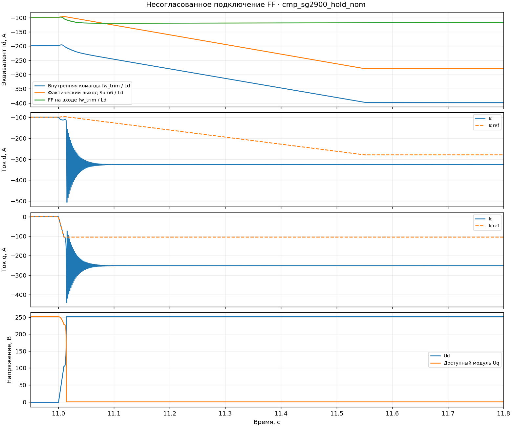
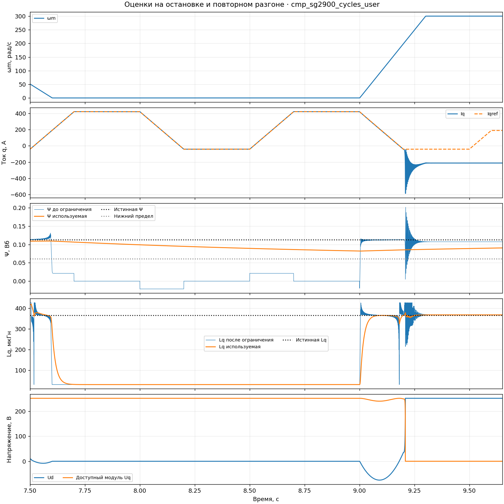
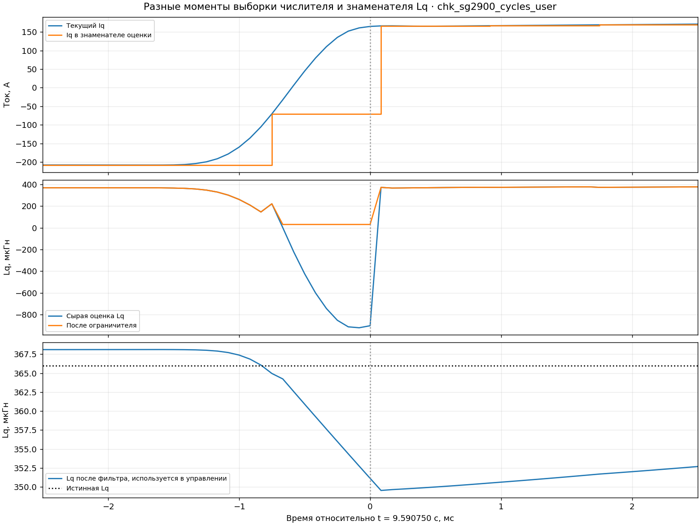
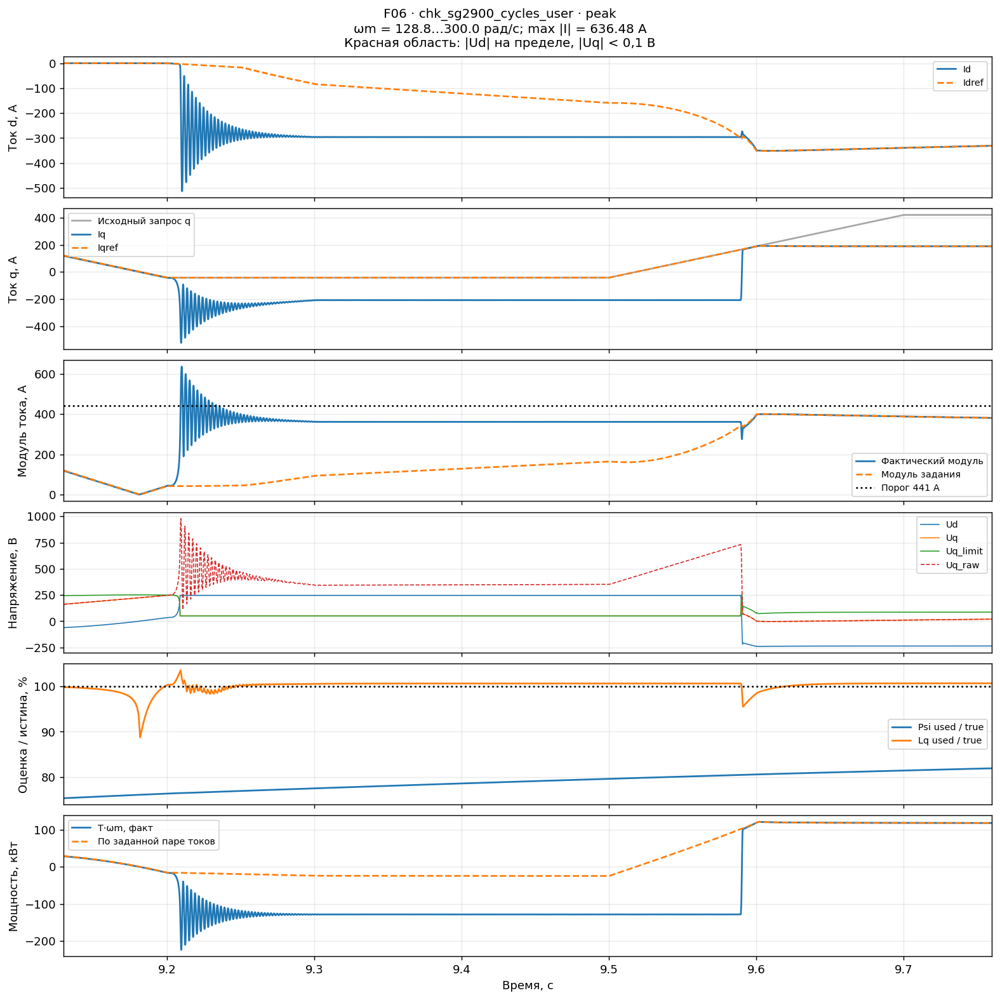

# F06-C01: аудит компонентов и их соединений

13.11.2026. После исправления пользователем отрицательного ограничения Iq
и замены smoothmin начата проверка активного тракта по отдельным узлам:
допустимые входы, знак, диапазон выхода, период, состояние и связь со следующим
блоком. Перестройка F07 на этом этапе не выполнялась.

**Правки Iq корректны на проверенных границах. Дополнительно обнаружено
несогласованное подключение FF в промежуточном autosave; в следующем
autosave пользователь его восстановил.** Остаются независимый предел Id,
обновление оценок при отсутствии информации и согласование их тактов.
Эти вопросы следует закрывать отдельными проверяемыми изменениями.

## Какие версии проверены

Сохранённый `ideal_source_drive_Idff_aug_param_F06.slx` во время аудита
оставался версией от 12:15:49, SHA-256 `1895d650…`. Новые правки обнаружены
в autosave. Использованы неизменяемые копии; рабочие модели ассистент не правил.

| Снимок | Источник | Активные отличия от сохранённой F06 |
|---|---|---|
| A, 14:59:20 | [component_source.slx](data/control_fixes/f06_components_20261113/component_source.slx), SHA `37876d8a…` | `Min2` вместо smoothmin; симметричный `lim` вместо `Min3`; FF отключён только от второго входа `Sum6` |
| B, 15:44:20 | [component_source_ff_restored.slx](data/control_fixes/f06_components_20261113/component_source_ff_restored.slx), SHA `045d393e…` | Обе правки Iq; FF снова подключён к `Sum6`; дополнительно `VectorBase/Gain1 = 0,98` |

В обеих копиях Kψ = 2,5, код `fw_trim` и его период сохранены,
оценщики Ψ/Lq включены. Model Workspace побайтно совпадает с сохранённой F06.
Изменение верхнего предела старого `PID Controller` с 500·Ld на 0·Ld
относится к закомментированному блоку и не управляет `fw_trim`.
Изменения Scope/Mux относятся к наблюдению.

Полные хеши и времена: [манифест источников](data/control_fixes/f06_components_20261113/source_manifest.json).
Матрица: [cases.json](data/control_fixes/f06_components_20261113/cases.json).
Результаты A нельзя приписывать только исправлениям Iq; результаты B
включают также резерв напряжения по d. Чистое сравнение только правок Iq
при неизменном Gain1 в этой серии не выполнялось.

## 1. Ограничение Iq: исправления подтверждены

Старое `min(IqLim, Iq_request)` не ограничивало отрицательный запрос снизу.
Новая функция `lim` при неотрицательном лимите реализует
`clip(Iq_request, −IqLim, +IqLim)`.

Исполнен именно извлечённый из SLX код функции. Проверены 130 сочетаний:
лимиты от 0 и 10⁻⁹ до 420 А, положительные/отрицательные запросы до 1000 А,
сохранение нуля, знака, монотонности, нечётности и неизменность внутри границ.
Все проверки прошли. В полных логах проверяется также фактическая пара
на входе токового контура, а не только выход отдельно взятой функции.

Старый smoothmin:

\[
s_\delta(a,b)=\frac{a+b-\sqrt{(a-b)^2+\delta^2}}2.
\]

При δ > 0 он всегда ниже точного минимума; при a = b ошибка равна δ/2.
Для неотрицательных входов отрицательный выход возникает при
`a·b < δ²/4`. При δ = 10 А получены непосредственно из старой функции:

| a, А | b, А | smoothmin, А | Обычный min, А |
|---:|---:|---:|---:|
| 0 | 0 | −5 | 0 |
| 1 | 1 | −4 | 1 |
| 0 | 10 | −2,0711 | 0 |
| 5 | 5 | 0 | 5 |

Это свойство аппроксимации, несовместимое с использованием выхода как
неотрицательного модуля разрешённого тока. В обеих новых копиях
`Min_smooth_ab` оставлен на листе без активных связей; лимит формирует `Min2`.
По логам его выход точно равен `min(Iq_curLim, Iq_voltLim_used)`.

В `lim` применяется `abs(limit)`. При проверенном неотрицательном входе
это не меняет результат. Однако отрицательный лимит от будущего ошибочного
расчёта превращать в положительный разрешённый ток нельзя считать проверкой
корректности бюджета: неотрицательность должна обеспечиваться до `lim`.

## 2. Соединение FF: проверенный дефект промежуточного снимка

В снимке A `From58/Psi_d_ff` подключён к первому входу `fw_trim`,
но второй вход `Sum6` не подключён. Для этой структуры требуется:

\[
\psi_{cmd}=\operatorname{clip}(\psi_{FF}+x),\qquad
trim=\psi_{cmd}-\psi_{FF},\qquad
Sum6=trim+\psi_{FF}=\psi_{cmd}.
\]

При отсутствующей связи `Sum6 = trim`, поэтому
`Sum6 − ψcmd = −ψFF`. По полным логам остаток этого равенства меньше
7·10⁻¹⁸ Вб. Максимальное расхождение перед окончательным ограничителем
равно 0,09211 Вб, то есть **297,13 А в эквиваленте Id**.
Это разность команд, а не непосредственно ошибка измеренного тока.

Видно, что внутреннее состояние уже дошло до предела около −396 А,
а фактически поданное задание остаётся значительно менее отрицательным.
Проекция внутри функции при этом может проходить собственные потактовые
проверки — связь с окончательным управляющим воздействием нарушена снаружи.

В снимке B связь восстановлена пользователем. Для полностью отключённого FF
нужно подавать ноль **на оба входа**: `fw_trim/1` и `Sum6/2`.
Для работающего FF на оба должен поступать один и тот же сигнал.
Отдельно проверены три конфигурации: A — связи не согласованы;
сохранённая F06 и прежняя экспериментальная копия без FF — согласованы.

Инспектор теперь явно возвращает `ffConnectionsConsistent`.
Стандартный запуск сравнения требует согласованных связей; диагностический
случай с известным разрывом должен явно объявлять ожидаемое состояние.
Это предотвращает повторное принятие неисправной конфигурации за опыт
«только без FF» или «только новые ограничители Iq».

## 3. Независимого ограничения Id по Is_max пока нет

Окончательная нижняя граница определяется как `−1,2·Ψ_used/Ld`.
При номинальных параметрах это −396,39 А, но при росте оценки потока:

| Ψ_used | Разрешённая нижняя граница Id |
|---|---:|
| Ψном | −396,39 А |
| 1,1·Ψном | −436,03 А |
| 1,4·Ψном, верхняя граница оценщика | −554,94 А |

Is_max = 420 А. Уже при Ψ_used >0,1085 Вб разрешённое задание d может
выйти за токовый круг. Расчёт `sqrt(max(Is_max²−Idreq²,0))` в таком случае
обнулит допустимый q, но **не вернёт Id внутрь круга**.
Например, (−436,03; 0) А остаётся недопустимой парой при полностью исправном `lim`.

Это воспроизводимый граничный контрпример к структуре. Он не означает,
что во всех выполненных сценариях Id фактически достигал такого предела.
Электрическую границу для следующей ручной правки можно выразить как
`psi_min = max(−1,2·Psi_used, −Ld·Is_max)` и подать согласованно на проекцию
состояния и окончательное ограничение. Отдельное ограничение размагничивания
и согласование пары при изменении Is_max остаются самостоятельными требованиями.

## 4. Оценщики: защита деления не обеспечивает достоверность оценки

Активные формулы по графу модели:

\[
\hat\Psi_{raw}=\frac{U_q-R_sI_q}{\omega_{den}}-L_d I_d,
\qquad
\hat L_{q,raw}=\frac{R_sI_d-U_d}{\omega_{den}I_{q,den}}.
\]

Модуль знаменателя скорости ограничен снизу 40 электрических рад/с,
тока — 0,1 А. Затем Ψ ограничивается 0,6…1,4 номинала, Lq — 0,1…1,4
номинала, после чего фильтруется. Отдельного допуска обновления при
достаточной скорости/возбуждении в активной цепочке нет.

На остановленной машине с постоянными токами числители не содержат
информации о потоке магнитов и Lq. При нулевых токах обе сырые оценки равны
нулю; ограничители направляют их к **0,6·Ψном и 0,1·Lqном**.
Фильтрация замедляет это движение, но не делает его оценкой параметра.
Постоянные времени: 1,667 с для Ψ и 16,667 мс для Lq.

В диагностическом прогоне A с повторными пусками непосредственно перед
новым разгоном, в t = 9 с: скорость 0, Ψ_used = 0,082126 Вб при истинной
0,11264 Вб; Lq_used = 30,5 мкГн при истинной 366 мкГн. Токи в это время
отрабатываются, но оценки уже существенно изменены. После разгона они
возвращаются с разными скоростями.

Такое обновление при отсутствии информации подтверждено. Его отдельный
вклад в возникновение срыва требует сравнения при одинаковой остальной
схеме. Снимок A одновременно содержит разрыв FF, поэтому весь его результат
нельзя объяснять только оценщиками. Динамические члены L·dI/dt и задержка
между командным и приложенным напряжениями в этих формулах также не учтены.

## 5. Периоды расчёта и границы токовых ПИ

В `fw_trim` фактический период 83,333 мкс, совпадающий с шагом интегрирования.
У `sat_signed1/2/3/5` фактический период **833,333 мкс**, что подтверждено
временными отметками новых логов. Таким образом, часть знаменателей
обновляется раз в десять тактов токового контура, тогда как числители
содержат более свежие напряжения/токи. Это отдельная точка проверки,
особенно при переходе Iq через ноль. Одно изменение коэффициента фильтра
не устраняет различие времени, к которому относятся числитель и знаменатель.

В снимке B это подтверждено непосредственно: при t = 9,59075 с,
ωm = 300 рад/с фактический Iq = **+164,71 А**, но `sat_signed3` ещё выдаёт
**−70,30 А**. Сырая оценка Lq = −902,10 мкГн и затем обрезается до 30,5 мкГн,
при истинной Lq = 366 мкГн. Это конкретное рассогласование выборок, а не
предположение о неверном коэффициенте. Его отдельное влияние на срывы ещё
не проверено изменением только этого узла.

По обоим токовым ПИ проверяются порядок внешних границ и равенство
`PI_limited = clip(PI_raw, lower, upper)` в каждом зарегистрированном такте.
В исходных диагностических прогонах остатки равны нулю, границы не перевёрнуты.
Они правильно сдвинуты на развязку. Показанные внутри маски постоянные
0/24/−15 не являются действующими границами: `SatLimitsSource = external`.

Это подтверждает арифметику ограничения, но не восстановление связанной
системы при насыщении. Приоритет d оставляет оси q почти нулевой запас,
а большой пропорциональный сигнал ошибки может удерживать насыщение даже
при небольшом состоянии интегратора. Автоматически относить это к windup
внутреннего интегратора нельзя.

## 6. UqLimiter, ШИМ и остальные узлы

Испытана копия **фактической подсистемы UqLimiter** в отдельной схеме Simulink.
При |Ud| = Umax, |Ud| > Umax и даже Vdc = 0 она возвращает √0,001 = 0,03162 В.
Причина — нижняя граница подкоренного выражения 0,001 В². Это не запас,
достаточный для управления q. На 440 В превышение полного напряжения
из-за этого числа микроскопическое; оно не объясняет токовые выбросы
сотни ампер. При нулевом питании ненулевой предел логически некорректен;
приоритет этого исправления ниже независимого предела тока и оценщиков.

Извлечённая функция SVPWM прошла **8652 проверки** во всех секторах,
с положительным/отрицательным углом в диапазоне вызывающего блока,
при Vdc = 0,1/440/550 В и запросах до 110% лимита. Компенсации отключены,
как в проверяемой конфигурации. Скважности соблюдены, полутакт удержания
возвращает прежние выходы; ошибка восстановленного вектора меньше
3·10⁻¹³ В. Эту проверку нельзя распространять на включённые компенсации,
скачки Vdc или весь тракт задержек между FOC и машиной.

| Узел | Выполненная проверка | Статус |
|---|---|---|
| `lim`, `Min2` | Граничные случаи и фактические сигналы | Локальные исправления подтверждены |
| Id и токовый круг | Диапазоны, числовой контрпример | Нужен самостоятельный предел Id |
| FF + `fw_trim` + `Sum6` | Граф, три конфигурации связей, потактовая разность | Разрыв A подтверждён, в B восстановлен |
| `fw_trim` | Код, период, проекция и рекуррентные равенства | Арифметика блока подтверждена; динамика полного контура не принята |
| Оценки Ψ/Lq | Формулы, пределы, фильтры, остановка | Обновляются без достоверной информации |
| Знаменатели оценок | Фактические периоды и знаки в логах | Требуется согласовать моменты выборки |
| Токовые ПИ и развязка | Источники границ, знаки сумм, потактовое ограничение | Ошибки подключения границ не обнаружены; восстановление открыто |
| `UqLimiter` | Отдельная копия реального блока | Численный нижний предел не даёт управляемого запаса q |
| SVPWM | Реальный код, секторные/граничные проверки | Пройдено для проверенного режима |
| Clarke/Park/обратный Park | Настройки: амплитудная нормировка, ось d, радианы | Несогласованности настроек не найдено; отдельный тест полного тракта фаз и задержек ещё нужен |
| Фильтры и измерения | Разделение управляющих и диагностических ветвей | CurrentsMuxFilter на верхнем листе идёт в наблюдение; его задержку нельзя приписывать активному контуру |
| SpeedController, GenPowerController, HallSensors | Проверка активных связей | Выход скорости не используется; генераторный регулятор и HallSensors закомментированы, в этих прогонах не участвуют |

## Контрольные прогоны и следующий шаг

На каждом снимке выполнены номинальная полка с быстрыми изменениями q
и повторные разгоны с ошибками машины +5% Ld / +20% Lq / +10% Ψ.
Каждый случай — 25 с, VDC = 440 В, Is_max = 420 А,
вся история скорости ≤2900 об/мин. Это диагностические сценарии,
не утверждённая программа приёмки.

Числа всех случаев и проверки компонентов находятся в
[сводке](data/control_fixes/f06_components_20261113/analysis/summary.json).
Сравнение должно учитывать разрыв FF в A и дополнительный Gain1 = 0,98 в B.
Ни один из этих опытов не следует описывать как чистый эффект замены smoothmin.

| Сценарий | Прежняя сохранённая F06, max I | Снимок A, max I | Снимок B, max I |
|---|---:|---:|---:|
| Полка, номинал | 605,29 А | 595,93 А | 521,25 А |
| Повторные разгоны, ошибки +5/+20/+10% | 751,00 А | 1129,87 А | 636,48 А |

Полные осциллограммы снимка B: [номинальная полка](img/control_fixes/f06_components_20261113/chk_sg2900_hold_nom.png)
и [повторные разгоны](img/control_fixes/f06_components_20261113/chk_sg2900_cycles_user.png).
Парные наложения с прежней F06: [полка](img/control_fixes/f06_components_20261113/chk_sg2900_hold_nom_comparison.png)
и [разгоны](img/control_fixes/f06_components_20261113/chk_sg2900_cycles_user_comparison.png).

Все четыре новых прогона полные и конечные. Все соблюдают предел задания
420 А, но не проходят предел фактического тока 441 А и критерии слежения.
После восстановления FF и введения резерва d результат улучшился;
готовность системы не подтверждена. Резерв 0,98 оставляет около 20%
полного напряжения для q при достижении предела d, но не гарантирует
достижимости произвольного запроса тока.

В числовом анализе разделены предел d (`Ulim`, уже с Gain1) и полный
радиус круга напряжений. Для B это соответственно 246,46 и 251,49 В.
Проверка стационарной достижимости использует полный радиус; отдельно
сохранены длительности насыщения d и насыщения d с почти нулевым Uq.
Отсутствие второго признака при Gain1 = 0,98 не означает отсутствия
насыщения d.

Последовательность продолжения:

1. Зафиксировать сохранённый SLX с выбранным режимом FF, обеими правками Iq
   и явно указанным Gain1. Перед каждым прогоном проверять все связи и
   параметры, а не только изменённый блок.
2. Ограничить Id по Is_max и согласовать эту границу с состоянием ОП.
3. Разобрать условия допустимого обновления Ψ/Lq и моменты выборки.
   Сначала сохранять последнее достоверное значение при отсутствии
   информации; пороги и динамику возвращения проверять отдельно.
4. Затем возвращаться к быстродействию ОП, сигналу Uq и составу F07,
   сохраняя отдельные контрольные варианты.

В [архиве](data/control_fixes/f06_components_20261113/) сохранены снимки,
структурные данные, тестовый стенд UqLimiter, исходный код проверок,
логи и результаты. Полные MAT находятся в `tmp/f06_components_20261113/`
и нужны для продолжения анализа. Удаление не выполнялось; воспроизводимые
сборочные кэши можно удалить отдельно только после подтверждения пользователя.
