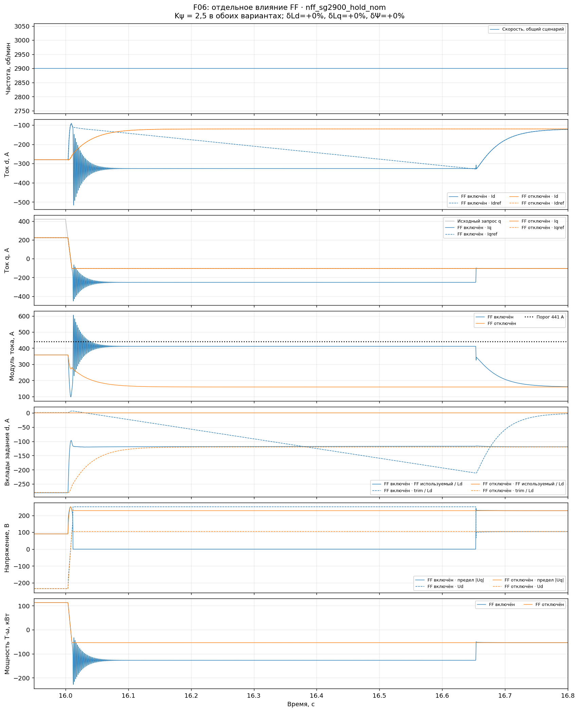
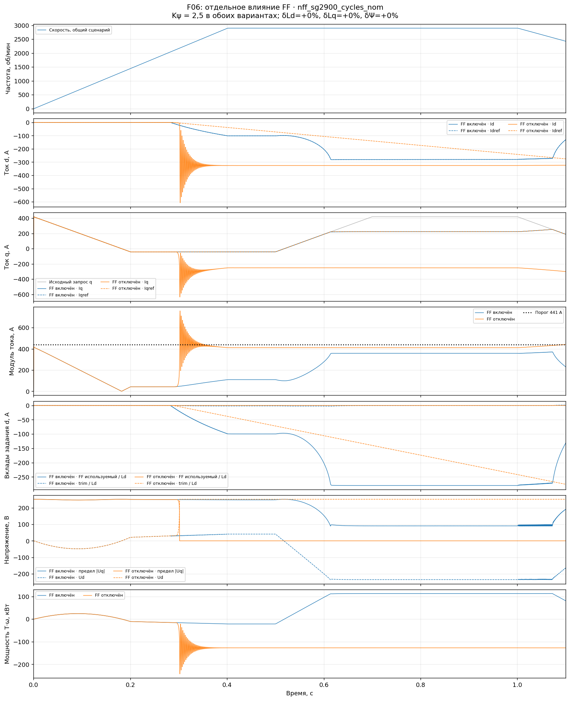
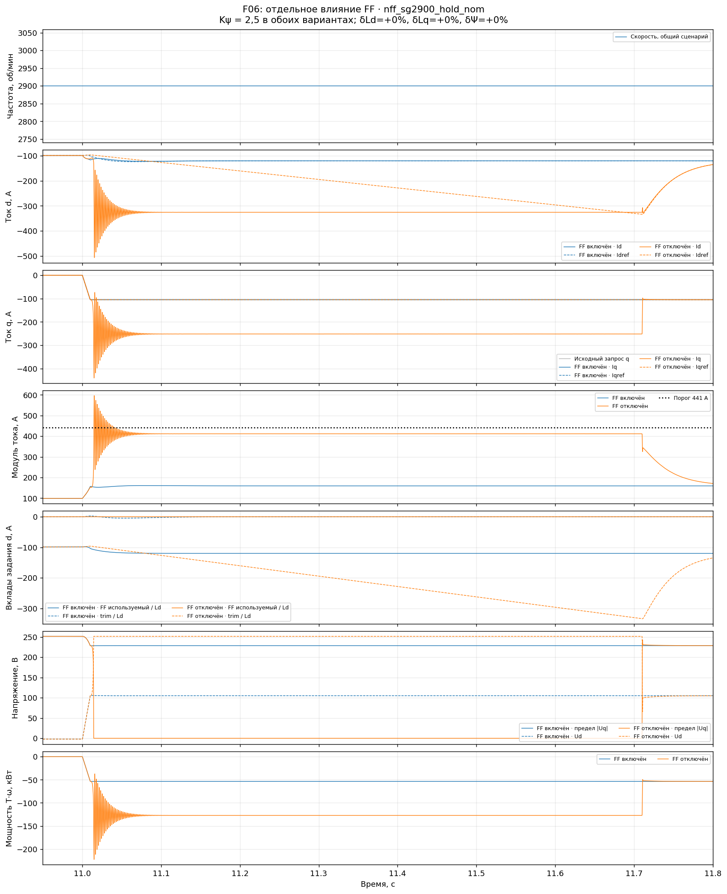

# F06-NFF: отдельная проверка влияния FF

13.11.2026. По предложению пользователя перед F07 проверено отключение FF
при сохранении остальных механизмов F06. Выполнены **шесть новых прогонов
по 25 с** на прежних сценариях стартер-генератора до 2900 об/мин.

**Удаление FF устраняет часть прежних срывов, но создаёт или усиливает другие.**
На переходе к генерации около 5 с в номинале пик снизился с 609,09 до 344,52 А,
а насыщение Ud длительностью 0,957 с исчезло. При первом быстром разгоне
номинальной машины, напротив, пик вырос с 421,19 до 758,90 А.
Все шесть полных сценариев без FF не прошли прежние критерии.

Это проверка вклада FF при **исходном Kψ = 2,5**, а не результат настройки
регулятора без FF. Она не доказывает непригодность архитектуры с одной
обратной связью. Исторический алгоритм по Uq исследован отдельно:
[схемы и подключения из Git](field_weakening_uq_history.md).

## Проблема и действие

В [F06-SG2900](f06_starter2900_validation.md) подтверждены срывы при резких
изменениях q и повторных разгонах, в том числе в номинальной машине.
Нужно отделить движение расчётного FF от реакции интегратора и последующего
удержания насыщения внутренними контурами.

Источник — тот же сохранённый снимок F06 от 13.11.2026 12:15:49:

- [F06 с FF](data/control_fixes/f06_noff_20261113/reference_source.slx), SHA-256
  `1895d6502311498c93f831b02794d1ea081b0092d15f70014eb0889ef192151e`;
- [копия без FF](data/control_fixes/f06_noff_20261113/noff_source.slx), SHA-256
  `a659ad73c6900842f769adef4e45a95ee696bca25d79e3af9640b94603ef558e`.

На копии добавлен один Gain `Experiment_FF_gain = 0` после `From58`
(`Psi_d_ff`). Его выход подан **одновременно** на первый вход `fw_trim`
и второй вход `Sum6`. Обнуление только одной из этих связей нарушило бы
согласование состояния с окончательной суммой и проверяло бы другой алгоритм.

Код `fw_trim`, Kψ, обратная связь по модулю напряжения, такт, ограничения,
токовые ПИ, оценщики Ψ/Lq и их переключатели сохранены. При нулевом FF
состояние `fw_trim` непосредственно задаёт полное отрицательное потокосцепление.
Старая ветвь расчёта FF оставлена для наблюдения; её ненулевой сигнал
`Psi_d_ff` в логе **не используется в задании**. Используемый вход записан
в `fw_inputs(:,1)` и равен нулю во всех шести случаях.

Проверены XML-связи: один добавленный Gain, две перенаправленные ветви,
без изменения параметров существующих корневых блоков. Model Workspace
исходной копии совпадает побайтно. Другие отличия SLX при сохранении относятся
к отображению окон, открытию подсистем, метаданным и миниатюре; код Stateflow
не изменён. [Проверка связей](data/control_fixes/f06_noff_20261113/ablation_xml_diff.json),
[полный текстовый diff пакета](data/control_fixes/f06_noff_20261113/ablation_package_diff.txt).

Рабочая сохранённая F06 не перезаписывалась; её SHA-256 в конце проверки
совпадает с исходным. Более новый `.autosave` не использовался как база и
не изменялся ассистентом. Сравнение относится именно к зафиксированной версии.

## Условия и критерии

В каждой паре совпадают таблицы скорости и исходного q, параметры машины,
положение переключателей и сетка токовых логов. Полная история скорости
ограничена **303,6873 механических рад/с = 2900 об/мин**.
VDC = 440 В, Is_max = 420 А, Kψ = 2,5, такт `fw_trim` = 1/12000 с.

Проверены три профиля: быстрые изменения q на полке, повторные разгоны,
пуск–генерация–снятие нагрузки. Каждый выполнен в номинале и с ошибками
машины Ld +5%, Lq +20%, Ψ +10%, Rs 0%. Точные воздействия —
[cases.json](data/control_fixes/f06_noff_20261113/cases.json).

Прежние критерии: модуль задания ≤420 А; фактический модуль ≤441 А;
допустимые duty; отсутствие ошибок d/q свыше 100 А длительностью более
20 мс. Дополнительно оценивается ошибка ≤8,4 А после 50 мс неизменных
внешних команд. Это диагностические критерии проекта, а не утверждённая
программа приёмки стартер-генератора.

Все записи полные, конечные, без прореживания; период и потактовые равенства
F06 подтверждены. Во всех случаях использованный FF = 0, `Sum6 = Psi_trim`
точно в зарегистрированных отсчётах. Максимальное различие фактической
скорости между парными расчётами — 0,00006242 рад/с при одинаковой таблице
идеального источника. Численный допуск сравнения скорости принят 0,001 рад/с;
критерии тока и слежения не ослаблялись.

## Результат за полный прогон

«Длительные ошибки q» — число эпизодов |Iq − Iqref| >100 А дольше 20 мс.
По одному пику нельзя судить обо всём качестве: эпизоды без FF становятся
многочисленнее, даже когда наибольший ток немного уменьшается.

| Профиль | Ошибки машины | max I с FF, А | max I без FF, А | max Iref без FF, А | Длительные ошибки q, с FF → без FF |
|---|---|---:|---:|---:|---:|
| Полка 2900, быстрый q | Номинал | 605,29 | 596,39 | 390,35 | 1 → 7 |
| Полка 2900, быстрый q | +5/+20/+10% | 599,43 | 566,69 | 365,70 | 6 → 7 |
| Повторные разгоны | Номинал | 759,77 | 759,96 | 420,00 | 1 → 8 |
| Повторные разгоны | +5/+20/+10% | 751,00 | 750,88 | 420,00 | 2 → 8 |
| Пуск–генерация | Номинал | 609,09 | 743,79 | 420,00 | 1 → 7 |
| Пуск–генерация | +5/+20/+10% | 739,54 | 727,78 | 420,00 | 2 → 7 |

Все шесть вариантов без FF соблюдают лимит задания, но не проходят проверку
фактического тока и слежения. Дополнительный критерий установившейся ошибки
также не выполнен. [Числовая сводка](data/control_fixes/f06_noff_20261113/analysis/summary.json).

## Что улучшилось: снятие чрезмерно быстрого изменения Idref

В номинальном профиле полки перед переходом в 16 с оба варианта находятся
почти в одной точке: Id ≈ −280 А, Iq ≈ +223 А. За 10 мс исходный запрос q
меняется с +420 на −105 А. При работающем FF задание Id быстро поднимается
примерно от −280 до −95 А; без FF — только до −258 А.

В варианте с FF после этого Ud достигает +251,49 В и оставляет q только
0,0316 В. При отключённом FF переход проходит с сохранением диапазона q.
Это прямое подтверждение влияния FF на **возникновение этого срыва**.

| Окно и случай | Пик с FF → без FF, А | max ошибка q с FF → без FF, А | Время насыщения d с FF → без FF, с |
|---|---:|---:|---:|
| 15,95–16,80 с, полка, номинал | 605,29 → 357,84 | 345,95 → 9,59 | 0,641 → 0 |
| 5,95–6,80 с, полка, ошибки | 599,43 → 351,76 | 394,29 → 4,46 | 0,691 → 0 |
| 4,95–6,15 с, пуск–генерация, номинал | 609,09 → 344,52 | 351,18 → 9,61 | 0,957 → 0 |
| 14,45–15,70 с, пуск–генерация, ошибки | 739,54 → 384,55 | 477,33 → 10,88 | 1,003 → 0 |

В таблице показаны целые выбранные окна, включая состояние перед переходом.
Исчезновение насыщения не означает нулевой переходной ошибки.

Синий — FF включён, оранжевый — отключён. Штриховые кривые токов — задания.
Вклад FF показан по фактически используемому входу, а не по оставленному
диагностическому расчёту. [Пуск–генерация, 5 с](img/control_fixes/f06_noff_20261113/nff_sg2900_startgen_nom_transition.png).

## Что ухудшилось: вход в ослабление и набор отрицательного Id

При первом быстром разгоне номинальной машины с FF на интервале 0–1,1 с
пик равен 421,19 А, длительного насыщения d нет. Без FF пик — 758,90 А,
суммарное время насыщения d в этом окне — 0,798 с.

В 0,30 с при задании Iq = −42 А:

| Величина | С FF | Без FF |
|---|---:|---:|
| Idref, А | −19,60 | −3,96 |
| Фактический Iq, А | −42,08 | −97,85 |
| Использованный FF / Ld, А | −19,74 | 0 |

К 0,50 с без FF: Idref = −71,87 А, Id = −325,72 А, Iq = −251,62 А,
Ud = +251,49 В, Uq ≈0. С FF в тот же момент Idref ≈Id ≈−101,3 А,
Iq ≈−42 А. При прежнем Kψ чисто интегральная коррекция не успевает
сформировать нужное ослабление на этом разгоне.

Другой новый срыв виден на полке в 11 с при переходе **0 → −105 А по q**.
До перехода оба варианта имеют Id ≈−98,81 А. С FF переход отрабатывается;
без FF возникает пик 596,39 А и насыщение d на 0,695 с.
Такой результат нельзя объяснить одним чрезмерно быстрым снятием FF:
здесь FF отсутствует, а потребность в отрицательном Id возрастает.

На повторном разгоне в 9,0–9,75 с номинальный пик практически одинаков:
759,77 А с FF и 759,76 А без FF, но насыщение d без FF длится дольше:
0,520 против 0,383 с. После возникновения срыва его удержание не требует
работающей расчётной ветви FF.

При Ud на пределе прежняя обратная связь по модулю даёт примерно
241,33 − 251,49 = −10,16 В. При Kψ = 2,5 это соответствует изменению
задания потокосцепления около −0,1053 Вб/с, или −339,6 А/с после деления
на номинальное Ld. Поэтому задание в сорванном состоянии медленно уходит
к большому отрицательному Id. Изменение Kψ ускорит это движение, но само
по себе не проверит правильность сигнала ошибки и восстановления q.

## Решение по дальнейшей работе

Проверка удаления FF выполнена; состояние рабочей модели оставлено пользователю.
Перед объединением изменений в F07 разделяем дальнейшие опыты:

1. **Быстродействие обратной связи без FF.** При прежнем сигнале модуля
   проверить настройку Kψ на двух противоположных событиях: вход в ОП
   при быстром разгоне и снятие/смена q на полке. Добавить переход 0 → −105 А.
   Настройка, улучшившая только один переход, не принимается.
2. **Способ формирования ошибки по Uq.** При одинаковом формирователе
   состояния отдельно сравнить зависимость предела Uq от фактического Ud
   и от расчётного Ud для заданного Iq. Исторический ПИ, его дополнительную
   алгебраическую ветвь и новый `fw_trim` не менять одновременно.
3. После этого выбирать состав F07 и проверять восстановление при обоих
   знаках насыщения d. Согласование d/q остаётся открытой задачей.

Ни FF как обязательный элемент, ни окончательный отказ от него по этому
опыту не выбраны. Подтверждены отдельно его полезное упреждение, влияние
быстрого снятия ослабления на часть срывов и сохранение механизма залипания
при нулевом FF.

## Артефакты и воспроизведение

В [архиве проверки](data/control_fixes/f06_noff_20261113/) находятся источники,
матрица, шесть проверок, числовой анализ, журналы и снимки использованных
инструментов. Полные MAT и рабочие копии: `tmp/f06_noff_20261113/`;
парные исходные MAT с FF: `tmp/f06_sg2900_20261113/`.
Они сохраняются для последующего анализа; очистка не выполнялась.
В новой серии полные MAT занимают около 3,06 ГиБ и нужны для следующих
сравнений. После подтверждения пользователя можно удалить воспроизводимые
сборочные каталоги `nff_*/cache_*` (около 96 МиБ); MAT, сценарии и исходные
копии при такой очистке следует сохранить.

Подготовка копии — [prepare_noff_f06.m](../tools/fw_limiter/prepare_noff_f06.m),
парное сравнение — [noff_comparison.py](../tools/fw_limiter/noff_comparison.py),
точки переходов — [noff_mechanism_probe.py](../tools/fw_limiter/noff_mechanism_probe.py).
[Инструкция запуска](../tools/fw_limiter/README.md#f06-отдельное-отключение-ff).

Полные осциллограммы сравнения:
[полка, номинал](img/control_fixes/f06_noff_20261113/nff_sg2900_hold_nom_comparison.png),
[полка, ошибки](img/control_fixes/f06_noff_20261113/nff_sg2900_hold_user_comparison.png),
[разгоны, номинал](img/control_fixes/f06_noff_20261113/nff_sg2900_cycles_nom_comparison.png),
[разгоны, ошибки](img/control_fixes/f06_noff_20261113/nff_sg2900_cycles_user_comparison.png),
[пуск–генерация, номинал](img/control_fixes/f06_noff_20261113/nff_sg2900_startgen_nom_comparison.png),
[пуск–генерация, ошибки](img/control_fixes/f06_noff_20261113/nff_sg2900_startgen_user_comparison.png).

Модель содержит идеальные фазные источники напряжения и заданную скорость.
Это проверка электрического управления; двигатель внутреннего сгорания,
механический пуск, динамика DC-звена и переключения силового инвертора
в этой серии не моделировались. Исторические модели по Uq не симулировались.
