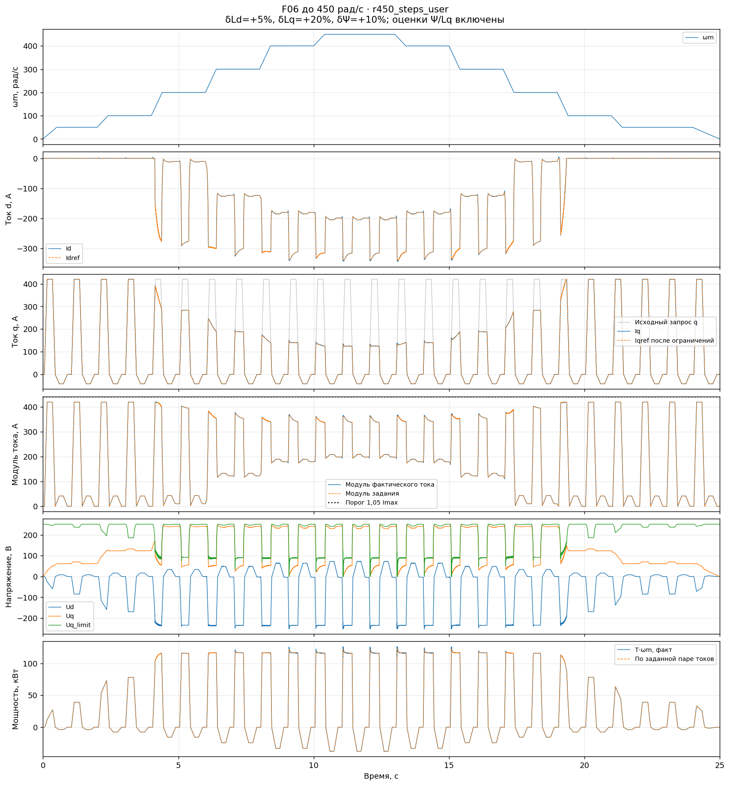
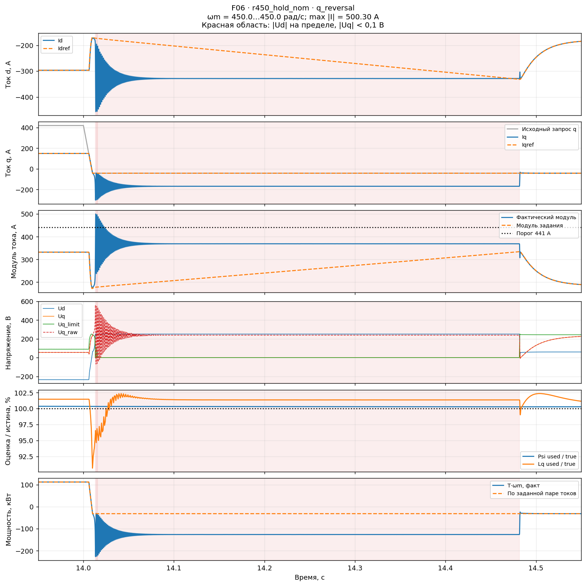
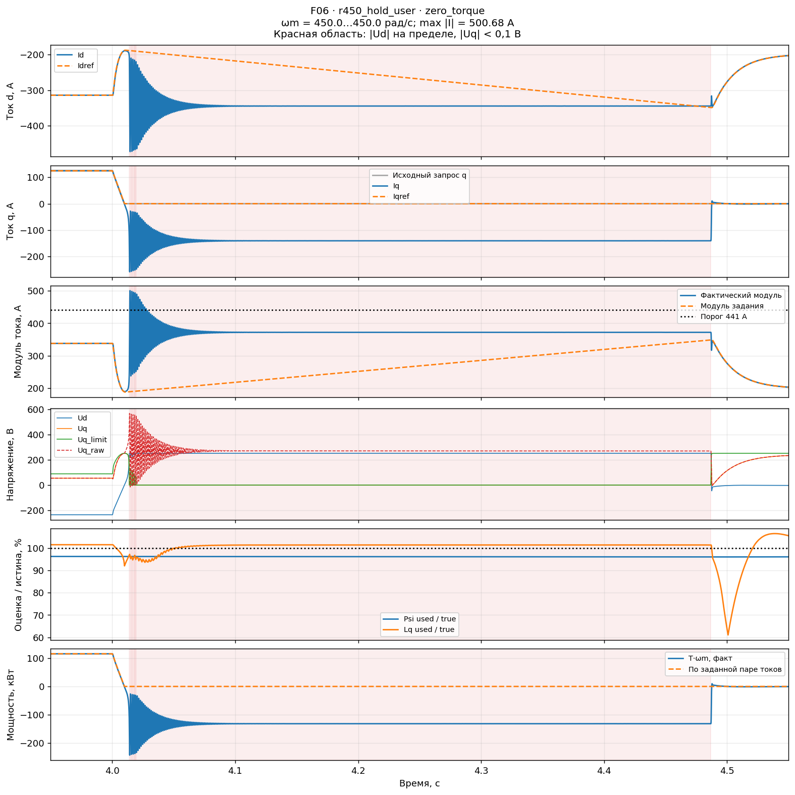

# F06: проверка диапазона 0…450 рад/с

13.11.2026. Контрольный снимок пользовательской модели, сохранённой в 12:15:49.
Цель — проверить пригодность текущей F06 для ближайших испытаний с ограниченной
скоростью, отдельно от разработки F07. Скорость везде **механическая**.

**Уточнение после этой серии:** реальный максимум по сообщению пользователя —
2900 об/мин (303,687 рад/с), 450 рад/с выбраны с запасом. Применение —
автомобильный стартер-генератор с резкими переходами. Отдельная проверка,
в которой вся история скорости ограничена реальным максимумом:
[F06-SG2900](f06_starter2900_validation.md). Числа ниже относятся к исходной серии.

**Плавный профиль до 450 рад/с проходит в номинале и с сохранёнными ошибками
машины. Общая работоспособность в этом диапазоне не подтверждена:** при быстрых
изменениях задания, разгоне и повторном входе в ОП возникают потеря слежения
и превышение тока. Отказы есть и в номинале. Ограничение только максимальной
скорости не устраняет проблему.

## Снимок модели и изменения для испытаний

[Исходная F06](data/control_fixes/f06_release450_20261113/source_model.slx),
SHA-256 `1895d6502311498c93f831b02794d1ea081b0092d15f70014eb0889ef192151e`.
Рабочий пользовательский SLX не изменялся. В копиях менялись сценарии скорости,
исходного задания q и ошибки параметров машины; добавлялись наблюдатели.
Настройки контроллера и коэффициент подстройки не менялись.

- VDC = **440 В**, Is_max = **420 А**, FocDiscrTime = **1/12000 с**.
- Kψ = **2,5**; проекция состояния `fw_trim` с persistent, без старого freeze.
- mFW = 0,95; mMaxCurrent = mMaxPWM = 0,99; Gain15 = 0,95; VectorBase/Gain1 = 1.
- Номинальная машина: Ld = 310 мкГн, Lq = 305 мкГн, Ψ = 0,1024 Вб,
  Rs = 0,02 Ом, 11 пар полюсов.
- В сохранённой модели ошибки машины: **Ld +5%, Lq +20%, Ψ +10%, Rs 0%**.
  Далее это сочетание названо «пользовательским».
- Включены **оценки Ψ и Lq**: оба выбранных сигнала проверены по полным логам.
  Это существенное отличие от ночной [F06-T](control_fix_log.md#f06-t),
  где для управления были выбраны постоянные параметры. Старые численные
  результаты не переносятся на дневной снимок.

## Матрица и критерии

Каждый случай длится 25 с, логи без прореживания. Точные таблицы входов и ошибок:
[cases.json](data/control_fixes/f06_release450_20261113/cases.json).

| Профиль | Воздействия и назначение |
|---|---|
| `saved` | Точная сохранённая лестница до 438 рад/с и исходный периодический запрос q. Проверка воспроизводимости наблюдения пользователя |
| `steps` | Полки 50, 100, 200, 300, 400, 450 рад/с и обратный ход; максимальный темп 250 рад/с². Запрос q: 0 → +420 → 0 → −42 → 0 А с периодом 1 с, нарастание до +420 А за 100 мс |
| `hold` | Разгон 0 → 200 за 0,5 с → 450 за следующие 0,5 с, затем удержание до 24 с. Нулевой q до 1,1 с. Далее уровни 0, +42, +126, +210, +420, −42, −105 А; переходы за 10 мс, включая прямую смену знака |
| `cycles` | Повторные переходы 0/50/204/300/450 рад/с, остановка и повторный разгон. Максимальные темпы +1333,3 и −2000 рад/с². Исходный периодический запрос от +420 до −42 А, максимальный темп 2310 А/с |

`steps`, `hold`, `cycles` проверены в номинале и с пользовательскими ошибками.
Для `hold` и `cycles` дополнительно проверены **изолированные Ld ±20%**,
при нулевых ошибках Lq/Ψ/Rs. Это диагностические возмущения, не подтверждённые
допуски реальной машины. `saved` проверен в сохранённой конфигурации.

Проверяются два набора условий:

1. Прежние регрессионные критерии: модуль задания ≤420 А, фактический ток
   ≤441 А (1,05·Is_max), конечные duty в пределах; нет непрерывной абсолютной
   ошибки d/q >100 А дольше 20 мс. Контролируется и открытое событие на конце.
2. Дополнительный предварительный критерий качества: ошибка каждого тока
   ≤8,4 А (2%·Is_max) после 50 мс неизменных **внешних** задания q и скорости.
   Это предложенный инженерный критерий, не согласованная спецификация релиза.
   Внутреннее изменение Iqref ограничителями не исключает интервал из проверки.

Ограничение положительного Iq до достижимого значения само по себе не считается
отказом: сравнение слежения идёт с окончательными Idref/Iqref. Исходный запрос
также показан на осциллограммах. Отдельно проверяются снятие момента, знак Iq,
насыщение d с почти нулевым Uq, стационарная потребность напряжения и мощность.

## Результаты

**Завершены 11 прогонов; 3 прошли, 8 не прошли критерии.**

| Сценарий — ссылка на осциллограмму | Ошибки машины | max Iref, А | max I, А | max ошибка d/q после 50 мс, А | Результат |
|---|---|---:|---:|---:|---|
| [Сохранённый, до 438](img/control_fixes/f06_release450_20261113/r450_saved.png) | Пользовательские | 420,00 | 420,26 | 0,10 / 0,14 | Прошёл |
| [Плавные ступени](img/control_fixes/f06_release450_20261113/r450_steps_nom.png) | Номинал | 419,99 | 420,04 | 0,12 / 0,11 | Прошёл |
| [Плавные ступени](img/control_fixes/f06_release450_20261113/r450_steps_user.png) | Пользовательские | 419,99 | 421,38 | 0,10 / 0,24 | Прошёл |
| [Удержание 450, быстрый q](img/control_fixes/f06_release450_20261113/r450_hold_nom.png) | Номинал | 402,72 | 500,30 | 143,76 / 131,66 | Не прошёл |
| [Удержание 450, быстрый q](img/control_fixes/f06_release450_20261113/r450_hold_user.png) | Пользовательские | 403,05 | 727,35 | 150,36 / 148,31 | Не прошёл |
| [Повторные быстрые циклы](img/control_fixes/f06_release450_20261113/r450_cycles_nom.png) | Номинал | 420,00 | 759,79 | 240,83 / 213,00 | Не прошёл |
| [Повторные быстрые циклы](img/control_fixes/f06_release450_20261113/r450_cycles_user.png) | Пользовательские | 420,00 | 750,96 | 235,67 / 170,77 | Не прошёл |
| [Удержание 450, быстрый q](img/control_fixes/f06_release450_20261113/r450_hold_ldp20.png) | Ld +20% | 387,36 | 472,37 | 275,12 / 341,65 | Не прошёл |
| [Удержание 450, быстрый q](img/control_fixes/f06_release450_20261113/r450_hold_ldm20.png) | Ld −20% | 432,54 | 570,42 | 144,73 / 66,63 | Не прошёл |
| [Повторные быстрые циклы](img/control_fixes/f06_release450_20261113/r450_cycles_ldp20.png) | Ld +20% | 420,00 | 1449,34 | 240,20 / 332,50 | Не прошёл |
| [Повторные быстрые циклы](img/control_fixes/f06_release450_20261113/r450_cycles_ldm20.png) | Ld −20% | 420,00 | 865,75 | 306,74 / 451,62 | Не прошёл |

В таблице ошибка — максимум после указанных 50 мс неизменных внешних входов.
Она может включать сохраняющийся переходный процесс. «Прошёл» означает
выполнение обоих наборов условий только в данном сценарии.

### Подтверждённое улучшение: плавный профиль

Точная пользовательская модель воспроизводит спокойную работу: пик 420,26 А,
на участках неизменных входов максимальные ошибки d/q — 0,098/0,144 А.
На новом плавном профиле до 450 рад/с пик 420,04 А в номинале и 421,38 А
с пользовательскими ошибками. Во втором случае ошибки d/q после 50 мс
не превосходят 0,104/0,240 А; при нулевом запросе момент снимается.

Это воспроизводимый положительный результат конкретной последовательности.
Он не доказывает, что любой профиль с темпом ≤250 рад/с² будет проходить:
между сценариями различаются также нагрузка, начальное возбуждение и история
оценщиков. Отдельное универсальное ограничение темпа пока не установлено.

### Отказ в номинале на постоянных 450 рад/с

В `r450_hold_nom` исходный запрос меняется с +420 до −42 А за 10 мс
в 14,00–14,01 с. Конечное положительное Iqref до перехода ограничено доступным
напряжением, а отрицательные −42 А доходят до токового контура.

Пик **500,30 А в 14,01358 с**. Приоритет d удерживает Ud на +251,49 В,
оставляя диапазон Uq всего **±0,0316 В**, хотя q-регулятор запрашивает
сотни вольт для восстановления тока. Непрерывное насыщение 14,01567–14,48167 с
длится **0,466 с**. В 14,06708 с Iqref = −42 А, Iq = −169,94 А;
Idref = −191,53 А, Id = −331,17 А. Стационарное напряжение заданной пары
в этот момент 220,34 В при доступных 251,49 В: её статической достижимости
недостаточно для восстановления связанной системы.

### Пользовательские ошибки: срыв при нулевом запросе

В `r450_hold_user` на полке 450 рад/с повторяются срывы при снятии задания q.
После перехода +126 → 0 А в 4,00–4,01 с получен пик **500,68 А**,
а в 4,06033 с Iq = **−148,31 А при Iqref = 0**, мощность T·ωm = **−139,41 кВт**.
Насыщение d длится 4,01933–4,48683 с; Uq снова практически обнулено.

Наибольший ток на самой полке 450 рад/с — **503,70 А**.
Глобальный пик этого прогона, **727,35 А**, возникает раньше — в **0,52842 с,
213,71 рад/с**, ещё при разгоне и нулевом запросе q. Поэтому 727 А нельзя
приписывать переходу на уже установившихся 450 рад/с.
[Увеличенный запуск](img/control_fixes/f06_release450_20261113/r450_hold_user_startup.png).

В `r450_cycles_user` повторный разгон даёт **750,96 А в 9,20992 с,
208,92 рад/с**, при Iqref = −42 А. В этой точке Id = −591,43 А,
Iq = −462,76 А, Ψ_used = 0,08607 Вб против истинных 0,11264 Вб.
Ошибка оценки потока присутствует, однако её исключительная причинная роль
не доказана: сравнения с отключёнными оценщиками на этом сценарии не проводилось.
[Увеличенный повторный вход](img/control_fixes/f06_release450_20261113/r450_cycles_user_restart.png).

### Дополнительные ошибки Ld

Изолированные ±20% не проходят оба профиля. На быстрых циклах при Ld +20%
пик **1449,34 А** возникает уже при снижении скорости: **7,53175 с,
51,94 рад/с**, Iq = −1445,09 А при задании +31,34 А. Ограничение скорости
сверху не ограничивает последствия ранее возникшего насыщения.

При Ld −20% на `hold` зафиксирован также дефект **самого задания**:
в 11,48733 с Idref = −419,60 А и Iqref = −105 А, модуль **432,54 А**
при Is_max = 420 А. Это согласуется с открытым пунктом бэклога о двухстороннем
ограничении q и формировании единой пары в токовом круге. F01 исправил
конкретное отставание бюджета, но не закрыл все ограничения пары.

Прежний критерий 100 А / 20 мс недостаточен сам по себе: `hold`, Ld +20%
не имеет таких длительных событий, но даёт 472,37 А и ошибку q до 341,65 А
после 50 мс неизменных входов. Эти результаты учитываются как отказ.

## Решение для ближайшего этапа

Сохранить F06 как контрольную базу. Положительный результат относится
к зарегистрированным плавным сценариям; выпуск с общей формулировкой
«работает до 450 рад/с» эта матрица не обосновывает. Для программы ближайших
испытаний нужны фактические пределы VDC, тока, рекуперации и темпов заданий;
после их фиксации проверять именно этот профиль, включая пуск без момента
и снятие нагрузки. Снижение только максимальной скорости или отсутствие
срыва на одной полке не являются достаточной коррекцией.

Работу над [F07](field_weakening_f07.md) вести отдельным диалогом и отдельным
файлом `_F07`; [контекст для продолжения](F07_HANDOFF.md) подготовлен.
Принцип обратной связи по Uq предложен пользователем. Кандидат конкретизирует
целевое Uq по стационарной потребности d для заданного Iq; в полном приводе
он ещё не проверен. Эта серия не содержит изменений F07 и не доказывает
его эффективность. Совместные ограничения токов/напряжений остаются открытыми.

## Проверка и воспроизводимость

Все 11 случаев завершены до 25 с, сигналы конечны и покрывают полный интервал.
Проверены хеши исходников, моделей и MAT, совместная сетка токов, выбранные
выходы оценщиков, тождества напряжений до/после PI и развязки. Фактический
период `fw_trim` = **83,333 мкс** во всех случаях; остатки потактовых равенств
выхода, проекции и обновления состояния равны **нулю**. Момент по датчику
согласуется с уравнением dq с максимальным остатком <0,001% пикового момента.
Хеш рабочей F06 после завершения совпал с исходным.

- [Итоговый протокол](data/control_fixes/f06_release450_20261113/verification.txt).
- [Полная численная сводка](data/control_fixes/f06_release450_20261113/analysis/summary.json).
- [Снимок, сценарии и протоколы](data/control_fixes/f06_release450_20261113/).
- [Хеши использованных инструментов](data/control_fixes/f06_release450_20261113/tool_manifest.json).
- [Воспроизведение](../tools/fw_limiter/README.md#f06-проверка-до-450-механических-радс):
  `run_release450_suite` и `release450_analysis.py`; итоговый анализ выполнен
  без `--available`, отсутствие любого из 11 случаев приводит к ошибке.

В тестах используются идеальные источники фазного напряжения и навязанная
механическая скорость. Ключевой инвертор, реальная механическая нагрузка
и динамика DC-звена не проверялись. Напряжения на графиках — команды
VectorBase до/после ограничителя, не независимо измеренное напряжение машины.
Стационарная проверка напряжения не включает L·dI/dt.

Вся матрица выполнена при 440 В и 420 А, только с положительной скоростью,
запросом рекуперации до −105 А. Диапазон DC, отрицательная скорость и полная
отрицательная команда −420 А не входят в эту проверку.

Полные MAT, инструментированные копии и кэши сохранены в
`tmp/f06_release450_20261113/`. Неполная первая попытка `cycles_nom`
сохранена отдельно: процесс пакета завершился кодом 143 при записи MAT;
файл не читается целиком и исключён из результатов. Причина завершения
процесса не установлена. Сценарий повторён из того же снимка в новом каталоге.
Удаление файлов не выполнялось; кэши и неполную попытку можно удалить
после подтверждения, полные MAT пока нужны для сравнения F07.
