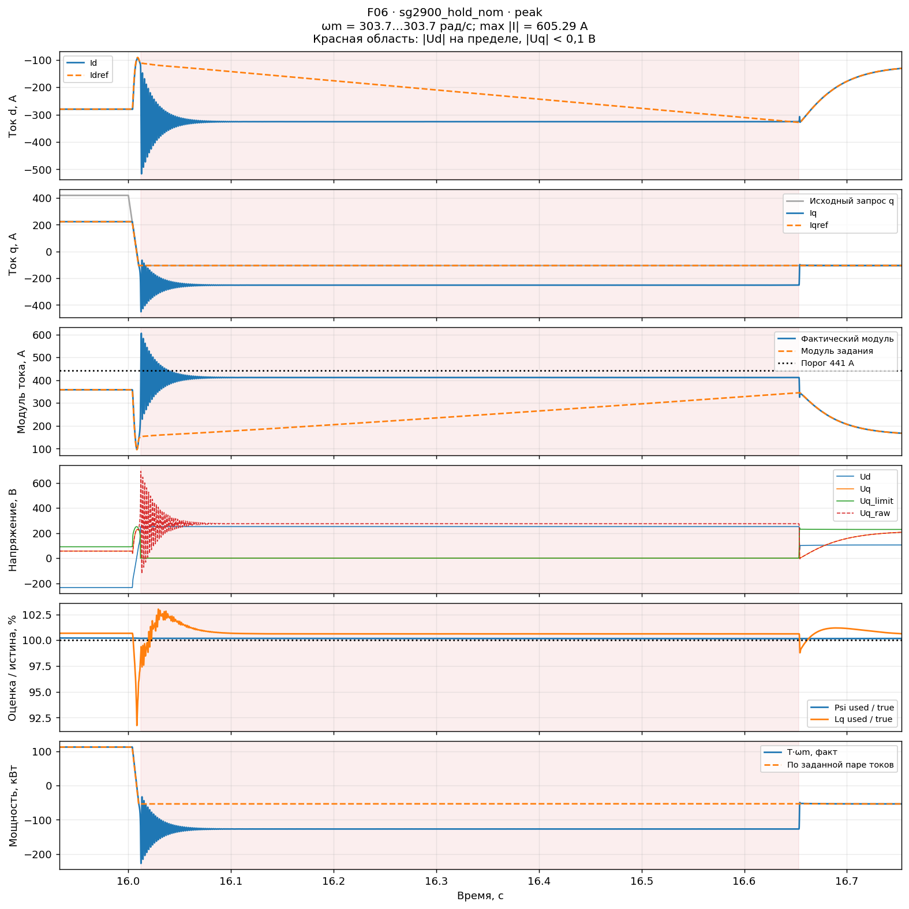
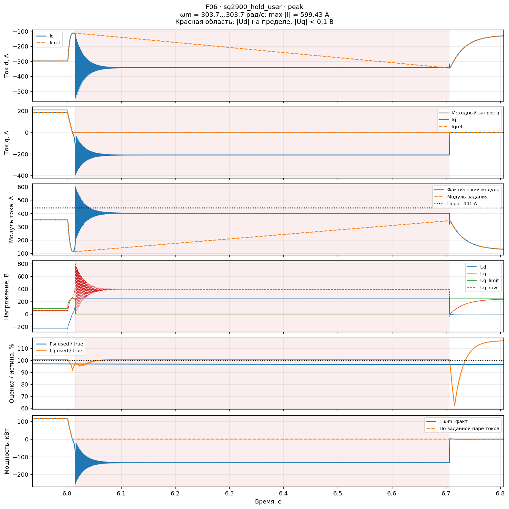
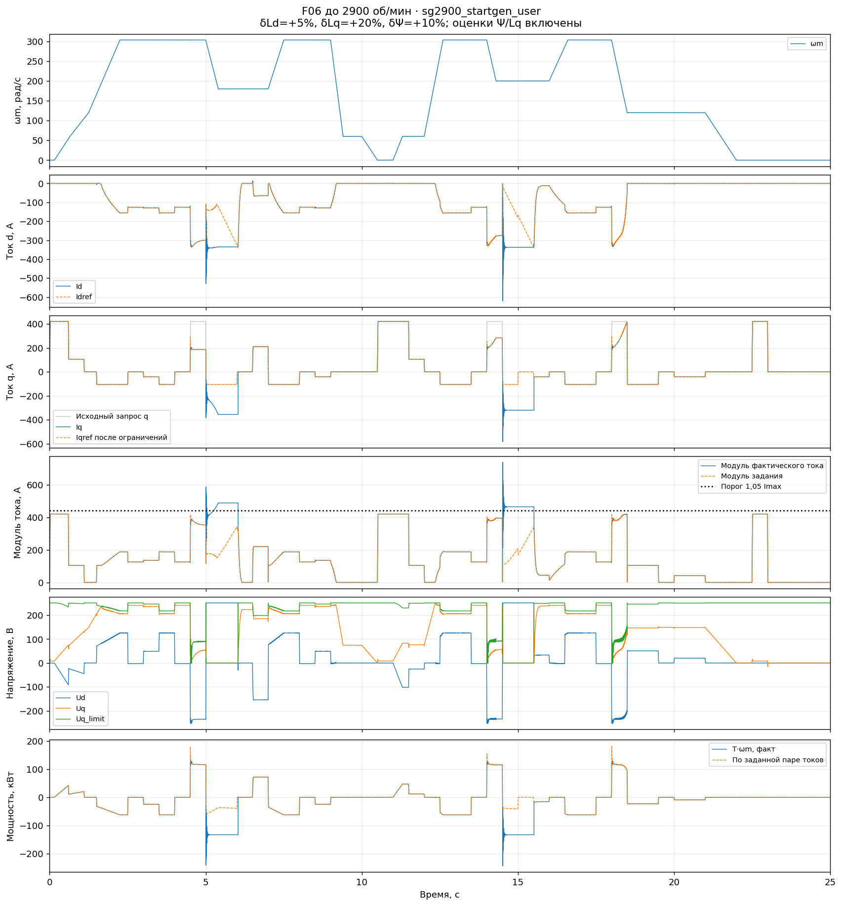

# F06: стартер-генератор, диапазон до 2900 об/мин

13.11.2026. Пользователь уточнил назначение: в дальнейшем автомобильный
стартер-генератор, возможны резкие изменения режима. Реальная максимальная
частота вращения — **2900 об/мин**, то есть **303,6873 механических рад/с**.
Прежние 450 рад/с выбраны с запасом. Утверждённой программы испытаний пока нет.

Для этого применения плавный профиль не является достаточной проверкой.
В пределах реальной скорости проверяются пуск, смена знака момента,
наброс и снятие генераторной нагрузки, остановка и повторный разгон.
Темпы и уровни ниже — выбранные диагностические воздействия, а не полученные
от пользователя эксплуатационные ограничения или утверждённая программа.

**Снижение максимума до реальных 2900 об/мин не устранило срывы F06.**
Все шесть выбранных сценариев не прошли, включая номинальную машину.
Быстрые переходы на максимуме дали 605,29 А, повторные разгоны — 759,77 А
в номинале; при этом лимит задания 420 А соблюдался. Требуется восстановить
управляемость при насыщении, сохраняя проверку резких переходов.

## Условия и отделение от предыдущей серии

Сохранён тот же снимок F06 от 13.11.2026 12:15:49, SHA-256
`1895d6502311498c93f831b02794d1ea081b0092d15f70014eb0889ef192151e`.
[Снимок модели](data/control_fixes/f06_sg2900_20261113/source_model.slx).
Рабочая модель не изменяется; сценарии и ошибки машины задаются на копиях.
Оценщики Ψ/Lq включены, Kψ = 2,5, такт fw_trim = 1/12000 с.
VDC = 440 В и Is_max = 420 А сохранены из предыдущей проверки.

В [серии до 450](f06_release450_validation.md) часть срывов возникала уже
на 209–230 рад/с. Однако у повторного разгона была предыстория работы на 450,
поэтому такие результаты не объявлялись доказательством отказа при ограничении
всей истории до 2900 об/мин. Новая серия проверяет именно это ограничение
с нулевыми начальными состояниями каждого запуска.

## Сценарии и критерии

Шесть прогонов по 25 с: три профиля × два набора параметров машины.
Номинал — нулевые ошибки; пользовательский набор — Ld +5%, Lq +20%, Ψ +10%,
Rs 0%. Изолированные Ld ±20% в эту серию не включены.
[Полные таблицы входов](data/control_fixes/f06_sg2900_20261113/cases.json).

| Профиль | Назначение и воздействие |
|---|---|
| `hold` | Разгон 0 → 200 рад/с за 0,5 с → 303,687 рад/с ещё за 0,5 с. Нулевой запрос q до 1,1 с. На полке — уровни 0, +42, +126, +210, +420, −42 и −105 А; изменения за 10 мс, включая прямую смену знака |
| `cycles` | Повторные переходы между 0, 50, 204, 300 и 303,687 рад/с. Исходный периодический запрос q от +420 до −42 А, период 1 с. В прежнем профиле заменены только полки 450 на реальный максимум |
| `startgen` | Запрос +420 А за 20 мс при неподвижной машине; разгон через 60 и 120 рад/с до максимума. Переход к отрицательному q, набросы и снятие генераторной нагрузки, прямые переходы двигатель/генератор, остановка и повторный пуск. Основные переключения q за 10 мс |

Максимальный модуль темпа скорости для этих профилей: 400 / 1268,44 / 609,22
рад/с² соответственно. Максимальный темп исходного q: 52 500 / 2310 / 52 500
А/с. Запрос +420 А при высокой скорости может ограничиваться контроллером;
ошибка слежения оценивается по окончательной паре Idref/Iqref.

Критерии те же, что в предыдущем отчёте: модуль задания ≤420 А,
фактический ток ≤441 А, допустимые duty, отсутствие непрерывной ошибки d/q
>100 А дольше 20 мс. Дополнительно — ошибка каждого тока ≤8,4 А после 50 мс
неизменных внешних запроса q и скорости. Последний порог предварительный,
не согласованная спецификация. Снятие момента и насыщение с потерей Uq
проверяются независимо от прохождения токового порога.

## Результаты и осциллограммы

Все шесть случаев завершены; **все шесть не прошли критерии**. Во всей записи каждого случая скорость не превышает 2900 об/мин.

| Сценарий — осциллограмма | Параметры машины | max Iref, А | max I, А | max ошибка d/q после 50 мс, А |
|---|---|---:|---:|---:|
| [Полка 2900, быстрый q](img/control_fixes/f06_sg2900_20261113/sg2900_hold_nom.png) | Номинал | 418,78 | 605,29 | 203,13 / 153,64 |
| [Полка 2900, быстрый q](img/control_fixes/f06_sg2900_20261113/sg2900_hold_user.png) | Пользовательские ошибки | 418,37 | 599,43 | 228,00 / 221,33 |
| [Повторные разгоны](img/control_fixes/f06_sg2900_20261113/sg2900_cycles_nom.png) | Номинал | 420,00 | 759,77 | 240,98 / 212,99 |
| [Повторные разгоны](img/control_fixes/f06_sg2900_20261113/sg2900_cycles_user.png) | Пользовательские ошибки | 420,00 | 751,00 | 235,29 / 170,78 |
| [Пуск → генерация → снятие нагрузки](img/control_fixes/f06_sg2900_20261113/sg2900_startgen_nom.png) | Номинал | 420,00 | 609,09 | 169,96 / 321,07 |
| [Пуск → генерация → снятие нагрузки](img/control_fixes/f06_sg2900_20261113/sg2900_startgen_user.png) | Пользовательские ошибки | 420,00 | 739,54 | 322,70 / 319,92 |

### Смена знака момента в номинале

В `hold_nom` в 16,00–16,01 с запрос меняется с +420 на −105 А при
303,687 рад/с. Пик **605,29 А** возникает в **16,01267 с**:
Idref / Id = −111,59 / −487,15 А, Iqref / Iq = −105 / −359,24 А.
Ud = **+251,49 В**, диапазон Uq всего **±0,0316 В**, хотя Uq_raw = +301,76 В.
Оценка Ψ = 0,102579 Вб при истинных 0,1024 Вб — отличие около 0,175%.
Следовательно, наличие этого срыва нельзя объяснить только большой ошибкой Ld
или потока: сама машина в данном случае номинальная.

Положительное насыщение d держится **0,6413 с**, 16,01192–16,65325 с.
В 16,06125 с ошибка q всё ещё 153,64 А. Полный ток уже может вернуться
в допустимый круг, тогда как заданный момент ещё не выполняется.

### Снятие момента при пользовательских ошибках

В `hold_user` в 6,00–6,01 с исходный запрос +210 А снимается до нуля.
На неизменных 2900 об/мин пик **599,43 А в 6,01642 с**:
Id = −530,05 А, Iq = −279,92 А при Iqref = 0. Позже, в **6,06117 с**,
Iq = **−221,33 А** при том же нулевом задании, мощность T·ωm = **−140,22 кВт**.
Насыщение d длится 6,01558–6,70608 с. Подобные события повторяются после
нескольких снятий нагрузки, а не только при первом входе в ослабление.

### Повторный разгон без предыстории 450 рад/с

В `cycles_nom` пик **759,77 А** получен в 9,23067 с при **229,67 рад/с**;
в `cycles_user` — **751,00 А** в 9,20992 с при **208,92 рад/с**.
В обоих случаях Iqref = −42 А. Предшествующие остановка и повторный вход
в ОП входят в новый профиль; превышений 303,687 рад/с нигде не было.
Результат близок к предыдущей серии с запасом, поэтому прохождение полок 450
не требуется для воспроизведения этого отказа.

В номинальном случае Ψ_used в точке пика = 0,082036 Вб против истинных
0,1024 Вб. Поведение оценщиков после остановки требует отдельной проверки;
единственная причина срыва этим наблюдением не устанавливается.

### Электрический цикл стартера-генератора

Номинальный `startgen` дал **609,09 А** в 5,01283 с при 300,03 рад/с
после перехода тяга → генерация. Непрерывная ошибка q >100 А длится
**0,93875 с**. С пользовательскими ошибками пик **739,54 А** возникает
в 14,51525 с уже на **200 рад/с**, Iqref / Iq = −105 / −467,69 А.
Максимальная ошибка при нулевом запросе q после 50 мс неизменных входов
достигает **319,92 А**; длительность одного насыщения d — **1,0245 с**.

### Что это меняет для F07

Ночная F06-T показывала прежде всего отрицательное насыщение Ud в глубоком ОП.
Здесь подтверждено удержание **положительного** Ud при снятии/смене момента.
Проверять новое формирование ошибки нужно на обоих режимах, вместе с
распределением напряжений d/q и согласованием задания после FF.

[Статический расчёт кандидата на записанных точках](data/control_fixes/f06_sg2900_20261113/q_candidate_positive_ud_probe.json)
даёт положительную ошибку Uq около +218,79 В в номинале и +241,20 В при
пользовательских ошибках. Она увеличивала бы Idref, который уже выше
фактического Id примерно на 195/213 А при положительном насыщении d.
Расчёт использует конечный **нефильтрованный** Uq на записи F06, не реальный
вход Uq_f новой замкнутой системы. Он не является прогоном F07, но показывает,
почему одного стационарного обоснования знака недостаточно для обещания
восстановления. План F07 дополнен этим ограничением; код и логика SLX не менялись.

## Границы результата и дальнейшая работа

Ограничение скорости до 2900 об/мин отражает уточнённое применение; быстрые
переключения сохраняются как существенная часть проверки. Возможность
обрабатывать такие команды оценивается отдельно от необходимости ограничивать
физически недостижимую пару токов. Устойчивое и управляемое ограничение момента
допустимо; неконтролируемый ток или сохранение момента при нулевом задании
не считаются нормальным ограничением мощности.

`startgen` — электрический сценарий с **навязанной скоростью**. Он не моделирует
разгон коленчатого вала моментом машины, компрессию, механику ДВС и систему
управления двигателем. VDC постоянно, ключевой инвертор и динамика DC-звена
не входят в модель. Поэтому это проверка управления токами для характерных
переходов, а не полная проверка автомобильного стартер-генератора.

Логику F06 в этой серии не исправляли. Разработка новой ошибки ОП по Uq
продолжается отдельно в [F07](F07_HANDOFF.md), с последующим сравнением
на одинаковых сохранённых профилях. Состав реальных ограничений по мощности,
току генерации, темпам и напряжению предстоит уточнить при подготовке программы.

## Верификация и хранение

Проверены все 6 × 25 с: конечность, полнота, исходные параметры,
хеши MAT/моделей, общая сетка токов и отсутствие превышения **2900 об/мин
на всём интервале**. Выбранные Ψ/Lq равны выходам оценщиков.
Фактический период fw_trim = 83,333 мкс; остатки потактовых равенств
проекции, выхода и обновления состояния равны нулю. Проверено соответствие
измеренного момента уравнению dq. Исходная рабочая F06 после серии имеет
прежний хеш. Итоговый анализ без `--available` завершился кодом 0.

- [Протокол](data/control_fixes/f06_sg2900_20261113/verification.txt).
- [Сводка всех шести](data/control_fixes/f06_sg2900_20261113/analysis/summary.json).
- [Хеши инструментов](data/control_fixes/f06_sg2900_20261113/tool_manifest.json).
- [Воспроизведение](../tools/fw_limiter/README.md#f06-стартер-генератор-до-2900-обмин).

Пакет с пользовательскими параметрами завершился кодом 143 во время проверки
последнего случая. Его симуляция уже дошла до 25 с и сохранила целый MAT;
полная проверка повторена отдельным MATLAB-процессом и прошла с кодом 0,
без нового моделирования. Номинальный пакет выдал сообщение `waitpid:
No child processes`, затем завершил все три проверки с кодом 0.
Причина этих сообщений среды не установлена;
[журнал исполнения](data/control_fixes/f06_sg2900_20261113/runtime_note.json).

Полные MAT, тестовые SLX и кэши оставлены в `tmp/f06_sg2900_20261113/`.
Основные сводки, исходный снимок, сценарии, протоколы и осциллограммы
сохраняются в `docs/data/control_fixes/f06_sg2900_20261113/` и
`docs/img/control_fixes/f06_sg2900_20261113/`.
Очистка не выполнялась; после сравнения F07 можно предложить удаление
воспроизводимых кэшей, сохранив исходные логи до подтверждения пользователя.
