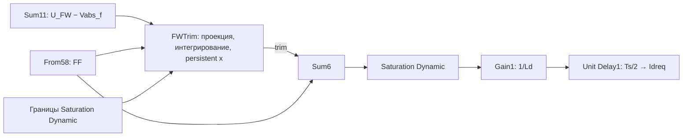

# F06: первый шаг перестройки подстройки ослабления поля

Дата: 12.11.2026, состояние обновлено 13.11.2026. **Пользователь внедрил F06
и исправил период; четыре прогона подтвердили такт, но выявили потерю управления q.**
[Результат F06-T и осциллограммы](control_fix_log.md#f06-t).
После него выполнены [аудит компонентов C01](f06_component_audit.md) и
[анализ нелинейности F06-NL](fw_trim_nonlinearity.md). Нормировка ошибки
не линеаризует объект; при текущем запасе напряжения интегральное усиление
ОП ограничено примерно 340 А/с при неподвижном FF. Сначала согласуем
компоненты и насыщение, затем проверяем [направленную ошибку F07](field_weakening_f07.md).
Ассистент рабочие SLX не изменял. Ниже сохранена инструкция F06.
Исходная схема — сохранённая `ideal_source_drive_Idff_aug_param_woFreeze.slx`
после F05-I: разрешение 1, I = 15, предел trim ±500·Ld, reset по обоим фронтам.
Основание — [F05-I в журнале](control_fix_log.md#f05-i);
общее направление — [план перестройки](field_weakening_redesign.md).
По предложению пользователя состояние перенесено внутрь MATLAB Function
через `persistent`. Для внедрения использовать **fw_trim_persistent.m**;
прежний **fw_trim_projected.m** оставлен как эталон для сравнения.
Период **FocDiscrTime** объявляется в блоке как **Parameter**, без сигнального порта.

## Задача первого изменения

Заменить наружный `PID Controller` одним дискретным состоянием подстройки,
которое учитывает FF и окончательный предел задания Id. На вход подать
относительную ошибку напряжения без деления на скорость и знаковый `sens`.
FF участвует в задании как прежде. Старые freeze/reset не управляют новым состоянием.

Так исправляются два механизма из F05-I: состояние за окончательным пределом
Id и большая/неправильно направленная коррекция при запуске из-за нормировки.
Проверка исправления в замкнутой системе ещё предстоит. Это не законченный
формирователь допустимой пары Id/Iq и не доказательство устойчивости при ошибке Ld.

В этом шаге состояние остаётся в **Вб**, как выход прежнего PID. Это сохраняет
размерности существующих `Sum6 → Saturation Dynamic → Gain1 (1/Ld)`.
На осциллограмме деление на Ld даёт эквивалентную поправку в амперах.

## Закон обновления

Обозначения: f — текущий FF в Вб; x — состояние подстройки в Вб;
zmin/zmax — те же границы, что у окончательного `Saturation Dynamic`.
При нынешних параметрах zmin = −1,2·Psi = −0,12288 Вб; zmax = 0.
В формулах ниже Ts = FocDiscrTime; в коде используется непосредственно FocDiscrTime.

На каждом такте:

```text
e       = clip((U_FW − Vabs_f) / max(U_FW, 1 В), −1, +1)
z       = clip(f + x, zmin, zmax)
trim    = z − f
z_next  = clip(z + Ts·Kψ·e, zmin, zmax)
x_next  = z_next − f
```

`trim` подаётся в существующую сумму с FF сейчас. В конце вызова x_next
записывается в `persistent x` и используется на следующем такте.
Начальное x = 0 задаётся через `if isempty(x)`. Это явный шаг Euler с
ограничением самого сохраняемого состояния. Выход вычисляется **до** записи
нового состояния, поэтому удаление внешнего Unit Delay не убирает такт
из исходного дискретного закона.

Например, при f = 0 положительная ошибка напряжения не может накопить
положительную поправку: zmax = 0 ограничивает и выход, и следующий шаг.
Если при возврате на низкую скорость x отрицательно, положительная ошибка
плавно возвращает его к нулю. Сброс по порогу скорости для этого не нужен.
При дефиците напряжения коррекция разрешена даже при f = 0.

Положительный trim при отрицательном FF допустим: например, f = −0,08 Вб,
trim = +0,03 Вб дают z = −0,05 Вб. Ограничивается итоговая сумма, а не знак
поправки. Когда FF или границы меняются, сначала заново ограничивается текущая
сумма; только затем выполняется интегрирование. Состояние с прошлого такта
может не соответствовать новым границам, но выход и следующий шаг уже
пересчитаны по текущим значениям.

Такой учёт вклада FF соответствует общей задаче anti-windup при суммировании
двух каналов: [пример MathWorks](https://www.mathworks.com/help/simulink/slref/anti-windup-control-using-a-pid-controller.html).
Здесь выбрана прямая проекция состояния; пример по ссылке использует tracking
с отдельным коэффициентом. Это разные реализации, ссылка не подтверждает
качество предлагаемого закона на нашей машине.

## Что изменить вручную

1. Сохранить рабочую копию как `ideal_source_drive_Idff_aug_param_F06.slx`.
   Для первого сравнения использовать нынешний профиль до 738 рад/с.
2. Добавить **MATLAB Function** с именем `FWTrim`. Вставить целиком код из
   [fw_trim_persistent.m](../tools/fw_limiter/fw_trim_persistent.m).
   В свойствах блока задать **Update method = Discrete**, **Sample time = FocDiscrTime**.
   В сохранённой пользователем модели блок назван **`fw_trim`**. У него два уровня
   настроек: в обычном **Block Parameters** поле **Sample time** (`SystemSampleTime`)
   вернуть в **−1**, а в **Property Inspector MATLAB Function** выбрать указанные
   выше Discrete и FocDiscrTime. Найденное значение FocDiscrTime*10 на уровне
   подсистемы даёт фактический такт 833,333 мкс; оставлять его нельзя.
   Property Inspector открывается в окне схемы: **Simulation → Prepare →
   Property Inspector**, при выделенном блоке. Это рекомендованный MathWorks
   уровень настройки периода MATLAB Function; ниже приведён вариант командами
   без поиска панели и результат проверки настройки через Block Parameters.
3. Внешний `FWTrimState` **не нужен**: единственное состояние хранится внутри
   функции. Если задержка уже добавлена по первой инструкции, удалить её
   после замены кода. У нового блока нет входа x; второй выход теперь
   `x_state` для наблюдения, его не нужно возвращать на вход.
   **Allow direct feedthrough оставить включённым**: текущие FF и границы
   влияют на проекцию и выход независимо от наличия persistent.
4. В **Edit Data / Symbols** выбрать **FocDiscrTime**, задать **Scope = Parameter**,
   **Tunable = off**. Переменная FocDiscrTime должна быть определена в рабочей
   области модели; в текущей модели она уже есть. Она остаётся аргументом
   в заголовке функции, но сигнальный порт для неё исчезает.
   Подключить шесть входов по таблице ниже; все — скалярные `double`.
   Для Kψ добавить Constant = **2.5**. Отдельный Constant/провод Ts не нужен.
5. Первый выход `trim` подключить **вместо всех ответвлений выхода старого PID**:
   к `Sum6`, вход 1; к `Goto33` (`Psi_trim`); к `ScopeDemag2`, вход 5.
   Старый `PID Controller` отключить через **Comment Out**, не Comment Through.
6. Четвёртый выход `e_norm` подать на вход 4 `ScopeDemag2` вместо прежнего
   `Product1`. Подписать сигнал `e_FW_norm`: это уже безразмерная ошибка.
   Второй выход `x_state` добавить отдельным каналом наблюдения `trim_state`.
   Это состояние на входе в такт, до проекции и интегрирования. При изменении
   FF/границ оно может отличаться от текущего ограниченного `trim`.
   Третий выход `psi_cmd` можно подключить к Terminator: окончательное задание
   уже наблюдается в существующей цепи после ограничения и Gain1.
7. Обновить схему (Ctrl+D) и сохранить. Старые `Divide`, `Product1`, расчёт
   freeze/reset и sens можно пока оставить для сопоставления; их сигналы
   не подключаются к новому интегратору. Старый freeze на осциллограмме теперь
   является диагностикой прежнего алгоритма, а не разрешением новой подстройки.

| № входа FWTrim | Имя | Откуда взять |
|---|---|---|
| 1 | psi_ff | `From58`, тег `Psi_d_ff`: тот же сигнал, который идёт во вход 2 `Sum6` |
| 2 | eU | Выход `Sum11`: U_FW − Vabs_f, до `Divide` и `Product1` |
| 3 | Ufw | Выход `From65`, тег `Vs_max`: тот же сигнал, что на входе 1 `Sum11` |
| 4 | psi_min | Выход `Gain11` (−1,2): тот же сигнал, что на нижнем входе окончательного `Saturation Dynamic` |
| 5 | psi_max | Выход `Constant15` (0): тот же сигнал, что на верхнем входе этого ограничителя |
| 6 | Kpsi | Constant = 2.5, Вб/с при единичной относительной ошибке |

Отдельно от сигнальных входов: **FocDiscrTime**, Scope = Parameter, размер 1,
тип double, значение из рабочей области модели — сейчас 1/12000 с.
И заголовок, и шаг интегрирования используют это имя:

```matlab
function [trim, x_state, psi_cmd, e_norm] = fw_trim_persistent( ...
    psi_ff, eU, Ufw, psi_min, psi_max, Kpsi, FocDiscrTime)
% ...
psi_next = min(max(psi_cmd + FocDiscrTime * Kpsi * e_norm, psi_min), psi_max);
```

В свойствах исполнения блока также **Sample time = FocDiscrTime**. Объявление
Parameter само по себе частоту исполнения не задаёт: обе настройки нужны,
чтобы период вызова и коэффициент шага интегрирования совпадали.
Tunable отключён, поскольку период исполнения не перестраивается на каждом такте;
изменение FocDiscrTime выполнять между прогонами с обновлением модели.
См. [параметры MATLAB Function](https://www.mathworks.com/help/simulink/ug/parameter-arguments-in-matlab-function-block-functions.html).
Обычной числовой переменной рабочей области достаточно, отдельный объект
Simulink.Parameter для этого подключения не обязателен.

Если удобнее сделать именно настройку периода командами MATLAB, при открытой F06:

```matlab
b = 'ideal_source_drive_Idff_aug_param_F06/fw_trim';
set_param(b, 'SystemSampleTime', '-1');
c = get_param(b, 'MATLABFunctionConfiguration');
c.UpdateMethod = 'Discrete';
c.SampleTime = 'FocDiscrTime';
```

Это команды для ручного выполнения пользователем; ассистент их к рабочей модели
не применял. На отдельной схеме проверено: если оставить SystemSampleTime =
FocDiscrTime*10 и переключить только MATLAB Function на FocDiscrTime, компиляция
выдаёт конфликт периодов. При SystemSampleTime = −1 и явном периоде MATLAB Function
FocDiscrTime получены нужные 83,333 мкс.
[Проверка настроек](data/control_fixes/f06_20261112/rate_settings_verification.txt).

**Уточнение 13.11.2026: вариант через найденное поле Block Parameters.** Если
оставить MATLAB Function в режиме **Inherited**, а обычный **Sample time**
(`SystemSampleTime`) заменить с FocDiscrTime*10 на **FocDiscrTime**, на отдельной
схеме MATLAB R2025a также получается такт **83,333 мкс**. Все четыре выхода и
временные отметки совпали с вариантом Discrete/FocDiscrTime при подсистеме −1:
1201 отсчёт за 0,1 с, максимальная разность 0.
[Протокол сравнения](data/control_fixes/f06_period_20261113/verification.txt).
Таким образом, для проверенной схемы вычисления одинаковы; различается уровень
задания периода. Однако [документация MATLAB Function](https://www.mathworks.com/help/simulink/slref/matlabfunction.html)
рекомендует задавать его через настройки самой функции, а не подсистемы.
Поэтому команды выше остаются основным способом настройки без Property Inspector.
Полный привод с исправленным периодом этой проверкой не охвачен; Kψ пока 2,5.

Речь об ограничителе **без суффикса 1**, между `Sum6` и `Gain1`.
Его границы нужно разветвить в функцию, а не задавать вторую независимую пару
констант. Старые пределы PID ±500·Ld в новом законе не используются.



Ufw и Kψ — дополнительные входы функции из таблицы; FocDiscrTime — параметр.
FF, существующая
задержка **`Unit Delay1` с Ts/2 после Gain1** и токовые PI сохраняются
в этой проверке. Её не следует путать с исключённой задержкой состояния FWTrimState.

`persistent` хранит значение между вызовами; период выполнения задаётся
отдельно в свойствах [MATLAB Function](https://www.mathworks.com/help/simulink/slref/matlabfunction.html).
Инициализация выполняется константой 0, без раннего `return`:

```matlab
persistent x
if isempty(x)
    x = 0.0;
end
```

Такой шаблон соответствует [рекомендации MathWorks](https://www.mathworks.com/help/stateflow/ug/initialize-persistent-variables.html).
Каждый MATLAB Function в Simulink хранит собственное состояние; при новом
обычном прогоне оно инициализируется заново. При самостоятельном вызове
M-файла из MATLAB состояние живёт между вызовами до `clear fw_trim_persistent`.
См. [описание persistent](https://www.mathworks.com/help/matlab/ref/persistent.html).
`isempty` не означает сброс при отключении привода внутри одного прогона;
отдельное событие разрешения/сброса здесь пока не вводится.

## Начальный коэффициент и границы опыта

Начать с **Kψ = 2,5 Вб/с**, затем оценивать динамику по результату прогона.
Это другой коэффициент: его нельзя вводить как I старого PID при прежнем входе.
Оценка порядка по прежнему I = 15, базовой электрической скорости
ωbase = 1471,56 рад/с и условном sens = 1:

```text
Kψ ≈ I_old · U_FW / ωbase ≈ 2,46 Вб/с.
```

Она не делает новый регулятор эквивалентным старому на всех скоростях.
При ограниченном напряжении 251,49 В и цели 241,33 В новая ошибка ≈−0,0421;
скорость поправки Id составит около −340 А/с, или −0,0283 А за такт.
При обрезке e до ±1 максимальное приращение за счёт интегрирования после
проекции равно 0,672 А за такт. Сама проекция при изменении FF/границ может
изменить trim быстрее. Это **не ограничение темпа полного Idref**;
ограничение темпа пары остаётся отдельным шагом.

Отдельный порог включения по скорости не вводится. При запасе напряжения
коррекция направлена к уменьшению ослабления, а при f = 0 упирается в Id = 0.
Нормировка защищена снизу 1 В только от деления на ноль; режимы пропадания
DC-питания и разрешение самого привода этим компонентом не описываются.

Закон рассчитан на обычную ветвь ОП, где уменьшение Id уменьшает потребность
в напряжении. Исключение знакового sens устраняет его инверсию в регуляторе,
но **не устраняет физическую смену чувствительности** машины при переослаблении.
Заданный сейчас нижний предел −1,2·Psi/Ld не доказывает допустимость этой ветви
при неизвестной Ld. Срыв при Ld −20%, уменьшение |Iq|, освобождение напряжения q
и anti-windup токовых PI остаются обязательными следующими проверками.

## Проверка

Подготовлен [тест компонента](../tools/fw_limiter/test_fw_trim_projected.m).
Он проверяет старт с запасом напряжения, удаление скрытого положительного
состояния, полезную положительную поправку при отрицательном FF, выход из
нижнего ограничения, возврат к нулю и движение FF/границ. Отдельная схема
Simulink проверяет компиляцию MATLAB Function и задержку состояния на 1201
отсчёте. Это проверка алгоритма блока, не замкнутого привода.
Все проверки пройдены в MATLAB/Simulink R2025a:
[протокол](data/control_fixes/f06_prepare_20261112/verification.txt),
[исходные версии и условия](data/control_fixes/f06_prepare_20261112/manifest.json).

Для новой реализации подготовлен отдельный
[тест эквивалентности persistent](../tools/fw_limiter/test_fw_trim_persistent.m):
порядок первого шага, совпадение длинной последовательности с прежним законом,
сравнение двух вариантов в Simulink, независимость экземпляров и повторный запуск.
Проверки пройдены: 6000 отсчётов MATLAB и четыре прогона Simulink по 1201 отсчёту,
из них два с Fast Restart; максимальное расхождение равно нулю.
Проверены независимость двух экземпляров и начальное состояние повторного прогона.
[Протокол persistent](data/control_fixes/f06_persistent_20261112/verification.txt),
[версии и условия](data/control_fixes/f06_persistent_20261112/manifest.json).
После перевода FocDiscrTime в Parameter проверки повторены: шесть сигнальных
входов, значение из рабочей области модели, Sample time = FocDiscrTime;
расхождение с эталоном осталось нулевым, включая повторные прогоны/Fast Restart.
[Протокол параметра периода](data/control_fixes/f06_parameter_20261112/verification.txt),
[версии и условия](data/control_fixes/f06_parameter_20261112/manifest.json).

```matlab
addpath tools/fw_limiter
test_fw_trim_projected('tmp/f06_component_repeat') % новый каталог
test_fw_trim_persistent('tmp/f06_persistent_repeat') % другой новый каталог
```

После ручного внедрения сначала проверить запуск и вход в ОП на первых 2,8 с:

- при FF = 0 и запасе напряжения trim и состояние остаются нулевыми;
- внутреннее состояние не улетает на десятки Вб;
- на тактах подстройки `FF + trim` совпадает с выходом окончательного
  ограничителя до Gain1, с численным допуском;
- при возникновении дефицита напряжения знак приращения подстройки отрицательный.

Основная матрица — четыре сочетания обоих профилей с номиналом/Ld +20%,
дополнительный случай — sweep738 с Ld −20%, по 25 с. `run_aug` адаптирован
к фактическому источнику trim и внутреннему состоянию MATLAB Function;
`verify_f06_case` проверяет потактовые равенства по записанным входам.
Оценивать токи, ошибки d/q, напряжения, момент, полки, повторные переходы
и восстановление — прохождение компонентных тестов не заменяет эту матрицу.

Первый полный прогон сохранённой F06 уже выполнен: sweep738, Ld +20%, 25 с.
Получены [осциллограммы и диагностика](control_fix_log.md#f06-run). В этой версии
такт подстройки оказался в десять раз больше шага интегрирования.
13.11.2026 выполнена основная матрица с исправленным периодом — [F06-T](control_fix_log.md#f06-t).
Код, такт и проекция подтверждены; устойчивость и слежение в глубоком ОП
не приняты. Дополнительный Ld −20% на F06-T пока не выполнен.
