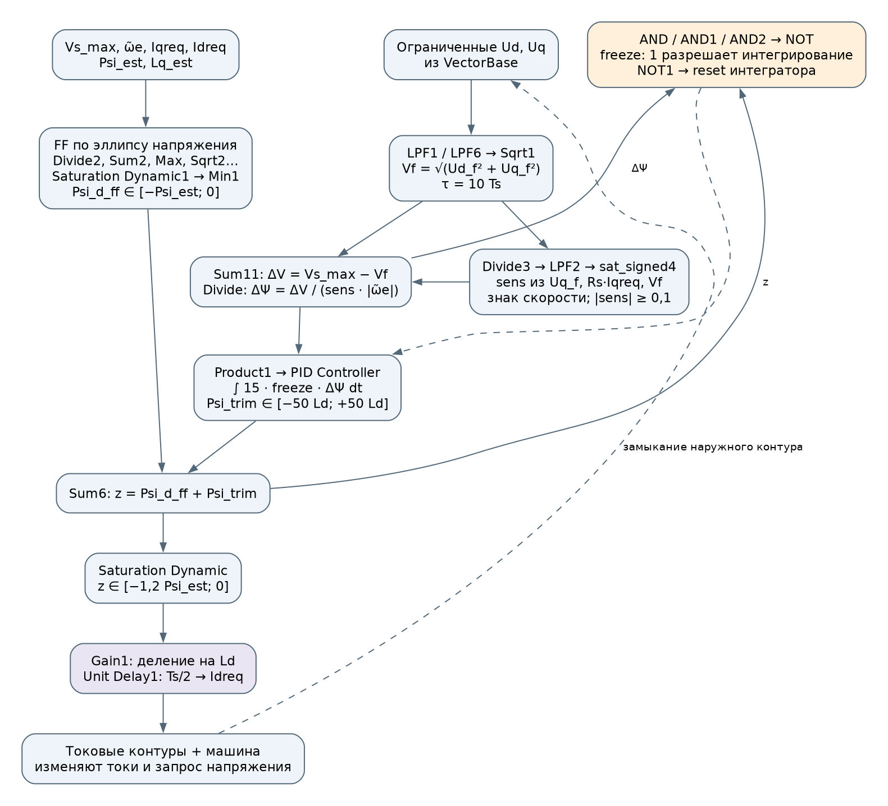
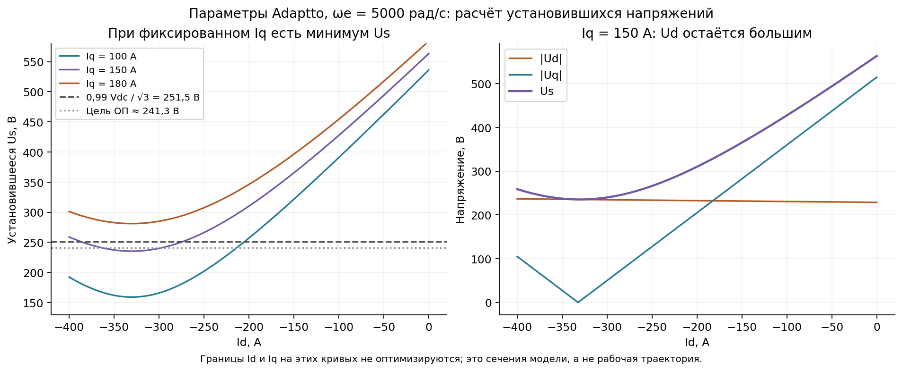
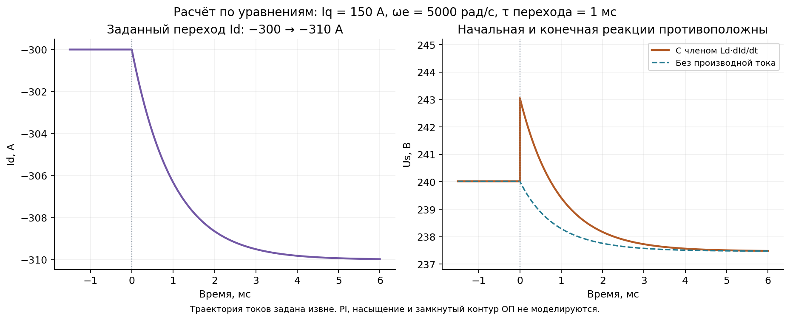
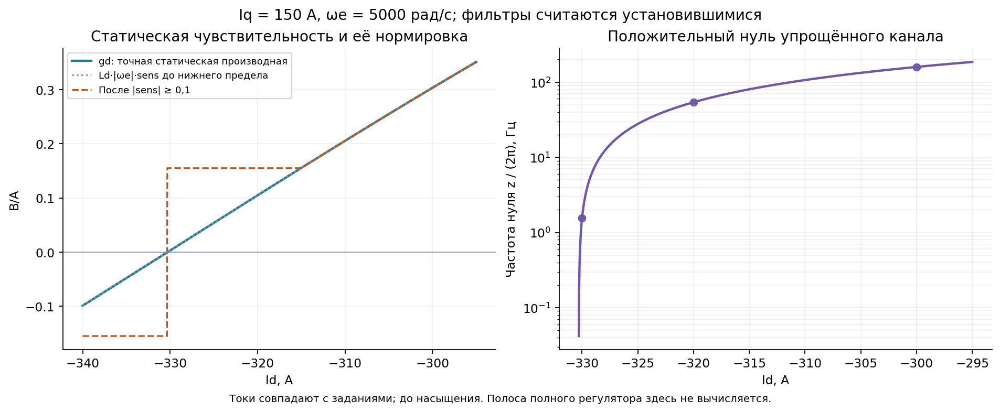
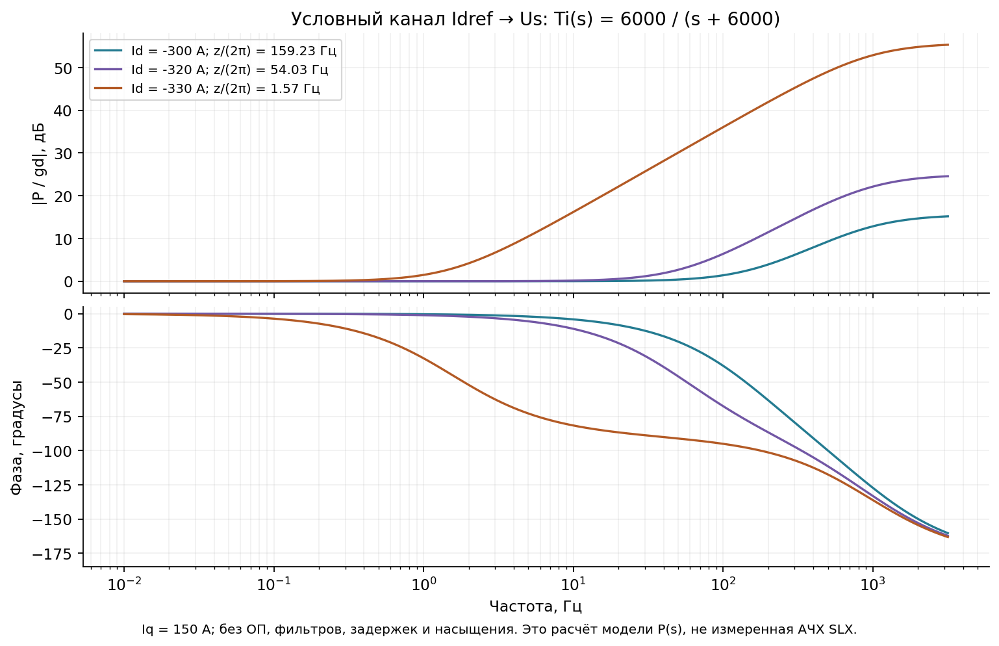
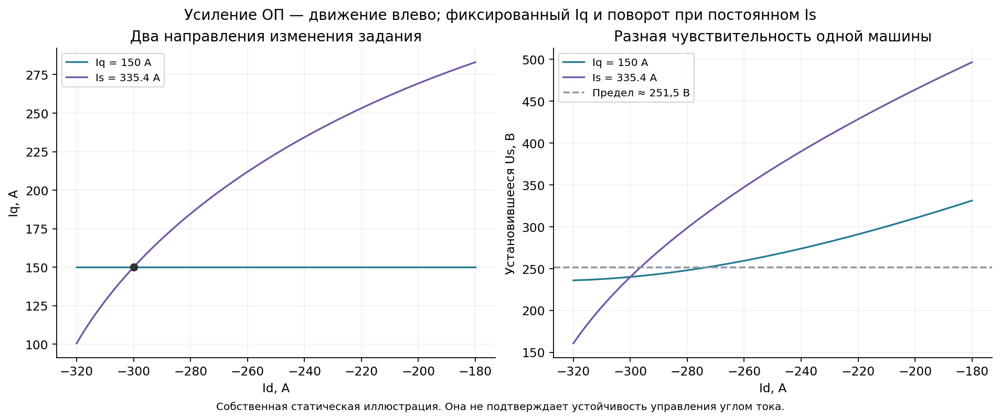
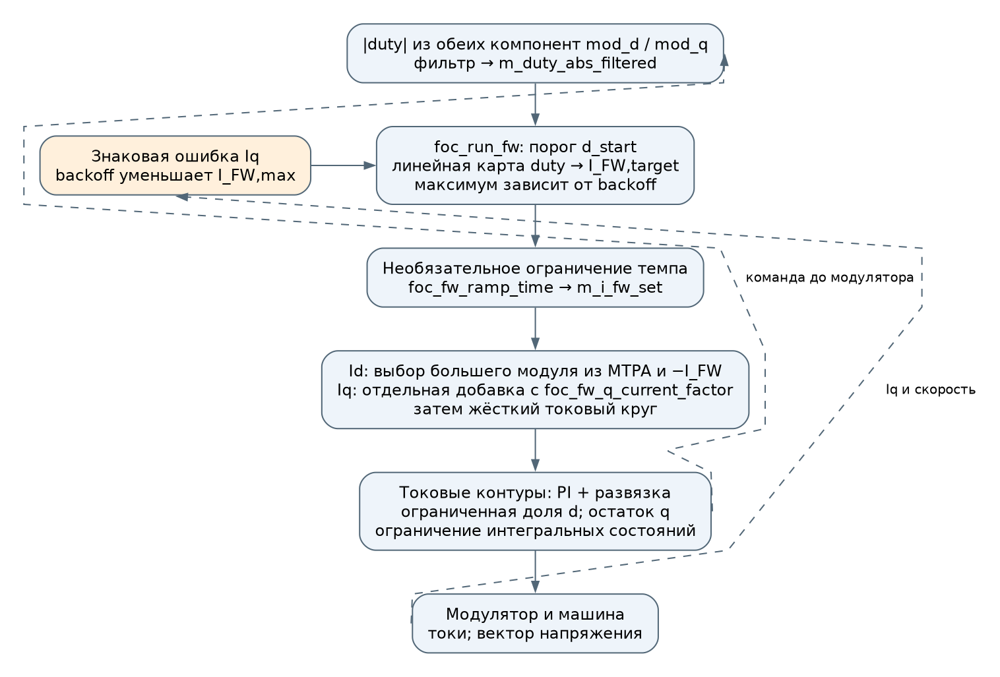
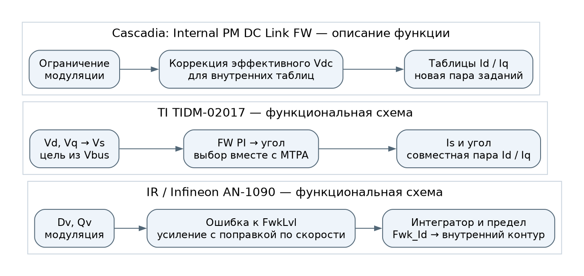
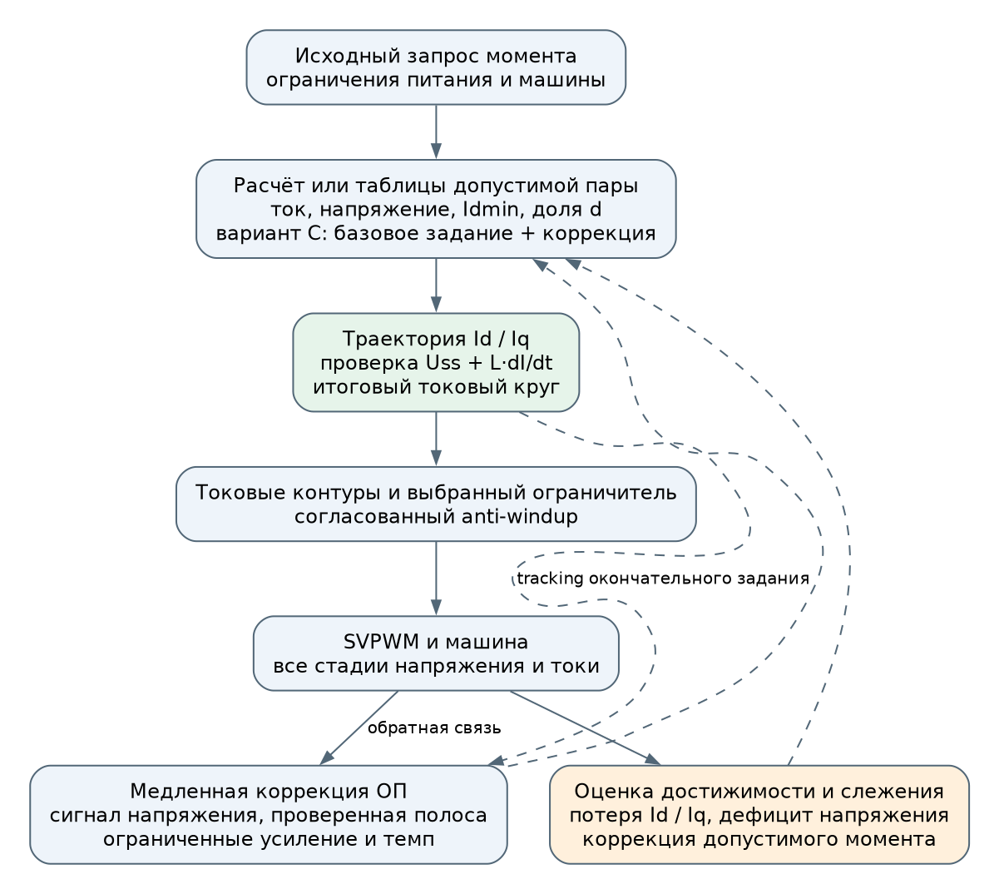

# Контур ослабления поля Adaptto: устройство, динамика и варианты изменения

Дата: 10.11.2026. Модель: [ideal_source_drive_Idff_aug_param.slx](../ideal_source_drive_Idff_aug_param.slx).

**Уточнение от 12.11.2026:** описание соединений ниже относится к состоянию
на дату документа. Последующие F01–F04 и диагностика записаны в
[журнале исправлений](control_fix_log.md). По предложению пользователя подготовлен
[новый проект формирователя ОП](field_weakening_redesign.md), включая контрольную
ветвь без прежнего FF. Он ещё не реализован; старые варианты ниже сохранены
как история анализа.

Документ дополняет [control_review](control_review.md) и [обзор промышленных реализаций](industry_field_weakening.md). Здесь подробно рассматривается наружный контур ОП: почему он измеряет полный вектор напряжения, что делает нормировка sens, как на него влияют токовые контуры и какие изменения следует сравнить.

**Статус:** описание действующей схемы, расчёт по уравнениям машины и проект испытаний. Исправленный регулятор не реализован. Новых прогонов Simulink нет. Иллюстрации с динамикой ниже используют заданную траекторию токов или явно указанную упрощённую передаточную функцию; они не являются испытанием полного FOC.

Основной вывод: полный модуль Us — обоснованная контролируемая величина. Проблема возникает, когда наружный регулятор пытается устранить любой дефицит напряжения одним Id и компенсировать изменение чувствительности одним множителем. В глубоком ОП уменьшается статическое влияние Id, возможна обратная начальная реакция, а насыщение меняет сам объект регулирования. Поэтому согласование Id/Iq, темпа перехода и anti-windup важнее точного обращения одной статической производной.

## 1. Основания и границы анализа

| Материал | Что он подтверждает |
|---|---|
| SLX и [карта блоков](data/control_model_structure.json) | Действующие соединения, коэффициенты, фильтры, ограничения и сигналы |
| [Прежние результаты](data/control_review/summary.json) | Превышение тока, потерю слежения, поведение оценщиков исходной модели |
| Уравнения PMSM с постоянными параметрами | Статическую чувствительность и локальную динамическую связь токов с напряжением |
| Открытый код VESC | Конкретную реализацию выбранного коммита, включая условия разрешения и ограничения |
| Руководства производителей | Только раскрытые функции и схемы; закрытый код по ним не реконструируется |
| Предложенные изменения | Гипотезы для сравнительных испытаний, без подтверждённого результата Adaptto |

Параметры расчётов: Rs = 0,02 Ом, Ld = 0,31 мГн, Lq = 0,305 мГн, Ψ = 0,1024 Вб, p = 11, Vdc = 440 В, Is_max = 420 А. Для собственных иллюстраций используется ωe = 5000 электрических рад/с, то есть ωm ≈ 454,5 рад/с. Нормировка dq амплитудно-инвариантная.

В исходном регуляторе Vmax = 0,995·Vdc/√3 ≈ 252,76 В, цель ОП VFW = 0,95·Vdc/√3 ≈ 241,33 В. Согласованный с принятыми пределами duty кандидат Ulim = 0,99·Vdc/√3 ≈ 251,49 В показан на расчётных рисунках отдельно. Он ещё не внедрён в SLX.

Полные URL и редакции собраны в [манифесте источников](data/fw_loop_sources.json). Иллюстрации собственные; [происхождение изображений](img/fw_loop/README.md).

## 2. Как устроен наш контур

### 2.1. Место ОП относительно токовых контуров



Рисунок 1. Текущая схема из control_review. LPF с номером означает блок `Low-Pass Filter (Discrete or Continuous)` с тем же номером. Имена относятся к корневому листу SLX, кроме явно указанного VectorBase.

Ослабление управляет заданием Idreq. Напряжения Ud/Uq формируют внутренние PI, развязка и ограничения VectorBase. Обратная связь ОП берёт эти уже ограниченные команды до SVPWM и задержки скважностей. Измеренные линейные напряжения машины в этот контур не поданы.

В действующем VectorBase ось d ограничивается первой; для q остаётся √max(0,001; Vmax² − Ud²). Поэтому выход PI_d может почти полностью убрать диапазон q. ОП находится снаружи этой нелинейной системы: его динамика зависит не только от машины, но и от режима внутренних ограничителей.

Скорость задаёт идеальный источник. Запрос Iq приходит от Repeating Sequence, а не от активного регулятора скорости. Подробная схема объекта и активных измерений дана в п. 2.3 control_review.

### 2.2. Измеряемая величина и чувствительность

Фильтруются компоненты напряжения, после чего вычисляется модуль:

$$
U_{d,f}=\operatorname{LPF}_1(U_d),\quad
U_{q,f}=\operatorname{LPF}_6(U_q),\quad
V_f=\sqrt{U_{d,f}^2+U_{q,f}^2}.
$$

Это не тождественно фильтрации готового модуля LPF(√(Ud² + Uq²)). При изменении направления вектора порядок операций имеет значение.

Ошибка напряжения и вход интегратора:

$$
\Delta V=V_{\mathrm{FW}}-V_f,\qquad
\Delta\Psi=\frac{\Delta V}{|\tilde\omega_e|\,sens}.
$$

Сигнал ω̃e соответствует `w_el_sat`: малый модуль защищён границей 0,1 рад/с. Ветка Divide3 → LPF2 → sat_signed4 даёт:

$$
s_{\mathrm{raw}}=\operatorname{sign}(\tilde\omega_e)
\frac{U_{q,f}-R_sI_{q,\mathrm{req}}}{\max(V_f,10^{-6}\ \text{В})},\qquad
sens=\operatorname{signedFloor}_{0{,}1}\bigl(\operatorname{LPF}_2(s_{\mathrm{raw}})\bigr).
$$

`signedFloor` сохраняет знак и повышает модуль до нижней границы; нулевому входу функция присваивает положительный знак. Это защита деления, а не проверка физической достоверности чувствительности.

| Узел | Действующая настройка |
|---|---|
| LPF1/LPF6 напряжений | τ = 10·Ts = 0,833 мс; шаг Ts |
| LPF2 чувствительности | τ = 10·Ts = 0,833 мс; шаг Ts |
| sat_signed4/5 | Период 10·Ts; модуль не ниже 0,1 |
| PID Controller наружного ОП | I-регулятор, коэффициент 15 с⁻¹, Forward Euler, шаг Ts |
| Предел Psi_trim | ±50·Ld = ±0,0155 Вб, эквивалент ±50 А |
| Anti-windup наружного I-регулятора | Clamping собственного выхода; tracking выключен |
| Unit Delay1 после деления на Ld | Задержка задания Id с шагом Ts/2 |

При разрешённом интегрировании, вне ограничений и сбросов:

$$
\Psi_{\mathrm{trim},k+1}=\Psi_{\mathrm{trim},k}
+15T_s\frac{V_{\mathrm{FW}}-V_f}{|\tilde\omega_e|\,sens}.
$$

Если выразить подстройку в амперах, эквивалентный интегральный коэффициент равен 15/(Ld_ном·|ω̃e|·sens). Поэтому изменения sens меняют динамику наружного контура даже при неизменной настройке PID Controller.

### 2.3. FF и окончательное задание Id

FF вычисляет предварительное приращение потокосцепления, соответствующее Ld·Id. При qf = LPF4(Iqreq) его выражение по существующим связям:

$$
F=\sqrt{\max\left[0,
\left(\frac{V_{\mathrm{FW}}}{\tilde\omega_e}\right)^2-
\left(\hat L_q q_f-\frac{R_s I_{d,\mathrm{req}}}{\tilde\omega_e}\right)^2\right]}
-\frac{R_s I_{q,\mathrm{req}}}{\tilde\omega_e}-\hat\Psi.
$$

После Saturation Dynamic1 и Min1, при idTorqueController = 0:

$$
\Psi_{d,\mathrm{ff}}=\operatorname{clip}(F,-\hat\Psi,0),\quad
z=\Psi_{d,\mathrm{ff}}+\Psi_{\mathrm{trim}},
$$

$$
I_{d,\mathrm{req}}=\operatorname{Delay}_{T_s/2}
\left[\frac{\operatorname{clip}(z,-1{,}2\hat\Psi,0)}{L_{d,\mathrm{ном}}}\right].
$$

Задержанный Idreq участвует и в следующем вычислении FF. Iqreq также возвращается в FF и чувствительность; его индуктивная составляющая проходит LPF4 с τ = 10·Ts. Поэтому «FF + медленный интегратор» здесь не означает отсутствие других замкнутых расчётных связей.

### 2.4. Разрешение, сброс и связь с Iq

Сигнал `freeze = 1` разрешает интегрирование. Он становится нулём при любом из условий:

- z ≤ −1,2·Psi_est и ΔΨ < 0;
- z ≥ 0 и ΔΨ > 0;
- |ω̃e| ≤ ωbase и ΔΨ < 0, где ωbase = Vs_max/√(Psi_est² + (Lq_ном·Is_max)²).

Последнее условие формирует AND2. Его инверсия подана на внешний reset с настройкой `either`: сброс происходит на обоих фронтах составного условия. Это отдельное переключение состояния, которое не описывается непрерывной линейной моделью.

Токовый предел использует LPF8(Idreq), τ = 8,33 мс. Остаток круга √max(0; Is_max² − Idreq_f²) мягко объединяется с Vs_max/(|ω̃e|·Lq_est), после чего Min3 ограничивает запрос Iq только сверху. Значит, внешняя реакция ОП зависит также от того, активен ли предел Iq и насколько успел измениться Idreq_f.

## 3. Что означает большая доля Ud

В установившемся режиме:

$$
U_{d0}=R_sI_d-\omega_eL_qI_q,\qquad
U_{q0}=R_sI_q+\omega_e(\Psi+L_dI_d).
$$

При высокой скорости и малом влиянии Rs:

$$
U_s\approx|\omega_e|\sqrt{(L_qI_q)^2+(\Psi+L_dI_d)^2}.
$$

При фиксированном Iq отрицательный Id уменьшает второе слагаемое, пока полное потокосцепление d положительно. Первое слагаемое практически не меняется. Поэтому большая доля Ud означает прежде всего ограниченную возможность снизить Us одним Id; сама по себе она не доказывает положительную обратную связь.



Рисунок 2. Собственный расчёт с учётом Rs. Кривые показывают требуемые установившиеся напряжения, включая точки за пределом инвертора. Они не изображают реально исполненные команды.

В приближении без Rs нижняя граница равна |ωe·Lq·Iq|. При Iq = 180 А это 274,5 В — больше Ulim ≈ 251,5 В. Усиление ОП не делает такой запрос достижимым. При указанных скорости и напряжении необходимая оценка предела |Iq| составляет около 164,9 А; токовый круг, предел Id и дополнительные резервы могут её уменьшить.

Точная статическая производная при фиксированном Iq:

$$
g_d=\frac{\partial U_s}{\partial I_d}
=\frac{R_sU_{d0}+\omega_eL_dU_{q0}}{U_{s0}}.
$$

На обычной ветви gd > 0, и уменьшение Id снижает Us. В минимуме gd = 0. После минимума gd < 0, и дальнейшее усиление ОП увеличивает напряжение. Предел размагничивания машины может запретить подход к этой области раньше; он должен учитываться независимо от математического минимума.

## 4. Почему напряжение может сначала вырасти

В динамике присутствует дополнительное слагаемое:

$$
U_d=R_sI_d-\omega_eL_qI_q+L_d\dot I_d.
$$

При ωe > 0, Iq > 0 и отрицательном Ud усиление ОП означает dId/dt < 0. Динамический член сразу увеличивает |Ud|, тогда как снижение Uq развивается по мере изменения самого Id. Это позволяет начальному и конечному изменениям Us иметь противоположные знаки.



Рисунок 3. Для заданной траектории Id = −300 − 10·(1 − exp(−t/1 мс)) А после t = 0, при неизменных Iq = 150 А и ωe = 5000 рад/с: Us до перехода 240,016 В, в момент 0+ — 243,049 В, конечное значение — 237,469 В. Ток непрерывен, его производная в начале меняется скачком. Все эти напряжения ниже Ulim; начальная обратная реакция существует и без насыщения.

Это другой опыт, чем радиальное уменьшение напряжения в предыдущем обзоре. Там задавалось изменение U и вычислялись начальные производные токов. Здесь задаётся траектория тока и вычисляется требуемое напряжение. Оба расчёта иллюстрируют связи машины, но не доказывают механизм зарегистрированной защёлки и не заменяют замкнутые испытания.

## 5. Что компенсирует sens и чего он не компенсирует

### 5.1. Локальная динамика при фиксированном Iq

Линеаризация около установившейся точки при постоянной скорости даёт:

$$
\delta U_s=g_d\delta I_d+h_d\delta\dot I_d,
\qquad h_d=\frac{L_dU_{d0}}{U_{s0}}.
$$

При gd > 0 и Ud0 < 0 коэффициент hd отрицателен. Если замкнутый токовый контур представить устойчивой функцией Ti(s), канал наружного регулятора имеет приближённую форму:

$$
P(s)=\frac{\delta U_s(s)}{\delta I_{d,\mathrm{ref}}(s)}
\approx(g_d+h_ds)T_i(s).
$$

В таком приближении существует положительный нуль z = −gd/hd. Он описывает неминимально-фазовую, то есть обратную начальную, реакцию. Этот вывод предполагает удержание Iq, отсутствие насыщения и отсутствие точной компенсации данного нуля другими звеньями. Он не утверждает наличие той же передаточной функции во всех режимах полного SLX.

| Id, А при Iq = 150 А | Ud, В | Uq, В | gd, В/А | z, рад/с | z/(2π), Гц |
|---:|---:|---:|---:|---:|---:|
| −300 | −234,75 | 50,0 | 0,30333 | 1000,45 | 159,23 |
| −310 | −234,95 | 34,5 | 0,20540 | 669,68 | 106,58 |
| −320 | −235,15 | 19,0 | 0,10490 | 339,48 | 54,03 |
| −330 | −235,35 | 3,5 | 0,00305 | 9,84 | 1,57 |

Близость к минимуму напряжения меняет не только статическое усиление, но и характерную частоту обратной реакции.



Рисунок 4. Слева сопоставлены точная статическая производная и эквивалентная нормировка из sens при установившихся фильтрах и точных номинальных параметрах. Справа показан положительный нуль только на ветви gd > 0. За пределами этой ветви правило интерпретации меняется.

В нашей схеме величина Ld·|ωe|·sens лишь приближает gd. Даже до ограничений sens использует Uq − Rs·Iqreq, тогда как точная производная содержит Rs·Ud + ωe·Ld·Uq. При насыщении и ошибке слежения различие становится существеннее.

Нижняя граница |sens| ≥ 0,1 ограничивает обратное усиление. Она **не обязательно разгоняет контур возле минимума**: когда истинное gd почти исчезло, эта граница может, наоборот, резко уменьшить эффективную полосу. Утверждать неизбежную неустойчивость из одного деления на sens нельзя. Но защита деления не является обоснованием устойчивости и не проверяет направление воздействия.

### 5.2. Почему одной нормировки статического усиления мало



Рисунок 5. Для иллюстрации принято Ti(s) = 6000/(s + 6000); показано P(s)/gd. Даже после нормировки статического усиления фазовые характеристики различаются. Здесь нет фильтров ОП, цифровых задержек, ограничителей и изменения Iq. Это не измеренные АЧХ модели.

Условный пример позволяет увидеть ограничение аналитически. Для обычной отрицательной обратной связи с наружным интегратором K/s, K > 0, и указанным Ti(s) характеристический полином:

$$
s^2+\omega_c(1+Kh_d)s+K\omega_cg_d=0.
$$

При gd > 0 и hd < 0 устойчивость этой упрощённой системы требует K·gd < z. Если выбрать K = a/gd ради постоянного статического темпа a, получится требование a < z. Следовательно, один и тот же желаемый темп нельзя сохранять произвольно близко к минимуму напряжения.

Это условие относится только к приведённой модели второго порядка. Оно не является критерием приёмки нашего FOC. Реальные фильтры, дискретизация, FF, адаптация и работа ограничителя должны войти в отдельный анализ. В частности, число 15 с⁻¹ в существующем интеграторе не равно автоматически полосе полного контура; граница sens дополнительно меняет его эффективное усиление.

### 5.3. Если одновременно изменяется Iq

На границе токового круга изменение Id вызывает изменение Iq. Тогда статическая чувствительность вдоль заданной траектории равна:

$$
g_{\mathrm{path}}=g_d+g_q\frac{dI_q}{dI_d},\qquad
g_q=\frac{-\omega_eL_qU_{d0}+R_sU_{q0}}{U_{s0}}.
$$

При постоянном модуле тока и Iq > 0: dIq/dId = −Id/Iq. В двигательном квадранте более отрицательный Id сопровождается меньшим Iq, что уменьшает основную составляющую |Ud|. Поэтому такая траектория может сохранять существенное влияние на Us там, где изменение одного Id малоэффективно.



Рисунок 6. Через точку (−300; 150) А проведены линия постоянного Iq и дуга постоянного Is ≈ 335,4 А. Это собственное статическое сравнение; модуль 335,4 А выбран для прохождения через общую точку и не заменяет предел 420 А.

Динамический член также изменяется: вместо hd появляется [Ld·Ud0 + Lq·Uq0·dIq/dId]/Us0, если оба тока следуют одной мгновенной параметризации. С разными токовыми контурами и задержками нужна двухканальная модель. Поэтому преимущества углового задания нельзя объявлять гарантией устойчивости, особенно при Iq → 0 и смене знака момента.

### 5.4. Насыщение — отдельный режим

Производные выше относятся к напряжению, необходимому машине. Наш контур видит команды после ограничителя. На границе круга модуль ограниченной команды может почти не меняться при увеличении необрезанного запроса. Одновременно перестают выполняться предположения о точном удержании Iq и следовании Id за заданием.

В такой ситуации нельзя использовать линейную производную ненасыщенной машины как точную чувствительность измеряемого сигнала. Нужны признаки насыщения и слежения, согласование интеграторов и коррекция достижимого запроса. При цели ниже предела даже ограниченный модуль оставляет ошибку для ОП, но скрывает глубину дефицита.

## 6. Что реализовано в доступных проектах

### 6.1. VESC: карта duty → ток ослабления

Зафиксирован коммит **3ebf8d1fe8cc485ad588e4272a761785c9cf0c5d**. Описание относится к активной ветви обычного FOC; override, специальные режимы и отдельные конфигурации могут её изменять.



Рисунок 7. Функциональная реконструкция по открытому коду. Динамика карты замыкается через токовые контуры и duty; отсутствие отдельного I-регулятора ОП не делает её разомкнутым управлением.

**Сигнал обратной связи.** `duty_now` вычисляется из модуля mod_d/mod_q с нормировкой по шине и overmodulation. В активном токовом контуре эти компоненты получаются из ограниченных команд напряжения. Если обозначить именно эти команды Ud/Uq:

$$
D=\frac{\sqrt3\sqrt{U_d^2+U_q^2}}{V_{\mathrm{bus}}k_{\mathrm{overmod}}}.
$$

Затем фильтруется |duty|. Значит, вклад Ud сохраняется: переход от Us к duty сам по себе физическую связь не устраняет. Поля состояния vd/vq позже пересчитываются с компенсацией dead time, но уже вычисленные mod_d/mod_q при этом не заменяются; подставлять эти поздние значения в формулу как ту же пару команд нельзя. [Расчёт duty](https://github.com/vedderb/bldc/blob/3ebf8d1fe8cc485ad588e4272a761785c9cf0c5d/motor/mcpwm_foc.c#L3818), [нормировка и последующее обновление напряжений](https://github.com/vedderb/bldc/blob/3ebf8d1fe8cc485ad588e4272a761785c9cf0c5d/motor/mcpwm_foc.c#L4704).

**Разрешение и закон ОП.** `foc_run_fw` требует достаточного foc_fw_current_max, состояния MC_STATE_RUNNING и одного из режимов current/current_brake/speed либо ещё действующего ОП после смены режима. Карта включается при foc_fw_duty_start < 0,99. Задаются Dmax = l_max_duty и Dstart = foc_fw_duty_start·Dmax. Ниже порога целевой ток ОП нулевой. На активном участке Dstart < D ≤ Dmax линейная карта имеет вид:

$$
I_{\mathrm{FW,target}}=I_{\mathrm{FW,max,eff}}
\frac{D-D_{\mathrm{start}}}{D_{\max}-D_{\mathrm{start}}}.
$$

Это запись карты на указанном диапазоне; дополнительного clamp её выхода в данном вызове `utils_map` нет. Наличие пределов в других частях прошивки не следует подменять выдуманным ограничителем здесь. [Функция ОП](https://github.com/vedderb/bldc/blob/3ebf8d1fe8cc485ad588e4272a761785c9cf0c5d/motor/foc_math.c#L717).

**Динамика и задания.** При ненулевом ramp_time изменение I_FW ограничивается шагом dt·I_FW,max/ramp_time; при ramp_time < dt новое значение присваивается сразу. Id выбирается по большему модулю из MTPA и −I_FW. Отдельная добавка к Iq зависит от знака mod_q, I_FW и foc_fw_q_current_factor. После этого применяется токовый круг. Этот коэффициент q не является общей моделью предельного момента. [Формирование Id/Iq](https://github.com/vedderb/bldc/blob/3ebf8d1fe8cc485ad588e4272a761785c9cf0c5d/motor/mcpwm_foc.c#L3646).

**Backoff.** При выполнении условий ветви максимальный ток ОП уменьшается:

$$
b=\operatorname{clip}\left[
K_b\frac{\operatorname{sign}(\hat\omega)(I_q-I_{q,\mathrm{target}})}{I_{\mathrm{FW,max}}},0,1\right],
\qquad I_{\mathrm{FW,max,eff}}=(1-b)I_{\mathrm{FW,max}}.
$$

Комментарий связывает это с чрезмерным ОП и нехваткой напряжения q. При положительной скорости ветвь реагирует на Iq выше задания. В нашей защёлке Iq ≈ −166,6 А, задание −42 А: знак противоположный, поэтому данный backoff её непосредственно не устраняет. При выходе из ОП код также продлевает разрешение модуляции. [Условия и комментарии](https://github.com/vedderb/bldc/blob/3ebf8d1fe8cc485ad588e4272a761785c9cf0c5d/motor/foc_math.c#L738).

**Общая конфигурация:** максимальный ток ОП 0 А, порог duty 0,8 от максимума, ramp_time 0 с, backoff 2, коэффициент q 0,05, максимальная доля d 0,98. Поэтому ОП нужно отдельно разрешить, а плавный ramp не действует по умолчанию. Это не настройки каждого устройства на VESC. [mcconf_default.h](https://github.com/vedderb/bldc/blob/3ebf8d1fe8cc485ad588e4272a761785c9cf0c5d/motor/mcconf_default.h#L499).

Инженерное отличие от Adaptto: на этой ветви нет интегрирования ошибки Us с делением на локальную чувствительность. Есть конечный наклон карты, фильтрация и режимные ограничения. Такая характеристика не обязана удерживать одну точно заданную модуляцию во всех режимах; её динамику и остаточную ошибку также нужно проверять.

### 6.2. IR / Infineon: интегратор с коррекцией усиления по скорости

[AN-1090, стр. 10–11](https://www.infineon.com/assets/row/public/documents/60/42/infineon-irmcf3xx-series-controller-dynamics-and-tuning-an-en.pdf?fileId=5546d462533600a401535595acd1103c) раскрывает контур IRMCF3xx: модуляция из Dv/Qv сравнивается с FwkLvl, затем действуют коррекция усиления по скорости, интегратор и предел отрицательного Fwk_Id. Производитель компенсирует рост усиления объекта с частотой двигателя. Для рассматриваемых бытовых применений указан отклик 0,1–0,4 с, настройка конфигуратора — 0,25 с.

Это подтверждает допустимость переменного усиления как метода. Документ не подтверждает применение нашего деления на sens и не обосновывает перенос указанных времён в тяговый привод. Его упрощённая модель первого порядка не описывает все быстрые динамические члены машины.



Рисунок 8. Собственные схемы по AN-1090, TIDM-02017 и руководству Cascadia. У Cascadia показана функция одного режима; внутренний закон коррекции не раскрыт.

### 6.3. TI: PI напряжения управляет углом тока

В [TIDM-02017, рис. 3-10/3-11](https://www.ti.com/lit/ug/tiduf56/tiduf56.pdf?ts=1780283501979#page=16) FW PI формирует угол, согласуемый с MTPA; из модуля тока и выбранного угла рассчитываются оба задания. В используемой TI нормировке Id = Is·cosβ и Iq = Is·sinβ. Это аппаратный референс тягового инвертора, а не раскрытый код всех автомобильных изделий.

Собственный вывод для сравнения: такая переменная управления задаёт направление изменения всей пары. Она позволяет разгрузить Ud посредством уменьшения Iq одновременно с усилением ОП. Смена координат не отменяет насыщение, переходную динамику и необходимость настройки при смене квадранта.

### 6.4. Kollmorgen и Cascadia: сведения о серийных приводах

[Kollmorgen AKD2G](https://webhelp.kollmorgen.com/kas/Content/AKD2G_User_Manual/Field_Weakening_View.htm) регулирует модуль напряжения воздействием на d. Руководство прямо описывает нелинейность и рост полосы со скоростью; предлагает учитывать её увеличение на 50%. Настраиваются порог напряжения и полосы фильтров d/q-напряжений и токов. Для расчёта настроек важны KE, LDLL и число полюсов. Точный код нормировки не опубликован, поэтому наличие именно sens-подобного деления неизвестно.

В [Cascadia / BorgWarner, §6.2](https://www.cascadiamotion.com/_files/ugd/b5e2cb_e731a297509a4b2786cea7ef36199b7f.pdf#page=38) режим Surface PM меняет отрицательный Id; Internal PM уменьшает Iq, опираясь на табличный Id; Internal PM DC Link FW корректирует эффективное Vdc на входе таблиц Id/Iq. Во всех случаях регулируется использование доступного напряжения, но выбирается разное воздействие. Эффективное Vdc — аргумент расчёта, а не физическое изменение батареи. Внутренний PI и его anti-windup по этому описанию восстановить нельзя.

### 6.5. Что добавляют остальные найденные материалы

[Microchip AN2520, раздел 4](https://onlinedocs.microchip.com/oxy/GUID-AAAF8F97-D139-4A93-A154-AA3C6EE6BB22-en-US-1/GUID-007091E0-0021-4359-A50B-127AF65C0B1C.html) раскрывает расчёт Id по уравнениям, остаток токового круга для Iq и приоритет напряжения d. Это полезный образец расчётного формирователя; он не доказывает устойчивость нашего наружного интегратора.

Материалы Beckhoff AX5000 и NXP AN12235 подтверждают наличие регулирования напряжения/ОП и соответствующих интерфейсов, но изученных описаний недостаточно для точного воспроизведения закона усиления. Infineon MOTIX с выбором приоритета d относится к внутреннему ограничителю, а AN-1090 выше — к наружному контуру: это разные публикации и разные вопросы. Ссылки и границы сведений сохранены в [предыдущем обзоре](industry_field_weakening.md).

## 7. Варианты изменения нашей схемы

Во всех вариантах нужны согласованные токовые пределы, обе полярности момента, определённая политика напряжения и совместимый anti-windup. Сравнивать наружные контуры поверх разных скрытых ограничителей некорректно. Онлайн-оценщики сначала фиксируются, затем возвращаются отдельным этапом.

| Вариант | Изменение | Ожидаемая польза | Что остаётся проверить |
|---|---|---|---|
| A. Ограниченный I-контур по Us/модуляции | Сохранить FF, ограничить усиление и темп, пересмотреть sens и tracking | Минимальное вмешательство; понятная контрольная ветвь | Полоса при малом gd, насыщение, скачки FF и логики reset |
| B. Карта модуляция → Id по примеру VESC | Заменить интегратор конечным наклоном карты; добавить фильтр, ramp и режимные пределы | Нет накопления ошибки наружным интегратором | Остаточная ошибка, достаточность наклона, знак backoff, переходы квадрантов |
| C. Совместный формирователь пары + ограниченная подстройка | Расчёт/таблицы учитывают допустимую область, наружный контур корректирует остаточную ошибку | Разделяет достижимость, динамику перехода и настройку ОП | Погрешности модели, выбор траектории и поведения при пустой допустимой области |
| D. Регулирование угла тока | FW меняет направление пары при заданном/ограниченном модуле | При усилении ОП уменьшается также Iq и составляющая Ud | Момент, MTPA, переход через Iq = 0, рекуперация и динамика модуля тока |

### 7.1. Вариант A: изменить динамику, сохранив основную структуру

Вместо стремления точно обратить малую чувствительность можно начать с ограниченного положительного коэффициента KFW(|ωe|) на проверенной ветви gd > gmin. В амперах подстройка x может иметь вид:

$$
x_{k+1}=\operatorname{clip}\left[x_k-T_sK_{\mathrm{FW}}e_V
+T_sK_{\mathrm{tr}}(I_{d,\mathrm{ref}}-I_{d,\mathrm{pre}})\right],
\qquad e_V=V_{\mathrm{feedback}}-V_{\mathrm{FW}}.
$$

Id_pre — предварительное задание после добавления x, Idref — результат окончательного формирования пары. KFW имеет размерность А/(В·с), Ktr — 1/с. Ограничение темпа задания выполняется с учётом траектории обеих осей. Если обратная связь выражена модуляцией, меняются единицы KFW.

Коррекция по скорости допустима, например с ограниченным диапазоном коэффициента; её закон подбирается по измеренному каналу. При малой/неверной чувствительности запрещается дальнейшее интегрирование в неподтверждённом направлении, а вопрос допустимого момента передаётся формирователю. Это не универсальная команда уменьшить |Id|: при высокой скорости такая команда сама может лишить привод необходимого ОП.

Сохранение прежнего FF означает, что его быстрые изменения остаются. Медленный trim не ограничивает быстрый скачок базового задания. Поэтому темп нужно контролировать после суммирования FF и trim, с возвратом результата в anti-windup.

### 7.2. Вариант B: конечный наклон вместо интегратора

Для исследовательской ветви задаётся I_FW = f(m), где функция имеет порог, конечный наклон и верхний предел, затем ограничивается темп. По смыслу это соответствует рассмотренной ветви VESC, но коэффициенты и режимные условия определяются для Adaptto.

При росте модуляции увеличивается отрицательное Id; новое Id через токовые контуры изменяет модуляцию. Следовательно, устойчивость всё равно определяется замкнутой системой. Слишком крутая карта и малая фильтрация способны дать колебания. Слишком пологая карта может потребовать большого отклонения модуляции для нужного ослабления. Жёсткие ограничения и обработка недостижимого Iq остаются необходимыми.

### 7.3. Вариант C: совместный расчёт и медленная коррекция



Рисунок 9. Проект для Adaptto, а не схема одного производителя. Структура совместима с разными ограничителями напряжения, если формирователь учитывает соответствующую область.

Это основной кандидат для развития после подготовки контрольной ветви A. Формирователь определяет пару Id/Iq по запросу момента, скорости, Vdc, токовым пределам, допустимому Id и принятой доле d. Для постоянных параметров подходит расчёт из п. 8.4 control_review; для нелинейной машины возможны карты потокосцепления и таблицы заданий.

Затем выбирается переход. Приближённо требуемое напряжение:

$$
\mathbf U_{\mathrm{dyn}}=\mathbf U_{\mathrm{ss}}+
\begin{bmatrix}L_d\dot I_d\\L_q\dot I_q\end{bmatrix}.
$$

Проверяется принадлежность этого вектора области актуатора. При ограниченном приоритете d недостаточно проверки круга: требуется также |Ud_dyn| ≤ kd·Ulim. Ошибки модели требуют запаса. Если допустимая конечная точка существует, но выбранный быстрый переход недопустим, меняются темп или траектория. Если не существует и конечная точка, корректируется запрос момента.

Наружная подстройка компенсирует остаточные ошибки модели в области надёжной чувствительности. Она не обязана решать всю задачу выхода из насыщения. Задачи слежения и достижимости наблюдаются отдельно; результат окончательного ограничения возвращается в соответствующие интеграторы.

### 7.4. Вариант D: угол как переменная управления

Для наглядности введём собственный угол γ от +q к −d:

$$
I_d=-I_s\sin\gamma,\qquad I_q=I_s\cos\gamma.
$$

Это не обозначение угла из SDK TI. При фиксированном Is и положительном Iq увеличение γ уменьшает оба члена, связанные с q-током и положительным остаточным потоком, на обычной ветви ОП. Фактическая производная определяется по пути, как в п. 5.3.

Для полноценного варианта требуется согласовать Is с моментом и напряжением. Уменьшение Iq при постоянном Is означает потерю момента; сравнение только по слежению за уже уменьшенным Iqref скроет эту цену. Смена направления вращения и рекуперация требуют отдельного определения угла и непрерывного перехода, а не механического переноса формул двигательного квадранта.

## 8. Можно ли решить вопрос заменой сигнала ошибки

| Сигнал | Польза | Ограничение |
|---|---|---|
| Модуль ограниченной команды Us | Непосредственно связан с использованием напряжения | Скрывает глубину насыщения; содержит динамические составляющие |
| Модуль необрезанного U* | Показывает величину запроса сверх доступного ресурса | Включает состояния PI и реакцию на ошибки тока; требует согласованного anti-windup |
| Нормированная модуляция | Удобно учитывает изменение Vdc и настройки модулятора | Не устраняет связь d/q и обратную начальную реакцию |
| Расчётное установившееся Uss | Отделяет базовую потребность от L·dI/dt | Зависит от модели и не отражает полный переходный бюджет |
| Квадрат модуля Ud² + Uq² | Исключает квадратный корень в ошибке | В линейном приближении лишь умножает чувствительность на 2Us; нуль динамического канала сохраняется |
| Запас q после учёта d | Показывает, какая часть ресурса остаётся q | Граница √(Ulim² − Ud²) сама чувствительна к Ud; знак мощности и противо-ЭДС требуют учёта |

Исключить Ud из общего бюджета нельзя: это реально требуемая составляющая. Регулировать только Uq без пересчёта доступного остатка означает игнорировать ограничение инвертора. Замена на остаток q может изменить удобство реализации, но не устранить геометрию ограничения.

Также не следует напрямую вычитать из измеренного напряжения шумную оценку L·dI/dt и считать результат достоверным установившимся напряжением. Такой наблюдатель или фильтр потребовал бы собственного обоснования. Для первого сравнения лучше логировать все стадии отдельно, а не смешивать их в один «исправленный Us».

## 9. Как сравнивать варианты

### 9.1. Сначала измерить объект наружного контура

На копиях исходной модели фиксируются параметры регулятора и оценщики. Контур trim временно отключается, FF не должен изменять исследуемое задание в ответ на тестовое возмущение. Внутренние токовые контуры сохраняются. Это диагностический режим, а не новый рабочий алгоритм.

| Шаг | Что проверяется |
|---|---|
| Установившаяся точка | Достижимость по истинной модели и принятому ограничителю; отсутствие насыщения; малые ошибки токов |
| Малое возмущение Idref при фиксированном Iqref | Каналы к Id, Iq, U*, Us и Ureal; начальная реакция, усиление и фаза |
| Уменьшение амплитуды возмущения вдвое | Сохраняется ли локальная линейность и не сработал ли ограничитель |
| Возмущение вдоль постоянного Is | Отличие от фиксированного Iq; фактическая динамика обеих осей |
| Включение фильтров/нормировки ОП | Вклад каждого звена в фазу, усиление и переключения sens |
| Замыкание выбранного наружного контура | Полоса, запас устойчивости и восстановление без насыщения |
| Отдельные большие возмущения | Работа ограничителей, смена ветви, предел Id и уменьшение момента |

Сетка включает оба знака скорости и момента, вход в ОП, d-доминирующее напряжение, окрестность малого gd, границу токового круга и области переключения FF/reset. Точки −300…−330 А из таблицы — начальные аналитические ориентиры при Iq = 150 А; предел размагничивания и работа фактического формирователя проверяются до включения их в рабочую матрицу.

### 9.2. Что логировать

Нужны исходный и ограниченный запрос момента; Id/Iq; предварительные и итоговые задания; Psi_d_ff/Psi_trim; s_raw, sens и сигнал до signedFloor; freeze/reset; U* до ограничения; Ud/Uq после ограничения; конечные duty; согласованное по времени Ureal; Vdc/Vdc_filt; состояния интеграторов и действующие пределы.

Раздельно оцениваются:

- уменьшение статической чувствительности;
- обратная начальная реакция без насыщения;
- скрытый дефицит после ограничения Us;
- потеря слежения при достижимой конечной точке;
- заведомая недостижимость запроса, требующая снижения момента.

Одного графика полного Us недостаточно, чтобы различить эти случаи.

### 9.3. Порядок экспериментов и критерии

1. Сохранить исходный полный прогон и действующие метрики из control_review.
2. Отдельно устранить несогласованность токового круга и пределов SVPWM; не приписывать их эффект наружному контуру.
3. Получить локальные каналы при фиксированных параметрах и сравнить с аналитическим знаком/динамикой.
4. Сопоставить варианты A и B на общей внутренней структуре и одинаковых достижимых заданиях.
5. Добавить совместный формирователь C; отдельно проверить D как иной способ параметризации пары.
6. Вернуть адаптацию, переключения режимов, изменения питания и ограничений, затем повторить полную матрицу.

Для сравнения фиксируются время восстановления, пик тока, длительность насыщения, знак момента, колебания и потеря момента относительно исходного запроса. Точность удержания модуляции не должна улучшаться только ценой скрытого урезания Iq. Предельные коэффициенты, допустимые темпы и полоса утверждаются по результатам, а не по одному примеру производителя.

## 10. Что уточняется в предыдущем ревью

Сохраняются подтверждённые проблемы тока, оценщиков, ШИМ и зарегистрированной защёлки. Дополнительно устанавливается, что статическая производная gd не описывает переход полностью. Её обратная нормировка не компенсирует член hd·dId/dt, задержки и изменение Iq.

Приоритет d, политика anti-windup и наружный закон ОП — отдельные решения. Ограниченный приоритет d остаётся первым кандидатом внутреннего ограничителя. Вариант C этого документа — кандидат организации заданий и наружного контура; он не подменяет сравнение ограничителей.

Наличие обратной реакции в уравнениях не объявляется доказанной причиной колебаний 240 Гц или конкретной защёлки. Для этого нужны диагностические прогоны из раздела 9. Новые расчётные рисунки не меняют статус прежних экспериментальных результатов.

## 11. Воспроизведение

Из корня репозитория:

```bash
MPLCONFIGDIR=/tmp/adaptto-mpl python3 tools/control_review/fw_loop_figures.py
```

Скрипт строит восемь PNG, три DOT и [численную сводку](data/fw_loop_analysis.json). Нужны NumPy, Matplotlib и Graphviz. Он проверяет SHA-256 исходного SLX и не изменяет модель, CSV и summary прежних прогонов. Схема текущего ОП на рисунке 1 воспроизводится отдельно через model_figures.py.
