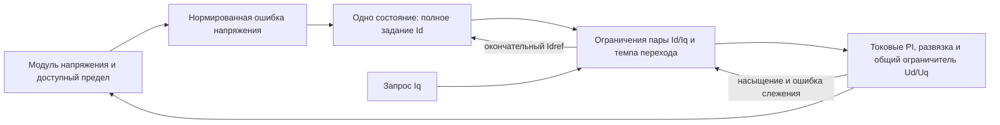

# Перестройка формирователя ослабления поля

Дата: 12.11.2026. Статус: после F05-I подготовлен и отдельно проверен
[первый блок F06 с инструкцией подключения](field_weakening_f06.md).
По предложению пользователя текущее исполнение хранит состояние через `persistent`
внутри MATLAB Function; внешний Unit Delay оставлен только в эталонном тесте.
Пользователь внедрил структуру в `_F06` и исправил период. Четыре прогона
[F06-T от 13.11.2026](control_fix_log.md#f06-t) подтвердили правильный такт,
но сохранилось насыщение d, почти обнуляющее Uq, и потеря слежения.
По уточнению пользователя перед F07 выполнено
[отдельное отключение FF на F06](f06_noff_validation.md): шесть парных прогонов
при прежнем Kψ = 2,5. Часть срывов при смене q исчезла, быстрый вход в ОП
ухудшился; насыщение d/q возможно без FF. Следующие отдельные вопросы —
быстродействие обратной связи и выбор ошибки Uq, затем состав F07.
[Исторические схемы Uq найдены и разобраны](field_weakening_uq_history.md).
Совместное ограничение напряжений и восстановление остаются открытыми.
Рабочую логику меняет пользователь;
в F05-I ассистенту отдельно разрешена настройка коэффициента на тестовых копиях.
Основания: [журнал исправлений](control_fix_log.md), [анализ канала ОП](field_weakening_loop.md).

После пользовательских правок ограничения Iq приоритет уточнён:
[F06-C01 — аудит компонентов и соединений](f06_component_audit.md).
Подтверждены локальные правки Iq, обнаружены рассогласование FF в промежуточной
копии, отсутствие независимого предела Id, обновление оценок на остановке
и старый знак тока в знаменателе Lq. Перед новым подбором коэффициента ОП
или F07 нужно зафиксировать конфигурацию и отдельно проверить эти узлы.

[F06-NL](fw_trim_nonlinearity.md) уточняет динамику нормированной ошибки:
геометрический множитель чувствительности может обращаться в ноль и менять
знак; постограничительный модуль ограничивает отрицательную ошибку −4,21%.
При Kψ = 2,5 это максимум 339,56 А/с усиления ОП интегральной частью при
неизменном FF. Нормировка не является линеаризацией; подбор одного Kψ
не решает неоднозначность модуля и потерю информации при насыщении.

## 1. Принятое направление

По предложению пользователя пересматривается весь формирователь Id, включая FF,
подстройку и freeze/reset. Согласование внутреннего ограничителя Ud/Uq и
anti-windup остаётся обязательным; оно не заменяет перестройку наружного контура.

В опыте **F05-W** пользователь сохранил FF и подал 0 на тег `freeze`.
Фактически это отключило вход подстройки: её выход и состояние равны нулю
во всех пяти прогонах. Увеличение пределов до ±500 А не участвовало в результате.
В рамках F05-W непрерывно работающая расширенная подстройка не проверялась;
этот опыт затем выполнен в F05-I при разрешении 1.

При Ld +20% исчезли прежние срывы с большим током, но сохранились участки
насыщения d с Uq ≈0 и ошибкой слежения. В номинале на полке 738 рад/с размах
Id/Iq вырос до 21,23/25,56 А; при Ld −20% получен срыв с пиком 2048 А.
Следовательно, F05-W служит контрольной ветвью с работающим FF и нулевой
подстройкой, а не готовым решением ослабления поля.
В номинале пара на полке 738 статически достижима (241,33 В при пределе
251,49 В), поэтому её колебания нельзя устранить одним уточнением Ld
или проверкой стационарной достижимости: требуется проверка динамики.

**F05-I отделил настройку от структуры.** Увеличение I с 15 до 150 на профиле
до 738 при Ld +20% уменьшило пик тока с 712,28 до 442,50 А, но сохранило ошибки
слежения; размах Id на полке вырос с 0,83 до 7,77 А. При Ld −20% и I = 150
получен срыв до 863,49 А. Настройка 150 не принята как исправление.

Обнаружены три конкретных механизма: интегрирование вне рабочей области ОП,
накопление поправки за окончательным ограничением Id и неправильное направление
коррекции по sens в сорванном режиме. Первый шаг состояния при I = 15 равен
30,17 Вб, хотя выход ограничен 0,155 Вб; затем на низкой скорости подстройка
достигает −500 А при нулевом FF. Сохранённый reset по фронтам не удерживает
состояние на нуле всё время неактивного режима. Эти механизмы нужно устранить
до дальнейшей оптимизации коэффициента.

**Обязательное удаление FF первым шагом исключено из последовательности.**
Сначала требуется согласовать коррекцию, окончательное задание Id/Iq и
ограничения напряжения. Существующий FF сохраняется для сравнения. Полное
задание и состояние коррекции должны оставаться согласованными при движении FF;
самостоятельное расширение пределов trim этого свойства не обеспечивает.

Кандидат **F05-A** с одним состоянием полного Id в амперах, без расчётного FF,
остаётся отдельной контрольной ветвью для последующего сравнения. Его задача —
измерить динамику обратной связи и необходимость упреждения. Он пока не
реализован и не выбран окончательной архитектурой.

**F06-NFF от 13.11 — уже выполненная проверка вклада FF, но не весь F05-A.**
На копии F06 обнулены оба активных входа FF, поэтому прежнее проецируемое
состояние в Вб задаёт полное ослабление. Kψ = 2,5, обратная связь по модулю
и формирование ограничений сохранены. Результат показывает полезность FF
на быстром входе в ОП и его нежелательное действие на части переходов
снятия ослабления. До выбора архитектуры требуется раздельное исследование
настройки обратной связи и её сигнала; простое удаление FF не принято как
готовое исправление.

## 2. Что в действующей структуре требует пересмотра

- Расчёт FF использует возвращённые Idreq/Iqreq, фильтры и оценённые параметры.
  Эта ветвь участвует в замкнутой системе, хотя называется feedforward.
- Коррекция интегрируется в единицах потокосцепления, ограничивается отдельно,
  затем складывается с FF. Сумма имеет ещё один предел; после него стоит деление
  на Ld и задержка. Ограничение собственного trim не учитывает все последующие
  ограничения и движение FF.
  F05-I подтвердил это непосредственно: на низкой скорости положительная
  поправка продолжает накапливаться при Idref = 0, а при следующем входе в ОП
  компенсирует необходимый отрицательный FF. Clamping собственного выхода
  также допускает превышение внутреннего состояния за один шаг Forward Euler.
- Деление на sens с принудительным минимумом модуля 0,1 сохраняет смену знака.
  Это может резко менять направление и величину коррекции около малой
  чувствительности. Устранение деления не устраняет физическую смену знака объекта.
- `freeze = 1` означает разрешение интегрирования, а не замораживание.
  Внешний reset — отдельный сигнал от условия базовой скорости и знака ошибки;
  I-регулятор настроен на сброс по обоим фронтам (`either`).
  В F05-W этот reset сохранён, а вход интегратора постоянно равен нулю.
  Старый вычисленный freeze теперь отделён от фактического разрешения;
  при анализе наблюдать оба сигнала, не подменять один другим.
  В F05-I постоянное разрешение 1 открыло вход и вне области применимости
  нормировки. Отсутствие дребезга этого разрешения само по себе не является целью.

Условное интегрирование само по себе допустимо: это один из способов anti-windup.
Частые переключения у предела не доказывают дефект автоматически. Проверять нужно,
какое условие их вызывает, меняется ли состояние скачком и как это влияет на Id.
Для регулятора с FF и последующим ограничением требуется учитывать его долю
в окончательном управляющем воздействии; это отдельно описано в
[примере MathWorks по anti-windup и feedforward](https://www.mathworks.com/help/simulink/slref/anti-windup-control-using-a-pid-controller.html).

## 3. Схема F05-A для отдельного сравнения

Для первого анализа сохраняется исправленное вычисление
`Vabs_f = LPF(hypot(Ud,Uq))`. Напряжения здесь являются ограниченными командами.
Отдельно наблюдаются полный запрос до ограничения и разность запрошенного и
выделенного напряжения: ограниченный модуль не показывает глубину насыщения.
Выбор основного сигнала по необрезанному запросу — отдельное сравнение после
согласования anti-windup токовых PI; его нельзя подменять в середине опыта.

Нормированная ошибка:

$$
e_v=\frac{U_{\mathrm{FW}}-V_f}{\max(U_{\lim},\varepsilon_U)}.
$$

На проверенной обычной ветви ОП, где уменьшение Id снижает установившееся
напряжение, используется положительный конечный коэффициент KFW:

$$
v_d=\operatorname{clip}(K_{\mathrm{FW}}e_v,-R_{\mathrm{more}},R_{\mathrm{less}}),
\qquad \widetilde I_d=x_k+T_s v_d.
$$

После совместного ограничения пары и её перехода:

$$
(I_{d,\mathrm{ref}},I_{q,\mathrm{ref}})
=\mathcal G(\widetilde I_d,I_{q,\mathrm{request}},\text{состояние и пределы}),
\qquad x_{k+1}=I_{d,\mathrm{ref}}.
$$

Это структура для реализации, не готовый настроенный алгоритм. KFW имеет
размерность А/с при безразмерной ошибке; Rmore/Rless — А/с. В уравнении нет
деления на Ld, скорость или sens. Зависимость динамики самого объекта от этих
величин остаётся. При необходимости допустима ограниченная настройка KFW по
скорости, после измерения канала, без обращения малой чувствительности.

Возврат окончательного задания в состояние предотвращает накопление скрытого
запроса за ограничителем задания и темпа. Он не заменяет anti-windup внутренних
PI по выделенному напряжению. Измеренный Id также не следует безусловно
приравнивать состоянию наружного интегратора на каждом такте: это изменит
динамику всей каскадной системы.

## 4. Ограничения и режимы

Формирователь G должен иметь явно проверяемые свойства:

1. Idref находится между допустимым отрицательным пределом и нулём для текущей
   стратегии без MTPA. Предел учитывает ток, размагничивание и допустимую ветвь ОП;
   старое −1,2·Psi/Ld не объявляется автоматически корректным пределом.
2. Окончательная пара находится в токовом круге. Ограничиваются обе полярности q.
   Темп проверяется для пары, а не только для Id до последующих изменений Iq.
3. Если дальнейшее увеличение |Id| не уменьшает потребность в напряжении или
   достигнут его предел, дефицит передаётся на ограничение |Iq|. Недостижимый
   запрос момента не должен превращаться в бесконечную коррекцию Id.
4. При Iqrequest = 0 на высокой скорости необходимое отрицательное Id сохраняется.
   Нельзя использовать модуль запроса q как единственный доступный модуль тока ОП.
5. При ограничении напряжения контролируется ошибка слежения. Продолжение
   обычного интегрирования по Vabs_f в уже потерянном режиме не считается
   достаточным механизмом восстановления.

Знак статической чувствительности и динамическая достижимость — незакрытые
части проекта. Один I-регулятор без FF не гарантирует работу за минимумом
напряжения по Id. Для первого опыта область проверки должна быть ограничена;
для полного решения нужны согласованное уменьшение q и проверка границ.

Нормальный вход/выход из ОП происходит через изменение ограниченного состояния
Id, а не через сброс при смене знака ошибки. На нижней скорости при достаточном
напряжении состояние плавно возвращается к нулю и остаётся на верхнем пределе.
Сброс/инициализация относятся к явному включению, отключению или переключению
режима. При включении на вращающейся машине нельзя безусловно задавать Id = 0.
Если потребуется режимный порог, его гистерезис выбирается отдельно; гистерезис
не используется для маскировки дребезга неправильного условия reset.

## 5. FF и коррекция после результата F05-W

Пять прогонов показали полезность разделения расчётной ветви и подстройки
в диагностике. Они не доказывают, что существующий FF корректен при ошибке Ld,
или что подстройку можно исключить. Дальнейшее сравнение должно определить:

- Как обеспечить полезную коррекцию ошибки параметров вокруг FF без смены
  направления из-за обращения малого sens и без накопления за окончательными
  ограничениями. Для состояния поправки требуется отслеживание `Idref − IdFF`;
  другой вариант — хранить полное задание и согласованно вводить упреждение.
- Как уменьшать |Iq| при недостижимой паре и восстанавливать слежение после
  насыщения. F05-W при Ld −20% остаётся в насыщении и после возвращения задания
  внутрь статически допустимой области: одной проверки конечной точки мало.
- Даёт ли более простой вариант F05-A достаточную динамику без FF. Только
  одинаковые ограничения и сценарии позволяют сравнить цену этих вариантов.

Таким образом, изменение касается ответственности блоков и хранения состояния,
а не только упрощения формулы квадратного корня.

Для возможной новой расчётной ветви предлагается явный статический контракт:

| Входы | Выходы |
|---|---|
| Исходный запрос q/момента, скорость, доступное напряжение, пределы тока и Id, принятые параметры машины | Номинальная достижимая пара Id/Iq и признак необходимости уменьшения запроса |

В постоянной модели проверяются непосредственно два условия:

$$
I_d^2+I_q^2\le I_{\max}^2,
\qquad
(R_sI_d-\omega_eL_qI_q)^2+
[R_sI_q+\omega_e(\Psi+L_dI_d)]^2\le U_{\mathrm{plan}}^2.
$$

Для выбранного q это квадратное неравенство по Id. Из допустимого пересечения
с пределами Id и токовым кругом выбирается точка с наименьшим требуемым |Id|.
Если пересечение пусто, уменьшается |Iq| и расчёт повторяется в ограниченном
диапазоне. Здесь нет необходимости возвращать вчерашний Idreq в формулу
квадратного корня: резистивные члены входят в решаемое неравенство.

Этот контракт описывает конечную точку по принятой модели. Переход к ней
выполняется отдельным ограничителем пары; погрешность модели и истинная ветвь
ОП проверяются обратной связью. Статический расчёт не становится доказательством
динамической достижимости. Его реализация и способ совместной работы с обратной
связью выбираются после проверки ограничений и коррекции; замена расчётной
формулы не должна смешиваться с первой проверкой включения подстройки.

## 6. Последовательность ручного внедрения и проверки

1. Снимки D06 и F05-W сохранены. F05-W использовать как контроль с нулевой
   подстройкой; D06 — как прежнюю схему FF/trim/freeze. Их результаты не смешивать.
2. Опыт `Constant16 = 1` выполнен в F05-I с прежними sens, пределами ±500 А
   и reset `either`. Коэффициенты 1,5 / 15 / 45 / 150 / 450 проверены на
   sweep738 при Ld +20%; ни один не прошёл все критерии тока и слежения.
   Следующая структурная правка должна определить состояние вне ОП и
   возврат окончательного ограничения в интегратор. При нулевом FF и Idref = 0
   не должно накапливаться положительное состояние за верхним пределом;
   стартовая нормировка по малой скорости и sens не должна уводить Id
   к отрицательному пределу при достаточном напряжении.
   Для этой проверки подготовлен [F06](field_weakening_f06.md): проекция состояния
   относительно текущего FF и окончательных границ, нормированная ошибка
   напряжения без деления на скорость/sens, Kψ = 2,5 Вб/с как начальная оценка.
   На первом шаге состояние сохранено в Вб для подключения к прежнему Sum6;
   перевод всего формирователя в амперы не является условием этой проверки.
   Компонентные тесты пройдены. Первый полный прогон пользовательской F06
   подтвердил работу проекции, но выявил такт 10·FocDiscrTime при шаге формулы
   FocDiscrTime. Период исправлен пользователем; четыре прогона F06-T
   подтвердили такт, но не восстановление: остаются удержание Ud на пределе
   и потеря напряжения q. Следующий опыт с направленной ошибкой описан в F07.
3. Проверить распределение Ud/Uq и anti-windup на достижимых переходах и при
   возврате из недостижимого задания. В F05-W положительная ошибка Ld даёт
   длительное отрицательное ограничение Ud без большого тока; отрицательная —
   длительное положительное ограничение Ud и потерю слежения. Проверять обе
   ситуации, включая освобождение напряжения q.
4. Подготовить согласованную коррекцию с сохранённым FF: состояние в амперах,
   учёт окончательных ограничений пары и темпа, определённая ветвь ОП и реакция
   на потерю слежения. F05-I при Ld −20% показал `sens = −0,1` и положительный
   вход коррекции при превышенном напряжении и Idref = 0: увеличение I
   ускоряет движение в том же неверном направлении. Нельзя принимать sens
   по ограниченному напряжению за достоверную производную в потерянном режиме.
   Устранение деления на sens не отменяет физическую смену знака
   чувствительности. Коэффициент и темпы выбирать по измеренной динамике;
   учитывается и малая ошибка по ограниченному модулю в насыщении.
5. Проверить прежние четыре сочетания и добавленный **sweep738, Ld −20%**,
   каждое по 25 с. Дополнительно оценивать короткие повторяющиеся ошибки,
   размах на полках, статическую ошибку d/q, момент и время насыщения.
   Отсутствие непрерывной ошибки >100 А дольше 20 мс не является полной приёмкой.
   Режим q = 0 с сохранением ОП и отрицательная ошибка Ld на hold204 ещё требуют
   отдельной проверки; пять выполненных прогонов их не заменяют.
6. При необходимости сравнить F05-A на той же внутренней структуре и тех же
   сценариях. По результатам выбирать дальнейшую расчётную ветвь и возврат
   адаптации; точная карта Ld не является условием базовой устойчивости.

Численные KFW, Rmore/Rless и предел Id пока не утверждены. Новая структура
не принимается по отсутствию freeze на осциллограмме: нужны управляемые токи,
корректное восстановление и понятная цена ограничения момента.
