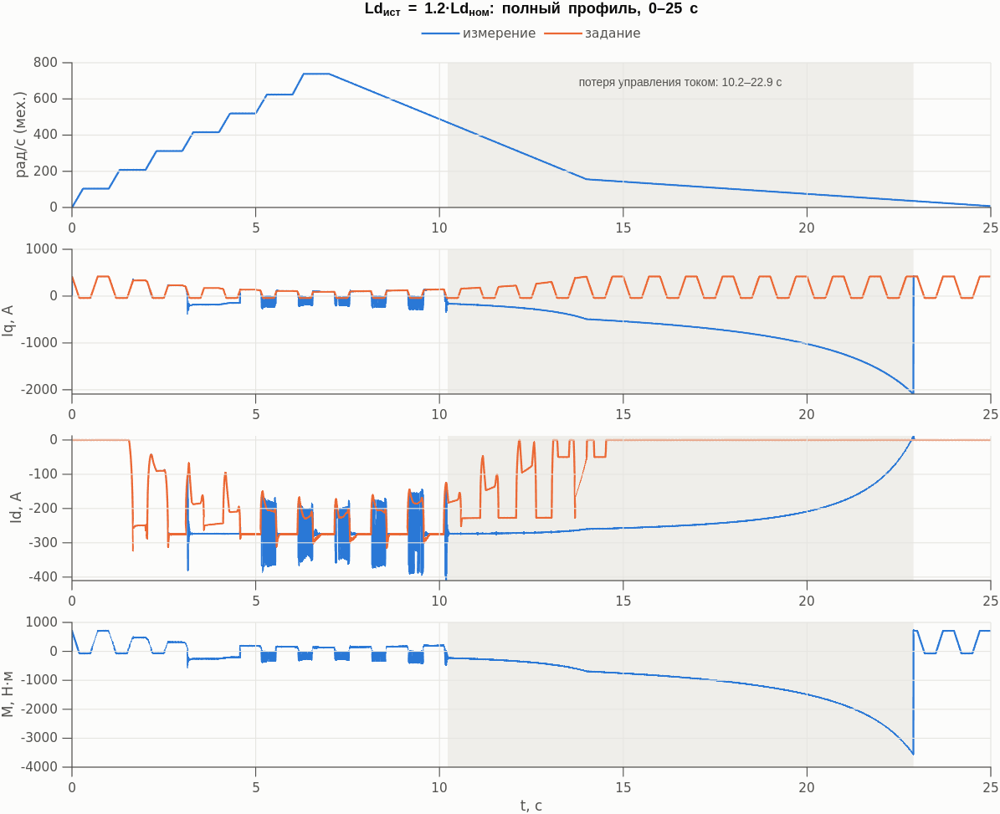
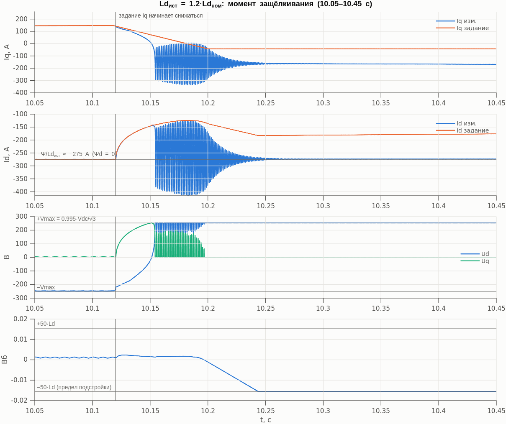
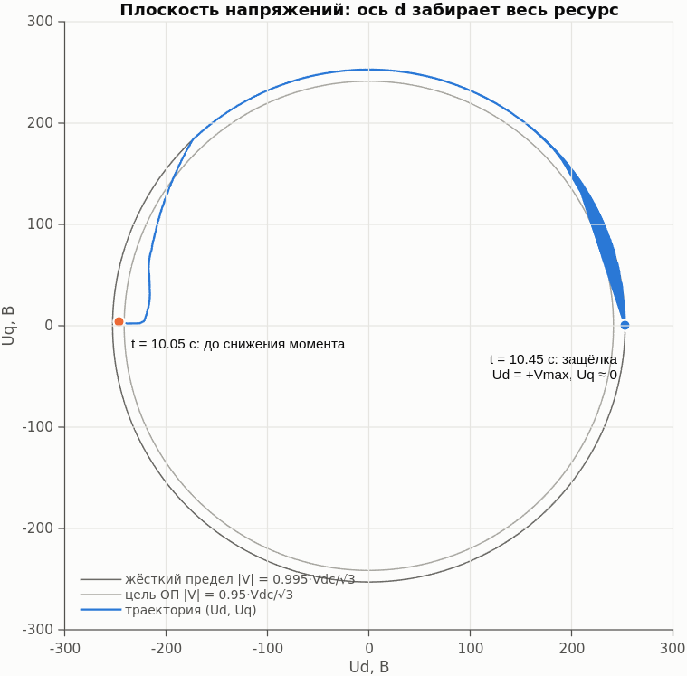
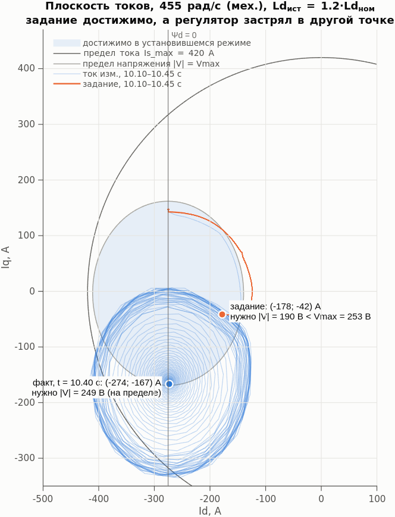
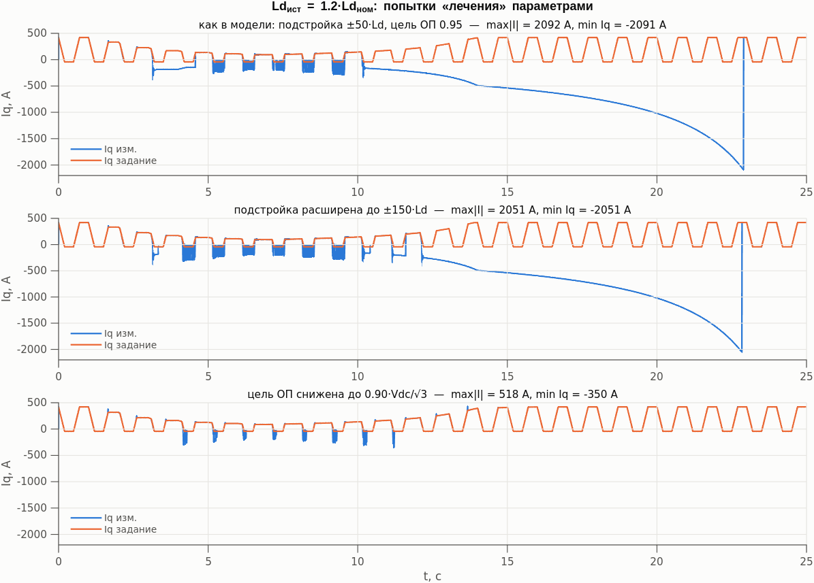
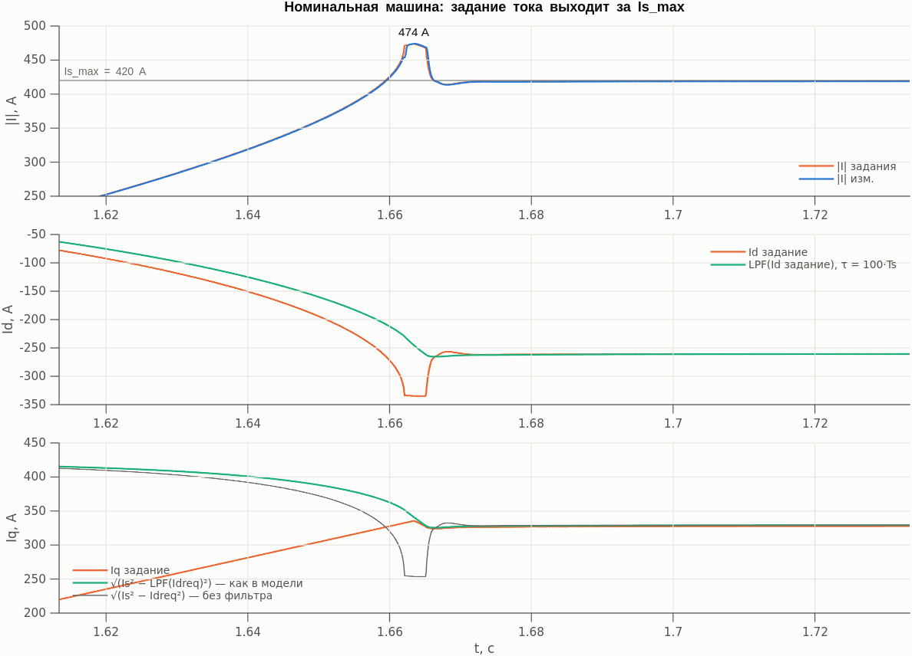
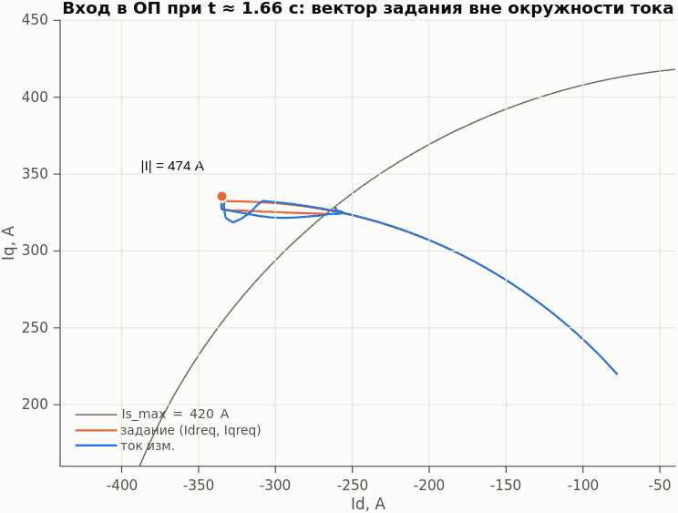
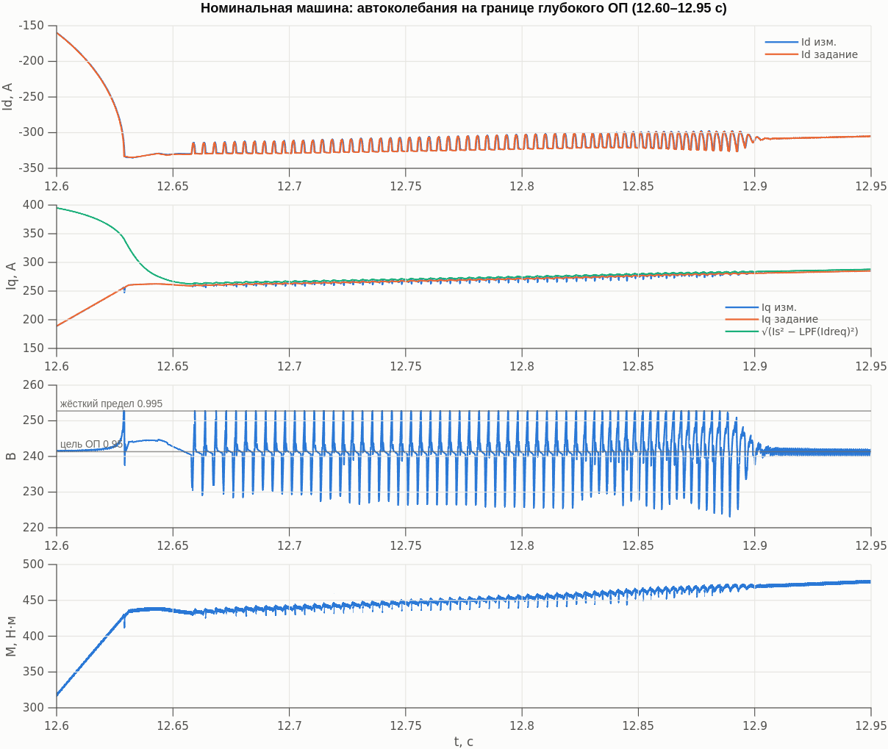

# Ограничитель напряжения и векторное ограничение тока: что не так

Модель: `ideal_source_drive_Idff_aug_param.slx` (коммит 0fc6532): машина 11 пар полюсов,
Ld = 0.31 мГн, Lq = 0.305 мГн, Ψ = 0.1024 Вб, Rs = 20 мОм, Vdc = 440 В, Is_max = 420 А,
Ts = FocDiscrTime = 1/12000 с, piBandwidth = 6000 рад/с.
Скорость задаётся идеальным источником по профилю до 738 рад/с (7050 об/мин), задание Iq —
`Repeating Sequence` с периодом 1 с (Is_max → −Is_max/10 → Is_max).

Документ описывает проблемы и направления исправления. В моделях ничего не менялось.
Все цифры получены прогонами копии модели с логированием сигналов (25 с, Rapid Accelerator).

## Кратко

1. **Защёлкивание токового контура в глубоком ОП.** Ось d в насыщении (Ud = +Vmax) отбирает у
   оси q всё напряжение (Uq ≈ 0), и выйти из этого состояния регулятор не может. При
   Ld_ист = 1.2·Ld_ном ток Iq уходит до −2090 А, момент до −3560 Н·м, управление потеряно на
   10.2–22.9 с (и раньше — на 3.15–4.58 с). Задание при этом **достижимо**: ему нужно 190 В при
   Vmax = 253 В.
2. **Задание тока выходит за Is_max уже на номинальной машине:** 474 А при Is_max = 420 А (+13 %).
   Ограничение Iq считается по отфильтрованному Idreq (τ = 8.3 мс), а совместной проверки
   |Idreq, Iqreq| ≤ Is_max нет. Превышение есть во всех прогонах; в прогонах без срыва — 456–475 А.
3. Связанное: на границе глубокого ОП в номинале есть автоколебания 240 Гц (Id ±12 А,
   |V| доходит до жёсткого предела). Причинная связь с п. 2 — гипотеза.

Параметрами (шире подстройка, больше запас по напряжению) п. 1 не лечится — нужна правка структуры.

## 1. Где это в модели

### Токовый контур, `VectorBase`

```
            ┌────────────┐   Ud* = PI_d − ω·Lq_est·Iq
 Idreq −(+)►│ PID Ctrl 3 ├──────────────────────────────► Ud ∈ [−Vmax, +Vmax]        ← ось d ограничивается первой
        Id  └────────────┘   (пределы PI: Sum9 / Sum10)          │
                                                                 ▼
                                               UqLim = √(Vmax² − Ud²)  (UqLimiter)   ← оси q — что осталось
            ┌────────────┐   Uq* = PI_q + ω·(Psi_est + Ld·Id)    │
 Iqreq −(+)►│ PID Ctrl 4 ├──────────────────────────────► Uq ∈ [−UqLim, +UqLim]
        Iq  └────────────┘   (пределы PI: Sum7 / Sum8)

 Vmax = 0.995·Vdc/√3 (VectorBase/Gain).  Anti-windup — clamping в каждом PI по своим пределам.
```

Ограничение с приоритетом оси d: если Ud = ±Vmax, то Uq ≡ 0, и ось q полностью теряет управление.

### Контур ОП (верхний уровень)

```
 |V|      = √(LPF(Ud)² + LPF(Uq)²)                      Sqrt1      ← по уже ОГРАНИЧЕННЫМ Ud, Uq
 ΔV       = 0.95·Vdc/√3 − |V|                           Gain8, Sum11
 sens     = sign(ω)·(LPF(Uq) − Rs·Iqreq)/|V|, |sens|≥0.1  Divide3, sat_signed4
 ΔΨ       = ΔV / (sens·|ω|)                              Divide
 Psi_trim = ∫ 15·freeze·ΔΨ dt,  предел ±50·Ld             PID Controller (I, clamping, reset «either»)
 Psi_d_ff = решение эллипса напряжения по Psi_est, Lq_est ∈ [−Psi_est, 0]   Min1, Saturation Dynamic1
 Ld·Idreq = clamp(Psi_d_ff + Psi_trim, −1.2·Psi_est, 0)  Sum6, Saturation Dynamic
 Idreq    = (1/Ld_ном)·… → Unit Delay1 (Ts/2)            Gain1, Unit Delay1
```

### Ограничение тока

```
 Iq_cur = √(Is_max² − LPF(Idreq)²),  LPF: τ = 100·Ts = 8.3 мс    Sum1, Sqrt, Low-Pass Filter …8
 IqLim  = smoothmin(Iq_cur, Vs_max/(|ω|·Lq_est))                   Min_smooth_ab, Divide4
 Iqreq  = min(IqLim, задание)                                       Min3   ← снизу не ограничено
 Idreq  ∈ [−1.2·Psi_est/Ld, 0] ≈ [−396, 0] А                       — независимо от Iq
```

## 2. Проблема А: защёлкивание токового контура в глубоком ОП

### 2.1. Что видно

Сценарий: истинная Ld машины на 20 % больше номинальной (`deltaLd = 0.2`), всё остальное — номинал.
Это реалистично: отрицательный Id в глубоком ОП разгружает ось d от насыщения, и Ld растёт.



- Первое защёлкивание — 3.15–4.58 с: снимается, когда задание Iq снова растёт.
- Второе — с 10.22 с: Iq монотонно уходит в минус до −2090 А, момент до −3560 Н·м
  (генераторный режим, ток растёт по мере торможения). Выход — только при 22.9 с на скорости ~40 рад/с.
- Между ними на каждом спаде момента (5.1, 6.1, 7.1, 8.1, 9.1 с) — колебательные срывы.

### 2.2. Как развивается



| t, с | скорость, рад/с | Idreq, А | Iqreq, А | Нужно \|V\| по истинным параметрам, В | «Считает» регулятор, В | Факт: Id / Iq, А | Факт: Ud / Uq, В |
|---|---|---|---|---|---|---|---|
| 10.10 | 480 | −275 | 147 | 243 | 243 | −275 / 147 | −246 / 4 |
| 10.15 | 476 | −146 | 73 | **280** | 248 | −147 / 15 | −25 / 252 |
| 10.18 | 474 | −124 | 4 | **293** | 250 | −410 / −187 | **+253 / 0** |
| 10.20 | 472 | −136 | −42 | **275** | 238 | −365 / −106 | +253 / 0 |
| 10.30 | 464 | −181 | −42 | 188 | 166 | −274 / −163 | +253 / 0 |
| 10.40 | 455 | −178 | −42 | 190 | 167 | −274 / −167 | +253 / 0 |

Vmax = 253 В. «Считает регулятор» — |V| по Psi_est = 0.0864 и Ld_ном (так считает FF).

1. **Триггер (10.12–10.20 с).** Момент сбрасывается, FF снимает ОП: Idreq с −275 до −124 А.
   Psi_est = 0.0864 (−16 % от истинной) сформировалась в старой рабочей точке, а FF переводит
   поток в ток через Ld_ном. Регулятор считает, что новой точке нужно ~250 В, а реально нужно
   280–293 В — **задание на время перехода физически недостижимо**. Напряжение упирается в предел.
2. **Защёлка (с 10.18 с).** ПИ оси d уходит в +Vmax, и ограничитель с приоритетом d оставляет оси q
   `√(Vmax² − Ud²) = 0`.
3. **Задание снова достижимо, но выхода нет (10.30 с и далее).** К 10.30 с задание (−181; −42) А
   требует всего 188 В, однако регулятор остаётся в Ud = +Vmax, Uq = 0.



### 2.3. Почему не выходит из насыщения

При Ud = +Vmax и Uq = 0 машина приходит в установившийся режим, который сам себя поддерживает:

- уравнение оси q: `Uq = Rs·Iq + ω·Ψd = 0` → `Ψd = Ψ + Ld·Id ≈ 0` → **Id ≈ −Ψ/Ld_ист ≈ −275 А**;
- уравнение оси d: `Ud = Rs·Id − ω·Lq·Iq = +Vmax` → **Iq ≈ −Vmax/(ω·Lq) ≈ −165 А**, растёт по модулю
  с падением скорости (отсюда −2090 А к 22.9 с).

ПИ оси d видит ошибку `Idreq − Id = −178 − (−274) = +96 А > 0` и хочет **увеличить** Ud — он уже на
+Vmax, clamping держит интегратор у верхнего предела. Чтобы поднять Id (сделать менее отрицательным),
нужно поднять Ψd, а это делается **напряжением по оси q**, которого нет. Ошибка оси d не меняет
знак, интегратор не разряжается, состояние устойчиво.

Выход появляется только когда Id сам переходит через Idreq. В прогоне это 22.9 с: на малой скорости
`Ψd = −Rs·Iq/ω` уже не мала, Id поднимается к 0 и пересекает Idreq = 0.



На плоскости токов видно: задание (оранжевая точка) лежит внутри области, достижимой в
установившемся режиме, а фактический ток стоит в точке Ψd = 0, на границе эллипса напряжения.
Это не физический предел машины, а ловушка в структуре регулятора.

### 2.4. Почему контур ОП не вытаскивает

Чтобы разрядить ПИ оси d, Idreq должен опуститься ниже Id ≈ −275 А. Контур ОП этого не делает:

1. **Он видит только ограниченное напряжение.** |V| считается по Ud, Uq после ограничителя: в защёлке
   |V| ≈ Vmax = 253 В, ΔV ≈ −12 В. Глубина насыщения (насколько запрос превышает предел) ему не видна.
2. **Чувствительность считается по Uq ≈ 0.** `sens = (Uq − Rs·Iqreq)/|V|` в защёлке определяется
   знаком `Rs·Iqreq`, а не состоянием машины, и упирается в ограничение |sens| ≥ 0.1. В прогоне с
   пределом подстройки ±150·Ld подстройка из-за этого прыгает между +150·Ld и −150·Ld вслед за знаком
   Iqreq (12.3 с: −0.0465 Вб, 13.0 с: +0.0465 Вб).
3. **Предел подстройки ±50·Ld (±50 А)** — подстройка упирается в −50·Ld за 50 мс (рис. выше, нижняя
   панель) и дальше Idreq не опускает.
4. **Ниже базовой скорости ОП заморожен** (`freeze`, ветка AND2) и Idreq = 0, а токовый контур
   при этом остаётся в защёлке.

### 2.5. Что не помогает



| Вариант | max \|I\|, А | min Iq, А | min момент, Н·м | Защёлки > 20 мс |
|---|---|---|---|---|
| как в модели (±50·Ld, цель 0.95) | 2092 | −2091 | −3560 | 3.15–4.58, 10.22–22.90 с |
| предел подстройки ±150·Ld | 2051 | −2051 | −3466 | 4 эпизода, последний 12.14–22.84 с |
| цель ОП 0.90·Vdc/√3 | 518 | −350 | −516 | нет, но колебательные срывы ~50 мс на каждом спаде момента |

Больший запас по напряжению лишь сокращает время в насыщении. Ловушка остаётся, просто реже
в неё попадает.

### 2.6. Итог по проблеме А

- **Корень** — структура: ограничитель с абсолютным приоритетом оси d плюс per-axis clamping. Из
  насыщения оси d нет выхода, пока задание Id выше точки Ψd = 0.
- **Триггер** — любое временно недостижимое по напряжению задание в глубоком ОП. Здесь — ошибка FF
  (Ld_ном и медленная смещённая Psi_est), но такими же триггерами могут быть ступень Vdc, резкий
  сброс момента, переходный процесс оценщиков. На номинальной машине в этих прогонах триггер не
  сработал — запас небольшой.

## 3. Проблема Б: задание тока выходит за Is_max



Номинальная машина, вход в ОП при t ≈ 1.66 с:

- FF быстро уводит Idreq к −335 А (последние ~65 А — за 2–3 мс);
- `LPF(Idreq)` с τ = 8.3 мс отстаёт, поэтому `√(Is² − LPF(Idreq)²)` ещё разрешает Iq ≈ 335 А;
- итог: (Idreq; Iqreq) = (−335; 335) А, **|I| = 474 А при Is_max = 420 А**, и измеренный ток за ним
  следует (токовый контур отрабатывает задание точно).
  Ограничение без фильтра `√(Is² − Idreq²)` в этот момент дало бы 253 А (серая линия).



Что ещё:

- Idreq ограничен только диапазоном [−1.2·Psi_est/Ld, 0] ≈ [−396, 0] А, без связи с Iq.
- `Min3 = min(IqLim, задание)` ограничивает Iq только сверху. Отрицательное (генераторное) Iq по
  IqLim не ограничено ни по току, ни по напряжению — в текущем профиле это не проявляется, так как
  задание там −42 А.
- Превышение есть во всех прогонах без срыва: 456–475 А (номинал, Ψ ±10 %, Lq ±20 %, Ld −20 %,
  Rs +50 %). Второй случай в номинале: 446 А при t = 13.68 с (Idreq = −251, Iqreq = 368 А).

Если Is_max — ограничение инвертора или защиты, то на стенде это ложные срабатывания защиты или
работа ключей за паспортным током.

## 4. Связанное: автоколебания на границе глубокого ОП



Номинальная машина, торможение через 262–276 рад/с при большом моменте. Это угловая точка, где
сходятся ограничение по току, эллипс напряжения и клемма Ψd = 0 (Idreq ≈ −Ψ/Ld).

- Частота 240 Гц, размах (без тренда) Id 24 А, Iq 10 А, |V| от 227 до 253 В — касается жёсткого
  предела 0.995. Пульсации момента ~22 Н·м (~5 % от 449 Н·м).
- В этом месте Iq сидит на `√(Is² − LPF(Idreq)²)` (бирюзовая линия на рис.). Гипотеза: колебание —
  взаимодействие ограничения по току через фильтр τ = 8.3 мс, FF с клеммой −Psi_est и контура ОП.
  Не доказано; коммит c7cccc2 пытался гасить это постоянной времени фильтра.

Важно для исправления п. 3: если убрать фильтр из ограничения тока, эти колебания могут усилиться.
Проверять вместе.

## 5. Направления исправления (не реализовано, для обсуждения)

### Для проблемы А

| # | Что | Плюсы | Минусы / риски |
|---|---|---|---|
| A1 | Ограничение вектора с сохранением угла: (Ud*, Uq*) после PI и развязки → при \|V*\| > Vmax масштабировать к Vmax. Anti-windup обоих PI — back-calculation на величину обрезки по своей оси или условное интегрирование (не интегрировать в сторону роста \|V*\|). | Ни одна ось не остаётся без напряжения; ловушка исчезает структурно | В переходах страдают оба тока; меняет поведение ниже базовой скорости — проверить |
| A2 | Гарантированный минимум для оси q: \|Ud\| ≤ √(Vmax² − Uq_min²) (например, Uq_min = 0.2·Vmax), приоритет d сохраняется. | Минимальная правка | В MTPV напряжение почти целиком на d: Ud_max падает на ~2 % при 0.2·Vmax — небольшая потеря момента в глубоком ОП. Достаточно ли этого для выхода из ловушки — проверить |
| A3 | Контур ОП должен видеть насыщение: в интегратор ОП подавать \|V*\| (запрос до ограничителя) или величину обрезки, а не \|V\| ограниченных Ud/Uq. Чувствительность считать по модели: ω·(Psi_est + Ld·Idreq)/\|V*\|, а не по ограниченному Uq. | Контур ОП начинает реально вытаскивать Idreq вниз | Сам по себе структурную ловушку не убирает |
| A4 | Tracking для ОП: пока PI оси d в насыщении, Idreq подтягивать к достижимому (к Id_изм или к точке Ψd = 0). | Прямо разрушает условие самоподдержания (Idreq > Id) | Логика переключения; риск дребезга |
| A5 | Убрать триггер: Ld(Id) вместо Ld_ном в FF, или оценивать сразу Ψd (без разложения на Ψ и Ld·Id); запас по напряжению в FF при сбросе момента. | Реже попадаем в насыщение | Триггеры всё равно будут (ступень Vdc и т.п.) — без A1/A2/A4 не достаточно |
| A6 | Страховка: детектор защёлки (PI_d в насыщении, знак ошибки d не меняется N·Ts, \|Iq − Iqreq\| растёт) → сброс интегратора d. | Просто, ловит и неизвестные случаи | Заплатка, а не исправление |

Рабочий вариант — A1 или A2, плюс A3/A4; A6 как страховка.

### Для проблемы Б

| # | Что |
|---|---|
| B1 | Жёсткое векторное ограничение на каждом шаге **после** Min3: \|Iqreq\| ≤ √(Is_max² − Idreq²) с тем же Idreq, что уходит в регулятор (после Unit Delay1, без фильтра). В ОП приоритет у Id. |
| B2 | Если фильтр нужен против колебаний п. 4 — оставить его в «мягком» IqLim (smooth min), а жёсткое ограничение B1 поставить после. |
| B3 | Ограничить Iq и снизу: `max(−IqLim, min(IqLim, задание))`. |

## 6. Как проверять исправление

Сценарии — тот же 25-секундный профиль, 10 прогонов: номинал; Ψ ±10 %; Lq ±20 %; Ld ±20 %;
Rs +50 %. Дополнительно — Ld +30 % (запас) и ступень Vdc в глубоком ОП (в модели Vdc сейчас
константа, нужен источник с шагом).

Критерии:

- \|Iref\| ≤ Is_max всегда; \|I_изм\| ≤ 1.05·Is_max;
- нет эпизодов \|Iq − Iqreq\| > 100 А длиннее 20 мс; момент не меняет знак против задания;
- момент на 738 рад/с не хуже 0.98 от теоретического (номинал: 157 Н·м для 0.95·Vdc/√3,
  сейчас 159 Н·м);
- размах автоколебаний в углу (п. 4) не больше текущего (Id 24 А p-p).

Текущее состояние по этим критериям — в приложении.

## 7. Как воспроизвести

Скриптами из `tools/fw_limiter/` (подробности в `tools/fw_limiter/README.md`):

```bash
tools/fw_limiter/run_parallel.sh 6      # 12 прогонов в work/fw_limiter/, ~15 мин при 6 сессиях
```

```matlab
addpath tools/fw_limiter
metrics        % приложение, превышения Is_max, автоколебания (п. 3, 4)
latch_table    % таблица раздела 2.2
fig_doc        % рисунки docs/img/fw_limiter/*.png
```

Вручную в Simulink:

1. Открыть `ideal_source_drive_Idff_aug_param.slx`, Model Explorer → Model Workspace: `deltaLd = 0.2`
   (остальные delta = 0).
2. Включить логирование сигналов: `Bus Selector` выходы 1/2 (Id/Iq), `Unit Delay1` (Idreq),
   `Min3` (Iqreq), `VectorBase` выходы 3/4 (Ud/Uq), `PID Controller` (Psi_trim),
   `Low-Pass Filter (Discrete or Continuous)7` (Psi_est), `PS-Simulink Converter2` (скорость).
   Для п. 3: выход `Low-Pass Filter (Discrete or Continuous)8` (LPF(Idreq)) и `Sqrt`.
3. Запустить на 25 с (Rapid Accelerator, ~5 мин). Защёлки: 3.15 с и 10.22 с.
4. Для п. 3 и 4: `deltaLd = 0`, смотреть t ≈ 1.66 с и 12.6–12.9 с.

## 8. Ограничения анализа

- Машина в модели с постоянными Ld, Lq, Ψ; Ld +20 % — заменитель реальной зависимости Ld(Id).
- Инвертор — идеальный источник напряжения (усреднённая модель), без мёртвого времени и без DC-звена.
  Ключевая модель `svpwm_inv_ideal_switch_drive` не прогонялась: в ней старый алгоритм ОП и она
  считает ~2 ч на секунду модельного времени.
- В модели нет токовой защиты. На стенде срыв, скорее всего, закончился бы аварийным отключением
  по току, а не ростом до 2000 А — но это всё равно отказ в ОП.

## Применимость к SEM200 на стенде

Механизм не зависит от параметров машины — это свойство структуры ограничителя и контура ОП. Если в
прошивке такой же ограничитель (приоритет d, Uq ≤ √(Vmax² − Ud²), per-axis anti-windup), риск есть и
на SEM200: при Ψ/Ld = 0.118/0.0036 ≈ 33 А (по `Blondel_SEM200.xlsx`) против Is = 141 А машина
уходит в глубокий ОП уже при умеренных токах.

На что смотреть на стенде: сброс момента на высокой скорости в ОП. Признаки защёлки: Ud на пределе,
Uq ≈ 0, Iq уходит в генераторную сторону при задании ≥ 0, ошибка Id не меняет знак. Испытывать с
консервативной токовой защитой.

## Приложение: сводка прогонов

| Прогон | Изменение | max \|I\|, А | min Iq, А | min момент, Н·м | Psi_est (истинная) | Защёлки > 20 мс |
|---|---|---|---|---|---|---|
| nom | — | 474 | −42 | −74 | 0.1027 (0.1024) | нет |
| psim10 | Ψ −10 % | 456 | −42 | −67 | 0.0925 (0.0922) | нет |
| psip10 | Ψ +10 % | 471 | −42 | −82 | 0.1129 (0.1126) | нет |
| lqp20 | Lq +20 % | 462 | −42 | −85 | 0.1027 | нет |
| lqm20 | Lq −20 % | 465 | −42 | −71 | 0.1027 | нет |
| ldp20 | Ld +20 % | **2092** | **−2091** | **−3560** | 0.0864 (0.1024) | 3.15–4.58, 10.22–22.90 с |
| ldm20 | Ld −20 % | 475 | −43 | −88 | 0.1238 (0.1024) | нет |
| rsp50 | Rs +50 % | 474 | −42 | −74 | 0.1028 | нет |
| ldp20_trim150 | Ld +20 %, подстройка ±150·Ld | **2051** | **−2051** | **−3466** | 0.0866 | 4 эпизода |
| ldp20_vs090 | Ld +20 %, цель ОП 0.90 | 518 | −350 | −516 | 0.0878 | нет (колебательные срывы ~50 мс) |

min Iq = −42 А — это задание (−Is_max/10), то есть нормальная работа. Psi_est — среднее за 7–12 с.
