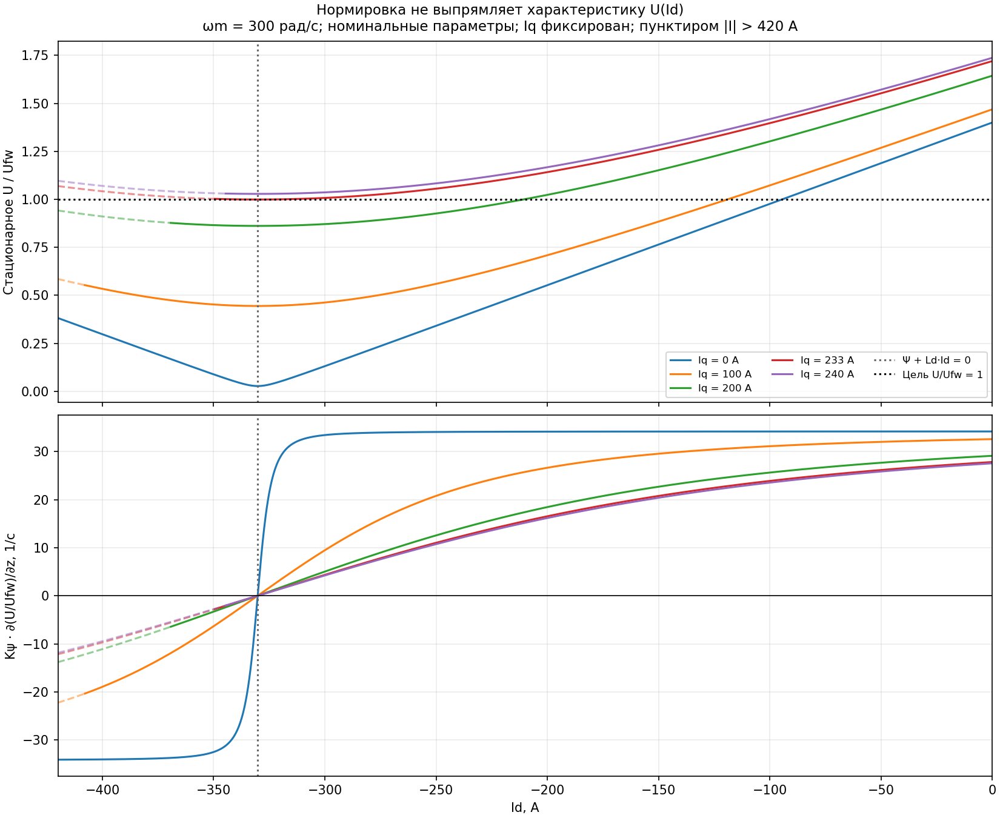
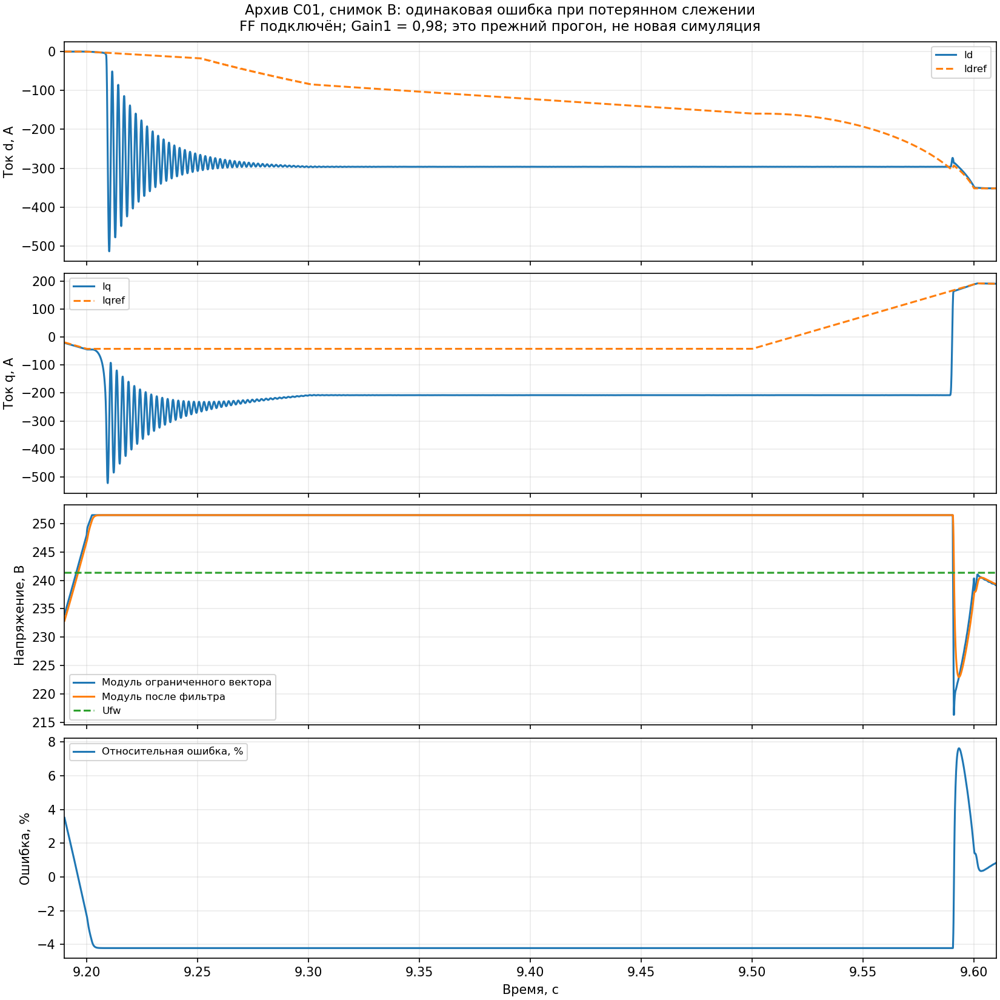

# F06-NL: что нормировка ошибки меняет в нелинейном контуре ОП

13.11.2026. Вопрос пользователя: нормированная ошибка в `fw_trim` устранила
нелинейность или только изменила способ настройки интегратора?

**Нормировка не линеаризует объект.** В F06 удалено обращение малой/знаковой
чувствительности из регулятора и добавлена проекция состояния. Зависимость
чувствительности объекта от режима сохранена. Дополнительно ограничение
наблюдаемого напряжения делает ошибку малоинформативной при потере слежения
и сильно ограничивает скорость усиления ослабления.

Рабочая модель не изменялась. Новых прогонов Simulink нет. Выполнены
аналитический расчёт, численная проверка производной и повторная обработка
одного ранее сохранённого прогона C01. Этот анализ не доказывает устойчивость
предлагаемой замены сигнала и не устанавливает единственную причину срывов.

## 1. Фактический закон и источник

Проверен уже сохранённый F06, SHA `632394ce…`, отличающийся от снимков C01.
Код `fw_trim` остался прежним: Kψ = 2,5 Вб/с, вход 2 от `Sum11`,
вход 3 — `Vs_max`; фильтр модуля имеет T = 10·FocDiscrTime.
Model Workspace побайтно совпадает со снимком B C01. Изменения остальных
компонентов новой модели в этом аналитическом исследовании не испытывались.
Полный источник и хеши: [архив](data/control_fixes/f06_nonlinearity_20261113/).

Обозначим z = `psi_cmd`, f = `psi_ff`, x — состояние подстройки:

\[
e_k=\operatorname{clip}\left(\frac{U_{FW}-U_f}{\max(U_{FW},1\text{ В})},-1,1\right),
\quad z_k=\operatorname{clip}(f_k+x_k,z_{min,k},z_{max,k}),
\]
\[
x_{k+1}=\operatorname{clip}(z_k+T_sK_\psi e_k,z_{min,k},z_{max,k})-f_k.
\]

Здесь z — задание изменения потокосцепления в Вб, а не полный поток машины:
внутри допустимого диапазона Idref = z/Ld_ctrl. При постоянном FF и неактивных
ограничениях получается интегратор dz/dt = Kψ·e. При переменном FF:

\[
z_{k+1}=z_k+T_sK_\psi e_k+(f_{k+1}-f_k),
\]

пока проекции не активны. Поэтому ограничение скорости интегральной коррекции
не ограничивает скорость всей команды: изменение FF проходит отдельным слагаемым.

При постоянном Ufw > 1 В и неактивном clip переход от ошибки в вольтах
к относительной ошибке эквивалентен замене коэффициента на Kψ/Ufw.
Это масштабирование, а не компенсация нелинейной характеристики.
Ограничение ошибки и проекция состояния сами являются кусочно-линейными
нелинейностями, но при обычной работе на пределе ошибка −4,21% далека от clip −1.

## 2. Чувствительность даже линейной машины непостоянна

Рассматриваем стационарный режим, постоянные скорость и Iq, точное слежение
токовых контуров, неизменные Rs/Ld/Lq/Ψ. Амплитудная нормировка dq:

\[
u_d=R_s i_d-\omega_e L_qi_q,\qquad
u_q=R_s i_q+\omega_e(\Psi+L_di_d),\qquad U=\sqrt{u_d^2+u_q^2}.
\]

Это стационарные уравнения машины; фазный предел здесь соответствует амплитуде
основной гармоники, не RMS. [Уравнения и ограничения MathWorks](https://www.mathworks.com/help/mcb/gs/pmsm-constraint-curves-and-their-application.html).
Ниже приведён собственный расчёт для параметров проекта.

Дифференцирование при фиксированном Iq даёт:

\[
\frac{\partial U}{\partial i_d}
=\frac{R_su_d+\omega_e L_du_q}{U},\qquad
G_z\equiv\frac{\partial(U/U_{FW})}{\partial z}
=\frac{R_su_d+\omega_e L_du_q}{U U_{FW}L_{d,ctrl}}.
\]

Для Rs ≈ 0:

\[
U\approx|\omega_e|\sqrt{(L_qi_q)^2+(\Psi+L_di_d)^2},
\]
\[
G_z\approx\frac{|\omega_e|}{U_{FW}}
\frac{L_d}{L_{d,ctrl}}
\underbrace{\frac{\Psi+L_di_d}
{\sqrt{(L_qi_q)^2+(\Psi+L_di_d)^2}}}_{c}.
\]

Нормировка не устраняет ни скорость, ни отношение фактического Ld к принятому
в управлении, ни геометрический множитель c. При c > 0 уменьшение Id
уменьшает U; при c = 0 исчезает чувствительность первого порядка;
при c < 0 дальнейшее уменьшение Id увеличивает U.
При Rs ≠ 0 точка минимума немного смещается. При Iq = 0 и Rs = 0
в точке нулевого потока модуль имеет излом, обычная производная там не существует.
Реальный Rs в численном расчёте сохранён.

Нелинейность возникает уже при постоянных индуктивностях. Насыщение стали
для её появления не требуется. Карта машины могла бы добавить зависимость
дифференциальных индуктивностей, но не устранила бы геометрию модуля.



Номинальные параметры: Rs = 0,02 Ом, Ld = 310 мкГн, Lq = 305 мкГн,
Ψ = 0,1024 Вб, p = 11. При ωm = 300 рад/с и Iq = 233 А цель
Ufw = 241,332 В имеет два решения:

| Id | Модуль тока | ∂U/∂Id |
|---:|---:|---:|
| −321,512 А | 397,063 А | +0,037994 В/А |
| −339,028 А | 411,375 А | −0,037994 В/А |

Обе точки укладываются в токовый круг 420 А. Следовательно, проверка
только полного тока не выбирает нужную ветвь U(Id). Для положительного Kψ
первая ветвь имеет возвращающее действие, вторая — противоположное
в идеализированном локальном контуре с фиксированным Iq.

При Iq = 240 А минимальное стационарное U равно 248,213 В: цель Ufw
уже недостижима одним Id, хотя это меньше полного предела 251,494 В.
Нужен согласованный бюджет q; бесконечное усиление интегратора такого
равновесия не создаёт. Числа относятся к фиксированному Iq, а не утверждают,
что действующий ограничитель обязательно выдаст именно этот запрос.

## 3. Почему постоянный Kψ не даёт постоянного быстродействия

Для малых отклонений вокруг допустимого равновесия, при неизменных FF,
Iq, Ufw и идеальном токовом слежении:

\[
\delta\dot z=-K_\psi G_z\,\delta z,\qquad
\tau_{ideal}=\frac{1}{K_\psi G_z}\quad(G_z>0).
\]

При ωm = 300 рад/с, p = 11, Kψ = 2,5, Rs ≈ 0 и Ld = Ld_ctrl:

| c | Kψ·Gz | Идеальная локальная постоянная времени |
|---:|---:|---:|
| 1 | 34,19 с⁻¹ | 29,3 мс |
| 0,5 | 17,09 с⁻¹ | 58,5 мс |
| 0,1 | 3,42 с⁻¹ | 292,5 мс |
| 0 | 0 | Нет возвращающего действия первого порядка |
| −0,1 | −3,42 с⁻¹ | Локальное отклонение растёт |

Это не измеренные времена установления привода. Реальные токовые контуры,
фильтр напряжения T = 0,833 мс, задержки, адаптация, FF и насыщение добавляют
динамику. При 738 рад/с и c = 1 та же оценка времени равна 11,9 мс;
одно и то же усиление даёт другой контур. Увеличение Kψ ускоряет обычную
ветвь, но усиливает неправильное действие на противоположной и сокращает
запас к задержкам. Само наличие нелинейности не означает неустойчивость;
критичны знак, нижняя граница чувствительности и активные ограничения.

Если ограничитель q меняет Iq вместе с Id, нужен полный наклон:

\[
\frac{dU}{di_d}=\frac{\partial U}{\partial i_d}
+\frac{\partial U}{\partial i_q}\frac{di_q}{di_d}.
\]

Например, на токовом круге diq/did = −id/iq при iq ≠ 0. Поэтому таблицу
фиксированного Iq нельзя автоматически распространять на активный токовый
бюджет или потерю слежения. Переключение ограничителей меняет сам канал.

## 4. Ограниченное напряжение: малая ошибка при большой проблеме

В F06 `Sum11` получает фильтр **уже ограниченного** модуля Ud/Uq.
При постоянном питании:

\[
U_{max}=0{,}99\frac{440}{\sqrt3}=251{,}494\text{ В},\quad
U_{FW}=0{,}95\frac{440}{\sqrt3}=241{,}332\text{ В}.
\]

После установления фильтра при полном насыщении:

\[
e=1-\frac{0{,}99}{0{,}95}=-0{,}0421053.
\]

Предел √0,001 в UqLimiter даёт лишь микроскопическую поправку на самой
границе; в рассматриваемом снимке B с Gain1 = 0,98 она не активна.

При Kψ = 2,5 отрицательная скорость интегральной части ограничена
0,105263 Вб/с, или **339,56 А/с** в эквиваленте Id. Дополнительные −100 А
при неизменном FF требуют **не менее 0,2945 с**. При U = 0 ошибка достигает +1:
верхняя граница скорости восстановления — **8064,52 А/с**. Это соотношение
максимумов 23,75, а не измеренное отношение времён всех переходов.

Условия оценки: постоянные FF и границы, постоянный корректный Vdc,
переход фильтра закончен, интегрирование разрешено проекцией. Сужение границ
или скачок FF могут изменить полную команду быстрее. Перепад Vdc при памяти
фильтра может временно нарушить указанную границу ошибки.

Асимметрия вызвана доступным диапазоном обратной связи и выбранным запасом
Ufw. Деление на постоянное Ufw только меняет масштаб; такая же проблема
информации существовала бы при ошибке в вольтах с эквивалентным усилением.

В архивном прогоне B C01 между 9,3 и 9,5 с e_norm действительно равно
−0,0421053 при потерянном слежении токов. Регулятор не видит, насколько
не хватает напряжения и какой компоненте: модуль уже стоит на границе.
Изменение его направления по окружности также не меняет этот сигнал.



Это другая проблема, чем нулевая производная стационарной U(Id): здесь
измерительный канал теряет информацию из-за ограничения, а Id уже не
следует Idref. Использовать стационарный наклон как фактический коэффициент
этого сорванного динамического режима нельзя.

Этот результат объясняет ограничение скорости коррекции без FF и согласуется
с ухудшением первого быстрого разгона в [F06-NFF](f06_noff_validation.md).
Он не доказывает, что только этим вызван каждый наблюдавшийся срыв.

## 5. Что следует из анализа для структуры

1. Сохранить проекцию состояния и ясную размерность Kψ. Они решают задачу
   согласования с окончательными пределами, но не задачу линеаризации.
2. Не возвращать безусловное деление на ∂U/∂Id. Около нуля оно требует
   неограниченного усиления; ограничение знаменателя не восстанавливает
   правильный знак и не делает недостижимую цель достижимой.
3. Разделить проверку геометрии сигнала и восстановление после насыщения.
   Направленный Uq при фиксированных Iq/цели имеет производную
   ∂[sgn(ωe)·Uq]/∂Id = |ωe|Ld и убирает множитель c. Скоростная зависимость
   остаётся. В F07 сама цель Uq рассчитывается через бюджет d и может меняться;
   это добавляет связь. Если Uq ограничено или токовое слежение потеряно,
   стационарная формула также недостаточна.
4. Ограниченная настройка Kψ по скорости способна выровнять множитель
   |ωe|/Ufw только в области допустимого положительного наклона. Она
   не исправляет ни противоположную ветвь модуля, ни ограниченный сигнал.
5. После компонентных исправлений измерить малые отклики Idref → U и
   Idref → Uq при фиксированных оценках, постоянном/отключённом FF,
   нескольких скоростях и долях бюджета q. Отдельно сравнивать напряжения
   до и после ограничения и восстановление обоих знаков d-насыщения.
   Простая замена обратной связи на запрос до ограничителя требует
   согласованного anti-windup ПИ и не является уже проверенным решением.

Нормированный модуль встречается и в типовых регуляторах, но с иным законом
изменения токового вектора. Например, [блок MathWorks](https://www.mathworks.com/help/simscape-electrical/ref/pmsmfieldweakeningcontroller.html)
использует индекс модуляции и изменяет угол задания тока. Сам факт нормировки
не означает ни линеаризацию, ни применимость другой структуры к нашей модели.

## Воспроизводимость

Расчёт: [fw_trim_nonlinearity.py](../tools/fw_limiter/fw_trim_nonlinearity.py).
Производная проверена центральной разностью в 2000 точках обоих знаков
скорости и Iq; максимальная разность 1,32·10⁻⁹ В/А. Корни U = Ufw проверены
подстановкой. Перед обработкой старого MAT проверен его SHA-256.
[Числа, исходники и манифест](data/control_fixes/f06_nonlinearity_20261113/).

```bash
MPLCONFIGDIR=tmp/mpl_cache PYTHONDONTWRITEBYTECODE=1 python3 tools/fw_limiter/fw_trim_nonlinearity.py tmp/f06_nonlinearity_20261113
```

Нужен архивный MAT `tmp/f06_components_20261113/chk_sg2900_cycles_user/`;
новая модель этим скриптом не запускается. Промежуточные материалы этого
анализа малы и оставлены для продолжения; очистка не выполнялась.
