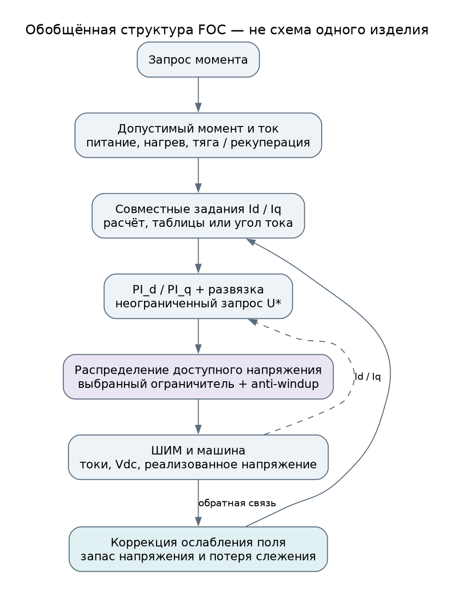
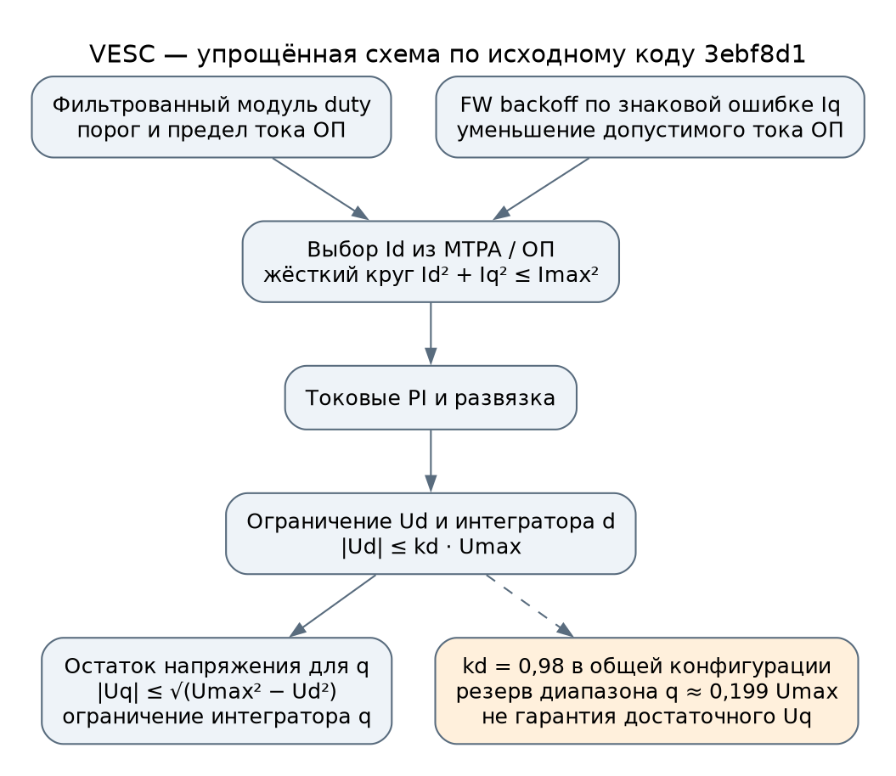
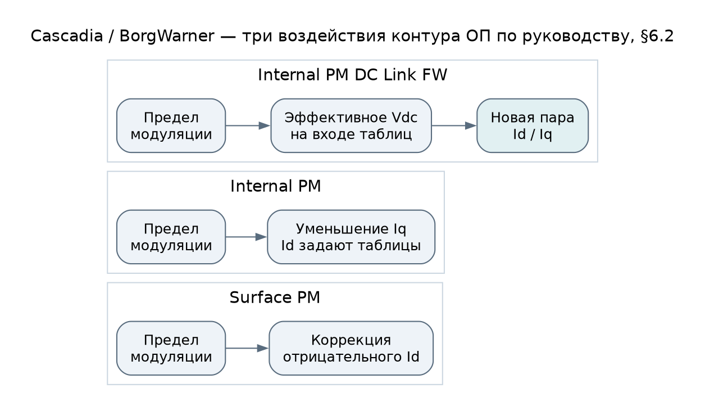
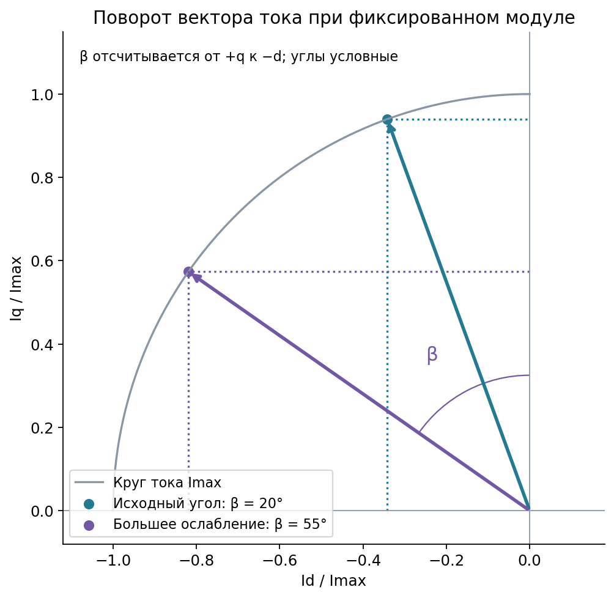
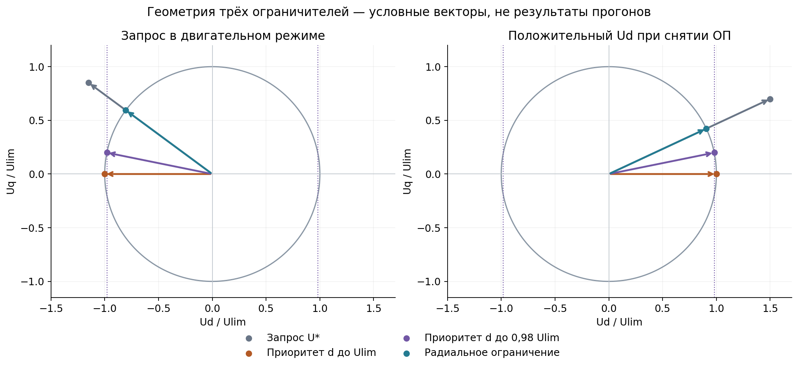
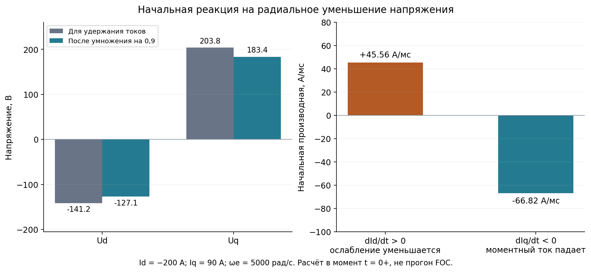

# Ограничения тока и напряжения PMSM в промышленных и тяговых приводах

Дата проверки источников: 10.11.2026. Связанный документ: [ревью модели Adaptto](control_review.md).

Подробности наружного контура, формулы нашей схемы, дополнительные источники и четыре варианта её изменения вынесены в [отдельный иллюстрированный разбор ОП](field_weakening_loop.md). Настоящий обзор дополнен его выводами; новые испытания исправленного регулятора не выполнялись.

В опубликованных реализациях ослабление поля обеспечивается совместной работой формирователя Id/Iq, токовых регуляторов, ограничителя напряжения и обратной связи по доступному напряжению. **Приоритет d применяется на практике. Радиальное ограничение — возможный способ распределения напряжения, но его преимущество в глубоком ОП не следует из сохранения угла вектора.**

Для нашей модели это меняет выбор первого эксперимента: исследовать ограниченный приоритет d и согласование заданий, а радиальную проекцию сравнивать с ним при одинаковых условиях. Зафиксированные превышения тока и защёлкивание исходной модели остаются действительными результатами.

## 1. Что позволяют установить открытые источники

Ниже разделены три уровня доказательств: руководство серийного изделия, открытая реализация ПО и аппаратный референс производителя компонентов. Наличие алгоритма в референсе не подтверждает его использование в конкретной модели автомобиля. Описание функции серийного привода не раскрывает автоматически внутренний закон ограничения Ud/Uq.

| Источник | Тип материала | Что установлено |
|---|---|---|
| [S1 — VESC](https://github.com/vedderb/bldc/tree/3ebf8d1fe8cc485ad588e4272a761785c9cf0c5d) | Открытая прошивка, зафиксированный коммит | Ограниченный приоритет d, ограничение интеграторов, круг заданий, FW backoff |
| [S2 — Cascadia / BorgWarner](https://www.cascadiamotion.com/_files/ugd/b5e2cb_e731a297509a4b2786cea7ef36199b7f.pdf) | Руководство серийных инверторов CM, 0A-0163-04 | Три стратегии ОП, таблицы Id/Iq, ограничение доступного момента |
| [S3 — Kollmorgen AKD2G](https://webhelp.kollmorgen.com/kas/content/AKD2G_User_Manual/Field_Weakening.htm) | Руководство серийного сервопривода | Контур по модулю напряжения, запас по шине, предел Id и полного тока |
| [S4 — Beckhoff AX5000](https://infosys.beckhoff.com/content/1033/ax5000_function_doku_hw2/10492589579.html) | Документация параметров серийного сервопривода | Регулятор полного напряжения, итоговые задания d/q, пределы ОП |
| [S5 — ABB](https://www.abb.com/gb/en/areas/motion/drives/expertise-technology/direct-torque-control) | Описание промышленной платформы DTC | Непосредственное управление потоком и моментом, в том числе PMSM |
| [S6 — TI TIDM-02017](https://www.ti.com/lit/ug/tiduf56/tiduf56.pdf?ts=1780283501979) | Референс тягового инвертора 48 В, 5 кВт | FWC через угол тока с согласованием с MTPA |
| [S7 — Microchip AN2520](https://onlinedocs.microchip.com/oxy/GUID-AAAF8F97-D139-4A93-A154-AA3C6EE6BB22-en-US-1/GUID-007091E0-0021-4359-A50B-127AF65C0B1C.html) | Алгоритм и аппаратные испытания производителя | Расчёт Id, остаток токового бюджета для Iq и приоритет напряжения d |
| [S8 — Infineon MOTIX](https://www.infineon.com/assets/row/public/documents/10/96/infineon-z8f80651251-um-generic-power-boards-software-software-en.pdf?fileId=8ac78c8c9625080601963e663fa340c8) | Демонстрационное ПО автомобильного MCU | Настройка приоритета d зависит от выбранного двигателя |
| [S9 — NXP S32K144](https://www.nxp.com/docs/en/application-note/AN12235.pdf) | Автомобильная библиотека и демонстрационная система | Отдельные блоки токового контура и ОП, пределы PI по фактическому Vdc |
| [S10 — IR / Infineon AN-1090](https://www.infineon.com/assets/row/public/documents/60/42/infineon-irmcf3xx-series-controller-dynamics-and-tuning-an-en.pdf?fileId=5546d462533600a401535595acd1103c) | Описание настройки контроллеров IRMCF3xx | Интегральный контур модуляции с коррекцией усиления по скорости |

Эта выборка устанавливает существование конкретных решений. Она не определяет доли рынка алгоритмов и не позволяет приписывать закрытым прошивкам OEM одинаковую структуру.

Все рисунки ниже построены заново для этого обзора. Это поясняющие схемы и расчёты, а не снимки закрытых алгоритмов и не результаты испытаний исправленной модели. [Происхождение иллюстраций](img/industry_fw/README.md).

## 2. Ограничения на разных уровнях управления



Рисунок 1. Обобщение для FOC по S1–S4, S6–S7. Обратные связи и порядок исполнения конкретного контроллера могут отличаться; DTC в эту схему не включён.

Следует различать четыре задачи:

1. **Допустимый запрос момента.** Ограничения машины, инвертора и питания определяют, какой момент разрешено запросить, отдельно для тяги и рекуперации.
2. **Допустимая пара Id/Iq.** Формирователь выбирает токи с учётом тока, напряжения, допустимого размагничивающего тока и рабочей области машины.
3. **Достижимый переход.** Даже допустимая конечная точка может требовать недоступного напряжения при слишком быстром изменении токов.
4. **Насыщение текущей команды напряжения.** Ограничитель распределяет доступный ресурс между осями; anti-windup согласует с результатом состояния регуляторов.

Это инженерное разделение задач, а не утверждение об одинаковых программных блоках у всех производителей. Хорошее выполнение четвёртой задачи не заменяет первые три. В частности, резерв Uq не гарантирует достижимость запроса момента, а жёсткий круг заданий не гарантирует отсутствие переходного превышения измеренного тока.

## 3. VESC и ограниченный приоритет d

Исследован коммит **3ebf8d1fe8cc485ad588e4272a761785c9cf0c5d**. Выводы относятся к этому коду и его общей конфигурации; настройки отдельного контроллера могут отличаться.



Рисунок 2. Функциональная реконструкция по S1. Показаны только узлы, существенные для ограничения и ОП.

### 3.1. Напряжение и интеграторы

В [control_current](https://github.com/vedderb/bldc/blob/3ebf8d1fe8cc485ad588e4272a761785c9cf0c5d/motor/mcpwm_foc.c#L4683) сначала учитывается развязка, затем ограничивается d, после чего вычисляется остаток для q. В наших обозначениях:

$$
U_d=\operatorname{clip}(U_d^*,-k_dU_{\lim},k_dU_{\lim}),
$$

$$
U_{q,\max}=\sqrt{\max(0,U_{\lim}^2-U_d^2)},\qquad
U_q=\operatorname{clip}(U_q^*,-U_{q,\max},U_{q,\max}).
$$

В этой реализации ограничиваются также интегральные состояния d/q. Это ограничение состояний, а не непрерывная back-calculation по разности общего вектора напряжения. Его наличие не доказывает, что такой способ оптимален для другой развязки и других задержек.

В [общей конфигурации](https://github.com/vedderb/bldc/blob/3ebf8d1fe8cc485ad588e4272a761785c9cf0c5d/motor/mcconf_default.h) `MCCONF_FOC_MAG_VD_MAX = 0.98`. Из геометрии следует:

$$
U_{q,\max}\ge U_{\lim}\sqrt{1-k_d^2}
\approx0{,}199\,U_{\lim}.
$$

Это нижняя граница **доступного диапазона q**, а не нижняя граница реально поданного Uq. Если запрос q мал, принудительно выдавать 0,199·Ulim контроллер не обязан. Даже этот диапазон может оказаться недостаточным для противо-ЭДС и нужной динамики.

Предел Ulim в коде учитывает Vdc, максимальный duty и настройку overmodulation. Число 0,98 определяет долю d относительно уже рассчитанного Ulim и не совпадает с коэффициентом использования DC-шины.

### 3.2. Задания и реакция на потерю слежения

После формирования MTPA/ОП ограничивается сам Id, затем Iq по оставшемуся кругу тока. [Участок формирования заданий](https://github.com/vedderb/bldc/blob/3ebf8d1fe8cc485ad588e4272a761785c9cf0c5d/motor/mcpwm_foc.c#L3627).

В [foc_run_fw](https://github.com/vedderb/bldc/blob/3ebf8d1fe8cc485ad588e4272a761785c9cf0c5d/motor/foc_math.c#L717) величина ОП зависит от фильтрованного модуля duty, порога и предельного тока ОП. Предусмотрены настройка темпа изменения и **backoff по знаковой ошибке Iq**. Для включённой ветви и положительного предела тока её смысл можно записать так:

$$
b=\operatorname{clip}\left(
K_b\frac{\operatorname{sign}(\hat\omega)(I_q-I_{q,\mathrm{ref}})}{I_{\mathrm{FW,max}}},0,1\right),
\qquad
I_{\mathrm{FW,max,eff}}=(1-b)I_{\mathrm{FW,max}}.
$$

Комментарий к коду связывает эту меру с чрезмерным запросом ОП: d занимает почти всё напряжение, а q теряет возможность компенсировать перекрёстную связь. В общей конфигурации максимальный ток ОП равен нулю, то есть функцию ещё нужно разрешить настройкой. Наличие функции не означает, что она активна в каждом устройстве.

Для Adaptto важно различие направлений. При положительной скорости backoff VESC реагирует на **Iq выше задания**. В нашей точке 10,4 с Iq ≈ −166,6 А при задании −42 А: ошибка противоположная. Кроме того, Id уже более отрицателен, чем требуется. Буквальная копия этой ветви не является готовым исправлением нашей защёлки.

### 3.3. Наружный закон отличается от нашего

В рассматриваемой ветви VESC используется линейная карта от превышения порога duty к току ОП с конечным наклоном; отдельного интегратора ошибки напряжения и деления на sens здесь нет. Ramp настраивается отдельно и по общей конфигурации равен нулю. Duty включает обе компоненты напряжения, поэтому вклад Ud сохраняется. Точные условия, формулы, настройки и схема приведены в [п. 6.1 подробного разбора](field_weakening_loop.md), по [foc_run_fw](https://github.com/vedderb/bldc/blob/3ebf8d1fe8cc485ad588e4272a761785c9cf0c5d/motor/foc_math.c#L717) и [расчёту duty](https://github.com/vedderb/bldc/blob/3ebf8d1fe8cc485ad588e4272a761785c9cf0c5d/motor/mcpwm_foc.c#L3818).

Отсутствие отдельного интегратора не означает отсутствия обратной связи: Id изменяет duty через внутренние контуры. Конечная карта также требует проверки устойчивости, остаточной ошибки и достаточного диапазона ОП.

## 4. Cascadia и BorgWarner в автомобильной тяге

В [руководстве CM 0A-0163-04, §6.2](https://www.cascadiamotion.com/_files/ugd/b5e2cb_e731a297509a4b2786cea7ef36199b7f.pdf#page=38) перечислены три воздействия контура ОП:

| Вариант | Регулирующее воздействие |
|---|---|
| Surface PM | Дополнительный отрицательный Id для удержания предела модуляции |
| Internal PM | Снижение Iq; необходимый Id предполагается заданным таблицами |
| Internal PM DC Link FW | Изменение эффективного Vdc на входе таблиц Id/Iq |



Рисунок 3. Схематизация описания S2; внутренние PI и ограничитель Ud/Uq не раскрываются.

Эффективное Vdc — величина для расчёта, физическое напряжение батареи этим алгоритмом не изменяется. Варианты привязаны к типу двигателя и конкретным интегрированным приводам. По §6.1 доступный момент пересчитывается каждые 3 мс отдельно для тяги и рекуперации с учётом текущих ограничений инвертора и температурных условий.

Инженерный смысл для нашей задачи: регулятор может воздействовать на **общий формирователь токов**, а не только добавлять Id к независимо заданному Iq. Конкретную таблицу или настройки Cascadia нельзя перенести без соответствующей модели машины.

## 5. Серийные промышленные приводы

### 5.1. Kollmorgen и Beckhoff

В [AKD2G](https://webhelp.kollmorgen.com/kas/content/AKD2G_User_Manual/Field_Weakening.htm) контур ОП контролирует модуль напряжения, изменяя ток d. Настраиваются полоса, фильтры и запас относительно DC-шины. Ограничение полного тока согласуется с foldback — снижением допустимой нагрузки; отдельно существует MOTOR.IDMAX. Производитель рекомендует использовать эту функцию в режимах скорости/положения, а не момента. Поэтому её описание нельзя без проверки считать готовым решением тягового torque mode.

У [Beckhoff AX5000](https://infosys.beckhoff.com/content/1033/ax5000_function_doku_hw2/10492589579.html) опубликованы параметры полного напряжения P-0-0469, задания регулятора напряжения P-0-0470, итоговых заданий q/d P-0-0465/P-0-0471 и пределов ОП. По этому перечню нельзя установить, где именно измеряется напряжение относительно насыщения или какой оси отдаётся приоритет.

Дополнительная [страница настройки AKD2G](https://webhelp.kollmorgen.com/kas/Content/AKD2G_User_Manual/Field_Weakening_View.htm) прямо отмечает нелинейность контура и увеличение полосы со скоростью. Следовательно, настройка только в одной точке недостаточна. Точный внутренний закон изменения усиления не раскрыт.

### 5.2. ABB и другая структура внутреннего управления

[ABB описывает DTC](https://www.abb.com/gb/en/areas/motion/drives/expertise-technology/direct-torque-control) как непосредственное управление потоком и моментом с выбором переключений; технология поддерживает PMSM. Применение DTC для PMSM прямо указано и в [руководстве ACS800](https://library.e.abb.com/public/cff2602d11b16162c125785c00461fd1/EN_ACS800_PermMagSynchSupplStd_C.pdf), гл. 4.

Это отдельное семейство управления. Сравнивать его с FOC только по правилу обрезки двух выходов PI некорректно. Для текущего исследования переход на DTC существенно расширил бы задачу: потребовались бы иной внутренний регулятор и повторная настройка всего тракта. Найденные материалы не дают основания считать такую замену необходимой.

## 6. Алгоритмы платформ разработки

### 6.1. TI и управление углом тока

В [TIDM-02017, §3.2, рис. 3-10/3-11](https://www.ti.com/lit/ug/tiduf56/tiduf56.pdf?ts=1780283501979#page=15) PI ослабления формирует угол тока. Он согласуется с углом MTPA, после чего вычисляются оба задания. Это референс тягового инвертора, а не описание всех серийных автомобильных контроллеров TI.



Рисунок 4. Собственная геометрическая иллюстрация. Здесь β отсчитывается от +q к −d; эта нормировка угла введена для рисунка и не подменяет обозначения SDK.

При выбранной на рисунке нормировке:

$$
I_d^*=-I_s^*\sin\beta,\qquad I_q^*=I_s^*\cos\beta.
$$

Тогда при фиксированном Is увеличение β в двигательном квадранте одновременно усиливает ОП и уменьшает Iq. Это геометрический способ согласования пары; достижимость по напряжению и устойчивость перехода ещё требуют отдельной проверки. Для рекуперации и обратного вращения необходимо явно задать знаки.

### 6.2. Microchip и приоритет d

[Microchip AN2520, раздел 4](https://onlinedocs.microchip.com/oxy/GUID-AAAF8F97-D139-4A93-A154-AA3C6EE6BB22-en-US-1/GUID-007091E0-0021-4359-A50B-127AF65C0B1C.html) описывает расчёт Id по уравнениям и динамическое выделение напряжения с приоритетом d. Iq ограничивается остатком токового круга. Мотивировка — сохранение тока, необходимого для ОП. Аппаратные результаты относятся к указанным двигателю и режимам, а не к произвольному FOC.

### 6.3. Infineon и NXP

В [Infineon Z8F80651251, таблица 3, стр. 16](https://www.infineon.com/assets/row/public/documents/10/96/infineon-z8f80651251-um-generic-power-boards-software-software-en.pdf?fileId=8ac78c8c9625080601963e663fa340c8#page=16) параметр приоритета d включён для одного из двух двигателей и выключен для другого. Это подтверждает наличие выбора, но не определяет автоматически алгоритм при выключенной опции.

[NXP AN12235, §4.3.4](https://www.nxp.com/docs/en/application-note/AN12235.pdf#page=41) разделяет AMCLIB_CurrentLoop и AMCLIB_FW. Первый включает два PI с пределами, вычисляемыми по фактическому Vdc; второй формирует режим ОП. Эта часть описания не позволяет воспроизвести всю внутреннюю логику библиотеки.

### 6.4. IR / Infineon: коррекция усиления наружного контура

[AN-1090, стр. 10–11](https://www.infineon.com/assets/row/public/documents/60/42/infineon-irmcf3xx-series-controller-dynamics-and-tuning-an-en.pdf?fileId=5546d462533600a401535595acd1103c) показывает интегратор ошибки модуляции с изменением усиления по скорости. Это пример применения переменного коэффициента, но не подтверждение нашей конкретной нормировки sens. Схема и границы переноса приведены в [подробном разборе, п. 6.2](field_weakening_loop.md).

## 7. Что меняется при выборе ограничителя напряжения



Рисунок 5. Геометрия для двух условных запросов. Круг — ограничение модуля, пунктир — предел доли d. Ни одна стрелка не является траекторией восстановившегося управления.

Приоритет d сохраняет её запрос, пока тот помещается в выделенный диапазон. Радиальное ограничение сохраняет отношение Ud/Uq текущего запроса. Это разные критерии; ни один сам по себе не обеспечивает сохранение нужного Id.

### 7.1. Почему радиальное ограничение способно ослабить ОП

Рассмотрим установившийся двигательный режим при ωe > 0, Id < 0, Iq > 0 и Uq0 > 0. Напряжения удержания:

$$
U_{d0}=R_sI_d-\omega_eL_qI_q<0,\qquad
U_{q0}=R_sI_q+\omega_e(\Psi+L_dI_d).
$$

Если в первый момент приложить α·U0, 0 < α < 1, то из уравнений машины:

$$
\dot I_d(0^+)=\frac{(\alpha-1)U_{d0}}{L_d}>0,\qquad
\dot I_q(0^+)=\frac{(\alpha-1)U_{q0}}{L_q}<0.
$$

Id становится менее отрицательным, растёт ωe(Ψ + Ld·Id), что увеличивает потребность в Uq. Одновременно уменьшается положительный Iq и потребность в компенсации ωeLqIq по d. Поэтому начальное ухудшение ОП возможно, но неизбежный нарастающий срыв из этих знаков не следует. Следующая команда PI также может изменить направление вектора напряжения.



Рисунок 6. Собственный расчёт начальных производных по параметрам Adaptto: Ld = 0,31 мГн, Lq = 0,305 мГн, Rs = 0,02 Ом, Ψ = 0,1024 Вб. Для Id = −200 А, Iq = 90 А, ωe = 5000 рад/с и α = 0,9 получаются +45,56 А/мс по d и −66,82 А/мс по q. Динамика PI, ОП и механики здесь не моделируется.

### 7.2. Почему резерв q также не даёт полной гарантии

Ограничение |Ud| ≤ kd·Ulim запрещает выделить оси d весь круг, но вводит дополнительное ограничение достижимого напряжения. Статическая точка теперь должна удовлетворять обоим условиям:

$$
U_{d,\mathrm{ss}}^2+U_{q,\mathrm{ss}}^2\le U_{\lim}^2,
\qquad |U_{d,\mathrm{ss}}|\le k_dU_{\lim}.
$$

Иначе формирователь может назвать точку достижимой по кругу, хотя выбранный ограничитель её исключает. Слишком малый kd ухудшит удержание Id и уменьшит доступный момент. Нужен поиск компромисса, а не перенос числа 0,98 как универсальной константы.

### 7.3. Обратная реакция наружного контура не сводится к ограничителю

При постоянном Iq снижение Id сначала добавляет Ld·dId/dt к Ud. Если Ud отрицательно, его модуль может вырасти раньше, чем уменьшится Uq. Локальная связь:

$$
\delta U_s=g_d\delta I_d+\frac{L_dU_{d0}}{U_{s0}}\delta\dot I_d.
$$

Поэтому даже до насыщения начальное и конечное изменения Us могут иметь противоположные знаки.

Это собственный вывод из уравнений машины. [Расчётные рисунки и условия вывода](field_weakening_loop.md) показывают, почему одной нормировки статической чувствительности недостаточно. Он не доказывает причину прежней защёлки Adaptto. При изменении Iq вместе с Id меняются и статическая чувствительность, и динамический канал; это одна из причин сравнивать совместное формирование пары с коррекцией только d.

## 8. Выводы для ревью Adaptto

| Область | Что сохраняется | Что уточняется |
|---|---|---|
| Защёлка | Длительная потеря слежения при достижимом установившемся задании подтверждена | Не доказана порочность любого приоритета d; проверяется вся связанная структура |
| Токовый круг | Итоговая пара Id/Iq должна быть согласована; нужны обе полярности | Учитывать изменяемые пределы машины и инвертора, а не только фиксированные 420 А |
| Ограничитель напряжения | Требуется определённое распределение напряжения при насыщении | Основной исследуемый вариант — ограниченный приоритет d; радиальный — вариант сравнения |
| Anti-windup | Он должен учитывать фактически действующее ограничение | Clamping не объявляется ошибочным сам по себе; back-calculation — один из вариантов |
| Контур ОП | Нельзя скрывать потерю слежения и неверную чувствительность | Полный модуль физически обоснован; важны динамика, траектория пары и место измерения, а не только нормировка статического усиления |
| Оценщики | Деградация Lq без возбуждения и смешение Ψ/Ld остаются проблемами | Для начальных сравнений допустимы фиксированные параметры; онлайн-адаптация не обязательна |
| ШИМ | Пределы команды, duty и фактического напряжения должны согласовываться | Круговой предел, доля d и запас ОП — три разные настройки |
| Приёмка | Нужны полные профили, обе скорости и полярности момента | Проверять как потерю отрицательного Id, так и слишком быстрое снятие ОП |

Сначала нужны управляемые сравнения на одинаковых заданиях, параметрах машины, Vdc и задержках. Полезно разделить испытание ограничителя на заданной достижимой траектории и испытание полного замкнутого ОП. Так можно отличить ошибку распределения напряжения от ошибки самой траектории.

Для начальной матрицы предлагаются три политики: исходный приоритет d до полного предела; приоритет d с ограниченной долей; радиальная проекция. Для каждой требуется совместимый anti-windup. Если коэффициенты отличаются, их нужно опубликовать вместе с результатом; сравнение произвольных настроек нельзя выдавать за доказательство свойства геометрии.

Отдельно сравниваются наружные законы ОП: ограниченный интегратор, карта по примеру VESC, совместный расчёт пары с медленной коррекцией и управление углом тока. Их [план испытаний](field_weakening_loop.md) начинается с измерения локального канала токового контура и не требует заранее выбирать единственную «правильную» чувствительность.

Порядок изменений и конкретные критерии приведены в [обновлённом ревью, разделы 8–10](control_review.md). Серийные примеры дают варианты структуры и полезные сценарии отказа. Достаточность исправления Adaptto определяют собственные прогоны.

## 9. Воспроизведение и фиксация источников

Из корня репозитория:

```bash
MPLCONFIGDIR=/tmp/adaptto-mpl python3 tools/control_review/industry_figures.py
```

Скрипт создаёт шесть PNG и три DOT. Он не запускает Simulink и не изменяет данные прежних прогонов. Список URL, версии и зафиксированный коммит VESC сохранены в [манифесте](data/industry_fw_sources.json). Публичные руководства могут обновляться; номера страниц и разделов здесь относятся к указанным редакциям.
